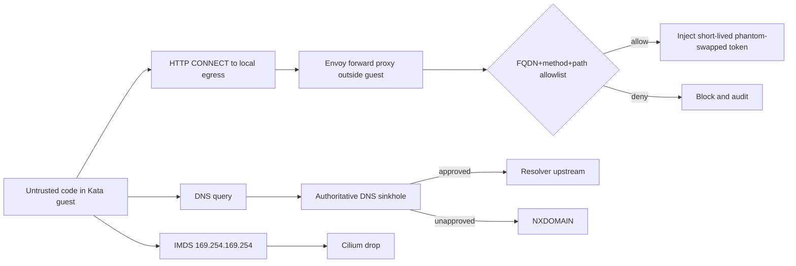
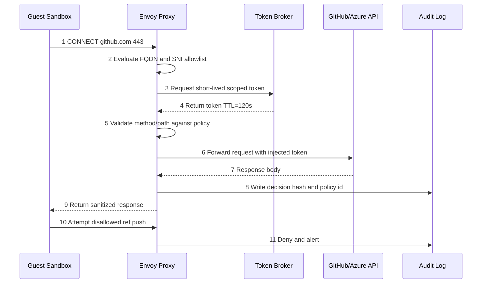
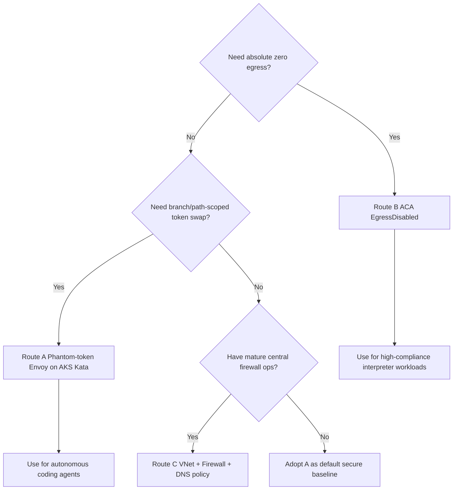

# 企业 Agent 代码沙箱外联隔离选型 FAQ：Phantom-Token Envoy/Kata vs ACA Zero-Egress vs Firewall Hub vs 明文密钥反模式
> **适用对象**：企业 AI 平台架构师、应用安全团队、LLMOps 团队、金融与制造业合规负责人。
> **核心目标**：在不牺牲工程效率的前提下，切断“非可信输入 + 私有凭据 + 出站网络”三元致命链路。

## 1. Executive Summary
把敏感凭据放进可执行沙箱，同时允许任意出站，是多数智能体安全事故的共因。
Route A 把令牌注入点移出 Guest，并用 DNS 下沉与路径级代理策略建立硬边界。
Route B 直接把沙箱 egress 设为禁用，通过宿主编排器做受控 I/O 代办，风险面最小。
Route C 复用企业网安中台能力，适合既有 Hub-Spoke 与 SOC 流程成熟的大组织。
Route D 的明文 `.env` 与 IMDS 直通会把一次 prompt 注入升级为横向泄露事故。
如果业务要求无人值守 coding agent，优先 A；若要求绝对隔离，优先 B；若要集中治理，优先 C。

## 2. Core Pain Points and Threat Model
Lethal Trifecta 的第一环是非可信输入，包括恶意 `README`、`setup.py`、`postinstall` 与测试夹带脚本。
第二环是可窃取凭据，常见来源是环境变量、挂载文件、明文 PAT、可访问 IMDS 的托管身份。
第三环是可自由出站，攻击者会选择 HTTPS webhook、DNS 隧道、DoH 或 git push 等看似正常通道。
一旦三环同时成立，攻击者可在单轮推理内完成发现、打包、外传和擦痕。
在多租户集群里，受害范围不仅是单会话，还可能波及共享镜像层、缓存与日志系统。
因此架构目标不应只盯住“阻断恶意域名”，而是要重建凭据边界与出站最小化执行模型。

## 3. Architecture A: Out-of-Band Phantom-Token Proxy on AKS Kata
A 路线把真实令牌永不落入沙箱 Guest，沙箱仅看到占位头或会话别名。
CiliumNetworkPolicy 在 Pod 级别阻断 `169.254.169.254`，并封禁任意 TCP/UDP 53 直连。
DNS 查询仅允许到授权解析器，未登记域名直接 `NXDOMAIN`，降低 base32 子域外传吞吐。
出站流量必须经过宿主侧 Envoy forward proxy，在 CONNECT、SNI、HTTP method 与 path 四层联合校验。
例如可允许 `GET` 到白名单包仓、允许 `git push` 但仅限 `refs/heads/agent/*`。
当策略命中时，代理在宿主进程注入短时 Entra 或 GitHub App 令牌，TTL 通常控制在 60-180 秒。
攻击脚本即使拿到响应体，也无法反向恢复真实凭据，因为令牌从未进入 Guest 内存空间。

## 4. Architecture B: ACA Dynamic Sessions with EgressDisabled
B 路线在 Hyper-V 会话池层直接配置 `networkStatus: EgressDisabled`，把外联面降到零。
沙箱镜像预置常用 Python/Node 依赖，减少运行中联网安装需求。
确需访问 Blob、SQL、REST 时，由宿主编排器在受信网络中代表执行并回传最小结果集。
该模型显著降低凭据泄露概率，也便于审计“谁在什么上下文下调用了外部系统”。
代价是交互灵活性下降，临时拉取新包与访问开放互联网会受到流程约束。
B 特别适合高合规金融、医疗和涉密研发环境，尤其是分析沙箱与报表型 agent。

## 5. Architecture C: VNet + Firewall Premium + DNS Resolver Policy
C 路线保留受控出站，但把治理重心放在企业中心防火墙与 DNS 策略域。
Azure Firewall Premium 负责 TLS inspection、应用 FQDN 规则、IDPS 与统一审计日志。
Azure DNS Private Resolver 负责域名分流、黑白名单与递归访问边界。
与 Private Link 结合后，内部制品库、密钥服务与业务 API 可走私网通道。
该路线对已有网络运营团队友好，不必自建大规模 Envoy fleet。
但若要做到路径级 token 置换，仍需补充代理层逻辑或服务网关扩展。

## 6. Architecture D Anti-Pattern
D 路线常见于“先跑起来再说”的 PoC：把 PAT 写进 `.env`，让容器能直连 `0.0.0.0/0`。
一旦沙箱可访问 IMDS，攻击者即可窃取托管身份令牌并跨资源横跳。
如果 DNS 无限制，攻击者可通过高熵子域持续外传片段数据，难以在应用日志中发现。
该模式的短期开发效率会在真实生产中转化为安全事故、监管问责与品牌损失。

## 7. Architecture Principles and Quantitative Formulas
面向生产落地，建议把安全目标写成可验证数学约束，而非抽象原则。
1. DNS 隐蔽信道容量：`C_dns = R_qps * floor(L_qname * 5 / 8)`。
2. 代理重终止额外时延：`ΔT_proxy = T_connect + T_tls_reterm + T_kv_cache`。
3. 凭据暴露窗口：`E_cred = P_inj * I_in_guest_secret * TTL_token`。
4. 泄露期望损失：`L_exp = P_compromise * Impact_data * Detection_delay`。
5. 允许域误判率：`F_allow = FP_allow / (TP_allow + FP_allow)`。
6. 出站策略命中率：`Hit_policy = Allowed_requests / Total_requests`。

## 8. Mermaid: Phantom-Token Proxy and DNS Sinkhole Architecture


## 9. Mermaid: 11-Step Scoped Git/API Egress and Token-Swap Flow


## 10. Mermaid: Selection Decision Tree


## 11. 12-Dimension Horizontal Comparison Matrix
| 评估维度 | Route A | Route B | Route C | Route D |
|---|---|---|---|---|
| 凭据是否进入 Guest | 否 | 否 | 可能否（取决实现） | 是 |
| DNS 隧道抑制能力 | 高（Sinkhole） | 高（零外联） | 中高 | 低 |
| IMDS 横向移动风险 | 低（显式阻断） | 低 | 中（需额外策略） | 高 |
| 出站细粒度控制（方法/路径） | 高 | 中（由宿主 broker） | 中 | 低 |
| 研发灵活性 | 中高 | 中 | 高 | 高（高风险） |
| 平台运维复杂度 | 中高 | 中 | 中 | 低表面/高隐患 |
| 统一审计可观测性 | 高 | 高 | 高 | 低 |
| 对既有网络团队复用 | 中 | 中 | 高 | 中 |
| 依赖预置镜像程度 | 中 | 高 | 中 | 低 |
| 监管解释性 | 高 | 高 | 中高 | 低 |
| 3 年总拥有成本 | 中 | 中 | 中高 | 低初期/高长期 |
| 综合推荐级别 | 高 | 高 | 中高 | 禁用 |

## 12. Production Python Reference: Path-Scoped Phantom Token Filter
```python
from __future__ import annotations
from dataclasses import dataclass
from fnmatch import fnmatch
from typing import Iterable

@dataclass(frozen=True)
class EgressRule:
    host: str
    method: str
    path_glob: str

def allowed(rules: Iterable[EgressRule], host: str, method: str, path: str) -> bool:
    for r in rules:
        if r.host == host and r.method == method and fnmatch(path, r.path_glob):
            return True
    return False

def inject_phantom_token(headers: dict[str, str], real_token: str) -> dict[str, str]:
    out = dict(headers)
    out['Authorization'] = f'Bearer {real_token}'
    out['X-Credential-Origin'] = 'out-of-band-proxy'
    return out
```

## 13. YAML Reference: Cilium IMDS/DNS Block + Envoy Egress
```yaml
apiVersion: cilium.io/v2
kind: CiliumNetworkPolicy
metadata:
  name: sandbox-egress-guard
spec:
  endpointSelector:
    matchLabels:
      app: agent-sandbox
  egressDeny:
    - toCIDRSet:
        - cidr: 169.254.169.254/32
    - toPorts:
        - ports:
            - port: "53"
              protocol: UDP
            - port: "53"
              protocol: TCP
  egress:
    - toEndpoints:
        - matchLabels:
            app: envoy-egress-proxy
      toPorts:
        - ports:
            - port: "15001"
              protocol: TCP
```

### Q1: DNS 隧道究竟能泄露多少数据，为什么必须先封 UDP/TCP 53
若攻击脚本维持 `40 qps`，每条 `qname` 可承载约 `45` 字节有效载荷，理论速率约 `1.8 KB/s`。
看似不高，但 10 分钟即可泄露超过 1 MB 关键片段，足够外传 API key、客户主键与源码摘要。
企业 SOC 往往优先关注 HTTP 告警，DNS 高频小包更容易形成侦测盲区。
因此在沙箱场景里，先做 DNS 出口收口比事后内容检测更可靠。

### Q2: Route A 的代理延迟开销会不会毁掉 coding agent 体验
在同区域部署下，`T_connect` 常见 `8-15 ms`，TLS 重终止 `6-20 ms`，缓存命中时总增量约 `20-45 ms`。
对依赖安装与 git 操作这类秒级步骤，额外时延通常小于 `5%`，对吞吐影响可接受。
关键是对频繁小请求开启连接复用与 token 缓存，避免每次都触发 STS 调用。
若跨区域代理，时延会显著上升，建议与沙箱同 Region 部署并开启 zone-aware 路由。

### Q3: 为什么不直接把短时令牌发给 Guest，然后设置 60 秒 TTL
TTL 缩短只能压缩暴露窗口，不改变“可被窃取”这个根因。
一旦 prompt 注入触发立即外传，60 秒已足够完成高价值操作。
Out-of-band 注入把 `I_in_guest_secret` 变为 0，才能让 `E_cred` 在模型上逼近 0。
这也是 A/B 两条路线优于 D 的本质差异。

### Q4: Route B 零外联会不会导致包管理和依赖升级停摆
不会停摆，但需要把升级流程从“运行时联网安装”改为“镜像构建阶段受控引入”。
可通过每日离线镜像流水线同步批准依赖，并在镜像签名后发布到会话池。
这样既保持零外联，又能把 CVE 修复时效控制在 24 小时级别。
对探索型任务，可配置受审计的 broker 拉取白名单制品并回传哈希校验值。

### Q5: Route C 与 A 的边界如何划分，是否需要二选一
若企业已有成熟 Firewall/SIEM 流程，C 可承担中心治理与统一审计主干。
但需要路径级 token swap、分支级 git 推送约束时，A 的代理能力更直接。
实践上常见组合是“C 负责网络边界，A 负责应用级出站语义”，并不冲突。
设计关键在于策略源唯一化，避免多层规则互相覆盖导致误放行。

### Q6: 如何量化是否已真正打破 Lethal Trifecta
建议建立三个强制指标：Guest 内真实凭据暴露数、可达外联端点数、IMDS 可达率。
上线门槛可设为 `guest_real_secret_count = 0`、`imds_reachability = 0%`。
同时要求未授权域名请求 `NXDOMAIN` 命中率接近 `100%`，并记录策略版本。
当任一指标回退时，自动触发发布冻结与安全审查。

## 14. Enterprise Scenario A: Autonomous PR Coding Agent Fleet
场景背景是跨仓库 coding agent 自动修复与 PR 生成，日均任务数可达 `20k`。
业务要求允许 `git fetch/pull` 与 `git push`，但必须限制到 `refs/heads/agent/*`。
Route A 可在代理层验证 git smart HTTP 路径与 refspec，再执行短时令牌注入。
即便仓库内含恶意 Hook，攻击脚本也拿不到可复用的 PAT 或云令牌。
在该场景里，A 的收益体现在“可自动化 + 可控出站 + 可审计”三者平衡。

## 15. Enterprise Scenario B: Financial Data-Science Interpreter on ACA
场景背景是量化与风控分析师使用 Python 沙箱处理敏感报表与客户数据样本。
监管要求沙箱不得直接连接外网或企业核心库，且过程可追溯。
Route B 通过 `EgressDisabled` 满足零外联要求，外部查询由宿主 broker 代办。
分析师仍能获得所需数据切片，但原始凭据、连接串与账户权限不进入沙箱。
该模型特别适合需要强隔离、弱实时外联的报表与审计工作流。

## 16. 3-Year TCO Model
| 路线 | 三年平台成本 | 安全运营与审计成本 | 综合结论 |
|---|---:|---:|---:|
| Route A | `$3.9M-$5.4M` | 低到中 | 高价值，适合高自动化编码场景 |
| Route B | `$3.4M-$4.8M` | 低 | 高价值，适合高合规解释器场景 |
| Route C | `$3.6M-$5.0M` | 中 | 中高价值，适合大型集中网安组织 |
| Route D | `$2.3M-$3.2M` | 高且不确定 | 禁用，长期总成本最高 |
若把事故停机、应急审计与品牌损失计入，D 的隐性成本通常会反超所有安全路线。

## 17. Go-Live Acceptance Checklist
1. 校验 Guest 镜像中无明文 PAT、连接串、云访问密钥与长期刷新令牌。
2. 校验 IMDS `169.254.169.254` 在沙箱命名空间不可达。
3. 校验非授权 DNS 域名统一返回 `NXDOMAIN` 并被审计留痕。
4. 校验 egress 仅可达代理端点或 broker，不存在旁路 NAT 出口。
5. 校验 git/API 请求路径级策略，确认仅允许业务定义的 method/path。
6. 校验短时令牌 TTL、受众、作用域与吊销机制。
7. 校验告警与工单联动，在拒绝事件触发时可自动派发到 SOC。
8. 校验灰度与回滚机制，避免策略误配导致大面积任务失败。

## 18. Day-2 Security Operations
上线后每周复盘拒绝事件分布，识别误拦截与真实攻击信号。
每次新增外部依赖都应走“白名单评审 + 风险分级 + 有效期”流程。
对高风险仓库可启用更严格代理策略，例如禁止任意 `POST` 与大体积上传。
在红队演练中应包含 DNS 隧道、DoH 绕行、IMDS 探测与供应链投毒四类脚本。
若策略命中率异常下降，优先排查是否出现未登记的旁路网络路径。

## 19. Authoritative References
- IEC 62443-3-3 工业与关键基础设施网络分区与安全级别控制框架。
- NIST SP 800-82 Rev. 3 ICS 安全防护指南（含网络隔离与访问控制建议）。
- Azure Container Apps Dynamic Sessions 文档（`networkStatus: EgressDisabled` 能力）。
- Azure Firewall Premium 与 Azure DNS Private Resolver 官方架构建议。
- Cilium NetworkPolicy 与 eBPF 数据面访问控制文档。
- GitHub App 安装令牌最小权限与短时凭据实践指南。

## 20. Final Recommendation
若目标是无人值守 coding agent 且要保持有限外联能力，优先 Route A。
若目标是审计优先和零外联，优先 Route B，并用 broker 承接受控数据访问。
若组织已有强网络运营体系，可采用 Route C 作为中心治理主干并按需叠加 A。
任何生产环境都不应采纳 Route D，尤其在金融、医疗、制造与政企场景。
安全架构真正要做的是把“可被窃取的凭据”从执行环境中彻底移除。

## 21. Governance Metrics and Audit Artifacts
建议把以下指标纳入季度治理看板，并与发布门禁联动。
| 指标 | 定义 | 建议阈值 | 超阈值动作 |
|---|---|---|---|
| `guest_real_secret_count` | Guest 内检测到真实凭据数量 | `0` | 立即阻断发布并触发清理 |
| `imds_probe_success_rate` | IMDS 探测成功率 | `0%` | 升级 P1 安全事件 |
| `dns_sinkhole_hit_rate` | 未授权域请求被下沉比例 | `>= 99.9%` | 回滚策略并排查旁路 |
| `policy_deny_replayable` | 拒绝事件可重放取证比例 | `= 100%` | 不足则修复日志链路 |
| `token_ttl_p95` | 注入令牌生存期 P95 | `<= 180s` | 收紧 STS 策略 |
| `proxy_latency_p95` | 代理附加时延 P95 | `<= 60ms` | 扩容或同域部署优化 |
证据包建议包含：策略版本哈希、请求摘要、决策结果、令牌来源标识、审计时间戳与审批记录。
若企业跨区域部署，应附加 Region 维度策略一致性校验结果，防止边缘配置漂移。

## 22. 90-Day Rollout Blueprint
第 0-30 天：完成资产清点、凭据外溢扫描、IMDS 可达性测试与基线策略草案。
第 31-60 天：在一条低风险业务链灰度 Route A 或 B，建立拒绝事件处理 SOP。
第 61-90 天：扩展到核心业务并把治理指标接入季度审计，完成跨团队演练。
在组织层面，平台、安全、审计、业务四方需统一术语与责任边界，减少口径偏差。
在工程层面，把策略验证、镜像签名和凭据扫描放入 CI 门禁，避免人为绕过。
在运营层面，保持白名单最小化和有效期管理，避免规则长期膨胀导致可读性下降。
在成本层面，持续记录代理时延、拒绝误判率与审计人力开销，形成可解释 ROI。
当业务进入国际化阶段，应同步处理主权云与跨境数据合规要求，确保策略可迁移。
通过上述节奏，可在 90 天内建立“可自动化、可审计、可持续”的沙箱出站治理能力。
该能力会直接提升智能体平台在高合规行业的可上线率与客户信任度。
