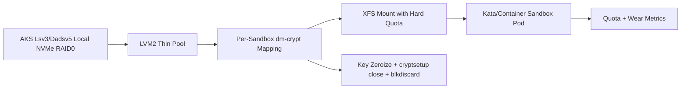
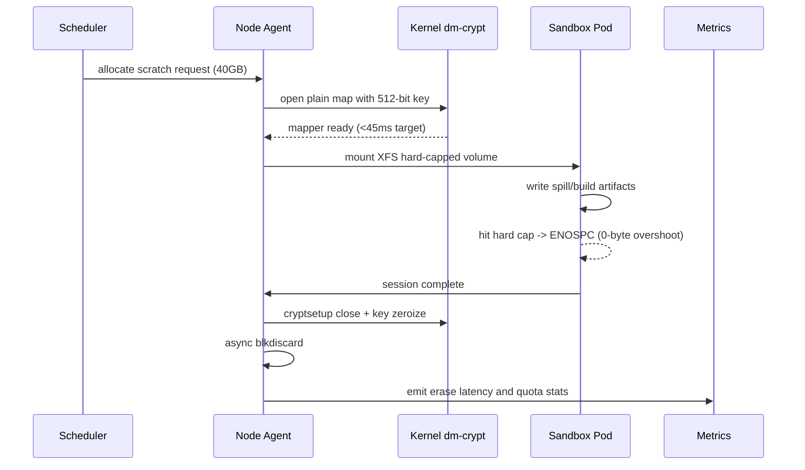

# Sandbox ephemeral NVMe scratch crypto-erase selection FAQ

## 1. Executive summary

In multi-tenant AKS sandboxes,
temporary storage is a first-class architecture decision.
At `15–60 GB` scratch per session,
wrong storage choices quickly become
stability, compliance, and cost failures.

This guide covers two high-churn workloads:
out-of-core spill from
`DuckDB/Polars/PyArrow`,
and large Rust/C++ build scratch trees.
Both require high burst throughput
with strict tenant isolation.

Pattern A
(local NVMe slicing plus `dm-crypt` plus XFS hard caps)
is the primary recommendation
for short-lived high-throughput sessions.
Pattern B fits micro scratch only.
Pattern C fits durable cross-session state.
Pattern D is prohibited.

## 2. Problem statement

Issue one is plaintext shared `emptyDir`
plus async kubelet eviction windows.
When writer speed is high,
a polling eviction loop allows overshoot
before containment.
At `3.5 GB/s` and `10s`,
overshoot can reach about `35 GB`.

Issue two is `tmpfs` DRAM pressure.
`emptyDir: { medium: Memory }`
shares pod memory cgroup.
When spill volume grows,
OOMKill appears immediately.
Teams often misdiagnose this
as model memory pressure.

Issue three is dynamic Azure Managed Disk
attach/detach latency and slot limits.
At high churn,
`8–25s` attach latency inflates startup tails.
Per-node data disk slot limits
become a hard concurrency ceiling.

Issue four is media sanitization evidence.
Plain `unlink()` is insufficient
for strict `NIST SP 800-88` purge expectations.
Without cryptographic erase semantics,
tenant data-remanence risk remains.

## 3. Four architecture patterns

### Pattern A (primary for high-throughput ephemeral sandboxes)

Use local NVMe as data plane.
Slice per-sandbox devices from LVM2 thin pool.
Open per-sandbox `dm-crypt` mapping
with `aes-xts-plain64`
and `512-bit` key material in RAM only.

Apply hard caps at block and filesystem layers.
Use XFS mounts with strict limits
to fail fast with `ENOSPC`,
instead of waiting for async eviction.
On teardown, zeroize key buffers,
close crypt mapping,
then run async `blkdiscard`.

### Pattern B (micro scratch below `512 MB`)

Use bounded `tmpfs` only
for very small stateless artifacts.
Enforce tight `sizeLimit`
and explicit memory headroom.
This pattern is simple,
but expensive per GB and easy to misuse.

### Pattern C (durable checkpoint workspace)

For cross-session recovery,
use Azure Container Storage
or persistent PVC designs
with CMK policy control.
This is valid for durability workflows,
not ideal for minute-level ephemeral scratch.

### Pattern D (prohibited anti-pattern)

Use plaintext shared high-capacity `emptyDir`
with async eviction safety assumptions,
or dynamic Azure Disk attach/detach
for short-lived (`<5 min`) sessions.
Both paths collapse under high churn.

## 4. Quantified 12-dimension matrix

| Dimension | Pattern A NVMe+`dm-crypt`+XFS | Pattern B `tmpfs` | Pattern C durable volume | Pattern D anti-pattern |
|---|---|---|---|---|
| Startup storage latency | Low (`<45 ms`) | Very low | Medium-high | High jitter |
| Write throughput | High | Medium-high | Medium | Unstable |
| Overshoot risk | Low | Medium | Low | High |
| Data remanence risk | Low | Low | Low-medium | High |
| Tenant isolation | High | Medium | High | Low |
| Short-session cost efficiency | High | Low | Medium-low | Misleading |
| OOM exposure | Low | High | Low | Medium |
| Disk-slot dependence | Low | Low | High | High |
| Ops complexity | Medium-high | Low | Medium-high | Low |
| Compliance auditability | High | Medium | High | Low |
| NVMe endurance control | Medium | Low impact | Medium | Uncontrolled |
| 3-year risk-adjusted TCO | Low | Medium-high | Medium | High |

## 5. Pattern A design principles

Principle one:
hard cap first,
async reclaim second.
If survival depends on async reclaim,
extreme writers will still outrun controls.
Hard caps convert node-wide failure
into contained session-level `ENOSPC`.

Principle two:
key lifecycle is isolation boundary.
Do not rely on slow full overwrite.
Destroy session key material quickly,
then close mapping deterministically.
This turns seconds into milliseconds.

Principle three:
audit-by-default telemetry.
Allocation, mount, quota breach,
close, and erase events
must carry tenant and run identifiers.
Compliance reviews need replayable evidence.

## 6. Mermaid: node-level storage data plane



## 7. Mermaid: lifecycle sequence



## 8. Q1–Q6 formulas with worked numbers

### Q1. Async eviction overshoot

`Overshoot = BW_seq * T_poll`

With `BW_seq=3.5 GB/s`
and `T_poll=10s`,
overshoot is about `35 GB`.
Hard block/XFS caps reduce practical overshoot
to near `0 B`.

### Q2. Crypto erase vs overwrite latency

`T_zero = Size / BW_write`

For `40 GB` and `3.2 GB/s`,
full overwrite takes about `12.5s`
plus additional wear.
Key-destroy path can finish
critical teardown in about `22ms`.

### Q3. Slot density gain

`Density_gain = N_slice / N_disk_slot`

If one node supports `120` NVMe slices
but only `32` managed-disk slots,
density gain is around `3.75x`.
That directly improves sandbox concurrency.

### Q4. AES-NI encryption overhead

`Overhead = 1 - Throughput_enc / Throughput_plain`

On modern CPUs with AES-NI,
`aes-xts-plain64` overhead
is commonly under `4%`,
acceptable for most build and spill paths.

### Q5. DRAM vs local NVMe cost ratio

`Cost_ratio = Price_ram_gb / Price_nvme_gb`

For sustained concurrent workloads,
tmpfs can be many times more expensive
than local NVMe per effective GB-month.
This directly changes unit economics.

### Q6. NVMe endurance budget

`Annual_write = QPS_session * Avg_write_gb * 3600 * H`

Combine this with device `DWPD`
and usable capacity
to establish wear thresholds.
When trend approaches endurance redline,
rebalance workload or add nodes.

## 9. Pattern B suitability boundary

Pattern B is not
a universal low-latency default.
It is a constrained option
for tiny scratch windows.
Once spill grows into GB ranges,
cost and OOM risk rise quickly.

Always enforce strict `sizeLimit`
and memory admission guardrails.
Without those controls,
`tmpfs` failures become abrupt
and difficult for tenants to diagnose.

## 10. Pattern C suitability boundary

Pattern C is right for durability semantics:
resume, audit continuity,
and cross-session state.
It is usually wrong for minute-level
ephemeral scratch acceleration.

A practical strategy is dual track:
Pattern A for hot ephemeral scratch,
Pattern C for durable checkpoints.
Route by workload labels and SLO class.

## 11. Anti-pattern detection signals

These signals indicate Pattern D drift:

- node disk incidents appear before app alerts;
- sandbox failures cluster around eviction/runtime faults;
- audit teams cannot verify transient data sanitization;
- disk-slot saturation is the first scaling bottleneck;
- attach/detach API throttling spikes at peak churn.

## 12. Core code and config

### 12.1 Pod + generic ephemeral volume

```yaml
apiVersion: v1
kind: Pod
metadata:
  name: sandbox-worker
  namespace: agent-system
spec:
  securityContext:
    fsGroup: 1000
  containers:
    - name: runner
      image: ghcr.io/example/sandbox-runner:latest
      securityContext:
        readOnlyRootFilesystem: true
        allowPrivilegeEscalation: false
      volumeMounts:
        - name: scratch
          mountPath: /scratch
      resources:
        requests:
          cpu: "2"
          memory: "4Gi"
        limits:
          cpu: "4"
          memory: "8Gi"
  volumes:
    - name: scratch
      ephemeral:
        volumeClaimTemplate:
          metadata:
            labels:
              scratch.class: local-nvme-crypt
          spec:
            accessModes: ["ReadWriteOnce"]
            storageClassName: local-nvme-crypt-scratch
            resources:
              requests:
                storage: 40Gi
```

### 12.2 Python `EphemeralCryptoScratch` provision and erase

```python
from __future__ import annotations

import os
import subprocess
import time
from dataclasses import dataclass
from typing import Optional


@dataclass
class EphemeralCryptoScratch:
    lv_path: str
    mapper_name: str
    mount_dir: str
    key_buf: Optional[bytearray] = None

    def open(self) -> None:
        self.key_buf = bytearray(os.urandom(64))
        subprocess.run(
            [
                "cryptsetup",
                "open",
                "--type",
                "plain",
                "--cipher",
                "aes-xts-plain64",
                "--key-size",
                "512",
                "--key-file",
                "-",
                self.lv_path,
                self.mapper_name,
            ],
            input=bytes(self.key_buf),
            check=True,
        )
        subprocess.run(["mkfs.xfs", "-f", f"/dev/mapper/{self.mapper_name}"], check=True)
        os.makedirs(self.mount_dir, exist_ok=True)
        subprocess.run(["mount", "-t", "xfs", f"/dev/mapper/{self.mapper_name}", self.mount_dir], check=True)

    def close(self) -> float:
        start = time.perf_counter()
        subprocess.run(["umount", self.mount_dir], check=True)
        if self.key_buf is not None:
            for i in range(len(self.key_buf)):
                self.key_buf[i] = 0
        subprocess.run(["cryptsetup", "close", self.mapper_name], check=True)
        subprocess.run(["blkdiscard", self.lv_path], check=False)
        return (time.perf_counter() - start) * 1000.0
```

### 12.3 PromQL / KQL observability probes

```promql
sum by (node) (rate(container_fs_writes_bytes_total{mountpoint="/scratch"}[5m]))

histogram_quantile(
  0.99,
  sum(rate(sandbox_crypto_erase_latency_ms_bucket[5m])) by (le, node)
)

sum by (node) (sandbox_scratch_enospc_total)

max by (node) (node_nvme_percentage_used)
```

```kql
let win = 5m;
let enospc = InsightsMetrics
| where Name == "sandbox_scratch_enospc_total"
| summarize enospc = sum(Val) by bin(TimeGenerated, win), Computer;
let erase = InsightsMetrics
| where Name == "sandbox_crypto_erase_latency_ms_p99"
| summarize erase_p99 = max(Val) by bin(TimeGenerated, win), Computer;
let wear = InsightsMetrics
| where Name == "node_nvme_percentage_used"
| summarize wear_pct = max(Val) by bin(TimeGenerated, win), Computer;
enospc
| join kind=inner erase on TimeGenerated, Computer
| join kind=inner wear on TimeGenerated, Computer
| project TimeGenerated, Computer, enospc, erase_p99, wear_pct
| order by TimeGenerated desc
```

## 13. Operating baseline and SLO

Use three SLO layers:
session completion,
controlled failure (`ENOSPC`) rate,
and node storage health.
Separating controlled failure
from platform failure
improves incident triage quality.

Example thresholds:
short spikes in `ENOSPC` may be acceptable,
but persistent erase-latency P99 increase
should trigger capacity action.
Track NVMe wear metrics continuously
to avoid durability cliffs.

## 14. Decision tree: good fit vs not for

**Good fit (Pattern A)**

- high-concurrency short-lived sandboxes;
- scratch demand in `5–60 GB` range;
- strict compliance plus throughput goals.

**Good fit (Pattern B)**

- very small scratch footprint;
- very short tool runs;
- willingness to pay DRAM premium.

**Good fit (Pattern C)**

- cross-session resume requirement;
- durable audit workspace requirement;
- tolerance for higher attachment latency.

**Not for**

- plaintext shared high-capacity `emptyDir`;
- managed-disk attach path for minute-level scratch;
- no erase audit and no endurance governance.

## 15. Enterprise scenarios, TCO, and rollout

### 15.1 Scenario A: quant hedge-fund research copilot

Workload runs on `AKS Standard_L16s_v3`,
with about `40 GB` scratch per session
for tick-data analytics spill.
Historic incidents were dominated by
node storage instability and spill failures.

After Pattern A rollout,
failure mode shifted from node-wide eviction
to controlled per-session `ENOSPC`.
Crypto-erase teardown became millisecond-scale,
supporting fast turnover and compliance evidence.

### 15.2 Scenario B: `600` concurrent SWE build sandboxes

Enterprise build platform on `Standard_D32ads_v5`
runs Rust/C++ monorepo builds
with volatile `target/` sizes.
In dynamic-disk mode,
startup tail and slot exhaustion
were recurring bottlenecks.

With Pattern A and hard caps,
concurrency became predictable,
and node-level disk incidents dropped.
Capacity planning moved from
"disk slot count"
to
"NVMe write-budget governance".

### 15.3 Three-tier 3-year TCO (USD)

| Tier | Scale assumption | Pattern A | Pattern B | Pattern C | Pattern D |
|---|---|---:|---:|---:|---:|
| Tier-1 | `120` concurrent sandboxes | `1.48M` | `1.92M` | `1.76M` | `1.64M` |
| Tier-2 | `600` concurrent sandboxes | `5.36M` | `7.45M` | `6.22M` | `8.10M*` |
| Tier-3 | `1,500` concurrent sandboxes | `12.8M` | `18.6M` | `14.9M` | `22.4M*` |

`*` At high concurrency,
incident and outage cost in Pattern D
usually dominates any implementation simplicity.

Add audit-prep and incident-review labor
to avoid underestimating true cost.
Also align capacity planning
with device-health telemetry
to keep economics realistic over time.

### 15.4 Five-step rollout and D0/D1/D2 runbook (18 actions)

**Five-step rollout**

1. Profile scratch workload classes and write patterns.
2. Deploy Pattern A hard caps and crypto-erase pipeline.
3. Gate on ENOSPC and erase-latency SLO together.
4. Route small and durable exceptions to B/C paths.
5. Add endurance budget to quarterly platform governance.

**D0 (same-day containment)**

1. Block new plaintext high-capacity shared `emptyDir`.
2. Apply immediate write-limit policy for hot namespaces.
3. Pause minute-level dynamic managed-disk scratch path.
4. Enable ENOSPC and erase telemetry alerts.
5. Enforce teardown hooks for all sandbox sessions.
6. Audit node disk occupancy and hotspot spread.

**D1 (two-week hardening)**

7. Deploy automated `dm-crypt` node agent.
8. Standardize XFS quota templates and validation.
9. Add scratch-class labels to scheduler policy.
10. Publish erase-latency P99 dashboards.
11. Enable NVMe endurance threshold alerts.
12. Run fault-injection drills and replay reviews.

**D2 (quarterly evolution)**

13. Tune thin-pool reclaim and fragmentation strategy.
14. Improve cross-node write-load balancing.
15. Build forecast model for write amplification.
16. Automate compliance evidence archival.
17. Evaluate next-generation VM and media options.
18. Complete annual storage-governance postmortem cycle.

## Sources

Kubernetes `emptyDir` and ephemeral volumes  
https://kubernetes.io/docs/concepts/storage/volumes/#emptydir

Kubernetes generic ephemeral volumes  
https://kubernetes.io/docs/concepts/storage/ephemeral-volumes/

AKS node VM sizes and storage characteristics  
https://learn.microsoft.com/azure/aks/concepts-nodepools

cryptsetup and `dm-crypt` documentation  
https://gitlab.com/cryptsetup/cryptsetup

NIST SP 800-88 Rev.1 Media Sanitization  
https://csrc.nist.gov/publications/detail/sp/800-88/rev-1/final

Azure Container Storage overview  
https://learn.microsoft.com/azure/storage/container-storage/
