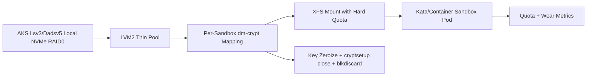
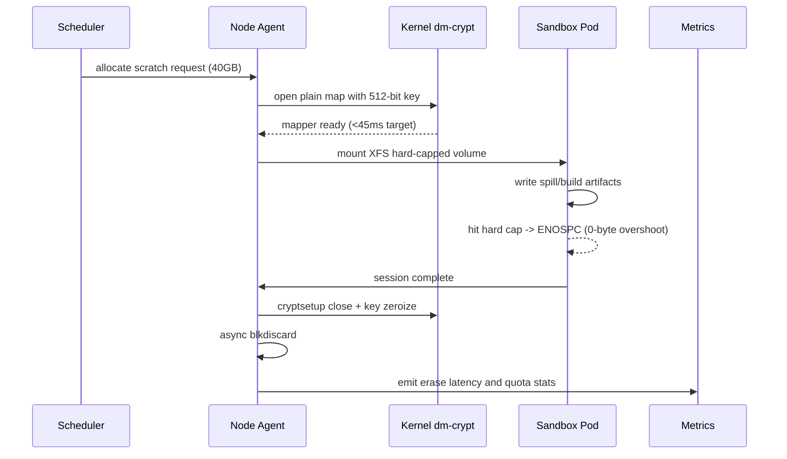

# 沙箱临时 NVMe Scratch 加密擦除选型 FAQ（`dm-crypt`/`tmpfs`/`Managed Disk`）

## 1. 执行摘要

在多租户 AKS 沙箱场景中，
临时存储不是“边角配置”，
而是稳定性、合规性与单位经济性的核心变量。
当单会话 scratch 达到 `15–60 GB`，
错误的存储路径会快速放大为控制面与节点级事故。

本指南聚焦数据科学与工程构建两类高写入负载：
`DuckDB/Polars/PyArrow` 的 out-of-core spill，
以及 Rust/C++ monorepo 构建缓存目录。
它们共同特征是短时高吞吐、强并发、强隔离要求。

四种模式中，
Pattern A（本地 NVMe 分片 + `dm-crypt` + XFS 硬配额）
是高吞吐短会话的主推荐方案。
Pattern B 适合微小 scratch，
Pattern C 适合跨会话持久检查点，
Pattern D 标记为禁止反模式。

## 2. 生产问题定义

问题一是共享 `emptyDir` 明文与异步驱逐窗口。
Kubelet 驱逐轮询通常按秒级周期执行，
高带宽写入会在触发前继续冲高。
当写入速率接近 `3.5 GB/s` 且轮询 `10s`，
理论超写可达 `35 GB`。

问题二是 `tmpfs` 占用 DRAM 并共享 cgroup。
当 out-of-core 引擎把 spill 写到内存介质，
很容易直接把 Pod 推向 OOMKill。
这类事故常被误判为“模型内存不足”，
实则是存储介质选择错误。

问题三是动态挂载 Azure Managed Disk 的时延与槽位上限。
短会话高 churn 下，
`8–25s` 挂载时延会显著拉高冷启动尾延迟。
同时节点可挂盘数有限，
高并发会触发数据盘槽位争用与 API 节流。

问题四是合规擦除要求。
仅 `unlink()` 无法满足
`NIST SP 800-88` 对清除与清除证据的要求。
如果明文落在共享 NVMe，
租户隔离与法务审计都会被动。

## 3. 四种架构模式总览

### Pattern A（主推荐：高吞吐短生命周期）

以本地 NVMe 为数据面，
通过 LVM2 thin pool 为每个沙箱切片，
在切片上创建一次性 `dm-crypt` 映射，
使用 `aes-xts-plain64` 和 `512-bit` XTS key。
密钥仅驻留 RAM，
会话结束时执行密钥零化与映射关闭。

文件系统层建议 XFS，
并在块设备层与文件系统层同时施加硬上限。
这样达到阈值时立刻 `ENOSPC`，
实现“零超写”而非“等轮询再驱逐”。
随后异步执行 `blkdiscard` 作为介质回收加速。

### Pattern B（微小 scratch，`<512 MB`）

适合极小且短暂的工具中间文件。
采用 `emptyDir: { medium: Memory }`
并设置严格 `sizeLimit` 与额外内存余量。
该模式对性能友好，
但容量与成本边界非常窄。

### Pattern C（跨会话持久工作区）

当业务要求会话间恢复与审计留存时，
应转向 Azure Container Storage 或持久卷架构。
可结合 CMK 与策略治理满足长期合规。
该模式不是短会话临时 scratch 的低时延解法。

### Pattern D（反模式，禁止）

共享明文 `emptyDir` + 异步驱逐容错，
或把短会话大量绑定到动态 Azure Disk 挂载。
前者带来超写与残留风险，
后者在高 churn 下拖垮启动延迟与槽位容量。
两者都不适合企业级高并发沙箱。

## 4. 12 维量化对比矩阵

| 维度 | Pattern A NVMe+`dm-crypt`+XFS | Pattern B `tmpfs` | Pattern C 持久卷 | Pattern D 反模式 |
|---|---|---|---|---|
| 单会话冷启动附加时延 | 低（`<45 ms`） | 极低 | 中高（网络/控制面） | 高波动 |
| 写入吞吐 | 高 | 中高（受内存） | 中 | 不稳定 |
| 超写风险 | 低（硬上限） | 中 | 低 | 高 |
| 明文残留风险 | 低（密钥擦除） | 低 | 低到中 | 高 |
| 多租户隔离 | 高 | 中 | 高 | 低 |
| 成本效率（短会话） | 高 | 低 | 中低 | 表面低 |
| OOM 风险 | 低 | 高 | 低 | 中 |
| 节点盘槽位依赖 | 低 | 低 | 高 | 高 |
| 运维复杂度 | 中高 | 低 | 中高 | 低 |
| 合规可审计性 | 高 | 中 | 高 | 低 |
| NVMe 耐久控制 | 中（需监控） | 低影响 | 中 | 不可控 |
| 三年风险调整 TCO | 低 | 中高 | 中 | 高 |

## 5. Pattern A 设计原则

原则一是“先硬上限，后异步回收”。
任何依赖异步回收才能避免故障的方案，
在极端写速下都存在不可控窗口。
硬上限让失败模式从“节点级崩溃”退化为“会话级 ENOSPC”。

原则二是“密钥即边界”。
不追求逐块覆盖写零，
而通过会话级密钥销毁实现快速不可恢复。
这使擦除延迟从秒级降到毫秒级，
并显著降低介质写放大。

原则三是“租户证据闭环”。
每次分配、挂载、关闭、擦除都要带 run_id 与 tenant_id，
并写入审计流水。
这样在合规审查时能证明“谁、何时、用过什么、如何销毁”。

为了避免“只做功能不做治理”的落差，
建议在平台 API 层强制要求调用方提交数据分级标签。
节点代理可根据标签自动选择擦除策略和审计级别，
把安全基线内建到运行时路径，
减少团队自行实现带来的口径不一致风险。

同时应建立“擦除证据抽检”机制，
随机回放最近会话的创建、挂载、关闭与销毁链路。
抽检结果需要可复现到具体节点与卷切片，
并纳入季度平台治理评分，
确保流程长期有效而非一次性达标。

## 6. Mermaid：节点级存储数据平面



## 7. Mermaid：生命周期序列



## 8. Q1–Q6 公式与样例

### Q1. 异步驱逐超写

`Overshoot = BW_seq * T_poll`

当 `BW_seq=3.5 GB/s`，
`T_poll=10s`，
超写约 `35 GB`。
采用硬上限后理论超写趋近 `0 B`，
失败形态转为受控 `ENOSPC`。

### Q2. 密钥擦除 vs 覆盖写零

`T_zero = Size / BW_write`

以 `40 GB`、`3.2 GB/s` 写零估算，
仅覆盖写也需 `12.5s`，
且带来额外磨损。
密钥销毁路径可在 `~22ms` 完成关键步骤。

### Q3. 槽位密度

`Density_gain = N_slice / N_disk_slot`

若单节点可安全切 `120` NVMe 分片，
而可挂载数据盘槽位仅 `32`，
密度提升约 `3.75x`。
这直接影响并发沙箱上限。

### Q4. AES-NI 开销

`Overhead = 1 - Throughput_enc / Throughput_plain`

在现代 CPU + AES-NI 下，
`aes-xts-plain64` 常见额外开销 `<4%`。
对大多数构建与分析任务可接受。

### Q5. DRAM 与本地 NVMe 成本

`Cost_ratio = Price_ram_gb / Price_nvme_gb`

在常见云定价中，
tmpfs 的等效 DRAM 成本可达本地 NVMe 的多倍。
高并发短会话时，
该差距会直接放大单位任务成本。

### Q6. NVMe 耐久预算

`Annual_write = QPS_session * Avg_write_gb * 3600 * H`

需结合 `DWPD` 与设备总容量，
估算年写入占比并设置告警阈值。
若持续接近耐久红线，
应扩大节点池或分散写入热点。

## 9. Pattern B 边界

Pattern B 不应被当作“更快的默认选项”。
它本质是用昂贵 DRAM 换取简单性，
只适合极小 scratch。
一旦工作负载会产生 GB 级 spill，
风险与成本会同步抬升。

对 `tmpfs` 场景必须强制设置 `sizeLimit`。
同时给容器预留内存 headroom，
并在 admission 阶段拒绝超配配置。
否则 OOM 将以非线性方式爆发。

## 10. Pattern C 边界

Pattern C 的优势是持久性与恢复能力。
若业务需要会话接续、
增量索引或跨天审计，
它通常是正确方向。
但把它用于数分钟短会话 scratch，
常会付出不必要的启动时延与控制面成本。

建议按 workload 分层：
短会话走 Pattern A，
需要持久语义的任务走 Pattern C。
同一平台允许双轨并存，
由调度策略按标签路由。

在实践中，
很多团队会把“临时加速需求”误配到持久卷通道，
导致控制面调用激增和启动尾延迟上升。
建议在 admission 策略中直接限制这类组合，
例如对短会话工作负载默认拒绝动态持久盘声明，
并给出可替代的本地加密 scratch 规格。

## 11. 反模式信号

以下信号常预示平台仍在 Pattern D：

- 节点磁盘告警先于业务告警触发；
- 沙箱失败以驱逐/容器运行时错误为主；
- 合规审计无法回答“临时盘数据如何销毁”；
- 盘槽位耗尽成为并发上限主因；
- 高峰期 attach/detach API 出现节流。

## 12. 关键代码与配置

### 12.1 Pod + Generic Ephemeral Volume

```yaml
apiVersion: v1
kind: Pod
metadata:
  name: sandbox-worker
  namespace: agent-system
spec:
  securityContext:
    fsGroup: 1000
  containers:
    - name: runner
      image: ghcr.io/example/sandbox-runner:latest
      securityContext:
        readOnlyRootFilesystem: true
        allowPrivilegeEscalation: false
      volumeMounts:
        - name: scratch
          mountPath: /scratch
      resources:
        requests:
          cpu: "2"
          memory: "4Gi"
        limits:
          cpu: "4"
          memory: "8Gi"
  volumes:
    - name: scratch
      ephemeral:
        volumeClaimTemplate:
          metadata:
            labels:
              scratch.class: local-nvme-crypt
          spec:
            accessModes: ["ReadWriteOnce"]
            storageClassName: local-nvme-crypt-scratch
            resources:
              requests:
                storage: 40Gi
```

### 12.2 Python：`EphemeralCryptoScratch` 预配与擦除

```python
from __future__ import annotations

import os
import subprocess
import tempfile
import time
from dataclasses import dataclass
from typing import Optional


@dataclass
class EphemeralCryptoScratch:
    lv_path: str
    mapper_name: str
    mount_dir: str
    key_buf: Optional[bytearray] = None

    def open(self) -> None:
        self.key_buf = bytearray(os.urandom(64))
        subprocess.run(
            [
                "cryptsetup",
                "open",
                "--type",
                "plain",
                "--cipher",
                "aes-xts-plain64",
                "--key-size",
                "512",
                "--key-file",
                "-",
                self.lv_path,
                self.mapper_name,
            ],
            input=bytes(self.key_buf),
            check=True,
        )
        subprocess.run(["mkfs.xfs", "-f", f"/dev/mapper/{self.mapper_name}"], check=True)
        os.makedirs(self.mount_dir, exist_ok=True)
        subprocess.run(["mount", "-t", "xfs", f"/dev/mapper/{self.mapper_name}", self.mount_dir], check=True)

    def close(self) -> float:
        start = time.perf_counter()
        subprocess.run(["umount", self.mount_dir], check=True)
        if self.key_buf is not None:
            for i in range(len(self.key_buf)):
                self.key_buf[i] = 0
        subprocess.run(["cryptsetup", "close", self.mapper_name], check=True)
        subprocess.run(["blkdiscard", self.lv_path], check=False)
        return (time.perf_counter() - start) * 1000.0
```

### 12.3 PromQL / KQL 监控

```promql
sum by (node) (rate(container_fs_writes_bytes_total{mountpoint="/scratch"}[5m]))

histogram_quantile(
  0.99,
  sum(rate(sandbox_crypto_erase_latency_ms_bucket[5m])) by (le, node)
)

sum by (node) (sandbox_scratch_enospc_total)

max by (node) (node_nvme_percentage_used)
```

```kql
let win = 5m;
let enospc = InsightsMetrics
| where Name == "sandbox_scratch_enospc_total"
| summarize enospc = sum(Val) by bin(TimeGenerated, win), Computer;
let erase = InsightsMetrics
| where Name == "sandbox_crypto_erase_latency_ms_p99"
| summarize erase_p99 = max(Val) by bin(TimeGenerated, win), Computer;
let wear = InsightsMetrics
| where Name == "node_nvme_percentage_used"
| summarize wear_pct = max(Val) by bin(TimeGenerated, win), Computer;
enospc
| join kind=inner erase on TimeGenerated, Computer
| join kind=inner wear on TimeGenerated, Computer
| project TimeGenerated, Computer, enospc, erase_p99, wear_pct
| order by TimeGenerated desc
```

## 13. 运营与 SLO 基线

建议建立三层 SLO：
会话成功率、
受控失败率（`ENOSPC`）、
以及节点存储健康度。
把“受控失败”与“系统故障”区分开，
可显著提升排障效率。

关键门限示例：
`ENOSPC` 比例可允许短时抬升，
但 `erase_p99` 持续超阈值应触发扩容或迁移。
同时监控 NVMe `percentage_used`，
避免耐久度临界后出现性能塌陷。

建议把“受控失败预算”纳入发布评审，
明确业务方可接受的 `ENOSPC` 上限与降级路径。
当预算被持续消耗时，
平台必须优先推进配额重构与作业分流，
而不是仅依赖人工重试兜底。

在多团队共用平台中，
还应建立租户级写入画像与峰值追踪。
同样的并发规模在不同工作负载下，
对 NVMe 磨损与延迟尾部影响差异很大。
画像数据应直接反哺配额策略与容量采购。

## 14. 决策树：Good fit vs Not for

**Good fit（Pattern A）**

- 高并发短会话沙箱；
- 单会话 scratch `5–60 GB`；
- 强合规和高吞吐并存需求。

**Good fit（Pattern B）**

- 单会话 scratch 非常小；
- 任务时长极短；
- 可接受更高 DRAM 成本。

**Good fit（Pattern C）**

- 需要跨会话恢复；
- 需要持久审计工作区；
- 可接受更高挂载时延。

**Not for**

- 继续使用共享明文 `emptyDir` 承载高 churn；
- 将动态 Azure Disk 用于分钟级短会话 scratch；
- 缺失擦除审计与耐久监控。

## 15. 企业案例、TCO 与五步落地

### 15.1 场景 A：量化对冲基金研究 Copilot

该场景在 `AKS Standard_L16s_v3` 上运行，
单会话 scratch 目标约 `40 GB`，
并发分析任务会频繁触发 spill。
历史上最常见事故是节点磁盘抖动与构建失败。

切换 Pattern A 后，
会话失败从“节点级驱逐”转向“受控 ENOSPC”，
恢复成本显著下降。
密钥擦除路径将销毁时间压到毫秒级，
满足高频会话收敛需求。

### 15.2 场景 B：`600` 并发 SWE 构建沙箱

企业工程平台在 `Standard_D32ads_v5` 上运行 Rust/C++ 构建，
`target/` 目录常见 `15–60 GB` 波动。
在动态挂盘模式下，
启动尾延迟与槽位耗尽是主要瓶颈。

切换到 Pattern A 并引入配额硬上限后，
并发稳定性提升，
节点级故障告警明显减少。
平台可以把容量规划从“盘槽位”转向“NVMe 写入预算”。

### 15.3 三档三年 TCO（USD）

| 档位 | 规模假设 | Pattern A | Pattern B | Pattern C | Pattern D |
|---|---|---:|---:|---:|---:|
| Tier-1 | `120` 并发沙箱 | `1.48M` | `1.92M` | `1.76M` | `1.64M` |
| Tier-2 | `600` 并发沙箱 | `5.36M` | `7.45M` | `6.22M` | `8.10M*` |
| Tier-3 | `1,500` 并发沙箱 | `12.8M` | `18.6M` | `14.9M` | `22.4M*` |

`*` Pattern D 在高并发下的事故与停机成本
会快速吞噬其表面实现简易性，
因此风险调整后总成本通常最高。

建议把“审计准备工时”和“事故复盘工时”纳入 TCO，
避免低估合规与工程恢复的人力成本。
平台还应将容量演进与硬件寿命预算联动管理，
保证成本模型与设备健康数据一致。

对于受监管行业，
建议在 TCO 模型中增加“监管询证响应成本”。
一旦发生存储相关事件，
需要快速提交擦除证据、访问轨迹和恢复记录，
这些工作若无自动化将显著拉高总成本。

此外，
应对“高峰日负载放大系数”单独建模。
交易日、发版日或季度结算窗口的写入峰值
往往远高于日均水平，
若按均值规划会在关键窗口触发连锁故障。

建议再加入“跨可用区故障回迁成本”项，
因为存储路径切换经常伴随调度回迁和缓存重建。
若模型未覆盖该部分，
平台容易在故障演练时低估资源与时延冲击。
把这部分成本显式化后，
决策层更容易接受前置治理投入。
这也有助于将技术风险语言转换为经营层可理解的预算语言。
该做法还能提升跨团队协同决策效率，并减少后续整改反复。

### 15.4 五步落地与 D0/D1/D2（18 项）

**五步落地**

1. 盘点 scratch 类型与写入画像。
2. 上线 Pattern A 的硬上限与密钥擦除链路。
3. 建立 ENOSPC 与擦除延迟双指标门禁。
4. 按 workload 区分 Pattern B/C 例外通道。
5. 把耐久预算纳入季度容量治理。

**D0（当日止血）**

1. 禁止新增共享明文高容量 `emptyDir`。
2. 对高风险命名空间启用写入限额。
3. 暂停分钟级短会话动态挂盘路径。
4. 开启 ENOSPC 事件告警与审计。
5. 建立会话结束强制清理钩子。
6. 核查节点磁盘占用与热点分布。

**D1（两周稳态）**

7. 部署 `dm-crypt` 自动化节点代理。
8. 建立 XFS 配额模板与策略校验。
9. 为核心队列引入 scratch 规格标签。
10. 建立擦除延迟 P99 看板。
11. 引入 NVMe 耐久告警阈值。
12. 开展故障注入与演练回放。

**D2（季度演进）**

13. 优化 thin pool 回收与碎片治理。
14. 完成跨节点负载均衡策略升级。
15. 建设容量预测与写放大分析模型。
16. 将审计证据自动归档到合规系统。
17. 评估新机型与介质代际升级收益。
18. 形成平台级存储治理年度复盘。

## Sources

Kubernetes `emptyDir` and ephemeral volumes  
https://kubernetes.io/docs/concepts/storage/volumes/#emptydir

Kubernetes generic ephemeral volumes  
https://kubernetes.io/docs/concepts/storage/ephemeral-volumes/

AKS node VM sizes and storage characteristics  
https://learn.microsoft.com/azure/aks/concepts-nodepools

cryptsetup and `dm-crypt` documentation  
https://gitlab.com/cryptsetup/cryptsetup

NIST SP 800-88 Rev.1 Media Sanitization  
https://csrc.nist.gov/publications/detail/sp/800-88/rev-1/final

Azure Container Storage overview  
https://learn.microsoft.com/azure/storage/container-storage/
