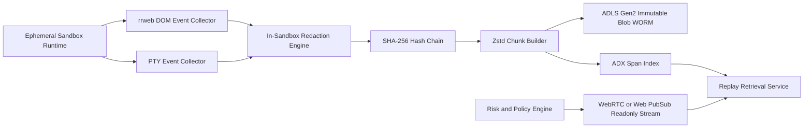
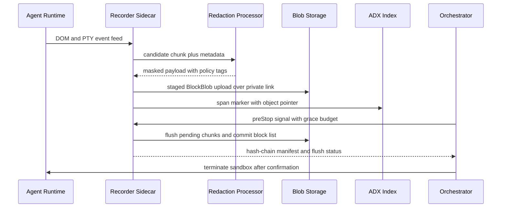
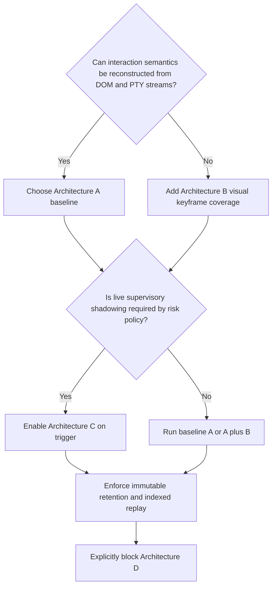

# Enterprise Sandbox Flight-Recorder and Replay Selection FAQ: Structural `rrweb+PTY+WORM` Streams vs Adaptive `VP9/AV1` Keyframe Rings vs Risk-Gated `WebRTC` Supervisor Shadowing vs Anti-Patterns
> **Audience**: Cloud & AI Solution Architects, platform security leads, compliance and legal-audit stakeholders, sandbox runtime SRE teams.
> **Core decision**: how to build forensic-grade session replay for ephemeral agent sandboxes with pre-egress PII redaction, immutable retention, and bounded operating cost.
> **Practical recommendation**: default to Architecture A, add Architecture B where visual semantics cannot be reconstructed from DOM/PTY events, enable Architecture C only under policy-triggered risk escalation, and explicitly prohibit Architecture D in production governance.

## 1. Executive summary
Enterprise agent platforms are rapidly moving toward short-lived, high-density sandbox execution, and in this model the decisive risk is not only task success but whether the organization can later prove exactly what happened after the runtime disappears.
Always-on raw video recording appears straightforward yet often fails under privacy and cost pressure, while zero telemetry appears cheap but leaves incident response teams blind during postmortem analysis.
A resilient design needs an evidence hierarchy: capture structural events by default, enrich with visual artifacts only where structural fidelity is insufficient, and escalate to live supervisor streams only when policy signals demand intervention.
Architecture A provides searchable event-accurate replay with low retention footprint, Architecture B provides pixel-ground-truth for native desktop or canvas-heavy surfaces, Architecture C provides near-real-time read-only supervisory visibility for high-risk sessions, and Architecture D captures two recurring failure modes that should be blocked by architecture review policy.
This guide provides formulas, concrete snippets, and 50K/1M/10M monthly-session TCO framing to support production design reviews.

## 2. Why this problem is different in ephemeral sandbox systems
Classical app telemetry assumes processes outlive most investigation windows, but ephemeral sandbox systems invert that assumption because runtimes can disappear in hundreds of milliseconds after task completion.
If replay buffers are not flushed before termination, evidence loss is permanent, and at the same time interaction traces may include typed credentials, copied secrets, token-bearing callback URLs, and regulated customer attributes.
Replay architecture is therefore both a reliability and privacy-boundary problem, and event volume at scale can be extreme because a million monthly sessions can generate billions of interaction records.
If representation is inefficient, retention quickly becomes financially unsustainable, so the architecture must solve evidentiary integrity, confidentiality, and cost governance simultaneously.

## 3. Design goals and explicit non-goals
Goal one is deterministic reconstruction of user-visible and agent-visible action chronology, goal two is mandatory pre-egress masking of secrets and PII inside the sandbox trust boundary, and goal three is tamper-evident archival with legally defensible retention controls.
Goal four is high-speed replay retrieval by tenant, task, span, policy hit, and time window, while goal five is cost elasticity where expensive modes are activated only when risk justifies them.
Non-goals include full-frame high-FPS capture for every low-risk session, deferred redaction after data has left the execution boundary, best-effort logs without integrity guarantees, and replay estates that cannot be operated by ordinary platform teams.

## 4. Candidate architectures in scope
Architecture A uses structural browser and terminal event streams with cryptographic chaining and immutable archival.
Architecture B uses action-boundary adaptive keyframes and compressed visual ring buffers for non-DOM workloads.
Architecture C uses risk-gated, on-demand, read-only supervisor multiplexing over low-latency streaming channels.
Architecture D either records unredacted always-on 30fps media or records nothing and destroys evidence on teardown.
A is the broad default for enterprise web-centric agent workflows.
B is the visual coverage extension where structural replay is insufficient.
C is the escalation layer for active risk supervision and human oversight.
D should be denied in production architecture boards and compliance control catalogs.

## 5. Architecture A deep dive: structural event-chain recorder
Architecture A treats replay as a structured evidence system rather than a media archive.
`rrweb` captures masked DOM mutations, interaction events, and layout evolution.
`asciinema v2`-style PTY streams capture terminal input and output with timing fidelity.
Both streams are annotated with shared trace and span metadata so cross-layer analysis is deterministic.
Before any chunk leaves the sandbox boundary, redaction policies are applied in-process.
Masked chunks are compressed with Zstd and assembled as bounded blocks for predictable flush behavior.
Each block hash includes the previous block hash to form a forward-linked integrity chain.
Object storage receives encrypted chunks over private networking paths.
Azure Data Explorer receives lightweight markers for span-level searchable replay indices.
Investigators can locate suspicious windows quickly without loading full session payloads.
In many 10-minute sessions, this design remains within roughly 1.5 to 4 MB of retained replay payload.
The result is high evidence fidelity at materially lower storage and egress cost than continuous video.

## 6. Architecture B deep dive: adaptive keyframe and visual ring buffer
Architecture B is purpose-built for interfaces that cannot be reconstructed from DOM events.
Typical examples include Win32 desktop clients, SAP GUI workflows, remote desktop surfaces, and canvas-rendered applications.
The strategy is not continuous high-fps capture.
The strategy is low-idle sampling plus burst sampling around meaningful action boundaries.
Idle mode can run near 0.5 fps to preserve environment state with low overhead.
Action bursts can rise near 10 fps around click, type, focus, and modal-transition signals.
Pre-action and post-action PNG anchors provide explicit forensic checkpoints.
Frames first land in a quarantine path where OCR and visual-entity redaction execute asynchronously.
Only validated and masked artifacts move into auditor-readable hot storage tiers.
Lifecycle management then migrates artifacts through hot, cool, and cold layers by policy.
B closes visual evidence gaps but must be tightly controlled because compute and bandwidth costs rise quickly.

## 7. Architecture C deep dive: risk-triggered real-time supervisor shadowing
Architecture C assumes that always-on human supervision is neither necessary nor affordable.
Baseline sessions run on structural recording only, preserving low overhead.
A policy and anomaly engine monitors in-flight behavior and risk context.
When trigger thresholds are crossed, the platform upgrades the session into a live read-only shadow mode.
Supervisors receive browser and terminal views via WebRTC or Web PubSub fan-out.
Controls are constrained to observation by default, with optional governed escalation channels if organizational policy requires intervention.
When risk decays below threshold, streaming sessions auto-demote to baseline recording.
This pattern minimizes routine cost while preserving rapid-response capability.
With tuned sidecars, steady-state overhead can remain below roughly two percent CPU.
Trigger-to-visible latency can be held below roughly 180 ms under healthy network and signaling paths.
C is therefore an operational amplifier, not a universal default.

## 8. Architecture D anti-patterns and failure consequences
The first D pattern is always-on unredacted high-frame-rate media capture.
This pattern leaks typed credentials, token-bearing URLs, and regulated PII into bulky archives.
The second D pattern is no recording plus rapid sandbox destruction.
This pattern makes incidents non-reconstructable and breaks accountability chains.
Both patterns fail compliance in different ways.
One fails by over-collecting sensitive data without bounded controls.
The other fails by under-collecting evidence required for audit and forensics.
Both patterns also produce poor economics.
Over-collection inflates storage and egress burn.
Under-collection inflates incident investigation time and legal exposure.
Production governance should classify both as prohibited reference architectures.

## 9. Quantitative planning model
Monthly storage demand can be estimated as:
`S_monthly = N_sessions * D_min * R_MB_per_min * T_days / 30`
Where `N_sessions` is monthly session count, `D_min` is average session duration in minutes, and `R_MB_per_min` is effective retained replay rate.
Teardown flush budget can be estimated as:
`T_flush = (B_chunk * Q_pending) / BW_effective`
Where `B_chunk` is average chunk size, `Q_pending` is queued chunk count, and `BW_effective` is effective upload throughput.
Safe teardown requires:
`T_preStop_grace >= T_flush + T_hash + T_retry_margin`
Redaction CPU tax can be measured as:
`CPU_tax = (CPU_with_redaction - CPU_baseline) / CPU_baseline`
Redaction latency tax can be measured as:
`Latency_tax = P95_with_redaction - P95_baseline`
These metrics should be segmented by tenant class, policy version, workload type, and runtime substrate.

## 10. Twelve-dimension architecture comparison
| Dimension | Architecture A | Architecture B | Architecture C | Architecture D |
|---|---|---|---|---|
| Searchable forensic replay | High | Medium | Medium-High | Low or unavailable |
| Pixel-faithful visual truth | Medium | Highest | High after trigger | High or none |
| Default privacy posture | High | Medium-High | High | Low or unknown |
| Steady-state resource overhead | Low | Medium-High | Low | High or zero |
| Incident escalation speed | Medium | Medium | High | Low |
| Legal retention readiness | High | High | High | Low |
| Cost predictability | High | Medium | Medium-High | Low |
| Teardown flush controllability | High | Medium | High | Low |
| Replay query efficiency | High | Medium | High | Low |
| Operational complexity | Medium | Medium-High | High | Superficially low |
| Recommended deployment scope | Default baseline | Targeted extension | Risk escalation lane | Prohibited |
| Net architecture posture | Primary | Coverage complement | Supervisory overlay | Reject |

## 11. Four-architecture replay and redaction control plane


## 12. Teardown flush timeline and indexed replay sequence


## 13. Architecture selection decision tree


### Q1. Why should structural replay be the enterprise default
Structural replay is machine-queryable and directly supports policy analytics.
It captures what changed, when it changed, and under which task context.
At scale, this matters more than raw frame continuity.
It also enables cross-linking with tool-call logs, policy outcomes, and tenant metadata.
For most browser-centric workloads, structural fidelity is sufficient for root-cause reconstruction.
Therefore structural replay should anchor the default evidence pipeline.

### Q2. Why must redaction happen before data leaves the sandbox
Post-egress redaction still exposes sensitive content in transit and upstream staging layers.
Private networking reduces exposure but does not remove the principle-of-least-exposure requirement.
In-sandbox redaction ensures sensitive tokens and PII are transformed before storage ingress.
This minimizes blast radius if downstream systems are misconfigured or over-permissioned.
Compliance programs increasingly evaluate where redaction occurs, not only whether it exists.
For forensic replay systems, pre-egress redaction is a control boundary, not an optimization.

### Q3. When does Architecture B become mandatory instead of optional
B becomes mandatory when core workflows are rendered outside reconstructable DOM semantics.
Native desktop applications, virtual desktop sessions, and canvas-heavy UIs are common triggers.
In these cases structural traces alone can miss critical visual causality.
Action-boundary keyframes recover that missing causality while avoiding full-time high-fps capture.
The architecture should still enforce selective capture and rigorous visual redaction.
B is therefore a targeted evidence-completeness control, not a blanket default.

### Q4. How should Architecture C be constrained to avoid runaway cost
C should activate from explicit, testable policy triggers rather than broad heuristics.
Examples include repeated high-risk tool invocations, anomalous command signatures, or regulated-task labels.
Sessions should auto-demote when risk decays, with anti-flap dampening windows.
Supervisor access should remain read-only by default with strict audit trails.
Cost controls should include concurrent-stream caps and escalation budgets per tenant tier.
Constrained escalation preserves response capability without converting all sessions into live media workloads.

### Q5. How do we verify teardown flush safety under hard sandbox lifetimes
Measure chunk size distribution, pending queue depth, and effective upload throughput under load.
Compute worst-case flush time using the drain formula rather than average cases.
Add hash-chain computation and retry margin to the required preStop budget.
If required flush time exceeds available grace, reduce chunk size, increase flush frequency, or raise upload concurrency.
Teardown readiness tests should run in CI and in periodic chaos drills.
A sandbox should never be admitted to production without proven flush-within-grace evidence.

### Q6. Five-step rollout plus Good fit vs Not for
Step one: classify workload interfaces and map evidence-level requirements to policy tiers.
Step two: deploy in-sandbox redaction policies with versioned governance and regression suites.
Step three: implement Architecture A baseline with immutable retention and indexed replay.
Step four: add Architecture B only where structural replay leaves validated evidence gaps.
Step five: configure Architecture C trigger, escalation, and auto-demotion with budget guardrails.
Good fit: multi-tenant agent platforms with strict auditability, privacy controls, and high monthly session volume.
Not for: short-lived demo environments with no regulated data and no post-incident accountability requirements.

## 14. Implementation snippets
```bicep
param storageName string
param retentionDays int = 2555

resource stg 'Microsoft.Storage/storageAccounts@2023-05-01' = {
  name: storageName
  location: resourceGroup().location
  sku: {
    name: 'Standard_LRS'
  }
  kind: 'StorageV2'
  properties: {
    immutableStorageWithVersioning: {
      enabled: true
    }
    allowBlobPublicAccess: false
    minimumTlsVersion: 'TLS1_2'
  }
}

resource container 'Microsoft.Storage/storageAccounts/blobServices/containers@2023-05-01' = {
  name: '${stg.name}/default/flight-recorder'
  properties: {
    publicAccess: 'None'
    immutableStorageWithVersioning: {
      enabled: true
      immutabilityPolicy: {
        immutabilityPeriodSinceCreationInDays: retentionDays
        state: 'Unlocked'
      }
    }
  }
}
```

```python
import hashlib
import re
import zstandard as zstd
from dataclasses import dataclass
from datetime import datetime, timezone

PATTERNS = [
    re.compile(r'(?i)(api[_-]?key|token|password|secret)\\s*[:=]\\s*[\\w\\-]{8,}'),
    re.compile(r'(?i)authorization:\\s*bearer\\s+[A-Za-z0-9\\-_.]+'),
]

@dataclass
class Chunk:
    session_id: str
    index: int
    previous_hash: str
    payload: bytes

def redact_text(text: str) -> str:
    value = text
    for p in PATTERNS:
        value = p.sub('[REDACTED]', value)
    return value

def build_manifest(chunk: Chunk) -> dict:
    compressed = zstd.ZstdCompressor(level=7).compress(chunk.payload)
    digest = hashlib.sha256(chunk.previous_hash.encode('utf-8') + compressed).hexdigest()
    return {
        "session_id": chunk.session_id,
        "chunk_index": chunk.index,
        "previous_hash": chunk.previous_hash,
        "chunk_hash": digest,
        "compressed_size": len(compressed),
        "created_at": datetime.now(timezone.utc).isoformat(),
    }
```

```yaml
apiVersion: apps/v1
kind: DaemonSet
metadata:
  name: sandbox-flight-recorder
  namespace: agent-runtime
spec:
  selector:
    matchLabels:
      app: sandbox-flight-recorder
  template:
    metadata:
      labels:
        app: sandbox-flight-recorder
    spec:
      serviceAccountName: recorder-wi
      terminationGracePeriodSeconds: 8
      containers:
        - name: recorder
          image: ghcr.io/example/sandbox-flight-recorder:1.0.0
          args:
            - "--mask-all-inputs=true"
            - "--pty-entropy-threshold=4.2"
            - "--chunk-max-kb=256"
            - "--flush-interval-ms=800"
            - "--grace-budget-ms=2500"
          resources:
            requests:
              cpu: "150m"
              memory: "256Mi"
            limits:
              cpu: "1000m"
              memory: "1Gi"
```

## 15. Enterprise TCO framing for 50K / 1M / 10M monthly sandbox sessions
| Monthly session scale | Recommended pattern | Typical average duration | Replay strategy | Dominant cost drivers | Practical conclusion |
|---|---|---|---|---|---|
| 50K sessions | A plus selective C | 8 to 12 minutes | Structural replay baseline with small triggered live-shadow share | Storage and index cost is moderate | Fastest path to governed production adoption |
| 1M sessions | A plus B plus C | 6 to 10 minutes | Web workloads on A, visual hotspots on B, risk sessions on C | Redaction CPU and indexing throughput | Requires explicit capacity and policy engineering |
| 10M sessions | Optimized A plus targeted B plus tightly gated C | 4 to 8 minutes | Aggressive structural compression with policy-driven visual evidence | Bandwidth, lifecycle tiering, and retrieval optimization | Demands platform-level cost controls and automation |

## 16. Production readiness checklist
Confirm recorder images are digest-pinned and signed through supply-chain controls, and confirm sandbox default redaction is enabled for input masking and sensitive pattern replacement.
Confirm PTY scrubbers cover credentials, tokens, personal identifiers, and common secret formats, and confirm teardown flush load tests prove completion inside configured preStop grace windows.
Confirm hash-chain discontinuity raises high-priority alerts, and confirm immutable retention policy durations are mapped to regulatory obligations.
Confirm replay index schema includes tenant, session, task, policy-hit, and time partitions, and confirm replay access paths enforce least privilege with complete access auditing.
Confirm visual redaction quality for Architecture B across multilingual OCR conditions, and confirm Architecture C supervisor channels are read-only by default with policy auditability.
Confirm trigger and demotion logic includes anti-flap controls with escalation rate limits, and confirm cost dashboards separate structural replay, visual replay, and live-shadow cost classes.
Confirm storage tiering transitions are testable and reversible under legal hold requirements, and confirm export workflows produce legal-grade evidence bundles with integrity metadata.
Confirm SOC analysts have task-oriented runbooks with quarterly replay drills, and confirm governance owners review replay and redaction quality metrics on a fixed cadence.

## 17. Operational lessons and advanced governance recommendations
Treat replay policy tier as a first-class scheduling input so one platform can enforce different evidence depth by risk class automatically, and enforce replay-overhead SLOs as deployment gates instead of post-launch surprises.
When CPU tax or latency tax exceeds threshold, trigger adaptive downsampling and policy review workflows, while maintaining redaction regression suites that include prompt-injection variants, mixed-language payloads, and obfuscated token formats.
Mirror hash-chain manifests into an independent audit stream to reduce single-system trust assumptions, and use tenant-specific policy versions for high-criticality customers to isolate governance change blast radius.
Provide SOC workflows that jump directly from alert to span-linked replay windows to reduce MTTR, and instrument replay-read behavior for misuse detection and insider-risk analytics.
Run controlled experiments on keyframe-trigger heuristics to optimize explainability versus spend, and couple live-shadow budget limits to staffing schedules so high-cost streams are not activated without supervision capacity.
Track evidence completeness, privacy incidents, and cost per session together in quarterly reviews, then promote those indicators into platform OKRs so governance quality survives staffing changes and roadmap pressure.
At very high scale, split retrieval architecture into summary-first and deep-evidence layers, and default sovereignty-sensitive tenants to region-isolated storage and indexing boundaries.
Prepare regulator-facing evidence chains that map policy version to replay sample to integrity hash to approval record, because this translation layer accelerates external audits and lowers legal response friction.
Replay architecture maturity should be measured by predictability and repeatability rather than raw capture volume, and the best programs optimize for provable control with minimal unnecessary data exposure.

## 18. Conclusion
Enterprise sandbox replay architecture should never be reduced to a false binary between full-time surveillance video and complete evidentiary absence, because both extremes fail either privacy governance or forensic accountability.
Architecture A is the most durable baseline for low-cost searchable integrity-verifiable replay with pre-egress redaction, Architecture B closes visual-forensics gaps for non-DOM workloads through action-boundary keyframes, and Architecture C converts live supervision into an on-demand risk control rather than a permanent cost burden.
Architecture D should be explicitly denied in production standards, and when A, B, and C are integrated with immutable retention, span-indexed retrieval, policy-triggered escalation, and cost guardrails, enterprises can operate replay systems that are auditable, privacy-aware, operationally sustainable, and resilient at very large session scale.
