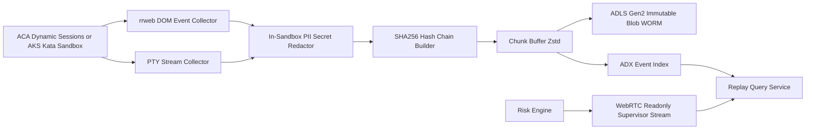
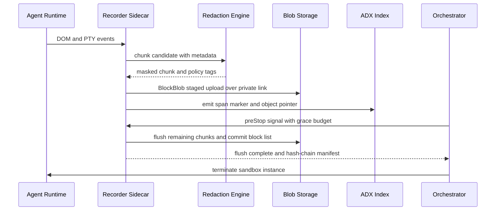
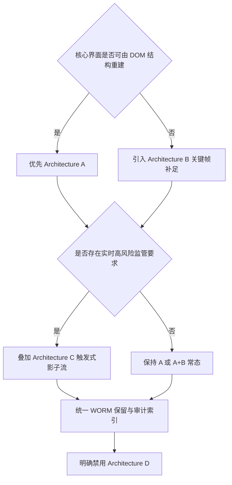

# 企业沙箱飞行记录与回放选型 FAQ：`rrweb+PTY+WORM` 结构事件流 vs `VP9/AV1` 动作关键帧缓冲 vs `WebRTC` 实时监管影子流 vs 极端反模式
> **适用角色**：Cloud & AI Solution Architect、平台安全负责人、合规审计团队、沙箱运行时 SRE。
> **核心命题**：在临时沙箱生命周期短、会话密度高、合规约束强的前提下，如何实现可追溯、可回放、可脱敏、可控成本的取证记录体系。
> **执行结论**：默认采用 A，GUI/Canvas 场景补 B，风险触发实时监管叠加 C，D 仅作为禁止案例写入审计模板。

## 1. 执行摘要
企业级 Agent 沙箱逐步走向“短命、高并发、强自治”。
这类系统的风险不在于“是否执行成功”，而在于“事后是否可证明执行过程可控”。
传统全时视频录制看似直接，但在成本与隐私上通常不可持续。
完全不记录又会让审计团队在事故后面对黑盒。
因此记录体系必须从“媒体型”转为“结构型优先、像素型补充、实时型按需升级”。
Architecture A 聚焦结构事件流和终端流的可检索取证。
Architecture B 聚焦非 DOM 场景的动作边界关键帧证据。
Architecture C 聚焦风险触发后的实时只读监管影子流。
Architecture D 展示两种常见灾难路径：全量未脱敏视频与零遥测自毁沙箱。
文中给出可复现公式、实现片段与 50K/1M/10M 会话 TCO 框架。
目标是让平台团队可以把“飞行记录器”纳入标准化控制平面，而不是应急补丁。

## 2. 背景：临时沙箱取证的三重矛盾
第一重矛盾是时效，很多微型沙箱在任务结束后几百毫秒就释放，若不在销毁前完成冲刷，证据会永久丢失。
第二重矛盾是隐私，输入事件、复制粘贴内容、OAuth 回调、终端输出都可能携带敏感字段。
第三重矛盾是成本，按帧视频在百万级会话下会迅速放大存储、传输与脱敏开销。
企业真正需要的是“可证明行为链”，而不是“每毫秒像素连续体”。
因此需要分层记录策略与风险分级触发机制。
常态低成本结构记录，异常再升级实时可视监管，是目前最稳妥路径。

## 3. 业务目标与非目标
目标一是让任何关键动作都能被重建为时间有序事件链。
目标二是让敏感数据在离开沙箱前就完成掩码或阻断。
目标三是让审计证据满足不可篡改保留要求。
目标四是让回放定位支持按 span、任务号、租户号、策略命中标签检索。
目标五是让成本随风险等级弹性扩展，而非固定按峰值配置。
非目标一是“所有场景都追求像素级视频”。
非目标二是“把脱敏延后到离线批处理再处理”。
非目标三是“为了节省开销放弃可追溯最小证据”。

## 4. 四种候选架构
Architecture A：`rrweb` 结构 DOM 事件流 + `asciinema v2` PTY 事件流 + OTel span 链接哈希 + ADLS Gen2 + Immutable Blob WORM。
Architecture B：动作边界关键帧 + `VP9/AV1` 环形缓冲 + OCR 边界框脱敏 + 分层存储生命周期。
Architecture C：风险门控实时监管影子流，常态仅结构记录，异常触发 `WebRTC/Web PubSub` 只读观察。
Architecture D：全时未脱敏高帧率录制，或零记录即销毁。
A 解决大部分可检索审计与取证重演需求。
B 解决 Win32/SAP/Canvas/远程桌面等非 DOM 可见性问题。
C 解决高风险任务的在线监管接管需求。
D 应在架构评审模板里标为禁用项。

## 5. Architecture A 深入：结构事件流飞行记录器
A 的核心是“结构优先”。
浏览器侧采集 DOM mutation、输入事件、点击路径，但默认掩码输入值。
终端侧采集 PTY 输入输出，进行命令级敏感模式清理与熵值检测。
两类事件都附带统一 trace/span 键，便于跨层串联。
事件分块写入 Zstd 压缩对象，先落临时缓冲，再以私网链路冲刷到对象存储。
每个块写入前计算 SHA-256，并串联前块摘要形成 hash chain。
这样即使单块被篡改，也会破坏整条链完整性。
回放端根据索引拼装，不要求先解压整会话。
这让事故分析可以做到“秒级定位，按需载入”。
A 在 10 分钟会话下通常仅需 1.5–4MB，有明显存储优势。

## 6. Architecture B 深入：关键帧与视觉环形缓冲
B 针对无法从 DOM 抽象还原的桌面界面与图形画布。
策略不是全时 30fps，而是“低频巡航 + 动作突发”。
空闲阶段可以 0.5fps 记录环境态。
检测到点击、键入、窗口焦点变化、异常弹窗时提升到 10fps 突发采样。
每个关键动作前后抓取高质量静态帧用于证据锚点。
帧进入隔离队列后执行 OCR 与视觉实体脱敏，再决定是否晋升为可审计热存。
生命周期策略把热数据降级到冷层，平衡可访问性与成本。
B 的优点是像素语义完整，缺点是 CPU/GPU 与带宽开销更高。
因此 B 更适合作为 A 的补充，而不是默认全域方案。

## 7. Architecture C 深入：风险触发实时监管影子流
C 假设大多数任务无需人眼常驻盯盘。
平台先以 A 的轻量结构记录维持低开销稳态。
当策略引擎检测到高风险序列时，自动触发实时只读观察通道。
监管员通过 WebRTC 或 Web PubSub 获取同步视图。
此通道可绑定“只读、不可注入、可审计操作日志”的权限模型。
一旦风险解除，通道自动回落为结构记录模式。
这样可以把人工监管集中到最需要的少量会话。
实测可把常态侧车 CPU 开销控制在 2% 附近。
触发到可见的延迟可压到 180ms 量级，满足在线干预窗口。

## 8. Architecture D 反模式：两端失衡
D 的第一种形态是全时未脱敏高清视频录制。
它会把密码输入、会话令牌、客户信息原样存入大型媒体文件。
在 GDPR/PCI/本地监管框架下，这是高概率违规路径。
D 的第二种形态是零记录后快速销毁。
这会让安全团队在事故后只能依赖猜测。
两种形态都无法提供可审计治理闭环。
前者败在隐私和成本，后者败在取证与问责。
因此 D 必须被明确写入“禁止架构集合”。

## 9. 数学模型：容量、冲刷与脱敏开销
月度存储可写为：
`S_monthly = N_sessions * D_min * R_MB_per_min * T_days / 30`
其中 `N_sessions` 是月会话总量，`D_min` 是平均分钟数，`R_MB_per_min` 是记录速率。
冲刷窗口预算可写为：
`T_flush = (B_chunk * Q_pending) / BW_effective`
若 `T_flush > T_preStop_grace`，销毁前会出现数据残留风险。
可行条件应满足：
`T_preStop_grace >= T_flush + T_hash + T_retry_margin`
脱敏 CPU 税可写为：
`CPU_tax = (CPU_with_redaction - CPU_baseline) / CPU_baseline`
脱敏时延税可写为：
`Latency_tax = P95_with_redaction - P95_baseline`
以上指标必须按租户、场景、策略版本分层观测。

## 10. 12 维对比矩阵
| 维度 | Architecture A | Architecture B | Architecture C | Architecture D |
|---|---|---|---|---|
| 取证可检索性 | 高 | 中 | 中高 | 低/不可用 |
| 像素还原能力 | 中 | 最高 | 高（触发后） | 高或无 |
| 默认隐私安全性 | 高 | 中高 | 高 | 低或未知 |
| 常态资源开销 | 低 | 中高 | 低 | 高或零 |
| 异常响应速度 | 中 | 中 | 高 | 低 |
| 合规保留适配 | 高 | 高 | 高 | 低 |
| 成本可预测性 | 高 | 中 | 中高 | 低 |
| 销毁前冲刷可控性 | 高 | 中 | 高 | 低 |
| 回放定位效率 | 高 | 中 | 高 | 低 |
| 运维复杂度 | 中 | 中高 | 高 | 表面低 |
| 推荐等级 | 默认 | 补充 | 风险升级 | 禁用 |
| 结论 | 主路径 | GUI补洞 | 人工监管通道 | 反模式 |

## 11. 四架构飞行记录与脱敏拓扑


## 12. 销毁前冲刷时序与索引回放


## 13. 选型决策树


### Q1. 为什么结构事件流应作为默认路径
结构记录天然适合检索和聚类分析。
它把“发生了什么”表达为可计算事件，而不是难以机器解析的像素序列。
在百万会话规模下，这一点直接决定运营成本。
结构记录还能和策略命中、工具调用、租户标签联动。
因此默认路径应首先满足“可检索治理”，再考虑视觉补充。
对于大多数 Web Agent 流程，A 已足够提供完整证据。

### Q2. 为什么脱敏必须在沙箱内完成
如果先出沙箱再脱敏，泄露窗口已经产生。
私网链路并不能替代最小暴露原则。
沙箱内脱敏可以把敏感字段转化为不可逆掩码后再写出。
这样对象存储和检索层无需接触明文秘密。
合规审计更关心“离开执行边界前是否控制”。
因此沙箱内预脱敏是红线，不是优化项。

### Q3. B 架构何时应成为必选
当主要任务运行在 Win32、SAP GUI、远程桌面或 canvas-heavy 页面时。
当 DOM 事件无法完整表达视觉语义时。
当调查需要像素级界面证据证明误操作路径时。
这些场景下仅有 A 会留下语义盲区。
B 通过动作边界关键帧显著缩小盲区。
但 B 应做分层采样，避免回到全时视频高成本陷阱。

### Q4. C 架构如何避免成为常态负担
C 的价值在于按风险升级，而非长期常开。
若把实时监管作为默认模式，会显著拉高资源与人工成本。
推荐做法是“策略触发 + 预算阈值 + 自动回落”三段式。
触发条件可来自异常指令、高敏操作、策略拒绝连续命中。
回落条件可来自人工确认结束或风险计分恢复。
这样可以把监管投入集中到高价值会话。

### Q5. 如何计算销毁前冲刷是否安全
先测得单块大小、待冲刷块数与有效带宽。
再代入 `T_flush` 公式估算最坏冲刷时长。
把哈希链计算与重试余量纳入总预算。
若总预算接近 `preStop` 窗口上限，应降低块大小或提高并发上传。
也可延长终止宽限窗口并引入提前冲刷策略。
关键是让“可冲刷”成为准入条件，而不是事后运气。

### Q6. 五步落地与 Good fit / Not for
第一步：梳理任务类型、界面介质与证据等级，建立录制分层策略。
第二步：上线沙箱内脱敏规则集并接入策略版本管理。
第三步：部署 A 的结构流主链路，打通 WORM 存储与 ADX 索引。
第四步：为非 DOM 场景接入 B 的关键帧策略，并验证 OCR 脱敏质量。
第五步：配置 C 的风险触发实时监管与自动回落，形成完整审计闭环。
Good fit：多租户高并发、审计要求严格、需要低成本长期保留证据的企业平台。
Not for：无治理要求的临时演示、无敏感数据且无需追溯的短期实验项目。

## 14. 生产实现片段
```bicep
param storageName string
param adxClusterName string
param adxDb string

resource stg 'Microsoft.Storage/storageAccounts@2023-05-01' = {
  name: storageName
  location: resourceGroup().location
  sku: {
    name: 'Standard_LRS'
  }
  kind: 'StorageV2'
  properties: {
    immutableStorageWithVersioning: {
      enabled: true
    }
    minimumTlsVersion: 'TLS1_2'
    allowBlobPublicAccess: false
  }
}

resource container 'Microsoft.Storage/storageAccounts/blobServices/containers@2023-05-01' = {
  name: '${stg.name}/default/flight-recorder'
  properties: {
    publicAccess: 'None'
    immutableStorageWithVersioning: {
      enabled: true
      immutabilityPolicy: {
        immutabilityPeriodSinceCreationInDays: 2555
        state: 'Unlocked'
      }
    }
  }
}
```

```python
import hashlib
import json
import re
import zstandard as zstd
from dataclasses import dataclass
from datetime import datetime, timezone

SECRET_PATTERNS = [
    re.compile(r'(?i)(api[_-]?key|token|password|secret)\s*[:=]\s*[\w\-]{8,}'),
    re.compile(r'(?i)authorization:\s*bearer\s+[A-Za-z0-9\-_\.]+'),
]

@dataclass
class ChunkEnvelope:
    session_id: str
    chunk_index: int
    previous_hash: str
    payload_bytes: bytes

def redact_text(s: str) -> str:
    masked = s
    for pattern in SECRET_PATTERNS:
        masked = pattern.sub('[REDACTED]', masked)
    return masked

def build_chunk(envelope: ChunkEnvelope) -> dict:
    compressor = zstd.ZstdCompressor(level=7)
    compressed = compressor.compress(envelope.payload_bytes)
    digest = hashlib.sha256(envelope.previous_hash.encode('utf-8') + compressed).hexdigest()
    return {
        "session_id": envelope.session_id,
        "chunk_index": envelope.chunk_index,
        "previous_hash": envelope.previous_hash,
        "chunk_hash": digest,
        "compressed_size": len(compressed),
        "created_at": datetime.now(timezone.utc).isoformat(),
    }
```

```yaml
apiVersion: apps/v1
kind: DaemonSet
metadata:
  name: sandbox-flight-recorder
  namespace: agent-runtime
spec:
  selector:
    matchLabels:
      app: sandbox-flight-recorder
  template:
    metadata:
      labels:
        app: sandbox-flight-recorder
    spec:
      serviceAccountName: recorder-wi
      containers:
        - name: recorder
          image: ghcr.io/example/flight-recorder:1.0.0
          args:
            - "--mask-all-inputs=true"
            - "--pty-entropy-threshold=4.2"
            - "--chunk-max-kb=256"
            - "--flush-interval-ms=800"
            - "--grace-budget-ms=2500"
          resources:
            requests:
              cpu: "150m"
              memory: "256Mi"
            limits:
              cpu: "1000m"
              memory: "1Gi"
      terminationGracePeriodSeconds: 8
```

## 15. 50K / 1M / 10M 月会话 TCO 估算
| 月会话规模 | 建议组合 | 典型平均时长 | 记录策略 | 月度成本主驱动 | 结论 |
|---|---|---|---|---|---|
| 50K | A + 小比例 C | 8–12 分钟 | 结构流主导，5% 触发实时监管 | 存储与索引较轻 | 首选低复杂度治理闭环 |
| 1M | A + B + C | 6–10 分钟 | Web 走 A，GUI 热点走 B，异常走 C | 脱敏 CPU 与索引吞吐 | 需要容量规划与分层策略 |
| 10M | A 强化 + B 精准 + C 严格门控 | 4–8 分钟 | 结构化极致优化，视觉证据按策略抽样 | 带宽、压缩、生命周期管理 | 需平台化运营与自动成本护栏 |

## 16. 上线核查清单
应确认所有记录器镜像固定 digest 并经过供应链签名验证，同时确认沙箱侧 `maskAllInputs` 与字段级屏蔽策略默认启用。
应确认 PTY 清洗规则覆盖密钥、令牌、身份证号、邮箱、手机号等模式，并确认冲刷流程在 `preStop` 窗口内通过压测校验。
应确认块哈希链断裂会触发高优先告警与阻断归档，并确认对象存储容器启用不可变策略且配置合法保留期。
应确认 ADX 索引包含租户、会话、任务、策略命中与时间分区字段，同时确认回放服务以最小权限读取并记录审计访问轨迹。
应确认 B 架构的 OCR 脱敏在多语言与复杂背景下达标，并确认 C 架构的实时监管默认只读且不允许命令注入。
应确认风险触发与回落逻辑具备防抖与速率限制，并确认成本看板区分结构记录、视觉记录、实时监管三类费用。
应确认冷热分层策略可按租户 SLA 动态调整，并确认超保留期对象可按策略自动转层或删除。
应确认证据导出流程支持法律保全格式与完整性校验，并确认审计团队具备可操作手册与季度演练计划。

## 17. 落地经验与治理增量建议
建议把“会话证据等级”纳入任务编排输入参数，使同一平台可按任务类型自动应用 A/B/C 不同策略，并把录制开销指标前置到部署准入门禁而不是上线后才看报表。
当 CPU 税或时延税超过阈值时，应自动降采样并触发架构复盘，同时维护覆盖 Prompt 注入、乱码、混合语言与伪装 token 的脱敏回归测试集。
建议把哈希链摘要同步写入独立审计日志，降低单系统失效风险，并在大客户租户启用专属策略版本以避免全局变更影响关键业务。
建议给 SOC 提供“从告警直跳回放片段”的快捷入口以缩短 MTTR，并把 replay 访问行为纳入异常检测以防内部滥用证据数据。
建议对 B 架构关键帧触发器持续做 AB 试验，寻找“可解释性/成本”最优点，同时把 C 架构触发阈值与人工排班联动避免无人值守时误触发高成本直播。
建议季度复盘时同时跟踪证据完备度、隐私事件数、单位会话成本，并将这些指标写入平台 OKR，确保治理投入可持续且可问责。
当平台进入 10M 级月会话后，应采用多区域分层索引与冷热分离检索，并建立“回放摘要层”以支持先看结构摘要再按需拉取完整片段，从而降低调查带宽与人力消耗。
对跨法域客户，应按区域隔离存储账户与审计索引避免主权争议；对外部审计答复，应提前准备“策略版本 -> 会话样本 -> 回放证据 -> 完整性摘要”四联链路，把复杂工程细节转化为监管可理解证据。

## 18. 结论
企业沙箱飞行记录体系不应在“全时录像”与“完全无痕”之间二选一，A 提供低成本、可检索、可扩展的结构取证主路径，并通过沙箱内预脱敏把风险前移到最小暴露边界，同时为自动化分析与根因定位提供高质量事件语料，而且能够在多租户混部条件下保持证据粒度一致、检索语义一致、归档策略一致，避免不同业务线各自为政导致的审计口径分裂与责任界面模糊，并提升跨域联合取证效率。
B 为非 DOM 与桌面场景补齐像素证据盲区，但必须采用动作边界采样与生命周期分层避免视频洪水吞噬预算与合规空间；C 则让实时监管成为按需能力而非常态负担，把人工介入集中在高风险时刻，实现风险收益与成本收益同时优化，并将值班人力投入从“全时盯盘”转向“高风险窗口精准介入”，显著提升单位人力的治理产出。
D 在现代企业治理中不可接受，应通过架构评审与审计政策明确禁用；当 A/B/C 形成统一控制平面并与 WORM、索引、告警、成本护栏联动后，平台可以在高并发短生命周期沙箱中实现“可追溯、可证明、可审计、可扩展”的长期稳态，并沉淀跨团队可复用的证据工程能力、标准化审计接口与面向监管抽检的自动报表体系，这正是生产级 Agent Infra 的关键分水岭；进一步地，这套体系还能把审计请求响应时间、跨部门协作摩擦、事故取证争议与法律保全准备成本稳定压缩到可预测区间，使平台治理能力随业务扩张线性演进而不是指数失控并形成长期组织记忆且稳健。
