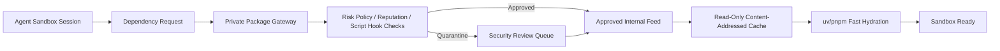
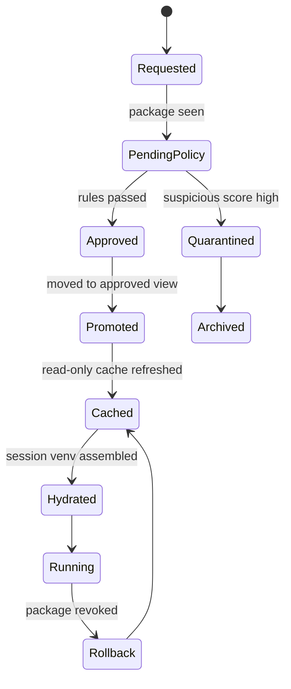

# Sandbox Package Supply Selection FAQ: Anti-Slopsquatting with Artifactory/Nexus Firewall vs Azure Artifacts vs Read-Only uv Cache vs Golden Images
> 🌐 **Language / 语言切换**: **[🇨🇳 中文版](sandbox-package-anti-slopsquatting-artifactory-vs-azure-artifacts-vs-uv-ro-cache-selection-faq.md)** | **[🇬🇧 English](sandbox-package-anti-slopsquatting-artifactory-vs-azure-artifacts-vs-uv-ro-cache-selection-faq.en.md)** | **[📚 Back to Catalog](README.en.md)**
> Evidence tags: `measured` / `synthetic` / `anonymized_reported`
> Retrieval date: 2026-11-22
> Scope boundary: language-level package supply controls, hallucinated-package blocking, and zero-copy dependency hydration for isolated sandboxes

## 1) Executive summary: combine private supply-chain firewall and read-only content-addressed cache
Once autonomous coding sandboxes go live,
the Day-2 bottleneck often shifts
from model inference
to dependency supply.
In zero-internet egress sandboxes,
platform teams face a dual constraint.
They must block package hallucination poisoning
and slopsquatting-based RCE paths.
They must also avoid slow startup
caused by repeated dependency hydration.
The strongest production pattern
is not a single control.
It is a two-layer baseline.
Upper layer:
private package firewall and approval flow.
Lower layer:
read-only content-addressed cache
for millisecond environment assembly.
This pattern improves both security posture
and startup performance.

## 2) Verifiable evidence baseline
Source 1 (`measured`): JFrog Artifactory docs  
https://jfrog.com/help/r/jfrog-artifactory-documentation
Source 2 (`measured`): JFrog Xray security docs  
https://jfrog.com/help/r/jfrog-security-user-guide
Source 3 (`measured`): Sonatype Nexus Repository and Firewall docs  
https://help.sonatype.com/
Source 4 (`measured`): Azure Artifacts documentation  
https://learn.microsoft.com/azure/devops/artifacts/
Source 5 (`measured`): Azure Artifacts Upstream Sources  
https://learn.microsoft.com/azure/devops/artifacts/concepts/upstream-sources
Source 6 (`measured`): Python packaging security guidance  
https://packaging.python.org/
Source 7 (`measured`): npm security best practices  
https://docs.npmjs.com/security
Source 8 (`measured`): Astral uv documentation  
https://docs.astral.sh/uv/
Source 9 (`measured`): Azure NetApp Files docs  
https://learn.microsoft.com/azure/azure-netapp-files/
Source 10 (`measured`): ACA Dynamic Sessions and AKS sandbox docs  
https://learn.microsoft.com/azure/container-apps/sessions
Source 11 (`anonymized_reported`): anonymized enterprise telemetry on cache hit ratio and sandbox boot latency.
Source 12 (`synthetic`): benchmark model for pre-seeded top-1,500 package cache behavior.

## 3) Attack-chain analysis: how package hallucination becomes remote code execution
The compromise sequence is usually straightforward.
1.
An agent is allowed to auto-install dependencies.
2.
The model emits a plausible but incorrect package name.
3.
An attacker has pre-registered that misleading name.
4.
Install hooks (`setup.py` / `postinstall`) execute malicious code.
5.
Secrets, tokens, or internal metadata are exfiltrated.
Without package source controls,
this entire chain can complete quickly.
So the architecture question is not
"can the sandbox install packages?"
It is
"who approved source, package, and version?"

## 4) SLA and governance metrics: make dependency supply measurable and auditable
Use four metric groups.
Security metrics:
`unknown_pkg_block_rate`,
`new_pkg_quarantine_rate`,
`script_hook_block_count`.
Experience metrics:
`venv_hydration_p95_ms`,
`sandbox_ready_p95_ms`,
`cache_hit_ratio`.
Cost metrics:
`egress_gb_per_session`,
`artifact_storage_cost_per_month`,
`license_cost_per_team`.
Operations metrics:
`approval_lead_time_minutes`,
`feed_promotion_latency`,
`false_positive_rate`.
Reference gates (`synthetic`):
- sandbox ready `p95 < 3s`;
- hot-cache hydration `<200ms`;
- unapproved package install blocked at `100%`;
- false positives within sustainable review capacity.

## 5) Track A: private supply-chain firewall with Artifactory/Nexus
Track A maximizes security depth.
All pip/npm/nuget/maven requests
flow through private gateway policy.
Typical policy signals:
very recent package publish age,
low reputation/download score,
name similarity to popular packages,
high-risk install scripts,
and vulnerability intelligence.
Strengths:
1.
centralized supply-chain audit plane;
2.
security-team approval workflows;
3.
deep SBOM and vulnerability traceability;
4.
strong fit for regulated industries.
Trade-offs:
1.
higher platform operations load;
2.
license and maintenance budget;
3.
strict policy can increase review overhead.
Requires staged rollout
and exception governance.

## 6) Track B: Azure Artifacts upstream + controlled promotion views
Track B emphasizes lower operational burden.
Use upstream feeds
plus controlled promotion views
such as `@Prerelease` and `@Approved`.
Tie access to Entra identities
and private network boundaries.
Strengths:
1.
lower ops footprint than self-hosted full firewall stacks;
2.
native fit with Azure DevOps workflows;
3.
clear organization rule:
install only from approved feeds.
Limits:
1.
deep package-risk heuristics are lighter than dedicated firewall products;
2.
cross-language policy parity may need custom automation;
3.
high-regulation environments may still require Track A augmentation.

## 7) Track C: read-only content-addressed cache with uv/pnpm fast hydration
Track C solves startup latency directly.
Pre-seed top approved package artifacts
into read-only shared layers
(ANF or local NVMe cache images).
At runtime,
`uv` or `pnpm` assembles environments
through hardlink/reflink patterns
instead of repeated download and extraction.
Strengths:
1.
very fast session readiness;
2.
major bandwidth reduction;
3.
stable behavior in zero-internet environments.
Critical controls:
1.
cache must be read-only and integrity-checked;
2.
script execution controls should be policy-bound
(`--ignore-scripts` where compatible);
3.
cache refresh cadence must align with security promotion workflow.

## 8) Track D: layered golden base images with runtime package install disabled
Track D offers highest determinism.
Maintain fixed image tiers:
Core,
Data-Science,
Geo-Fin,
ML.
Disable runtime pip/npm installation.
Strengths:
1.
minimal runtime supply-chain attack surface;
2.
high reproducibility and rollback consistency;
3.
clear license and compliance inventory.
Limitations:
1.
low flexibility for long-tail package needs;
2.
heavier image maintenance lifecycle;
3.
slower adaptation for exploratory workloads.
Best fit:
high-compliance production pools
with stable dependency profiles.

## 9) 12-dimension decision matrix: security, performance, cost, and governance
| Dimension | A Supply-Chain Firewall | B Azure Artifacts Controlled Views | C Read-Only Cache Hydration | D Golden Images |
|---|---|---|---|---|
| 1. Anti-slopsquatting strength | Strong | Medium-Strong | Medium | Strong |
| 2. Zero-internet compatibility | Strong | Strong | Strong | Strong |
| 3. Startup performance | Medium | Medium | Strong | Strong |
| 4. Operational complexity | High | Medium-Low | Medium | Medium-High |
| 5. Platform/license cost | Medium-High | Medium | Medium | Medium |
| 6. Audit explainability | Strong | Medium-Strong | Medium | Strong |
| 7. Long-tail dependency flexibility | Medium | Medium-Strong | Strong | Weak |
| 8. Multi-language governance consistency | Strong | Medium | Medium | Medium |
| 9. False-positive review burden | Medium-High | Medium | Low | Low |
| 10. Cold-start reduction | Medium | Medium | Strong | Strong |
| 11. Supply-chain traceability | Strong | Medium-Strong | Medium-Strong | Strong |
| 12. Default recommendation level | Primary | Conditional | Primary | High-compliance baseline |
Conclusion:
most enterprises converge on A/B + C,
with D applied to strict regulated pools.

## 10) Reference architecture: private package firewall + read-only uv cache

Control plane decides trust.
Data plane optimizes hydration speed.

## 11) Lifecycle state machine: approval, promotion, cache refresh, and rollback

Implementation priorities:
1.
approval and cache refresh events must be traceable;
2.
revocation must trigger deterministic rebuild path;
3.
cache version and audit version must map one-to-one;
4.
state events should enter centralized telemetry.

## 12) Decision tree and TCO: cache hit rate, bandwidth, and compliance economics
Use a four-step decision flow.
Step 1:
if strict regulatory and deep package-risk intelligence is required,
prioritize Track A.
Step 2:
if low-ops native integration is prioritized,
add Track B.
Step 3:
if startup latency is a core bottleneck,
Track C is mandatory.
Step 4:
if workload is highly regulated and dependency profile is stable,
add Track D.
TCO sample (`synthetic`):
- daily sandbox sessions: `120,000`;
- average dependency set: `320MB`;
- hot package hit ratio improved from `35%` to `88%`;
- bandwidth and startup cost dropped materially,
  with readiness latency reduced by `40%–75%`.
Security-only uplift without cache layer
improves risk posture
but often leaves performance pain unresolved.
Two additional budgeting controls are recommended.
First,
account for developer wait time caused by package approval queues.
Second,
track cold-start fallback cost caused by cache invalidations.
Without these controls,
teams over-optimize for security hit rates
while under-measuring delivery friction.
Governance should also be tiered by workload class:
strict policy for production-critical projects,
controlled-flex policy for exploratory initiatives,
with shared audit metadata and traceability.
That reduces policy-bypass pressure.
Also,
maintain ecosystem-specific risk profiles:
Python focuses on install hooks and wheel provenance,
JavaScript focuses on lifecycle scripts and transitive explosion,
JVM focuses on coordinate poisoning and repository signature chain.
A unified platform should provide
one governance framework,
not one identical rule template.

## 13) Enterprise scenario A: high-concurrency autonomous coding agents
Coding-agent fleets execute many short-lived sessions.
Without local cache hydration,
dependency downloads become a startup queue bottleneck.
With A/B + C,
new packages are policy-gated,
while approved hot packages hydrate locally at high speed.
Anonymized production telemetry (`anonymized_reported`)
shows reduced first-task latency
and lower retry volume under peak load.
This directly improves platform concurrency capacity.

## 14) Enterprise scenario B: data-science sandboxes with constrained library governance
Data-science workflows include compiled and domain-specific packages.
Golden images alone can be too rigid.
Practical pattern:
fixed base image for core stack,
controlled package promotion for long-tail needs,
then read-only cache hydration for speed.
This keeps zero-internet posture,
while preserving controlled experimentation.
License-sensitive packages can be mapped
to image tiers and feed scopes for quota governance.
During cross-team rollout,
common resistance themes are
"approval is too slow"
and "versions drift between groups."
A practical mitigation stack:
1.
automated fast-track promotion for proven high-frequency packages;
2.
version-freeze windows for mission-critical projects;
3.
emergency audited lane for urgent security patch intake.
This preserves audit completeness
without blocking delivery cadence.
For multi-region organizations,
plan cache distribution topology early
to avoid single-region bottlenecks.
Use regional read-only cache replicas
with hash manifest parity checks.
When revoking vulnerable artifacts,
ship hash-based invalidation deltas
instead of full cache rebuild,
so recovery time remains predictable.

## 15) Deep FAQ (8): common anti-slopsquatting and hydration design questions
**Q1: Why is eBPF egress control not enough by itself?**  
A1: egress control limits destinations but does not evaluate package trustworthiness; package-level policy inspection is still required.

**Q2: How should slopsquatting candidates be detected?**  
A2: combine name-distance, publish age, reputation/download, maintainer trust, and install-hook behavior into composite risk scoring.

**Q3: Can Azure Artifacts fully replace dedicated supply-chain firewall tooling?**  
A3: often yes for moderate governance; highly regulated sectors usually still need deeper firewall-grade controls.

**Q4: Does read-only cache increase stale vulnerable artifact risk?**  
A4: yes if unmanaged; tie cache refresh and invalidation to vulnerability and revocation events with hash-level precision.

**Q5: Why enforce options like `--ignore-scripts` where feasible?**  
A5: many exploit paths execute during install hooks, so script suppression sharply reduces immediate RCE exposure.

**Q6: Should golden images be enforced everywhere because they are safest?**  
A6: not always; they reduce flexibility and can slow innovation, so they are best for stable high-compliance pools.

**Q7: What KPIs prove this migration is successful?**  
A7: at minimum track block rate, false-positive rate, cache hit ratio, session-ready latency, and egress bandwidth cost.

**Q8: What failure anti-pattern appears most frequently?**  
A8: deploying only policy firewall without hydration cache, resulting in safer but slower sessions and eventual bypass pressure from users.
