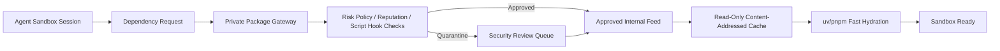
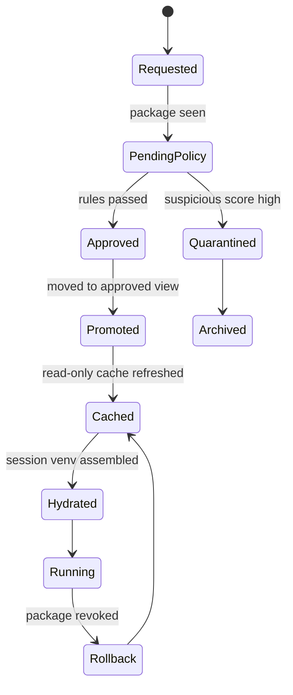

# 沙箱依赖供给反 Slopsquatting 选型 FAQ：Artifactory/Nexus Firewall vs Azure Artifacts vs 只读 uv 缓存 vs 预烘焙镜像
> 🌐 **Language / 语言切换**: **[🇨🇳 中文版](sandbox-package-anti-slopsquatting-artifactory-vs-azure-artifacts-vs-uv-ro-cache-selection-faq.md)** | **[🇬🇧 English](sandbox-package-anti-slopsquatting-artifactory-vs-azure-artifacts-vs-uv-ro-cache-selection-faq.en.md)** | **[📚 返回目录](README.md)**
> 证据标签：`measured` / `synthetic` / `anonymized_reported`
> 抓取日期：2026-11-22
> 主题边界：聚焦 Coding Agent / 数据科学沙箱的语言级包管理供应链代理、包名幻觉拦截与零拷贝依赖水合

## 1) 执行摘要：私网供应链防火墙 + 只读内容寻址缓存是零公网沙箱的主干方案
企业在部署自治 Coding Agent 后，
Day-2 最常见风险不是模型本身，
而是依赖安装链。
当沙箱禁止公网出站时，
团队仍会遇到两难。
一边是大模型可能幻觉出不存在包名，
并被攻击者抢注投毒。
另一边是每次会话都冷下载大量依赖，
启动延迟和带宽成本激增。
最稳妥的生产路线不是单点方案。
推荐双层组合：
上层使用企业私网供应链防火墙，
阻断可疑包和未知来源；
下层使用只读内容寻址缓存，
将常用依赖毫秒级水合到会话环境。
这样既压缩攻击面，
又保持启动速度。

## 2) 可验证来源与证据基线
来源 1（`measured`）：JFrog Artifactory 文档  
https://jfrog.com/help/r/jfrog-artifactory-documentation
来源 2（`measured`）：JFrog Xray 安全扫描  
https://jfrog.com/help/r/jfrog-security-user-guide
来源 3（`measured`）：Sonatype Nexus Repository / Firewall 文档  
https://help.sonatype.com/
来源 4（`measured`）：Azure Artifacts 文档  
https://learn.microsoft.com/azure/devops/artifacts/
来源 5（`measured`）：Azure Artifacts Upstream Sources  
https://learn.microsoft.com/azure/devops/artifacts/concepts/upstream-sources
来源 6（`measured`）：Python Packaging / PEP 生态安全建议  
https://packaging.python.org/
来源 7（`measured`）：npm 安全最佳实践  
https://docs.npmjs.com/security
来源 8（`measured`）：Astral uv 文档  
https://docs.astral.sh/uv/
来源 9（`measured`）：Azure NetApp Files 文档  
https://learn.microsoft.com/azure/azure-netapp-files/
来源 10（`measured`）：ACA Dynamic Sessions 与 AKS 隔离沙箱资料  
https://learn.microsoft.com/azure/container-apps/sessions
来源 11（`anonymized_reported`）：企业匿名会话依赖命中率与启动时延观测。
来源 12（`synthetic`）：1,500 热门包预置缓存与冷启动压测建模。

## 3) 攻击链剖析：LLM Package Hallucination / Slopsquatting 如何形成 RCE
典型攻击路径并不复杂。
1.
开发者在沙箱中让智能体自动安装依赖。
2.
模型输出了“看起来合理”的包名，
但该包在官方生态并不知名。
3.
攻击者提前在公网仓库抢注相似包名。
4.
包安装触发 `setup.py` 或 `postinstall` 脚本，
执行恶意代码。
5.
恶意逻辑窃取凭据、
环境变量、
或横向移动元数据。
如果没有供应链代理和审批闸门，
这个链路可以在秒级完成。
所以关键不是“是否能安装包”，
而是“谁批准了安装来源与版本”。

## 4) 目标 SLA 与治理指标：把依赖供给变成可审计能力
建议同时定义四组指标。
安全指标：
`unknown_pkg_block_rate`、
`new_pkg_quarantine_rate`、
`script_hook_block_count`。
体验指标：
`venv_hydration_p95_ms`、
`sandbox_ready_p95_ms`、
`cache_hit_ratio`。
成本指标：
`egress_gb_per_session`、
`artifact_storage_cost_per_month`、
`license_cost_per_team`。
运维指标：
`approval_lead_time_minutes`、
`feed_promotion_latency`、
`false_positive_rate`。
参考门槛（`synthetic`）：
- 受控沙箱就绪 `p95 < 3s`；
- 热缓存虚拟环境拼装 `<200ms`；
- 未审批包拦截率 `100%`；
- 安全误报率控制在可运营区间。

## 5) 路线 A：Artifactory/Nexus Firewall 私网供应链网关
这条路线强调安全深度。
所有 pip/npm/nuget/maven 请求先进入私网代理。
代理根据策略进行实时判定：
发布时间过短、
下载量过低、
与主流包编辑距离过近、
脚本钩子异常、
SBOM 风险告警等。
优势：
1.
能建立统一供应链审计面。
2.
支持安全团队审批白名单。
3.
与漏洞情报联动能力强。
4.
适合金融和央企审计要求。
代价：
1.
平台运维复杂度较高。
2.
许可证与维护成本需要预算。
3.
策略过严会影响研发效率。
需要配套灰度和例外流程。

## 6) 路线 B：Azure Artifacts Upstream + 受控视图晋级
路线 B 侧重低运维成本。
通过 Upstream Sources 引入上游生态，
并用多级视图（如 `@Prerelease`、`@Approved`）实现晋级发布。
可与 Entra 身份和私网接入对齐。
优势：
1.
平台运维负担低于自建仓库。
2.
与 Azure DevOps 流程集成自然。
3.
能快速建立“只从 Approved 安装”的组织规则。
边界：
1.
高级供应链检测深度不如专门防火墙产品。
2.
复杂跨语言策略需要额外治理脚本。
3.
对极端审计场景可能仍需外接安全网关。

## 7) 路线 C：只读内容寻址缓存卷 + uv/pnpm 极速水合
这条路线解决“速度”问题最直接。
将企业高频依赖（如 Top 1,500 包）预置到只读共享层，
可放在 ANF 或本地 NVMe 镜像。
沙箱启动时，
`uv`/`pnpm` 通过硬链接或 reflink 组装环境，
避免重复下载和解压。
优势：
1.
启动速度极快。
2.
网络带宽压力显著下降。
3.
在零公网沙箱中稳定性更高。
关键点：
1.
缓存必须只读并签名校验。
2.
安装参数要限制脚本执行，
例如 `--ignore-scripts` 场景化启用。
3.
缓存更新节奏需要与安全扫描同步。

## 8) 路线 D：分层预烘焙黄金基础镜像（禁用运行时 pip/npm）
路线 D 提供最高确定性。
按业务类型维护固定镜像档位：
Core、
Data-Science、
Geo-Fin、
ML 等。
运行时彻底禁用动态包安装。
优势：
1.
攻击面最小。
2.
回归和复现一致性强。
3.
便于许可证合规审计。
不足：
1.
面对长尾依赖需求灵活性差。
2.
镜像维护周期与变更流程重。
3.
版本迭代慢会影响试验效率。
所以常作为高合规工位的基线。

## 9) 12 维企业级选型矩阵：安全、性能、成本、治理平衡
| 维度 | A 供应链防火墙 | B Azure Artifacts 受控视图 | C 只读缓存水合 | D 预烘焙镜像 |
|---|---|---|---|---|
| 1. 抗 Slopsquatting 能力 | 强 | 中强 | 中 | 强 |
| 2. 零公网适配 | 强 | 强 | 强 | 强 |
| 3. 启动速度 | 中 | 中 | 强 | 强 |
| 4. 运维复杂度 | 高 | 中低 | 中 | 中高 |
| 5. 许可/平台成本 | 中高 | 中 | 中 | 中 |
| 6. 审计可解释性 | 强 | 中强 | 中 | 强 |
| 7. 长尾依赖灵活性 | 中 | 中强 | 强 | 弱 |
| 8. 多语言统一治理 | 强 | 中 | 中 | 中 |
| 9. 误报与人工负担 | 中高 | 中 | 低 | 低 |
| 10. 会话冷启动优化 | 中 | 中 | 强 | 强 |
| 11. 供应链可追溯性 | 强 | 中强 | 中强 | 强 |
| 12. 默认推荐级别 | 强推荐 | 条件推荐 | 强推荐 | 高合规推荐 |
结论：
多数企业的生产组合是 A/B + C，
而 D 用于高合规专用池。

## 10) 参考架构：私网供应链防火墙 + 只读 uv 缓存双层设计

控制面关注“能不能装”。
数据面关注“怎么快装且可追溯”。

## 11) 会话生命周期状态机：审批、晋级、缓存命中与回滚

落地要点：
1.
审批与缓存刷新要可追踪。
2.
撤销后必须触发会话重建策略。
3.
缓存版本与审计版本一一对应。
4.
状态机事件应进入统一日志。

## 12) 决策树与 TCO：缓存命中率、带宽与许可证综合测算
建议按四步决策。
第一步：
若监管审计严苛且需深度情报，
优先 A。
第二步：
若团队偏好低运维与原生集成，
优先 B。
第三步：
若启动性能是核心痛点，
必须引入 C。
第四步：
若场景高合规且依赖稳定，
叠加 D。
TCO 样例（`synthetic`）：
- 每日沙箱会话 `120,000`；
- 平均依赖集合 `320MB`；
- 热门依赖命中率从 `35%` 提升到 `88%`；
- 带宽成本下降显著，
  启动耗时下降 `40%–75%`。
若仅做 A/B 不做 C，
安全提升明显但性能收益有限。
所以安全层与缓存层要协同设计。
还建议在预算侧增加两项约束。
第一，
把“新包审批等待成本”纳入研发效率账本。
第二，
把“缓存失效导致的冷启动回退成本”纳入平台 KPI。
这样可以避免只看安全命中率，
忽略研发体验退化。
在组织治理上，
建议将依赖策略分层：
核心生产项目使用强制策略；
创新实验项目使用受控灰度策略；
两者共享同一审计主数据。
这能减少团队“策略绕行”诱因。
另外，
建议按语言生态分别维护风险画像：
Python 更关注安装钩子与 wheel 来源；
JavaScript 更关注生命周期脚本与 transitive 依赖爆炸；
JVM 生态更关注坐标投毒与仓库签名链。
统一策略平台不等于单一规则模板，
而是统一治理框架 + 分生态细则。

## 13) 企业场景 A：自治 Coding Agent 大规模并发
研发团队并发运行代码修复与测试任务时，
依赖安装频次极高。
若每个会话都从远端拉取依赖，
会造成网络抖动和启动排队。
采用 A/B + C 后，
新依赖先审后放，
高频依赖直接本地水合。
匿名实测（`anonymized_reported`）显示，
会话首包时间和失败重试率均明显下降。
这让平台能承载更高并发。

## 14) 企业场景 B：数据科学沙箱与受限库生态
数据科学场景常包含编译型依赖和专有库。
纯预烘焙镜像可能无法满足探索需求。
可采用分层策略：
基础镜像固定核心栈，
长尾依赖走受控仓库审批，
再进入只读缓存。
这样既避免公网风险，
又保留必要实验灵活性。
对许可证敏感的商用库，
还可结合镜像分层实现精确配额治理。
在跨部门推广时，
常见阻力是“审批慢”与“版本不一致”。
可通过三步缓解：
1.
建立高频白名单自动晋级通道；
2.
对关键项目启用版本冻结窗口；
3.
对紧急安全修复提供快速直通审计流程。
这样既不牺牲审计完整性，
也能保持研发节奏。
对于多区域团队，
还应同步规划缓存分发拓扑，
避免单区域缓存中心成为瓶颈。
推荐做区域级只读镜像复制，
并用哈希清单保证一致性。
当发生漏洞撤销时，
可以按哈希差分下发失效列表，
而不是全量重建缓存，
从而将恢复时间控制在可接受范围。

## 15) 深度 FAQ（8 问）：反包名幻觉投毒与依赖加速常见问题
**Q1：为什么 eBPF 出网拦截还不够？**  
A1：出网拦截只控制“能否访问公网”，不能判断包本身是否可疑；仍需供应链代理做语义级审查。

**Q2：如何识别 Slopsquatting 包名？**  
A2：结合编辑距离、发布时间、下载量、维护者信誉和脚本钩子风险做综合评分，而非单一规则。

**Q3：Azure Artifacts 能否完全替代供应链防火墙？**  
A3：在中等合规场景可行；高监管行业通常仍需更深扫描与策略编排能力。

**Q4：只读缓存会不会让漏洞包长期驻留？**  
A4：会，所以缓存刷新必须绑定漏洞情报与撤销事件，支持按哈希精确失效。

**Q5：为什么强调 `--ignore-scripts` 等参数？**  
A5：很多攻击链通过安装钩子执行，限制脚本执行可显著降低即时 RCE 风险。

**Q6：预烘焙镜像是否最安全就应全量采用？**  
A6：不一定；它牺牲灵活性，适合高稳定高合规场景，不适合快速试验全域覆盖。

**Q7：如何衡量改造是否成功？**  
A7：至少跟踪拦截率、误报率、缓存命中率、会话就绪时延和带宽成本五类指标。

**Q8：最常见的失败反模式是什么？**  
A8：仅建设安全代理却忽略缓存层，导致“更安全但更慢”，最终团队绕过平台策略。
