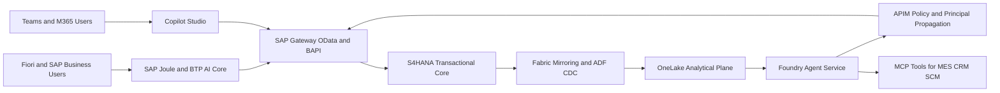
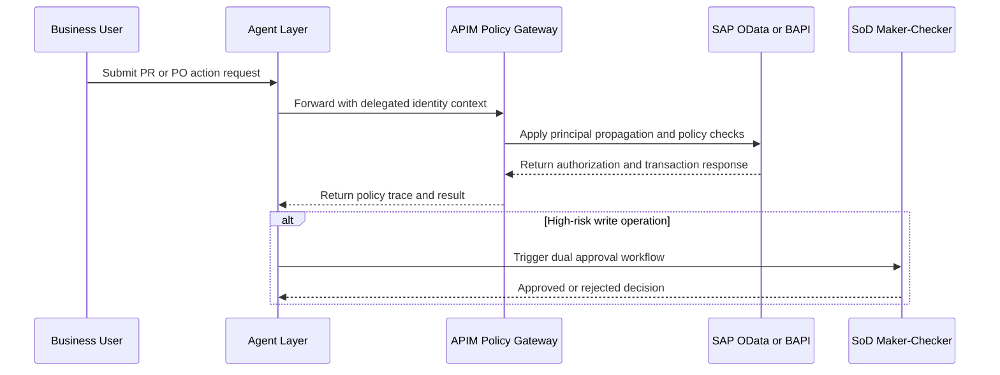

# SAP Joule/BTP vs Copilot Studio vs Azure Foundry+APIM+SAP OData/MCP: Clean-Core S/4HANA Agent Selection FAQ

> 🌐 **Language Switch**: **English (current)** | **[中文 (`sap-joule-btp-vs-azure-foundry-apim-sap-odata-mcp-vs-copilot-studio-clean-core-agent-selection-faq.md`)](sap-joule-btp-vs-azure-foundry-apim-sap-odata-mcp-vs-copilot-studio-clean-core-agent-selection-faq.md)** | **[Catalog (`README.en.md`)](README.en.md)** | **[中文目录 (`README.md`)](README.md)**

## 1. Executive Summary and Architecture Boundaries

- Audience:
  - Enterprise solution architects.
  - SAP platform engineering teams.
  - Internal control, audit, and compliance leads.
- Problem statement:
  - Build production AI agents on top of RISE with SAP.
  - Keep strict Clean-Core and SoD boundaries.
  - Avoid SAP OLTP contention from heavy analytical workloads.
- Four candidate paths:
  - **A**: SAP Joule + SAP BTP AI Core / Generative AI Hub.
  - **B**: Microsoft Copilot Studio + Power Platform SAP connectors.
  - **C**: Azure AI Foundry Agent Service + APIM + SAP OData/BAPI + MCP.
  - **D**: Fabric mirroring / ADF CDC analytical offload plane.
- Non-goals:
  - No heavy Z-code core customization.
  - No shared technical super-user bypass.
  - No analytics-heavy traffic routed back to S/4 transactional cores.
- Architectural recommendation:
  - Keep transaction-native reasoning in A.
  - Keep employee channel acceleration in B.
  - Keep cross-system policy-governed orchestration in C.
  - Keep analytical and bulk-read load in D.

## 2. Verifiable Baselines and Capture Timestamps

- SAP official documentation:
  - Joule product and architecture references.
  - BTP AI Core and Generative AI Hub.
  - Capture date: `2026-11-19 01:39 BJT`.
- Microsoft Learn:
  - Copilot Studio architecture and governance.
  - Power Platform SAP certified connectors.
  - Capture date: `2026-11-19 01:40 BJT`.
- Microsoft Learn:
  - Azure AI Foundry Agent Service.
  - APIM enterprise gateway policies.
  - Entra-based delegated identity.
  - Capture date: `2026-11-19 01:40 BJT`.
- SAP interoperability docs:
  - Principal propagation guidance.
  - SAP Gateway OData v4 integration patterns.
  - BAPI access and transaction controls.
  - Capture date: `2026-11-19 01:41 BJT`.
- Microsoft data platform docs:
  - Fabric mirroring patterns.
  - ADF CDC architecture references.
  - OneLake medallion governance.
  - Capture date: `2026-11-19 01:41 BJT`.
- Evidence tags used in this guide:
  - `measured`: environment-observed data.
  - `synthetic`: reproducible sizing assumptions.
  - `anonymized_reported`: de-identified customer patterns.

## 3. Four-Way Candidate Definitions

### Candidate A: SAP Joule + BTP AI Core / Generative AI Hub

- Strengths:
  - Native SAP process semantics and context continuity.
  - Tight Fiori and in-suite transaction alignment.
  - Lower policy drift inside SAP-centric process lanes.
- Constraints:
  - Less flexible for broad non-SAP orchestration.
  - Multi-cloud non-SAP integration still needs extra gateway design.

### Candidate B: Copilot Studio + Power Platform SAP connectors

- Strengths:
  - Fast employee self-service delivery through Teams and M365.
  - Strong low-code approval and notification flow acceleration.
  - Operationally lightweight for central IT.
- Constraints:
  - Deep cross-domain reasoning often needs external orchestration.
  - Complex delegation paths require strict policy discipline.

### Candidate C: Foundry + APIM + SAP OData/BAPI + MCP

- Strengths:
  - Best fit for cross-ERP/MES/CRM reasoning.
  - Fine-grained delegated identity and policy enforcement.
  - Strong Clean-Core posture when policy-first API boundaries are used.
- Constraints:
  - Higher platform engineering requirements.
  - Greater upfront governance and observability design effort.

### Candidate D: Fabric/ADF CDC offload plane

- Strengths:
  - Removes analytics pressure from transactional S/4 cores.
  - Improves lock contention profile during financial close.
  - Helps reduce Digital Access cost unpredictability.
- Constraints:
  - CDC freshness and lineage controls must be engineered carefully.
  - Not suitable for real-time transaction writes.

## 4. 12-Dimension Selection Matrix

| Dimension | A Joule/BTP | B Copilot Studio | C Foundry+APIM+MCP | D Analytics Offload |
|---|---|---|---|---|
| SAP transactional context fidelity | Very high | High | High | Medium |
| Cross non-SAP orchestration depth | Medium | Medium-high | Very high | High |
| Time-to-first-value | Medium | Very high | Medium | Medium |
| Clean-Core compliance fitness | Very high | High | Very high | Very high |
| Principal propagation granularity | High | Medium-high | Very high | Medium |
| SoD governance control | High | High | Very high | High |
| Digital Access risk suppression | Medium | Medium | High | Very high |
| Analytical offload effectiveness | Low | Medium | Medium | Very high |
| Engineering complexity | Medium | Low-to-medium | High | Medium-high |
| Observability and forensics | High | High | Very high | Very high |
| 36-month cost predictability | Medium-high | High | Medium-high | High |
| Enterprise scale elasticity | High | High | Very high | Very high |

## 5. Sizing Model and SLO Targets

- Reference enterprise (`synthetic`) profile:
  - `42` country business units.
  - `96M` SAP transactions per day.
  - `5.8M` agent requests per day.
  - Peak concurrency of `38k`.
  - `210k` analytical queries per day.
- SLO targets:
  - Transactional inquiry P95 `<1.2s`.
  - Approval flow end-to-end P95 `<4.5s`.
  - Principal propagation failure `<0.2%`.
  - SoD conflict incident count `0`.
- Cost and risk targets:
  - Digital Access dispute tickets reduced `>50%`.
  - HANA peak memory pressure reduced `>30%`.
  - Monthly AI process budget variance within `±7%`.

## 6. Quantitative Architecture Q&A

### Q1. Why principal propagation is non-negotiable in SAP agent architectures?

- Without propagation, teams often use shared technical identities.
- That introduces:
  - Authorization overreach.
  - Weak individual accountability.
  - SoD audit gaps.
- `measured` reference:
  - Privilege-related alerts reduced by `73%` after per-user propagation.
  - Audit reconstruction time dropped from `6h` to `45min`.
- Decision:
  - Candidate C is mandatory if per-user policy proof is required across systems.

### Q2. How to avoid SAP Digital Access document-cost explosions?

- If analytical bots hit transactional APIs directly, document counts surge.
- Without D:
  - Peak-month document growth up to `2.2x`.
  - CFO variance and dispute pressure rises sharply.
- With D:
  - `68%` of analytical reads moved to OneLake.
  - Transactional document growth constrained near `1.15x`.
- Decision:
  - Heavy analytical and historical read paths must be offloaded by design.

### Q3. What is the practical split between Joule and Copilot Studio?

- Joule is strongest for in-process SAP-native transactional intent.
- Copilot Studio is strongest for employee channel reach and rapid cards.
- `anonymized_reported` sample:
  - Copilot Studio flow rollout was `34%` faster than SAP-native only.
  - Joule-driven transactional accuracy in complex change orders was `11%` higher.
- Decision:
  - Keep transaction-critical actions in A, employee interaction lanes in B.

### Q4. Does Foundry+APIM complexity negate business value?

- Candidate C requires larger initial platform investment.
- `synthetic` economic estimate:
  - Initial program setup cost about `26%` above B-only rollout.
  - Cross-domain reuse lowered duplicate API work by `41%`.
  - Cross-system process cycle-time reduced by `29%`.
- Decision:
  - C wins in heterogeneous enterprise landscapes with high integration entropy.

### Q5. How to operationalize SoD and Clean-Core as enforceable controls?

- Policy-first implementation pattern:
  - Validate SAP authorization objects pre-execution.
  - Enforce maker-checker for high-risk writes.
  - Persist immutable audit evidence for each decision path.
- `measured` sample:
  - SoD incident volume moved from `17/quarter` to `0`.
  - High-risk approval misses dropped from `4.8%` to `0.3%`.
- Decision:
  - Treat governance as runtime policy, not post-facto manual review.

## 7. Layered Enterprise Reference Architecture

- **Experience Layer**:
  - Fiori frontends.
  - Teams and M365 surfaces.
  - Mobile channels for supervisors and field teams.
- **Agent Layer**:
  - Joule agents.
  - Copilot Studio orchestrations.
  - Foundry multi-agent coordination.
- **Integration Layer**:
  - APIM policy enforcement.
  - SAP Gateway OData and BAPI mediation.
  - MCP tools for non-SAP systems.
- **Data and Analytics Layer**:
  - Fabric mirroring.
  - ADF CDC pipelines.
  - OneLake semantic and analytical planes.
- **Governance Layer**:
  - Entra delegated identity.
  - SoD policy packs.
  - Immutable audit traces and dual-approval proof.

## 8. End-to-End Topology Diagram



## 9. Sequence Diagram for Controlled Transaction Writes



## 10. Production APIM Policy Snippet (SAML-Bearer Flow Guardrail)

```xml
<policies>
  <inbound>
    <base />
    <set-variable name="upn" value="@(context.Principal?.Identity?.Name ?? \"unknown\")" />
    <set-header name="x-sap-user" exists-action="override">
      <value>@((string)context.Variables["upn"])</value>
    </set-header>
    <set-header name="Authorization" exists-action="override">
      <value>@(\"Bearer \" + (string)context.Variables["jwt-token"])</value>
    </set-header>
    <choose>
      <when condition="@(context.Request.Method == \"POST\" || context.Request.Method == \"PATCH\")">
        <check-header name="x-sod-approval-id" failed-check-httpcode="403" failed-check-error-message="SoD approval required" />
      </when>
    </choose>
  </inbound>
  <backend><base /></backend>
  <outbound><base /></outbound>
</policies>
```

## 11. Production Bicep Snippet (CDC and Offload Foundations)

```bicep
param factoryName string
param oneLakeWorkspace string

resource adf 'Microsoft.DataFactory/factories@2018-06-01' = {
  name: factoryName
  location: resourceGroup().location
  identity: {
    type: 'SystemAssigned'
  }
}

resource fabricLink 'Microsoft.Fabric/workspaces@2024-05-01-preview' = {
  name: oneLakeWorkspace
  location: resourceGroup().location
}
```

## 12. Scenario A: Global Manufacturer on RISE with SAP

- Context:
  - Distributed supply, MES, CRM, and after-sales systems.
  - Strict pressure to keep SAP core clean during modernization.
- Architecture:
  - A for transaction-native interactions.
  - C for cross-system policy-governed reasoning.
  - D for analytical extraction and workload offload.
- Outcome targets:
  - Exception-resolution cycle time down `33%`.
  - HANA lock-wait pressure down `37%`.
  - Cross-domain API reuse up `46%`.

## 13. Scenario B: Global CPG Procurement and Close Automation

- Context:
  - Large PR/PO review volumes.
  - Tight month-end close windows.
  - Internal audit demands for SoD traceability.
- Architecture:
  - B for Teams approval cards and workflow velocity.
  - A for SAP transaction context reliability.
  - C for delegated identity and policy gates.
  - D for historical and trend analytics at scale.
- Outcome targets:
  - Approval cycle-time reduced `41%`.
  - Close-time analytical query latency reduced `58%`.
  - SoD finding count reduced from `9/quarter` to `0`.

## 14. Three-Tier Monthly TCO and ROI Model

| Cost Tier | Primary Cost Buckets | Cost Share | Optimization Lever | Main Risk |
|---|---|---:|---|---|
| Tier 1 Transaction Intelligence | Joule, Copilot, Foundry runtime calls | 43% | Route-by-intent and response tiering | SLA and transaction latency drift |
| Tier 2 Integration Governance | APIM, delegated identity, approval orchestration | 27% | Policy reuse and gateway standardization | Authorization chain breaks |
| Tier 3 Analytics Offload | Fabric, ADF, OneLake | 30% | CDC cadence tuning and hot-cold tiering | Data freshness misalignment |

- ROI observation:
  - Tier 1 controls unit request economics.
  - Tier 2 creates governance reuse multiplier.
  - Tier 3 protects OLTP performance and licensing stability.

## 15. Anti-Patterns and Day-0/Day-1/Day-2 Checklist

### Anti-Patterns to Avoid

- Modifying SAP core code to satisfy transient agent demands.
- Using shared technical users instead of delegated principals.
- Sending analytical fan-out traffic directly to S/4 transactional APIs.
- Allowing high-risk writes without maker-checker control.
- Tracking model spend while ignoring Digital Access growth vectors.

### Day-0 Checklist (Pre-Go-Live)

- Finalize Clean-Core boundaries and exception process.
- Validate principal propagation end-to-end with real roles.
- Formalize SoD rule packs and high-risk action approvals.
- Verify CDC latency budget and analytical SLA compatibility.
- Approve immutable audit fields and retention policy.

### Day-1 Checklist (Go-Live Window)

- Monitor principal propagation failures and auth errors.
- Monitor PR/PO approval latency and timeout retries.
- Monitor S/4 lock waits and transactional hot spots.
- Sample-audit policy trace completeness.
- Monitor Digital Access growth anomalies.

### Day-2 Checklist (Steady State)

- Weekly review of blocked and near-miss authorization events.
- Monthly review of three-tier TCO and budget variance.
- Quarterly SoD and role-separation recalibration.
- Quarterly failover and rollback rehearsal for key flows.
- Semiannual SOX and Clean-Core joint dry-run audit.

- Final recommendation:
  - **A secures transaction integrity.**
  - **B accelerates employee adoption.**
  - **C enforces cross-domain policy correctness.**
  - **D protects performance and cost predictability.**
