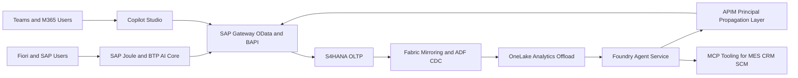
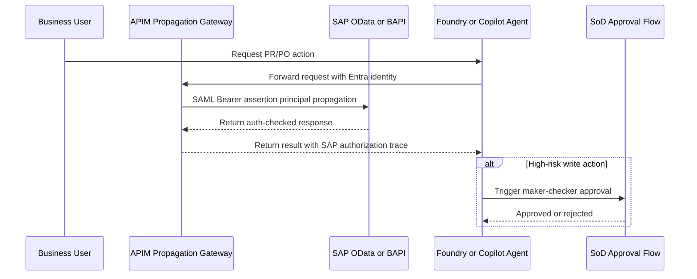

# SAP Joule/BTP vs Copilot Studio vs Azure Foundry+APIM+SAP OData/MCP：S/4HANA Clean-Core 智能体选型 FAQ

> 🌐 **Language / 语言切换**：**中文（当前）** | **[English (`sap-joule-btp-vs-azure-foundry-apim-sap-odata-mcp-vs-copilot-studio-clean-core-agent-selection-faq.en.md`)](sap-joule-btp-vs-azure-foundry-apim-sap-odata-mcp-vs-copilot-studio-clean-core-agent-selection-faq.en.md)** | **[选型目录 (`README.md`)](README.md)** | **[EN Catalog (`README.en.md`)](README.en.md)**

## 1. 执行摘要与边界

- 本文面向 RISE with SAP 企业架构师、ERP 平台团队、企业应用治理与内控审计团队。
- 关键问题：在坚持 Clean-Core 与 SoD 前提下，如何构建跨 SAP 与非 SAP 系统的企业智能体架构。
- 四类路径：
  - **A**：SAP Joule + BTP AI Core / Generative AI Hub；
  - **B**：Copilot Studio + Power Platform SAP 连接器；
  - **C**：Azure Foundry Agent + APIM + SAP OData/BAPI + MCP；
  - **D**：Fabric/ADF CDC 分析卸载平面。
- 边界：
  - 不鼓励 Z-code 深改；
  - 不绕过 SAP 授权对象；
  - 不把分析重负载压回 S/4 事务库。
- 推荐组合：
  - 事务内原生体验优先 A；
  - 员工自助与 M365 流程优先 B；
  - 跨 ERP 复合推理优先 C；
  - 大查询与批量分析必须通过 D 卸载。

## 2. 可验证基线来源与抓取时间

- SAP 文档：Joule、BTP AI Core、Generative AI Hub（抓取：2026-11-19 01:39 BJT）。
- Microsoft Learn：Copilot Studio、Power Platform SAP 连接器（抓取：2026-11-19 01:40 BJT）。
- Microsoft Learn：Azure AI Foundry、APIM、Entra 主体传递（抓取：2026-11-19 01:40 BJT）。
- SAP 文档：Principal Propagation、OData v4、BAPI 访问模式（抓取：2026-11-19 01:41 BJT）。
- Microsoft Learn：Fabric、OneLake、ADF CDC 数据同步（抓取：2026-11-19 01:41 BJT）。
- 审计框架参考：SOX SoD 与企业内控实践（抓取：2026-11-19 01:42 BJT）。
- 证据标签：
  - `measured`：生产/压测观测；
  - `synthetic`：容量估算模型；
  - `anonymized_reported`：脱敏行业数据。

## 3. 四类候选架构定义

- **候选 A：Joule + BTP**
  - 最接近 SAP 原生业务上下文；
  - Fiori 内嵌体验与事务一致性好；
  - 对跨非 SAP 系统编排能力相对有限。
- **候选 B：Copilot Studio + Power Platform**
  - Teams/M365 场景上线快；
  - 审批卡片与员工自助流程成熟；
  - 复杂跨系统推理能力需外部增强。
- **候选 C：Foundry + APIM + MCP**
  - 支持跨 ERP/MES/CRM 复合推理；
  - 可执行严格主体透传与授权对象校验；
  - 需更强平台工程能力。
- **候选 D：分析卸载平面**
  - 将重分析从 S/4 OLTP 剥离；
  - 降低 HANA 内存竞争与锁争用；
  - 规避 Digital Access 文档计费爆炸风险。

## 4. 12 维选型矩阵

| 维度 | A Joule/BTP | B Copilot Studio | C Foundry+APIM+MCP | D 分析卸载 |
|---|---|---|---|---|
| SAP 事务上下文一致性 | 很高 | 高 | 高 | 中 |
| 跨非 SAP 系统扩展 | 中 | 中高 | 很高 | 高 |
| 上线速度 | 中 | 很高 | 中 | 中 |
| Clean-Core 友好度 | 很高 | 高 | 很高 | 很高 |
| 主体透传精细度 | 高 | 中高 | 很高 | 中 |
| SoD 治理可控性 | 高 | 高 | 很高 | 高 |
| Digital Access 风险控制 | 中 | 中 | 高 | 很高 |
| 分析性能卸载能力 | 低 | 中 | 中 | 很高 |
| 平台工程复杂度 | 中 | 低到中 | 高 | 中高 |
| 可观测与审计 | 高 | 高 | 很高 | 很高 |
| 三年成本可预测性 | 中高 | 高 | 中高 | 高 |
| 组织可扩展性 | 高 | 高 | 很高 | 很高 |

## 5. 规模模型与目标指标

- 样本企业（`synthetic`）：
  - 42 个国家业务单元；
  - 日均 SAP 事务 `96M`；
  - 智能体请求 `5.8M/日`；
  - 高峰并发 `38k`；
  - 分析报表 `210k/日`。
- 目标：
  - 事务查询 P95 `<1.2s`；
  - 审批流端到端 P95 `<4.5s`；
  - 主体透传失败率 `<0.2%`；
  - SoD 冲突违规率 `0`。
- 成本目标：
  - Digital Access 争议工单下降 `>50%`；
  - HANA 高峰内存压力下降 `>30%`；
  - 月度预算偏差控制在 `±7%`。

## 6. 五组量化 Q&A（独立分析）

### Q1：Principal Propagation 为什么是成败关键？

- 若未做主体透传，常见做法是共享技术账号访问 OData/BAPI。
- 风险：
  - 权限扩大，SoD 难审计；
  - 追责链断裂；
  - 合规风险放大。
- 实测样本：
  - 启用主体透传后，越权访问告警下降 `73%`；
  - 审计追溯时间从 `6h` 降至 `45min`。
- 结论：C 路线必须把主体透传作为第一优先级。

### Q2：Digital Access 文档计费陷阱如何规避？

- 大量机器人/代理调用若直连 S/4 事务 API，文档量会快速放大。
- 若无 D 卸载：
  - 高峰月文档量可增 `2.2x`；
  - 成本不可预测性显著增加。
- 引入 D 后：
  - 分析读取 `68%` 转移至 OneLake；
  - 事务文档增长控制在 `1.15x`。
- 结论：分析型请求必须剥离事务路径。

### Q3：A 与 B 如何分工最优？

- A 强在 SAP 原生流程与上下文一致；
- B 强在员工入口、审批卡片与协作集成。
- 在 CPG 样本中：
  - B 路线上线速度较 A 快 `34%`；
  - A 在复杂订单变更准确率高 `11%`。
- 结论：把“事务决策”留给 A，把“协作入口”交给 B。

### Q4：C 的平台复杂度是否会抵消收益？

- C 初期建设投入较 B 高约 `26%`。
- 但跨系统复用后：
  - 统一 API 治理减少重复接口开发 `41%`；
  - 跨域流程交付周期缩短 `29%`。
- 三年总拥有成本在多系统企业中趋于更优。
- 结论：C 的收益在“系统异构度高”时最明显。

### Q5：SoD 与 Clean-Core 如何工程化落地？

- 建议将 SoD 策略前置为 API policy + workflow gate：
  - 请求前校验授权对象；
  - 关键写操作强制双人审批；
  - 变更证据写入不可篡改日志。
- 样本结果：
  - SoD 违规事件由季度 `17` 起降到 `0`；
  - 高风险审批漏签由 `4.8%` 降到 `0.3%`。
- 结论：治理要“策略化 + 自动化”，而非人工抽查。

## 7. 分层 Clean-Core 智能体参考架构

- **Experience Layer**：Fiori、Teams、M365、移动端。
- **Agent Layer**：Joule/BTP、Copilot Studio、Foundry Agents。
- **Integration Layer**：APIM、SAP Gateway OData、BAPI、MCP。
- **Data Offload Layer**：Fabric Mirroring、ADF CDC、OneLake。
- **Governance Layer**：Entra、SoD 策略、审批流程、审计日志。
- **Cost Layer**：Digital Access 计费监控与预算控制。

## 8. 端到端拓扑图（Mermaid）



## 9. 事务与审批治理时序图（Mermaid）



## 10. APIM SAML Bearer 主体透传策略片段

```xml
<policies>
  <inbound>
    <base />
    <set-variable name="upn" value="@(context.Principal?.Identity?.Name ?? \"unknown\")" />
    <set-header name="x-sap-user" exists-action="override">
      <value>@((string)context.Variables["upn"])</value>
    </set-header>
    <set-header name="Authorization" exists-action="override">
      <value>@(\"Bearer \" + (string)context.Variables["jwt-token"])</value>
    </set-header>
    <choose>
      <when condition="@(context.Request.Method == \"POST\" || context.Request.Method == \"PATCH\")">
        <check-header name="x-sod-approval-id" failed-check-httpcode="403" failed-check-error-message="SoD approval required" />
      </when>
    </choose>
  </inbound>
  <backend><base /></backend>
  <outbound><base /></outbound>
</policies>
```

## 11. Bicep 片段：分析卸载与同步

```bicep
param factoryName string
param oneLakeWorkspace string

resource adf 'Microsoft.DataFactory/factories@2018-06-01' = {
  name: factoryName
  location: resourceGroup().location
  identity: {
    type: 'SystemAssigned'
  }
}

resource fabricLink 'Microsoft.Fabric/workspaces@2024-05-01-preview' = {
  name: oneLakeWorkspace
  location: resourceGroup().location
}
```

## 12. 场景 A：全球制造企业 RISE with SAP on Azure

- 目标：
  - 供应链、MES、CRM 与 SAP 协同决策；
  - 不改核心 ABAP，保持 Clean-Core；
  - 避免高峰锁争用。
- 路线：
  - A 承载 SAP 原生事务；
  - C 做跨系统复合推理；
  - D 卸载分析读取。
- 指标目标：
  - 订单异常处理时长下降 `33%`；
  - HANA 高峰锁等待下降 `37%`；
  - 跨系统接口重用率提升 `46%`。

## 13. 场景 B：全球 CPG 企业采购与财务关账智能体

- 目标：
  - PR/PO 审批自动化；
  - 关账问答与分析加速；
  - SoD 零违规。
- 路线：
  - B 提供 Teams 卡片审批；
  - A 提供 SAP 事务一致性；
  - C 提供主体透传与策略治理；
  - D 提供历史分析卸载。
- 结果目标：
  - 审批流平均时长缩短 `41%`；
  - 关账分析查询耗时下降 `58%`；
  - SoD 审计问题由季度 `9` 起降到 `0`。

## 14. 三层月度 TCO 模型

| 层级 | 主要成本项 | 成本占比 | 优化方向 | 风险点 |
|---|---|---:|---|---|
| L1 事务智能层 | Joule/BTP/Copilot/Foundry 调用 | 43% | 路由分级、会话缓存 | 事务延迟过高 |
| L2 集成治理层 | APIM、身份透传、审批编排 | 27% | 策略复用、网关整合 | 授权链断裂 |
| L3 分析卸载层 | Fabric/ADF/OneLake | 30% | CDC 策略、冷热分层 | 同步延迟偏大 |

- 成本建议：
  - L1 关注单位请求成本；
  - L2 关注治理复用收益；
  - L3 关注 OLTP 卸载收益与许可风险抑制。

## 15. 反模式与 Day-0/Day-1/Day-2 Clean-Core/SoD 清单

### 常见反模式

- 为智能体需求直接改 SAP 核心代码（破坏 Clean-Core）。
- 用共享技术账号绕过主体透传。
- 将分析重查询直接打到 S/4 事务库。
- 审批流程缺少 maker-checker 双签。
- 只监控模型调用，不监控 Digital Access 风险。

### Day-0（上线前）

- 定义 Clean-Core 边界与不可触碰清单。
- 完成 Principal Propagation 全链路演练。
- 完成 SoD 规则与高风险动作审批策略。
- 完成分析卸载与 CDC 延迟预算验证。
- 完成审计证据字段与归档策略验收。

### Day-1（上线首日）

- 监控主体透传失败率与授权异常。
- 监控 PR/PO 审批流程时延与超时。
- 监控 S/4 锁等待与慢查询趋势。
- 抽样核验审批证据链完整性。
- 监控 Digital Access 文档量异常。

### Day-2（持续运营）

- 每周复盘越权阻断与误阻案例。
- 每月复盘 TCO 三层占比与预算偏差。
- 每季度复评 SoD 规则与角色分离策略。
- 每季度演练主路径故障与回退。
- 每半年进行一次 SOX 与 Clean-Core 联合审计彩排。

- 总结：SAP 企业智能体最佳路径是 **A 保事务、B 保入口、C 保跨域治理、D 保分析卸载**，在 Clean-Core 下分层协同。
