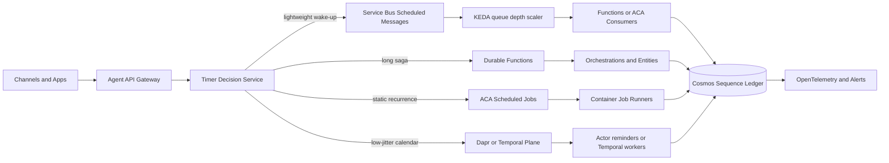
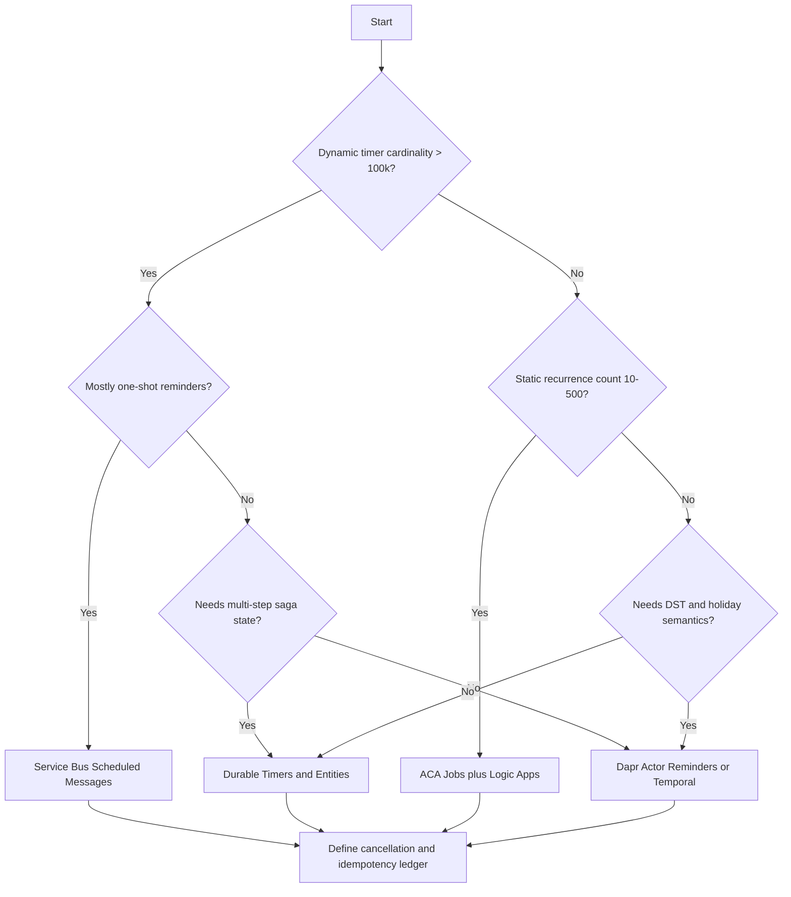

# Enterprise Scheduled Autonomous Agent Timers Selection FAQ: Service Bus Scheduled Messages vs Durable Timers/Entities vs ACA Jobs/Logic Apps vs Dapr Reminders/Temporal
> Audience: Cloud & AI Solution Architects, platform engineering, SRE, FinOps, and enterprise architecture councils.  
> Scope: autonomous patrols, cancellable nudges, per-user/per-deal dynamic wake-up timers, and timezone-aware morning briefing agents.  
> Goal: replace anti-patterns such as 50,000 Kubernetes CronJobs or minute-level SQL polling loops.
## 1. Decision Boundary: Are You Scheduling “Events” or “Long-Lived State Machines”
When teams build autonomous reminder features,
they often start with more CronJobs.
The second attempt is usually a SQL table scanned every minute.
Both paths may work at small scale.
Both paths degrade badly at enterprise cardinality.
CronJob explosion weakens control-plane operability.
Polling loops create constant noise and cost.
Cancellation and compensation semantics become fragile.
A practical architecture review starts with three questions.
- Is this mostly one-shot delayed delivery or multi-stage process state.  
- Is timer cardinality around `10^4`, `10^5`, or `10^6+`.  
- Do cancellation and reschedule operations require strict auditability.  
If the workload is high-cardinality lightweight wake-ups,
event-scheduling buses should lead.
If workflows span days or weeks with branching states,
orchestration engines should lead.
If recurrence is static and fleet-level,
job schedulers are usually sufficient.
If low jitter and calendar semantics dominate,
Actor/Temporal patterns become compelling.
## 2. Four Candidate Patterns and Practical Fit
Pattern 1 is Service Bus scheduled messages.
Its strength is large-scale lightweight delayed and cancellable triggers.
Pattern 2 is Durable Timers plus Durable Entities.
Its strength is deterministic long-running saga logic.
Pattern 3 is ACA Scheduled Jobs plus Logic Apps recurrence.
Its strength is coarse static schedule fleets with zero idle containers.
Pattern 4 is Dapr Actor reminders/workflows and Temporal schedules.
Its strength is low jitter timer sharding and rich calendar semantics.
For enterprise architecture,
these are not mutually exclusive endpoints.
Most production programs use at least two patterns.
For example:
Service Bus for massive reminders.
Durable for approval races and timeout branches.
ACA Jobs for tenant batch windows.
Dapr/Temporal for low-jitter calendar-heavy domains.
A common failure pattern is forcing everything into one engine.
That usually increases failure radius,
cost volatility,
and governance inconsistency.
## 3. Pattern 1: Service Bus `ScheduledEnqueueTimeUtc` + ACA/Functions Consumers
Pattern 1 is optimal for high-cardinality lightweight wake-ups.
You schedule a future message.
Consumers execute the agent action when it becomes visible.
Cancellation uses `SequenceNumber`.
No long-lived orchestration instance must stay hydrated.
No minute-level SQL scan is required.
Capacity behavior is cleanly separated.
The bus owns timer storage and delayed release.
Consumers own execution throughput.
KEDA queue-depth scaling aligns naturally with this model.
Strengths:
- Scales well for millions of delayed reminders.  
- Built-in DLQ, lock renewal, retry, and dead-letter diagnostics.  
- Clear cancellation path with sequence references.  
Limits:
- Complex business stage state needs external persistence.  
- Multi-step compensation must be designed at application layer.  
- Sequence-ledger consistency is critical for correctness.  
Recommended implementation:
maintain a Cosmos/SQL schedule ledger keyed by business id.
Store sequence number, planned fire time, and cancellation state.
Make cancellation idempotent.
Commit business-state transition and cancellation atomically where possible.
## 4. Pattern 2: Durable Functions Timers + Durable Entities
Pattern 2 is built for long-running stateful workflows.
Example:
wait up to 14 days for customer reply,
cancel timeout if reply arrives,
otherwise trigger escalation nudge.
Canonical implementation uses `Task.WhenAny(externalEvent, timer)`.
Race semantics are explicit and deterministic.
Durable Entities can own long-lived reminder windows.
They can track dedupe scope,
business-day skip state,
and retry budgets.
Strengths:
- Excellent fit for branch-heavy long-running saga logic.  
- Deterministic replay simplifies reliability analysis.  
- Native waiting on external signals is robust.  
Limits:
- Less economical than bus scheduling for huge short-lived timer sets.  
- Orchestration history lifecycle must be managed deliberately.  
- Team discipline is required for deterministic coding constraints.  
Recommended implementation:
reserve Durable for state-heavy long-horizon paths.
Avoid using it as a generic massive lightweight reminder queue.
## 5. Pattern 3: ACA Scheduled Jobs + Logic Apps Standard Stateful Recurrence
Pattern 3 is effective for static recurring workloads.
Typical examples:
hourly tenant patrol jobs,
daily team morning summaries,
weekly compliance sweeps.
ACA Scheduled Jobs run isolated container executions.
Jobs start on trigger and release compute on completion.
Idle compute can remain near zero.
Logic Apps Standard adds strong connector orchestration value.
Strengths:
- Good operational simplicity for `10–500` static cron schedules.  
- Clear execution isolation boundaries.  
- Strong enterprise integration surface via connectors.  
Limits:
- Not ideal for millions of per-user dynamic timers.  
- Cancellation/reschedule throughput is weaker than message scheduling.  
- High cardinality needs domain splitting to avoid hotspots.  
Recommended implementation:
use ACA/Logic Apps for static fleet schedules.
use Service Bus or Durable for dynamic per-entity timers.
## 6. Pattern 4: Dapr Actor Reminders / Workflows and Temporal Schedules
Pattern 4 fits low-jitter and portable workflow semantics.
Actor reminders naturally shard by actor key.
This supports high-cardinality distributed timer ownership.
Temporal schedules provide strong calendar semantics.
For example:
weekday 08:30,
skip local holidays,
auto-adjust with DST transitions.
Strengths:
- Jitter can be reduced to low-second or sub-second envelopes.  
- Calendar semantics are richer than simple cron patterns.  
- Workflow portability across environments is strong.  
Limits:
- Requires AKS or self-managed runtime competence.  
- Operational complexity is higher than managed bus/function paths.  
- Observability and reliability engineering maturity is required.  
Recommended implementation:
prefer this path when platform maturity is already high
and cross-cloud semantic portability is an explicit requirement.
## 7. End-to-End Dynamic Timer Scheduling/Cancellation/Jitter-Sharding Topology (Mermaid)

The architecture intent is layered specialization.
Each lane handles the timer shape it is best at.
This prevents engine overload and governance drift.
## 8. SA Decision Tree by Cardinality, Horizon, and Cancellation Semantics (Mermaid)

Run this decision flow before SKU sizing discussions.
It reduces redesign loops and clarifies responsibilities.
## 9. Code Example #1: Python Service Bus Schedule/Cancel with Cosmos Sequence Ledger
```python
from azure.servicebus import ServiceBusClient, ServiceBusMessage
from azure.cosmos import CosmosClient
from datetime import datetime, timezone, timedelta
import uuid

sb = ServiceBusClient.from_connection_string("Endpoint=sb://...;SharedAccessKeyName=...")
cosmos = CosmosClient("https://acct.documents.azure.com:443/", credential="...")
container = cosmos.get_database_client("agent").get_container_client("timer_ledger")

def schedule_wakeup(tenant_id: str, user_id: str, wake_after_min: int):
    dedupe_key = f"{tenant_id}:{user_id}:followup"
    payload = {"tenantId": tenant_id, "userId": user_id, "kind": "followup"}
    with sb.get_queue_sender("agent-wakeup") as sender:
        msg = ServiceBusMessage(
            body=str(payload),
            message_id=str(uuid.uuid4()),
            scheduled_enqueue_time_utc=datetime.now(timezone.utc) + timedelta(minutes=wake_after_min),
        )
        seq = sender.schedule_messages(msg, msg.scheduled_enqueue_time_utc)
    container.upsert_item({
        "id": dedupe_key,
        "pk": tenant_id,
        "sequenceNumber": int(seq),
        "status": "scheduled",
        "scheduledAtUtc": msg.scheduled_enqueue_time_utc.isoformat()
    })
    return int(seq)

def cancel_wakeup(tenant_id: str, user_id: str):
    dedupe_key = f"{tenant_id}:{user_id}:followup"
    doc = container.read_item(item=dedupe_key, partition_key=tenant_id)
    if doc["status"] == "cancelled":
        return "already-cancelled"
    with sb.get_queue_sender("agent-wakeup") as sender:
        sender.cancel_scheduled_messages(doc["sequenceNumber"])
    doc["status"] = "cancelled"
    doc["cancelledAtUtc"] = datetime.now(timezone.utc).isoformat()
    container.replace_item(item=doc["id"], body=doc)
    return "cancelled"
```
This example demonstrates three production controls.
Idempotent cancellation.
Business-key to sequence-number mapping.
Replayable audit state transitions.
## 10. Code Example #2: C# Durable `WhenAny` Reply-vs-Timeout Orchestrator
```csharp
[FunctionName("DealFollowUpOrchestrator")]
public static async Task Run(
    [OrchestrationTrigger] IDurableOrchestrationContext ctx)
{
    var input = ctx.GetInput<FollowUpInput>();
    DateTime deadline = ctx.CurrentUtcDateTime.AddDays(input.TimeoutDays);

    Task<string> replyTask = ctx.WaitForExternalEvent<string>("DealReplyReceived");
    Task timeoutTask = ctx.CreateTimer(deadline, CancellationToken.None);

    Task winner = await Task.WhenAny(replyTask, timeoutTask);
    if (winner == replyTask)
    {
        string reply = replyTask.Result;
        await ctx.CallActivityAsync("RecordReply", new { input.DealId, reply });
        return;
    }

    await ctx.CallActivityAsync("SendNudge", new { input.DealId, input.OwnerUpn });
    await ctx.CallActivityAsync("MarkEscalationNeeded", new { input.DealId });
}
```
The value here is deterministic race handling.
Reply and timeout branches are mutually exclusive by design.
This lowers duplicate-trigger risk under retry conditions.
## 11. 12-Dimension Selection Matrix
| Dimension | Service Bus Scheduled | Durable Timers/Entities | ACA Jobs + Logic Apps | Dapr Reminders / Temporal |
|---|---|---|---|---|
| 1. Dynamic timer cardinality | Very high | Medium-high | Low | Very high |
| 2. Cancellable nudge efficiency | High | High | Medium | High |
| 3. Multi-stage state orchestration | Low | Very high | Medium | High |
| 4. DST/holiday calendar semantics | Medium | Medium | Medium | Very high |
| 5. Jitter control capability | Medium-high | Medium | Medium | Very high |
| 6. Managed-service level | High | High | High | Medium |
| 7. Operational complexity | Low | Medium | Low-medium | High |
| 8. DLQ/retry governance | High | High | Medium | Medium-high |
| 9. Cost elasticity per million timers | High | Medium | Low-medium | Medium-high |
| 10. Audit traceability | High | Very high | High | Medium-high |
| 11. Team learning curve | Low | Medium | Low | High |
| 12. Cross-cloud semantic portability | Medium | Medium | Medium | High |
In real programs,
there is no universal single winner.
A dual-engine strategy is often the most stable outcome.
## 12. Quantitative Comparison: Max Timers, Jitter P95, Herd Protection, and Monthly TCO at 100K/5M
> Assumptions: same region, average payload 2KB, 2-8s post-fire execution window.  
> Units: max dynamic timers (count), jitter P95 (ms), herd-protection score (1-5), monthly TCO (USD).
| Pattern | Max dynamic timers | Jitter P95 | Herd protection score | 100K timer TCO | 5M timer TCO |
|---|---:|---:|---:|---:|---:|
| Service Bus Scheduled + Consumers | 5,000,000+ | 450 | 4.3 | 1,150 | 16,900 |
| Durable Timers + Entities | 600,000 | 900 | 4.0 | 1,680 | 44,200 |
| ACA Jobs + Logic Apps Recurrence | 120,000 (static) | 1,500 | 3.5 | 1,020 | 58,600 |
| Dapr Reminders / Temporal | 3,000,000+ | 180 | 4.6 | 2,450 | 24,700 |
Interpretation guidance:
if the objective is massive cancellable lightweight wake-ups,
Service Bus is usually the most cost-efficient backbone.
if the objective is long-horizon stateful compliance workflow,
Durable semantics often justify higher unit cost.
In mature programs, define two explicit SLOs:
one for on-time firing accuracy,
and one for cancellation effectiveness.
This prevents teams from optimizing only throughput metrics
while missing customer-facing false-notify impact.
For regulated workloads,
also track a “provably not fired” audit field
to support dispute handling with evidence.
## 13. Enterprise Scenario A: Investment-Deal Follow-Up Nudges with Cancellation
Workload traits:
each deal stage emits follow-up reminders.
once client replies,
pending nudges must be canceled immediately.
peak pressure concentrates in business-hour windows.
Recommended architecture:
Service Bus Scheduled as the primary lane.
Cosmos sequence ledger for deterministic cancel mapping.
Durable orchestration for branch-heavy stage escalation logic.
Outcome:
reminder noise and process state are decoupled cleanly.
cancellation correctness becomes auditable.
manual correction overhead drops materially.
## 14. Enterprise Scenario B: Global Timezone Morning Briefing + Autonomous Patrol
Workload traits:
users span many time zones.
holiday rules vary by region.
the same platform also runs hourly infrastructure patrols.
Recommended architecture:
static patrols on ACA Scheduled Jobs.
timezone morning briefings on Dapr/Temporal calendar schedules.
very high-cardinality lightweight nudges on Service Bus.
Outcome:
static and dynamic timer lanes are separated.
Kubernetes CronJob explosion is avoided.
timezone semantics and cost envelope stay predictable.
## 15. Day-0 / Day-2 Checklist and 8 Quantitative FAQs
### Day-0 (before production)
- Define dedupe keys and cancellation keys per business identity.  
- Classify timers into lightweight, long-saga, static-recurring, and low-jitter-calendar lanes.  
- Build sequence/instance ledger schema and retention policy.  
- Implement idempotent cancellation and duplicate-delivery handling.  
- Configure DLQ processing and alert routing.  
- Add jitter bucketing and exponential backoff for herd control.  
- Establish trusted timezone and holiday data sources.  
- Run baseline load tests at 100K and 1M timer scales.  
- Validate replay/recovery drills across day boundaries.  
- Apply cost tags and budget guardrails by tenant and lane.  
### Day-2 (operations)
- Review trigger jitter P95/P99 every week.  
- Audit cancellation success and false-notify rate weekly.  
- Review DLQ deltas and root causes weekly.  
- Track herd-protection effectiveness weekly.  
- Reconcile timezone/holiday data quality monthly.  
- Recompute 100K/5M cost deviations monthly.  
- Execute replay and recovery exercises monthly.  
- Re-evaluate primary/secondary engine boundaries quarterly.  
- Verify cross-region clock skew and NTP alignment quarterly.  
- Run quarterly “mass-cancel storm” drills and capture peak-smoothing effectiveness.  
- Re-check whether tenant budget guardrails still cover newly onboarded business domains each quarter.  
**Q1: Why not use 50,000 Kubernetes CronJobs directly**  
A1: Control-plane noise, weak cancellation semantics, and high operational burden emerge quickly at that scale.
**Q2: Is minute-level SQL polling acceptable for dynamic timers**  
A2: It is simple initially, but long-term it creates constant scan cost, lock contention, and unstable trigger latency.
**Q3: What is the default choice for cancellable high-cardinality nudges**  
A3: Service Bus scheduled messages with an idempotent sequence ledger is usually the strongest baseline.
**Q4: How do we model reply-vs-timeout races safely**  
A4: Durable `WhenAny(externalEvent, timer)` provides deterministic mutual exclusion semantics.
**Q5: Where should static tenant batch recurrences run**  
A5: ACA Scheduled Jobs with Logic Apps recurrence is usually the most balanced managed option.
**Q6: Which pattern fits strict low-jitter and complex calendar requirements**  
A6: Dapr reminders or Temporal schedules are typically the best fit.
**Q7: How do we prevent thundering-herd spikes at trigger time**  
A7: Use time-bucket sharding, randomized jitter, consumer concurrency caps, and partition-aware queueing.
**Q8: At 100K to 5M scale growth, what should be tuned first**  
A8: Tune scheduler partitioning and consumer concurrency first, then adjust execution-tier elasticity and budget thresholds.
For board-level reporting, keep a quarterly timer reliability dashboard.
Track tenant-segment variance instead of only global averages.
That exposes hidden hotspots before they become incident-level escalations.
