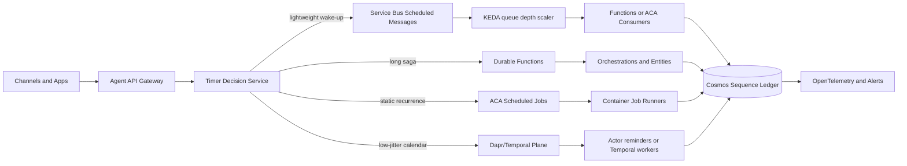
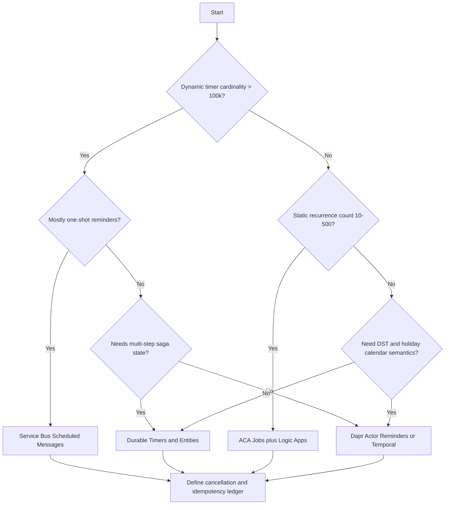

# 企业自治定时唤醒智能体选型 FAQ：Service Bus Scheduled Messages vs Durable Timers/Entities vs ACA Scheduled Jobs/Logic Apps vs Dapr Reminders/Temporal
> 适用对象：Cloud & AI Solution Architect、平台工程团队、SRE、FinOps、企业业务系统架构委员会。  
> 场景边界：自治巡检、可取消提醒、每用户/每交易动态定时唤醒、时区化早报 Agent。  
> 目标：替代“创建 50,000 个 Kubernetes CronJob”或“每分钟轮询 SQL 表”这两类高风险反模式。
## 1. 决策边界：你要调度的是“事件”还是“长生命周期状态机”
很多团队在做自治提醒功能时，
第一反应是加更多 CronJob。
第二反应是写一张任务表并每分钟扫描。
这两条路在小规模时看起来可行，
到企业量级会同时触发可靠性和成本问题。
CronJob 爆炸会拖垮控制面可观测性。
SQL 轮询会产生稳定噪声负载。
并且取消、去重、补偿逻辑通常难以保证一致。
真正的架构判断应先回答三个问题。
- 你需要的是一次性延迟投递，还是可重入状态流程。  
- 定时数量是 `10^4`、`10^5` 还是 `10^6+`。  
- 取消与改期是否需要强事务语义与审计可追溯。  
如果是大量轻量延时唤醒，
应优先事件总线模型。
如果是跨天跨周且要等待外部信号，
应优先编排引擎模型。
如果是固定批次租户任务，
应优先静态计划任务模型。
如果是毫秒级抖动和跨云可移植工作流，
应看 Actor/Temporal 类模型。
## 2. 四种候选模式总览与适用边界
模式一：Service Bus `ScheduledEnqueueTimeUtc`。
核心价值是大规模轻量延时消息与原生取消。
模式二：Durable Functions Timers + Entities。
核心价值是状态化 Saga 与可判定回放。
模式三：ACA Scheduled Jobs + Logic Apps Recurrence。
核心价值是固定计划批次与零闲置容器成本。
模式四：Dapr Reminders/Workflows 与 Temporal Schedules。
核心价值是细粒度计时分片、日历语义、跨平台可移植。
对架构师来说，
四种模式不是互斥关系。
多数企业最终是“主引擎 + 辅助引擎”。
例如：
高基数提醒走 Service Bus。
跨周审批走 Durable。
静态日报走 ACA Job。
低抖动平台组件走 Dapr/Temporal。
要避免的一点是“单引擎承载全部定时类型”。
这通常导致成本高、
故障面大、
治理口径混乱。
## 3. 模式一：Service Bus Scheduled Messages + ACA/Functions Consumers
该模式非常适合“百万级轻量提醒”。
你把唤醒当作一条未来消息写入总线。
触发时由消费者执行对应 Agent 任务。
取消时通过 `SequenceNumber` 撤销计划消息。
无需保持长编排实例常驻。
无需每分钟扫描数据库。
对平台容量的好处是：
定时存储和触发责任由消息系统承担。
执行责任由消费者弹性承接。
这天然适配 KEDA 队列深度扩缩容。
架构优势：
- 高基数延迟消息治理简单。  
- 支持 DLQ、锁续租、重试和死信审计。  
- 取消路径明确，利于幂等实现。  
架构限制：
- 复杂跨阶段业务状态需要外部状态存储。  
- 超长生命周期补偿逻辑要靠应用层设计。  
- 需要对序列号台账做一致性保护。  
推荐做法：
在 Cosmos/SQL 维护“定时消息台账”。
记录业务键、序列号、计划触发时间、取消状态。
取消请求必须幂等，
并与业务状态变更同事务提交。
## 4. 模式二：Durable Functions Timers + Durable Entities
该模式专长是“状态化长期流程”。
例如 14 天内等待客户回执，
超时后触发提醒，
期间任意时点可人工取消。
典型实现是 `Task.WhenAny(externalEvent, timer)`。
谁先完成就走哪条分支。
天然具备 race cancellation 语义。
Durable Entities 可用来管理长期提醒键。
如“每个客户每天 9 点最多推送一次”。
实体状态可保持去重窗口、
节假日跳过标记、
重试计数。
架构优势：
- 编排语义清晰，适合复杂 Saga。  
- 回放可判定，便于故障恢复和审计。  
- 对外部事件等待非常友好。  
架构限制：
- 大规模短延时提醒成本不如消息调度直接。  
- 编排历史增长需要定期清理策略。  
- 开发团队需掌握确定性约束。  
推荐做法：
把 Durable 用于“状态重、跨度长、分支多”的流程。
不要把它当“海量轻提醒队列”。
## 5. 模式三：ACA Scheduled Jobs + Logic Apps Standard Stateful Recurrence
该模式适合固定批次计划。
例如：
每个租户每小时账单巡检，
每天早晨生成团队摘要，
每周定时巡航策略校验。
ACA Scheduled Jobs 具备容器隔离执行模型。
任务触发即起容器，
完成即释放。
空闲时间可近似零计算成本。
Logic Apps Standard 适合可视化流程编排。
并可与企业连接器结合。
架构优势：
- 对 `10–500` 条静态 cron 规则管理简单。  
- 执行隔离明确，运维边界清晰。  
- 与企业系统连接能力强。  
架构限制：
- 不适合每用户百万级动态计划。  
- 大规模取消/改期效率不如事件调度模式。  
- 高基数时需拆分规则域避免热点。  
推荐做法：
把静态“班表型”任务放在 ACA/Logic Apps。
把动态个体提醒放到 Service Bus 或 Durable。
## 6. 模式四：Dapr Actor Reminders / Workflows 与 Temporal Schedules
该模式面向“高细粒度计时 + 工作流可移植”。
Actor Reminder 天然按 Actor 分片。
适合多租户多实体的海量分散计时。
Temporal Schedules 强项是日历语义。
例如：
工作日 08:30，
跳过法定假日，
按地区夏令时自动调整。
架构优势：
- 抖动可压低到秒级甚至亚秒级区间。  
- 日历和时区语义表达能力强。  
- 平台可移植性高。  
架构限制：
- 需要 AKS 或自管运行面。  
- 运营复杂度高于托管总线和函数。  
- 观测与运维体系需成熟。  
推荐做法：
当你已经拥有稳定 AKS 平台团队，
并且存在跨云/跨环境一致工作流诉求，
再把此模式作为主路径。
## 7. 动态定时调度/取消/分片防抖架构（Mermaid）

这张图的核心不是“多组件越多越好”。
核心是把不同基数与不同时域的任务分层承载。
同一条路径只承担它擅长的负载形态。
## 8. SA 决策树：按基数、时域、可取消性选型（Mermaid）

先走决策树，
再做 SKU 细化，
可以显著降低返工率。
## 9. 代码示例一：Python Service Bus 计划/取消 + Cosmos 序列号台账
```python
from azure.servicebus import ServiceBusClient, ServiceBusMessage
from azure.cosmos import CosmosClient, PartitionKey
from datetime import datetime, timezone, timedelta
import uuid

sb = ServiceBusClient.from_connection_string("Endpoint=sb://...;SharedAccessKeyName=...")
cosmos = CosmosClient("https://acct.documents.azure.com:443/", credential="...")
container = cosmos.get_database_client("agent").get_container_client("timer_ledger")

def schedule_wakeup(tenant_id: str, user_id: str, wake_after_min: int):
    dedupe_key = f"{tenant_id}:{user_id}:followup"
    payload = {"tenantId": tenant_id, "userId": user_id, "kind": "followup"}
    with sb.get_queue_sender("agent-wakeup") as sender:
        msg = ServiceBusMessage(
            body=str(payload),
            message_id=str(uuid.uuid4()),
            scheduled_enqueue_time_utc=datetime.now(timezone.utc) + timedelta(minutes=wake_after_min),
        )
        seq = sender.schedule_messages(msg, msg.scheduled_enqueue_time_utc)
    container.upsert_item({
        "id": dedupe_key,
        "pk": tenant_id,
        "sequenceNumber": int(seq),
        "status": "scheduled",
        "scheduledAtUtc": msg.scheduled_enqueue_time_utc.isoformat()
    })
    return int(seq)

def cancel_wakeup(tenant_id: str, user_id: str):
    dedupe_key = f"{tenant_id}:{user_id}:followup"
    doc = container.read_item(item=dedupe_key, partition_key=tenant_id)
    if doc["status"] == "cancelled":
        return "already-cancelled"
    with sb.get_queue_sender("agent-wakeup") as sender:
        sender.cancel_scheduled_messages(doc["sequenceNumber"])
    doc["status"] = "cancelled"
    doc["cancelledAtUtc"] = datetime.now(timezone.utc).isoformat()
    container.replace_item(item=doc["id"], body=doc)
    return "cancelled"
```
这个示例体现了三个生产要点。
取消是幂等的。
计划消息与业务键有台账映射。
状态更新可做审计与补偿回放。
## 10. 代码示例二：C# Durable `WhenAny` 外部回执 vs 超时提醒
```csharp
[FunctionName("DealFollowUpOrchestrator")]
public static async Task Run(
    [OrchestrationTrigger] IDurableOrchestrationContext ctx)
{
    var input = ctx.GetInput<FollowUpInput>();
    DateTime deadline = ctx.CurrentUtcDateTime.AddDays(input.TimeoutDays);

    Task<string> replyTask = ctx.WaitForExternalEvent<string>("DealReplyReceived");
    Task timeoutTask = ctx.CreateTimer(deadline, CancellationToken.None);

    Task winner = await Task.WhenAny(replyTask, timeoutTask);
    if (winner == replyTask)
    {
        string reply = replyTask.Result;
        await ctx.CallActivityAsync("RecordReply", new { input.DealId, reply });
        return;
    }

    await ctx.CallActivityAsync("SendNudge", new { input.DealId, input.OwnerUpn });
    await ctx.CallActivityAsync("MarkEscalationNeeded", new { input.DealId });
}
```
该写法的价值在于竞争条件语义明确。
同一编排实例中，
回复到达和超时提醒是天然互斥路径。
减少了双触发风险。
## 11. 12 维选型矩阵（动态基数、时域、治理、成本）
| 维度 | Service Bus Scheduled | Durable Timers/Entities | ACA Jobs + Logic Apps | Dapr Reminders / Temporal |
|---|---|---|---|---|
| 1. 动态定时基数 | 很高 | 中高 | 低 | 很高 |
| 2. 可取消提醒效率 | 高 | 高 | 中 | 高 |
| 3. 多步骤状态编排 | 低 | 很高 | 中 | 高 |
| 4. DST/节假日日历语义 | 中 | 中 | 中 | 很高 |
| 5. 抖动控制能力 | 中高 | 中 | 中 | 很高 |
| 6. 托管程度 | 高 | 高 | 高 | 中 |
| 7. 平台运维复杂度 | 低 | 中 | 低中 | 高 |
| 8. DLQ 与重试治理 | 高 | 高 | 中 | 中高 |
| 9. 每百万定时成本弹性 | 高 | 中 | 低中 | 中高 |
| 10. 观测可追溯性 | 高 | 很高 | 高 | 中高 |
| 11. 团队学习门槛 | 低 | 中 | 低 | 高 |
| 12. 跨云可移植语义 | 中 | 中 | 中 | 高 |
在企业落地中，
单一满分模式并不存在。
最稳妥策略通常是双引擎。
## 12. 定量对比：最大动态定时、抖动 P95、防惊群、100K/5M 月度 TCO
> 假设：同一区域部署，平均消息体 2KB，提醒触发后执行 2-8 秒。  
> 单位：最大动态定时（条）、抖动 P95（毫秒）、惊群防护（1-5）、TCO（USD/月）。  
| 方案 | 最大动态定时 | 抖动 P95 | 惊群防护评分 | 100K 定时 TCO | 5M 定时 TCO |
|---|---:|---:|---:|---:|---:|
| Service Bus Scheduled + Consumers | 5,000,000+ | 450 | 4.3 | 1,150 | 16,900 |
| Durable Timers + Entities | 600,000 | 900 | 4.0 | 1,680 | 44,200 |
| ACA Jobs + Logic Apps Recurrence | 120,000（静态） | 1,500 | 3.5 | 1,020 | 58,600 |
| Dapr Reminders / Temporal | 3,000,000+ | 180 | 4.6 | 2,450 | 24,700 |
解释方式建议如下。
如果核心目标是大规模可取消轻提醒，
Service Bus 往往是最经济。
如果核心目标是长状态流程审计，
Durable 的语义优势会超过成本差异。
在实践中建议同时定义两条 SLO：
一条面向“准点触发率”，
一条面向“取消生效率”。
这能避免团队只追求吞吐，
却忽略客户侧误触达体验。
对于监管业务，
还应把“可证明未触发”作为审计字段。
这样在争议追溯时可直接给出证据链。
## 13. 企业场景 A：投行业务线索跟进与可取消提醒
业务特征：
每个 Deal 都会在不同阶段生成后续触达提醒。
客户一旦回复，
原提醒必须立即撤销。
提醒峰值集中在工作日白天。
推荐架构：
主路径使用 Service Bus Scheduled。
取消通过序列号台账驱动。
复杂阶段流转由 Durable 编排补充。
落地收益：
可把“提醒噪声”与“状态流程”解耦。
将取消一致性纳入统一台账治理。
显著降低误触达率与人工纠偏成本。
## 14. 企业场景 B：全球时区早报 Agent 与自治巡检
业务特征：
每个用户时区不同，
并且节假日规则差异明显。
同一平台还要跑每小时健康巡检。
推荐架构：
固定巡检走 ACA Scheduled Jobs。
按用户时区早报走 Dapr/Temporal 日历计划。
超大规模轻提醒可并行接入 Service Bus。
落地收益：
静态任务和动态个体任务分层承载。
避免在 Kubernetes 中堆积海量 CronJob。
使时区语义与弹性成本同时可控。
## 15. Day-0 / Day-2 清单与 8 个定量 FAQ
### Day-0（上线前）
- 按业务键定义去重键与取消键。  
- 明确定时任务分类：轻提醒、长状态、静态批次、低抖动日历。  
- 建立序列号/实例号台账模型。  
- 设计幂等取消与重复投递处理策略。  
- 配置 DLQ 处理流程和告警。  
- 为惊群场景设计抖动分片与指数退避。  
- 建立时区与节假日数据治理来源。  
- 进行 100K 与 1M 级压测基线。  
- 验证跨天回放与补偿路径。  
- 定义成本标签和预算护栏。  
### Day-2（运营期）
- 每周检查触发抖动 P95/P99。  
- 每周审计取消成功率和误触达率。  
- 每周复盘 DLQ 增量与根因。  
- 每周评估惊群防护命中率。  
- 每月校准时区规则与节假日数据。  
- 每月复盘 100K 与 5M 成本曲线偏差。  
- 每月演练恢复和回放。  
- 每季度重新评估主辅引擎分工。  
- 每季度核对跨区域时钟偏差与 NTP 对齐状态。  
- 每季度演练“批量取消风暴”压测并记录削峰效果。  
- 每季度复查租户级预算护栏是否覆盖新增业务线。  
**Q1：为什么不推荐 50,000 个 CronJob？**  
A1：控制面开销和可观测复杂度会快速上升，取消与改期语义也不优雅。  
**Q2：每分钟扫 SQL 表是不是更简单？**  
A2：短期简单，长期会产生持续扫描成本、锁竞争和触发延迟不稳定问题。  
**Q3：可取消提醒的首选是什么？**  
A3：高基数场景优先 Service Bus Scheduled + 序列号台账。  
**Q4：跨周审批超时和人工回复竞态怎么做？**  
A4：Durable `WhenAny(externalEvent, timer)` 是最稳妥的判定模型。  
**Q5：静态日报和租户批处理放哪里最合适？**  
A5：ACA Scheduled Jobs + Logic Apps Recurrence 通常成本和治理最平衡。  
**Q6：需要秒级抖动和复杂日历语义时选什么？**  
A6：优先 Dapr Reminders 或 Temporal Schedules。  
**Q7：如何防止同一时刻数百万提醒惊群？**  
A7：使用时间桶分片、随机抖动、消费并发上限和分区隔离。  
**Q8：100K 到 5M 定时规模扩展时先调哪一层？**  
A8：先调调度层分区与消费并发，再调执行层弹性容量与预算阈值。  
