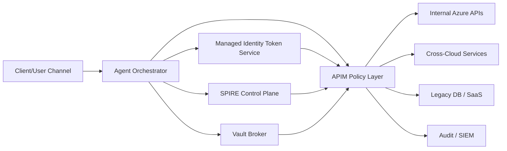
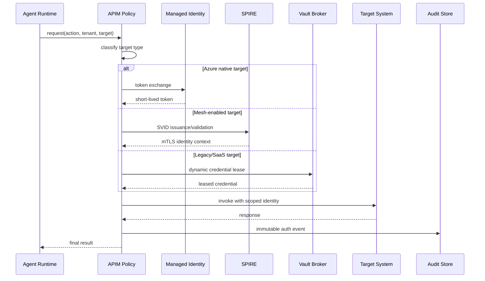

# Enterprise agent outbound secretless-auth selection FAQ: Managed Identity vs SPIFFE/SVID vs Vault Broker vs hybrid control plane

> **Scope**: enterprise Cloud & AI SA decisions for agent outbound access to APIs, databases, message buses, and SaaS under zero-trust constraints.  
> **Core trade-off**: eliminate static keys and passwords while preserving throughput, multi-tenant isolation, and legacy compatibility.

## 1. Why secretless outbound auth is a production boundary

In PoC environments,
teams often inject API keys via environment variables to accelerate integration.

At production scale,
that pattern introduces structural risk:

- Credentials leak through logs, traces, or debug dumps.
- Shared keys blur tenant boundaries and accountability.
- Rotation windows trigger outages and permission drift.

Agent platforms are more exposed than ordinary services.

They call more external tools,
follow dynamic execution paths,
and perform autonomous retries that amplify blast radius.

Secretless architecture therefore moves identity issuance to runtime,
instead of shipping long-lived credentials at build time.

## 2. Four enterprise patterns and fit boundaries

This guide compares four practical patterns:

- Pattern A: Azure Managed Identity + workload identity federation.
- Pattern B: SPIFFE/SPIRE with short-lived SVID and mTLS.
- Pattern C: Vault broker issuing dynamic leased credentials.
- Pattern D: hybrid control plane combining A/B/C by target class.

Selection cannot be based on cryptographic strength alone.

Enterprise SA evaluation also requires:

- control-plane complexity,
- integration compatibility,
- audit explainability,
- peak concurrency behavior,
- and failure rollback safety.

## 3. Pattern A: Managed Identity (fastest Azure-native path)

Pattern A is usually the shortest route inside Azure estates.

Typical flow:

- Agent runtime executes on ACA, AKS, or Functions.
- Runtime retrieves token via Managed Identity.
- Federated credentials extend trust to external OIDC integrations.
- Downstream APIs enforce least-privilege claims and scopes.

Strengths:

- No static secret material in application runtime.
- Native linkage with Entra audit and policy controls.
- Lower adoption friction for Microsoft-centric teams.

Constraints:

- Heterogeneous non-Azure targets often need adapters.
- Legacy systems may not accept modern token contracts.
- Fine-grained action authorization still needs policy overlays.

Recommended usage:

- Cover internal Azure APIs first.
- Route external SaaS through APIM normalization.
- Embed tenant boundary claims in every outbound token.

## 4. Pattern B: SPIFFE/SVID (best cross-cloud identity portability)

Pattern B standardizes workload identity across clusters and clouds.

Core mechanics:

- SPIRE issues short-lived workload SVID identities.
- Service-to-service communication uses mutual TLS.
- Identity is bound to runtime workload instance attestation.
- Authorization policy maps identity to allowed resource scopes.

Strengths:

- Strong portability across clouds and platforms.
- Lower dependence on cloud-specific token shape.
- Natural alignment with service-mesh ecosystems.

Constraints:

- Higher control-plane and certificate-lifecycle complexity.
- Requires platform engineering maturity in PKI operations.
- SaaS targets still need egress identity translation.

Recommended usage:

- Prioritize for multi-cluster and multi-cloud platform teams.
- Integrate with mesh observability and policy engines.
- Add secure egress bridge for non-mTLS endpoints.

## 5. Pattern C: Vault broker (best legacy-system compatibility)

Pattern C borrows credentials dynamically per request context.

Common capabilities:

- Dynamic DB user issuance with lease expiry.
- Temporary API token exchange.
- One-time certificate delivery.
- Automatic revocation and lease cleanup.

Strengths:

- Works with legacy estates that cannot quickly re-platform auth.
- Unifies key, cert, and dynamic-account lifecycle controls.
- Supports domain-level delegated operations and audit ownership.

Constraints:

- Introduces a high-value broker control plane.
- Broker availability and throughput become mission-critical.
- Policy misconfiguration can widen privilege exposure.

Recommended usage:

- Use where legacy databases and SaaS still require credential mediation.
- Enforce namespace isolation per tenant and domain.
- Define fail-safe behavior when broker is degraded.

## 6. Pattern D: hybrid control plane (enterprise steady-state)

Most large organizations converge on a hybrid model:

- Managed Identity for Azure-native targets.
- SPIFFE/SVID for mesh-oriented cross-cloud services.
- Vault broker for legacy and non-modern endpoints.

Critical success factors:

- Shared policy vocabulary for identity, action, resource, and tenant.
- Unified audit schema across all identity paths.
- Consistent fail-closed behavior on identity uncertainty.

Without governance unification,
hybrid becomes fragmented auth silos.

## 7. Reference topology across identity planes

Topology implications:

- Orchestrator stores no long-lived outbound secrets.
- APIM enforces normalized authorization gates.
- Three identity issuers coexist under one policy layer.
- Audit events must preserve tenant and action lineage.

## 8. Request and identity-exchange sequence boundary

Boundary rules:

- Never cache tenant context in reusable global token stores.
- Bind every lease or token to action digest and short expiry.
- Standardize deterministic error classes on exchange failures.

## 9. 12-dimension enterprise comparison matrix

| Dimension | A Managed Identity | B SPIFFE/SVID | C Vault Broker | D Hybrid Control Plane |
|---|---|---|---|---|
| Static-secret exposure risk | Very low | Very low | Low | Very low |
| Azure integration speed | Very high | Medium | Medium | High |
| Cross-cloud consistency | Medium | Very high | High | Very high |
| Legacy-system compatibility | Medium | Medium | Very high | Very high |
| Multi-tenant isolation clarity | High | High | High | Very high |
| Operations complexity | Medium | High | Medium to high | High |
| Audit explainability | High | High | High | Very high |
| Peak concurrency behavior | High | High | Medium to high | High |
| Failure rollback control | Medium | Medium | Medium | High |
| Team learning overhead | Low to medium | High | Medium | High |
| Compliance adaptation flexibility | Medium | High | High | Very high |
| Best-fit context | Azure-first enterprise | Multi-cloud platform | Legacy-heavy estate | Large federated enterprise |

## 10. Quantitative thresholds and TCO inflection

| Metric | A Managed Identity | B SPIFFE/SVID | C Vault Broker | D Hybrid |
|---|---:|---:|---:|---:|
| Added auth P95 latency | 35 ms | 50 ms | 70 ms | 58 ms |
| Manual credential-rotation effort per month | 18 h | 26 h | 22 h | 20 h |
| Identity-governance cost per 1,000 calls (USD) | 1.2 | 1.8 | 2.0 | 1.6 |
| Relative credential-leak exposure surface | 0.35x | 0.30x | 0.40x | 0.25x |
| Cross-system onboarding cycle time | 2.0 weeks | 3.5 weeks | 2.8 weeks | 3.0 weeks |

Assumptions:

- 1.8 million outbound calls per day.
- 12 target-system classes and 40 business domains.
- Combined platform + security staffing cost baseline.

Inflection guidance:

- If cross-cloud endpoints exceed 35%, SPIFFE value rises quickly.
- If legacy endpoints exceed 30%, Vault broker ROI improves.
- If domain-team count exceeds 20, hybrid usually minimizes risk-adjusted TCO.

## 11. Anti-patterns and corrective actions

Anti-pattern 1:
embedding long-lived API keys in agent containers.

Correction:
migrate to runtime identity exchange and block image-level secret injection.

Anti-pattern 2:
reusing one credential across tenants.

Mitigation:
bind token, cert, and lease to tenant claims plus resource scope.

Anti-pattern 3:
authenticating calls without recording authorization lineage.

Remedy:
log principal, delegation chain, action, target, and outcome per request.

Anti-pattern 4:
falling back to broad shared keys when broker fails.

Safer alternative:
fail closed or degrade to read-only mode under explicit policy.

## 12. Governance model and release cadence

Recommended four-party operating model:

- Platform engineering owns identity standards and SDK wrappers.
- Security owns policy review and incident response.
- Domain teams own action taxonomy and tenant boundaries.
- Compliance owns evidence sampling and regulator interfaces.

Release discipline:

- Weekly policy increments with replay validation.
- Monthly drift scan for permission boundary changes.
- Quarterly credential-leak simulation exercises.

Core operational KPIs:

- Dynamic-identity hit rate.
- Static-secret residual rate.
- Identity-exchange failure rate.
- Cross-tenant overreach block rate.
- Identity-governance unit cost.

## 13. Five-step implementation roadmap

Step 1: asset inventory.  
Enumerate outbound targets and current auth methods.

Step 2: target classification.  
Segment into Azure-native, cross-cloud mesh, and legacy targets.

Step 3: migrate high-risk paths first.  
Prioritize payment, customer-data, and admin-control endpoints.

Step 4: unify audit and alert streams.  
Consolidate identity events into one SIEM view.

Step 5: continuously reduce static-secret inventory.  
Set quarterly reduction goals and track as platform KPI.

## 14. Production readiness checklist

- [ ] Every outbound call is traceable to identity source.
- [ ] Static secrets removed from images and environment variables.
- [ ] Dynamic TTL, rotation, and revocation policies are testable.
- [ ] APIM policy enforces tenant boundary claims at ingress.
- [ ] Audit schema is normalized and tenant-queryable.
- [ ] Load tests include identity-plane jitter and peak bursts.
- [ ] DR drills validate fail-safe behavior without over-privilege.
- [ ] SOC alerting covers leakage and cross-tenant anomalies.

## 15. Field FAQ (8 questions)

**Q1: Can Managed Identity cover all outbound targets?**  
A1: No. It is ideal for Azure-native systems but needs complements for legacy and heterogeneous estates.

**Q2: Is SPIFFE/SVID too heavy for enterprise teams?**  
A2: It can be heavy for small single-cloud teams, but it pays off for multi-cloud and mesh-first platforms.

**Q3: Does Vault broker become a single point of risk?**  
A3: Yes, unless deployed HA with strict rate limits, fail-safe behavior, and operational drills.

**Q4: How should teams choose the first migration path?**  
A4: Use target composition: Azure-heavy starts with A, legacy-heavy starts with C, multi-cloud-heavy starts with B.

**Q5: Does hybrid always increase complexity?**  
A5: Operational complexity rises initially, but aggregate breach and overreach risk usually drops at enterprise scale.

**Q6: How do we prove business value of secretless migration?**  
A6: Track static-secret residual rate, credential incidents, overreach blocks, and audit pass metrics.

**Q7: Should outbound identity exchange failures retry automatically?**  
A7: Use bounded retries only; then fail fast into a controlled degradation path to prevent cascading outages.

**Q8: What if external SaaS does not support modern identity federation?**  
A8: Use APIM plus Vault broker mediation with least-privilege leasing instead of exposing master credentials.

