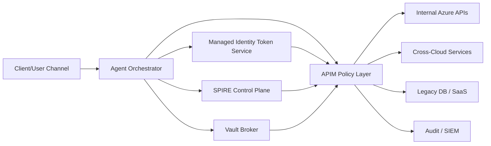
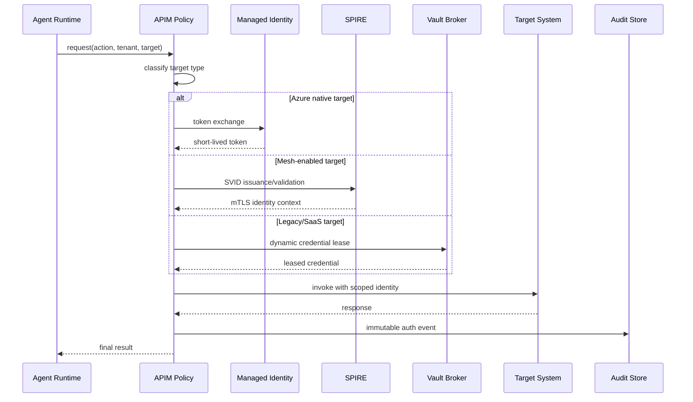

# 企业 Agent 出站“无密钥认证”选型 FAQ：Managed Identity vs SPIFFE/SVID vs Vault Broker vs 混合控制平面

> **定位**：企业 Cloud & AI SA 在推进智能体访问外部 API、数据库、消息系统、SaaS 时的零信任身份与凭据治理决策。  
> **核心矛盾**：既要杜绝 API Key/静态密码泄漏，又要保持高并发、多租户、跨云与遗留系统兼容能力。

## 1. 问题定义：为什么“无密钥”是 Agent 生产化分水岭

在 PoC 阶段，
很多团队会把第三方 API Key 放在环境变量中快速打通链路。

进入生产后，
这种做法会导致三个结构性风险：

- 凭据被日志、报错栈、调试快照意外暴露。
- 凭据共享导致租户边界与责任链混淆。
- 凭据轮转期间出现批量失败或权限漂移。

Agent 场景比传统服务更脆弱，
因为它天然连接更多外部工具，
调用路径更动态，
并且存在模型自动试错行为。

因此企业级架构必须把“密钥剥离”作为默认策略，
让身份在运行时动态签发，
而不是在构建期静态注入。

## 2. 四类企业方案与适用边界

本文比较四条主流落地路径：

- 方案 A：Azure Managed Identity + Workload Identity Federation。
- 方案 B：SPIFFE/SPIRE + SVID + Service Mesh mTLS。
- 方案 C：Vault Broker 动态短租凭据。
- 方案 D：混合控制平面（A/B/C 分层组合）。

架构师常见误区是只比较“安全性”。

实际选型要同时比较：

- 控制平面复杂度。
- 跨平台兼容能力。
- 审计可追溯性。
- 峰值并发表现。
- 故障回退可操作性。

## 3. 方案 A：Managed Identity（云原生路径最短）

该方案在 Azure 内部一致性最好。

典型流程：

- Agent 运行在 ACA/AKS/Functions 等托管环境。
- 运行时通过 Managed Identity 获取令牌。
- 使用 Federated Credentials 连接外部 OIDC 信任方。
- 下游服务按 `aud/scope/role` 做最小权限校验。

优点：

- 凭据不落地，减少密钥管理负担。
- 与 Entra 审计链天然集成。
- 团队上手曲线平缓。

限制：

- 面向非 Azure 生态时接入差异较大。
- 对历史系统改造依赖代理层。
- 细粒度“动作级授权”仍需额外策略层。

适用建议：

- 优先覆盖企业内部核心 API 与数据面。
- 对外部 SaaS 通过 APIM 中转实现能力收敛。
- 把租户边界声明写入令牌 claim，避免串租。

## 4. 方案 B：SPIFFE/SVID（跨平台身份统一）

该方案强调工作负载身份标准化，
适合混合云与多集群环境。

核心机制：

- SPIRE 颁发短时 SVID 身份。
- 服务间通过 mTLS 双向认证。
- 身份与工作负载实例强绑定。
- 访问策略按身份文档集中治理。

优点：

- 跨云与跨平台一致性强。
- 不依赖特定云厂商令牌格式。
- 对服务网格生态契合度高。

限制：

- 控制平面搭建与运维复杂。
- 团队需要掌握证书生命周期治理。
- 与 SaaS API 的直连常需额外桥接。

适用建议：

- 多云企业与平台团队优先考虑。
- 与 Istio/Linkerd 观测体系结合部署。
- 对非 mTLS 目标引入 egress 身份代理。

## 5. 方案 C：Vault Broker（遗留系统兼容最强）

该方案核心是“按需借出短租凭据”。

常见能力：

- 动态数据库账号签发。
- 临时 API Token 交换。
- 一次性会话证书下发。
- 自动吊销与到期回收。

优点：

- 对遗留系统友好，
  无需全面改造身份协议。
- 可以统一密钥、证书、动态账号生命周期。
- 便于按业务域实施分权托管。

限制：

- 引入新的高价值控制平面。
- Broker 可用性与性能成为关键依赖。
- 策略误配会放大权限泄漏半径。

适用建议：

- 对无法快速改造的老系统优先使用。
- 必须配合强审计与租户级命名空间隔离。
- 要有“Broker 不可用时的安全降级方案”。

## 6. 方案 D：混合控制平面（企业长期形态）

大多数大型企业最终会采用混合策略：

- Azure 内部服务优先 Managed Identity。
- 跨云服务网格采用 SPIFFE/SVID。
- 遗留数据库与第三方系统走 Vault Broker。

该模式关键成功点：

- 统一策略词汇表（身份、动作、资源、租户）。
- 统一审计事件格式（谁、何时、代表谁、做了什么）。
- 统一回退规则（身份异常默认拒绝）。

如果没有统一治理词汇，
混合架构会演变为“多套孤岛认证”。

## 7. 参考架构拓扑（多平面协同）

拓扑要点：

- 编排层不保存长期凭据。
- APIM 负责统一入/出站授权策略。
- 三类身份源并行存在但受统一策略约束。
- 审计层必须可追踪到租户与动作级别。

## 8. 请求与身份交换时序（边界流）

时序治理要点：

- 禁止把租户上下文留在可复用全局缓存。
- 任何凭据租约都要绑定动作摘要与过期时间。
- 身份交换失败统一返回可分诊错误码。

## 9. 12 维企业级对比矩阵

| 维度 | A Managed Identity | B SPIFFE/SVID | C Vault Broker | D 混合控制平面 |
|---|---|---|---|---|
| 密钥落地风险 | 很低 | 很低 | 低 | 很低 |
| Azure 集成速度 | 很高 | 中 | 中 | 高 |
| 跨云一致性 | 中 | 很高 | 高 | 很高 |
| 遗留系统兼容 | 中 | 中 | 很高 | 很高 |
| 多租户隔离清晰度 | 高 | 高 | 高 | 很高 |
| 运维复杂度 | 中 | 高 | 中到高 | 高 |
| 审计可解释性 | 高 | 高 | 高 | 很高 |
| 峰值并发表现 | 高 | 高 | 中到高 | 高 |
| 故障降级可控性 | 中 | 中 | 中 | 高 |
| 团队学习成本 | 低到中 | 高 | 中 | 高 |
| 合规适配灵活性 | 中 | 高 | 高 | 很高 |
| 推荐场景 | Azure 主场 | 多云平台 | 遗留改造 | 大型集团统一治理 |

## 10. 定量门槛：时延与 TCO 拐点

| 指标 | A Managed Identity | B SPIFFE/SVID | C Vault Broker | D 混合 |
|---|---:|---:|---:|---:|
| 认证额外 P95 时延 | 35 ms | 50 ms | 70 ms | 58 ms |
| 凭据轮转人工工时（月） | 18 h | 26 h | 22 h | 20 h |
| 每千次调用身份治理成本（美元） | 1.2 | 1.8 | 2.0 | 1.6 |
| 凭据泄漏暴露面（相对） | 0.35x | 0.30x | 0.40x | 0.25x |
| 跨系统接入周期（周） | 2.0 | 3.5 | 2.8 | 3.0 |

测算假设：

- 每日出站调用 180 万次。
- 涉及 12 类目标系统与 40 个业务域。
- 人工值守成本按平台与安全团队综合估算。

拐点判断：

- 当跨云目标占比 > 35% 时，SPIFFE 收益显著。
- 当遗留系统占比 > 30% 时，Vault Broker ROI 提升。
- 当组织规模 > 20 团队时，混合控制平面总体更优。

## 11. 反模式与治理修正

反模式一：
在 Agent 容器里保存长期 API Key。

修正动作：
全部迁移到运行时动态身份交换，
并禁用镜像内硬编码凭据。

反模式二：
把同一凭据跨租户复用。

改进动作：
令牌、证书、租约全部绑定租户声明与资源范围。

反模式三：
仅做认证不做授权审计。

缓解动作：
每次调用记录“主体、代理链、动作、资源、结果”。

反模式四：
Broker 不可用时直接放开兜底密钥。

替代动作：
默认拒绝或切换只读降级模式，绝不无条件放行。

## 12. 平台治理模型与发布节奏

建议建立“四方协作”：

- 平台团队：身份标准与 SDK 封装。
- 安全团队：策略评审与异常响应。
- 业务团队：动作分级与租户边界定义。
- 合规团队：证据抽样与外部审计对接。

发布节奏建议：

- 每周策略小版本发布与回放校验。
- 每月做一次跨域权限漂移巡检。
- 每季度执行一次“凭据泄漏演练”。

核心运营指标：

- 动态身份命中率。
- 静态凭据残留率。
- 身份交换失败率。
- 租户越权拦截率。
- 单位调用身份治理成本。

## 13. 五步落地路线图

第一步：资产梳理。  
识别所有出站目标与当前认证方式。

第二步：分层分类。  
按“Azure 原生 / 多云网格 / 遗留系统”三层归档。

第三步：先替换高风险路径。  
优先迁移资金、客户数据、管理面 API 调用。

第四步：统一审计与告警。  
把三类身份事件汇总到同一 SIEM 视图。

第五步：持续压缩静态凭据存量。  
设定季度目标并把残留率纳入平台 KPI。

## 14. 生产就绪检查清单

- [ ] 所有 Agent 出站调用均可追踪到身份来源。
- [ ] 静态凭据已从镜像与环境变量中清退。
- [ ] 动态凭据 TTL、轮转与吊销策略可验证。
- [ ] APIM/网关策略具备租户边界强制校验。
- [ ] 审计事件结构统一并可按租户检索。
- [ ] 压测覆盖身份服务抖动与峰值并发。
- [ ] 灾备演练验证“身份平面降级不越权”。
- [ ] 安全运营已配置泄漏与越权自动告警。

## 15. 实战 FAQ（8 问）

**Q1：Managed Identity 是否能覆盖全部场景？**  
A1：不能。它在 Azure 内最佳，但跨云与遗留系统仍需补充机制。

**Q2：SPIFFE/SVID 会不会太重？**  
A2：对单一云小团队偏重；对多云多集群平台则是长期收益项。

**Q3：Vault Broker 会不会成为单点风险？**  
A3：会，所以必须做高可用部署、限流与失败安全策略。

**Q4：如何选择先做哪一条？**  
A4：先看资产结构：Azure 原生优先 A，遗留占比高优先 C，多云占比高优先 B。

**Q5：混合方案会不会增加运维成本？**  
A5：短期会上升，但在多团队规模下可显著降低越权与泄漏总风险成本。

**Q6：怎么证明“无密钥”改造有价值？**  
A6：跟踪静态凭据残留率、泄漏事件、越权拦截率与审计通过率即可量化。

**Q7：身份交换失败时业务要不要重试？**  
A7：可做短重试，但超过阈值应快速失败并触发降级路径，避免雪崩。

**Q8：对外部 SaaS 无法改造身份协议怎么办？**  
A8：通过 APIM + Vault Broker 做代理签发与最小权限隔离，不直接暴露主凭据。

