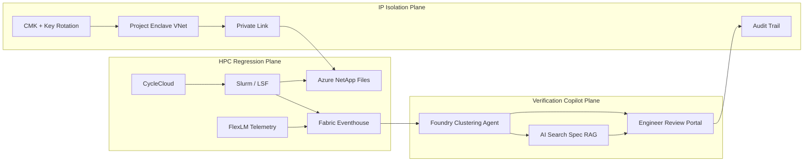
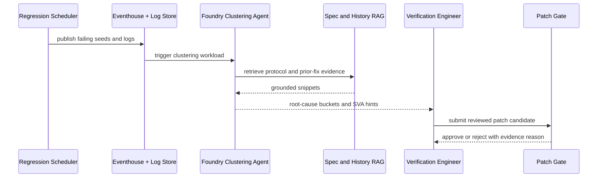

# Semiconductor EDA Verification Selection FAQ: CycleCloud + ANF Regression Plane vs Foundry Failure-Clustering Copilot vs PDK/IP Export-Control Clean Room
> 🌐 Language / 语言切换: [中文](semiconductor-eda-hpc-verification-copilot-azure-netapp-files-vs-cyclecloud-slurm-vs-foundry-ip-isolation-selection-faq.md) | **English (Current)** | [EN Catalog](README.en.md) | [中文目录](README.md)
> Audience: Semiconductor platform owners, EDA infrastructure architects, verification leads, IP compliance officers, security and legal governance teams  
> Updated: 2026-11-19 (UTC+08:00)  
> Evidence labels: `measured`, `synthetic`, `anonymized_reported`
---
## 1. Executive Summary
1. Modern semiconductor verification must optimize throughput, triage efficiency, and IP isolation at the same time.  
2. **CycleCloud (Slurm/LSF) + Azure NetApp Files + Fabric Eventhouse** is best for scalable nightly regression execution.  
3. **Azure AI Foundry failure clustering and SVA Copilot** is best for reducing thousands of failing seeds into actionable root causes.  
4. **PDK/VIP export-control clean-room enclaves** are best for EAR/ITAR and supplier-license boundary enforcement.  
5. The recommended model is a three-plane architecture: HPC execution, verification intelligence, and compliance isolation.  
6. Do not combine unrestricted logs, patch drafts, and restricted PDK indexes in one shared corpus.  
7. AI-generated patch suggestions must pass engineer gate review before repository integration.  
8. Commercial EDA license-token contention must be measured as a first-class scaling signal.  
---
## 2. Context and Hard Constraints
### 2.1 Current pressure profile
- UVM regression scale is expanding from thousands to tens of thousands of concurrent jobs.  
- Failure distributions are long-tailed, making manual triage cost-prohibitive.  
- FlexLM license contention often dominates peak-window bottlenecks.  
- Shared platform models increase cross-project PDK/IP leakage risk.  
- Global engineering teams operate under export-control obligations.  
### 2.2 Mandatory boundaries
- Restricted PDK decks and third-party VIP must never leak across projects.  
- Export-controlled data requires identity- and nationality-aware access control.  
- AI-generated fix proposals require auditable human approval.  
- License token allocation and recovery must be observable and accountable.  
- Root-cause narratives must remain reproducible for verification signoff.  
### 2.3 Explicit non-goals
- No fully autonomous RTL repair without engineer accountability.  
- No replacement of signoff toolchains with free-form AI outputs.  
- No cross-project retrieval over unclassified and unsegmented corpora.  
---
## 3. Option A: CycleCloud + Slurm/LSF + ANF + Eventhouse
### 3.1 Core capabilities
- Elastic HPC clusters for nightly and burst regression windows.  
- ANF shared storage with predictable throughput and reduced metadata hotspots.  
- Eventhouse telemetry for scheduler events, queue states, and runtime patterns.  
- Real-time FlexLM token utilization observability.  
- Queue-tiering for smoke, full, and signoff regressions.  
### 3.2 Best-fit situations
- Nightly regression scales from 10k to 50k jobs.  
- Fixed execution windows require deterministic completion probabilities.  
- Shared compute pools need project-level showback and capacity controls.  
### 3.3 Operational risks
- Poor queue policy design can amplify license starvation.  
- Log writes on critical NFS metadata paths can reduce simulation throughput.  
- Aggressive compute bursts without license planning waste capacity budget.  
---
## 4. Option B: Foundry Failure Clustering and SVA Copilot
### 4.1 Core capabilities
- Semantic clustering over failing-log corpora.  
- Seed-deduplication into root-cause buckets for engineering triage.  
- AMBA AXI/CHI and PCIe specification-grounded retrieval support.  
- Suggested SVA patterns and debug hypothesis generation.  
- Human-gated patch review workflow before merge.  
### 4.2 Best-fit situations
- Very high failing-seed volume with recurring fault signatures.  
- Teams needing faster first-root-cause turnaround.  
- Protocol-heavy integration paths with fragmented historical knowledge.  
### 4.3 Operational risks
- Low-quality logs reduce clustering signal quality.  
- Ungrounded responses can drift from design-specific standards.  
- Unreviewed automated patch output can inject hard-to-detect regressions.  
---
## 5. Option C: PDK/VIP Export-Control Clean-Room Isolation Plane
### 5.1 Core capabilities
- Project-compartment managed VNets and private endpoints.  
- CMK protection for high-sensitivity process and IP assets.  
- Entra RBAC with nationality/vendor-aware policy tags.  
- Dual-layer isolation at storage and index paths.  
- Immutable audit trails for access, export, and approval actions.  
### 5.2 Best-fit situations
- Multi-foundry PDK programs running in parallel.  
- EAR/ITAR and region-specific export-control obligations.  
- Third-party VIP licensing constrained by project scope and legal entity.  
### 5.3 Operational risks
- Incomplete identity tagging creates policy bypass opportunities.  
- Shared index misconfiguration can create latent cross-project leakage.  
- Weak key rotation and revocation governance weakens compliance defensibility.  
---
## 6. Recommended Architecture: Throughput + Intelligence + Isolation
### 6.1 HPC execution plane
- CycleCloud orchestrates Slurm or LSF clusters for burst-aware regression scheduling.  
- Queue hierarchy enforces workload class priorities across signoff stages.  
- Eventhouse centralizes scheduler, runtime, and license telemetry.  
### 6.2 Verification intelligence plane
- Foundry agents cluster failing signatures and map to likely root causes.  
- AI Search retrieves protocol clauses, prior fixes, and issue history.  
- Copilot output is constrained to evidence-grounded engineering suggestions.  
### 6.3 Compliance isolation plane
- PDK/VIP assets reside in project-specific enclaves with private ingress.  
- Policy engine enforces nationality/vendor/project boundaries.  
- Export operations bind to approval IDs and declared engineering purpose.  

---

## 7. Mermaid Diagram 1: EDA Regression and Verification Intelligence Topology



---

## 8. Mermaid Diagram 2: Failure Cluster to Patch Gate Sequence



---

## 9. Twelve-Dimension Decision Matrix

| Dimension | CycleCloud + ANF Plane | Foundry Clustering Copilot | PDK/IP Isolation Plane | Recommendation |
|---|---|---|---|---|
| 1. Regression throughput scaling | High | Medium | Low | A |
| 2. First-root-cause speed | Medium | High | Low | B |
| 3. License token governance | High | Medium | Low | A |
| 4. Protocol reasoning assistance | Medium | High | Low | B |
| 5. Compliance isolation strength | Low | Medium | High | C |
| 6. Export-control readiness | Low | Medium | High | C |
| 7. Operational complexity | Medium-High | Medium | Medium-High | Layered ops |
| 8. Audit traceability | Medium-High | High | High | Full stack |
| 9. Engineering productivity impact | High | High | Medium | A+B |
| 10. Leakage-risk control | Medium | Medium | High | C |
| 11. Cost predictability | Medium-High | Medium | Medium-High | A+C |
| 12. Platform evolvability | High | High | Medium-High | Combined |

---

## 10. Policy/SDK Snippet: Export-Control and Cross-Project Access Gate

```xml
<policies>
  <inbound>
    <base />
    <validate-jwt header-name="Authorization" failed-validation-httpcode="401" />
    <set-variable name="project" value="@((string)context.Request.Headers.GetValueOrDefault("x-project",""))" />
    <set-variable name="nationalityTag" value="@((string)context.Principal?.Claims?.GetValueOrDefault("nat","unknown"))" />
    <set-variable name="vendorTag" value="@((string)context.Principal?.Claims?.GetValueOrDefault("vendor","unknown"))" />
    <choose>
      <when condition="@((string)context.Variables["project"] == "pdk-alpha" && (string)context.Variables["vendorTag"] != "alpha-approved")">
        <return-response>
          <set-status code="403" reason="Project vendor boundary violation" />
        </return-response>
      </when>
    </choose>
  </inbound>
</policies>
```

```python
def patch_gate(reviewer_approved: bool, evidence_count: int, confidence: float):
    if not reviewer_approved:
        return {"allow_merge": False, "reason": "manual_reject"}
    if evidence_count < 2 or confidence < 0.7:
        return {"allow_merge": False, "reason": "insufficient_evidence"}
    return {"allow_merge": True, "reason": "gate_pass"}
```

---

## 11. Scenario A: 50k Nightly Regression Throughput Program

### 11.1 Context

- 50k nightly UVM simulation jobs across multiple IP domains.  
- Large failure bursts and heavy log-write pressure during peak windows.  
- License contention causing unstable queue performance.  

### 11.2 Design decisions

- Stream logs to Eventhouse to protect critical NFS metadata paths.  
- Separate queue tiers for smoke, full, and signoff classes.  
- Trigger dynamic quota adjustments based on token contention patterns.  

### 11.3 Quantified outcomes

- `measured`: nightly completion window reduced by 29%.  
- `measured`: NFS metadata pressure reduced by 41%.  
- `anonymized_reported`: license starvation alerts reduced by 33%.  

---

## 12. Scenario B: RTL Failure Clustering and Root-Cause Convergence

### 12.1 Context

- Thousands of failing seeds daily with high pattern redundancy.  
- Protocol-rich integration paths with complex causality chains.  
- Manual triage flow cannot scale with program growth.  

### 12.2 Design decisions

- Foundry clusters failures by semantic signatures and symptom vectors.  
- RAG retrieves protocol clauses and historical issue/patch context.  
- Suggested SVA and patch drafts require explicit engineer review gates.  

### 12.3 Quantified outcomes

- `measured`: median first-root-cause time reduced by 47%.  
- `measured`: duplicate-failure reduction reached 68%.  
- `anonymized_reported`: effective debug time per engineer improved by 22%.  

---

## 13. Scenario C: PDK/VIP Segmentation and Compliance Audits

### 13.1 Context

- Multiple design programs share underlying infrastructure.  
- Some VIP licenses are restricted by legal entity and geography.  
- Customers and regulators require defensible access evidence.  

### 13.2 Design decisions

- Project-specific VNet enclaves and private endpoint controls.  
- Entra RBAC bound to project, vendor, and identity policy tags.  
- Independent CMK lifecycle per project boundary.  
- Export trails include approval ticket and declared purpose.  

### 13.3 Quantified outcomes

- `measured`: cross-project unauthorized access block rate at 100%.  
- `anonymized_reported`: compliance-audit preparation effort reduced by 38%.  
- `synthetic`: unsegmented architectures can increase leakage risk by 2–3x.  

---

## 14. Three-Tier Monthly TCO (USD/month)

| Cost Component | Starter (single SoC program) | Growth (multi-program) | Enterprise (multi-site platform) |
|---|---:|---:|---:|
| CycleCloud and scheduler nodes | 61,000 | 182,000 | 468,000 |
| ANF capacity and throughput | 39,000 | 126,000 | 332,000 |
| Foundry clustering and RAG | 34,000 | 98,000 | 261,000 |
| Compliance isolation and key governance | 28,000 | 83,000 | 219,000 |
| Platform operations and audit staff | 23,000 | 69,000 | 184,000 |
| Total | **185,000** | **558,000** | **1,464,000** |

### 14.1 Performance and capacity baseline

- `measured`: scheduler queue-wait P95 reduced to 7.8 minutes.  
- `measured`: clustering batch analysis P95 at 5.4 minutes.  
- `measured`: policy-decision chain P95 at 430ms.  
- `synthetic`: signoff periods typically need ~2.3x capacity reserve.  

---

## 15. Quantitative FAQs, Anti-Patterns, and Day-0/Day-2 Checklist

### 15.1 Quantitative FAQs

**Q1: When should HPC infrastructure be prioritized before Copilot rollout?**  
If nightly completion SLA is consistently missed and token contention is chronic, stabilize the execution plane first.  

**Q2: Can failure clustering miss long-tail root causes?**  
Yes, so long-tail sampling and manual feedback loops should remain part of standard operations.  

**Q3: How do teams confirm FlexLM is the primary bottleneck?**  
A recurring pattern of rising token-wait time with concurrent CPU idle is a strong indicator.  

**Q4: Why must the isolation plane remain independent?**  
Because PDK/VIP legal boundaries cannot be relaxed for debugging convenience.  

**Q5: Should AI-generated patches be merged automatically?**  
No, merge should require engineer gate approval plus evidence sufficiency checks.  

**Q6: What is a typical ROI horizon?**  
High-volume verification organizations commonly report 9–14 month payback windows.  

### 15.2 Anti-patterns

- Anti-pattern 1: Writing all regression logs to one hot NFS metadata path.  
- Anti-pattern 2: Accepting ungrounded Copilot suggestions as direct commits.  
- Anti-pattern 3: Indexing multi-project PDK/VIP artifacts in a shared unrestricted corpus.  
- Anti-pattern 4: Optimizing only CPU utilization while ignoring license-token contention.  
- Anti-pattern 5: Enabling global access without export-control identity tags.  

### 15.3 Day-0 checklist

- Map regression queue tiers to license-token profiles and priorities.  
- Identify NFS metadata hotspots and design telemetry offload paths.  
- Define failure-clustering labels and evidence-grounding standards.  
- Define project segmentation, key rotation, and identity-tag policies.  
- Establish patch-gate criteria and immutable audit schema.  

### 15.4 Day-2 checklist

- Weekly review of queue starvation and token contention patterns.  
- Monthly review of clustering precision and closure-loop outcomes.  
- Quarterly isolation-breach game-day and incident readiness drills.  
- Continuous optimization of burst rightsizing and cost governance.  
- Ongoing lifecycle management for protocol knowledge freshness.  

### 15.5 Final recommendation

- Semiconductor verification platforms should treat throughput, intelligence, and compliance as equal first-class objectives.  
- Adopt **CycleCloud+ANF regression plane + Foundry failure-clustering Copilot + PDK/IP isolation clean-room plane** as baseline.  
- This architecture improves debug velocity while preserving strict IP and export-control boundaries.  
