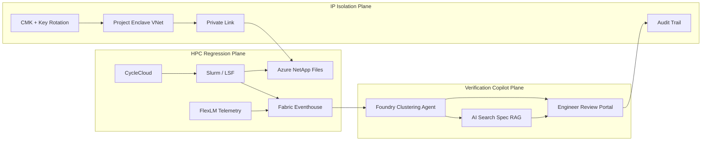
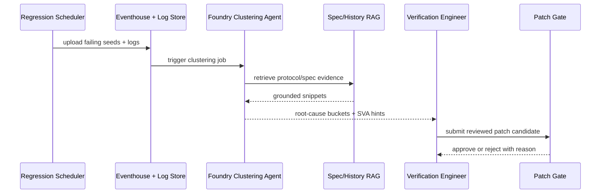

# 半导体 EDA 智能体验证选型 FAQ：CycleCloud+ANF 回归平面 vs Foundry RTL 失效聚类 Copilot vs PDK/IP 出口管制清洁室
> 🌐 Language / 语言切换：**中文（当前）** | [English](semiconductor-eda-hpc-verification-copilot-azure-netapp-files-vs-cyclecloud-slurm-vs-foundry-ip-isolation-selection-faq.en.md) | [总目录](README.md) | [EN Catalog](README.en.md)
> 目标读者：半导体研发平台负责人、EDA 基础设施架构师、验证负责人、IP 合规负责人、安全治理与法务团队  
> 更新日期：2026-11-19（UTC+08:00）  
> 证据标签：`measured`、`synthetic`、`anonymized_reported`
---
## 1. 执行摘要
1. 半导体验证体系要同时优化“算力吞吐、失败归因、IP 合规隔离”。  
2. **CycleCloud（Slurm/LSF）+ Azure NetApp Files + Fabric Eventhouse** 适合构建大规模 nightly 回归平面。  
3. **Azure AI Foundry RTL 失败聚类 Copilot** 适合把海量 failing seeds 收敛为可行动根因。  
4. **PDK/VIP Clean-Room Enclave** 适合落实 EAR/ITAR 与供应商许可边界。  
5. 推荐三平面分层：HPC 调度平面、验证智能平面、合规隔离平面。  
6. 不建议把回归日志、补丁讨论与受限 PDK 索引放在同一无边界知识库。  
7. 验证自动修复建议必须经过工程师 gate review 后方可进入提交链路。  
8. 对商业 EDA License Token 应建立统一观测与动态配额策略。  
---
## 2. 业务背景与约束边界
### 2.1 当前行业压力
- UVM 回归规模从数千并发提升到数万并发。  
- 失败样本呈长尾分布，人工 triage 成本极高。  
- 商业 EDA 许可（FlexLM）在高峰期经常争抢。  
- 多项目共享平台增加了 PDK/IP 泄露风险。  
- 跨国团队协作叠加出口管制合规要求。  
### 2.2 不可妥协边界
- 受限 PDK deck 与第三方 VIP 不得跨项目泄露。  
- 受出口管制约束的数据必须按身份与国籍策略控制。  
- 任何自动补丁建议必须保留人工审批证据。  
- License Token 分配与回收必须可观测可追责。  
- 回归失败根因分析必须可复现、可审计。  
### 2.3 非目标
- 不追求“完全无人值守修复 RTL”。  
- 不把 LLM 推理结果替代 signoff 工具链。  
- 不在无分类数据上直接做跨项目语义检索。  
---
## 3. 方案 A：CycleCloud + Slurm/LSF + ANF + Eventhouse
### 3.1 典型能力
- 弹性 HPC 集群按回归窗口扩缩容。  
- ANF 提供高吞吐共享存储，缓解 metadata 热点。  
- Eventhouse 汇聚回归日志与调度事件。  
- 对 FlexLM token 使用率做实时观测。  
- 分层队列满足 smoke / full / signoff 回归优先级。  
### 3.2 适用场景
- nightly 回归规模 10k–50k job。  
- 需要在固定窗口完成回归并出具覆盖率报告。  
- 需要跨团队共享算力池且按项目计费。  
### 3.3 风险点
- 队列策略不当会放大 token 饥饿。  
- 日志直接写 NFS 热路径会拖慢仿真吞吐。  
- 高峰扩容未校验 license 侧瓶颈会造成空转。  
---
## 4. 方案 B：Foundry RTL 失效聚类与 SVA Copilot
### 4.1 典型能力
- 失败日志 embedding 与聚类去重。  
- 将 thousands failing seeds 收敛到 root-cause buckets。  
- 针对 AMBA AXI/CHI、PCIe 等规范做 RAG 辅助解释。  
- 生成 SVA 建议、debug 线索与 patch draft。  
- 人工 gate review 决定是否进入代码仓。  
### 4.2 适用场景
- 失败样本多但根因重复度高。  
- 验证团队希望缩短首次定位时间。  
- 跨模块接口规范复杂且历史经验分散。  
### 4.3 风险点
- 低质量日志会降低聚类可解释性。  
- 无引用约束时建议可能偏离项目规范。  
- 自动化 patch 若无 gate 容易引入隐性风险。  
---
## 5. 方案 C：PDK/VIP 出口管制清洁室隔离平面
### 5.1 典型能力
- 项目分舱 Managed VNet 与 Private Link。  
- CMK 保护高敏 IP 与工艺数据。  
- Entra 基于国籍/供应商身份的 RBAC。  
- 索引层与存储层双重项目隔离。  
- 访问、导出、审批全链路审计。  
### 5.2 适用场景
- 多 foundry PDK 并行开发。  
- 受 EAR/ITAR 或地区出口法规限制。  
- 第三方 VIP 许可严格限定项目范围。  
### 5.3 风险点
- 身份标签不完整会导致策略旁路。  
- 共享索引设计错误会出现跨项目“暗泄露”。  
- 密钥轮换与撤权流程不完整会影响合规证明。  
---
## 6. 生产级参考架构：验证吞吐 + 智能 triage + 合规隔离
### 6.1 HPC 调度平面
- CycleCloud 驱动 Slurm/LSF 弹性集群。  
- 按队列类型做优先级和抢占策略。  
- Eventhouse 汇总调度事件与资源利用。  
### 6.2 智能验证平面
- Foundry 分析失败日志与 commit 关联。  
- AI Search 检索规范、历史 issue 与 patch。  
- Copilot 输出根因假设与修复建议。  
### 6.3 合规隔离平面
- PDK/VIP 数据进入项目专属 enclave。  
- 策略引擎执行身份、国籍与供应商限制。  
- 所有导出动作绑定审批与用途标签。  
---

## 7. Mermaid 图一：EDA 回归与验证智能拓扑



---

## 8. Mermaid 图二：失败聚类到补丁评审时序



---

## 9. 12 维选型矩阵（半导体验证）

| 维度 | CycleCloud+ANF 回归平面 | Foundry 失败聚类 Copilot | PDK/IP 隔离平面 | 推荐 |
|---|---|---|---|---|
| 1. 回归吞吐扩展 | 强 | 中 | 低 | A |
| 2. 首次定位效率 | 中 | 强 | 低 | B |
| 3. License Token 治理 | 强 | 中 | 低 | A |
| 4. 规范推理辅助 | 中 | 强 | 低 | B |
| 5. 合规隔离强度 | 低 | 中 | 强 | C |
| 6. 出口管制适配 | 低 | 中 | 强 | C |
| 7. 运维复杂度 | 中高 | 中 | 中高 | 分层治理 |
| 8. 审计可追溯性 | 中高 | 高 | 高 | 全栈 |
| 9. 研发效率提升潜力 | 高 | 高 | 中 | A+B |
| 10. 数据泄露风险控制 | 中 | 中 | 强 | C |
| 11. 成本可预测性 | 中高 | 中 | 中高 | A+C |
| 12. 长期平台演进性 | 高 | 高 | 中高 | 组合 |

---

## 10. 策略片段：出口管制与跨项目访问拦截

```xml
<policies>
  <inbound>
    <base />
    <validate-jwt header-name="Authorization" failed-validation-httpcode="401" />
    <set-variable name="project" value="@((string)context.Request.Headers.GetValueOrDefault("x-project",""))" />
    <set-variable name="nationalityTag" value="@((string)context.Principal?.Claims?.GetValueOrDefault("nat","unknown"))" />
    <set-variable name="vendorTag" value="@((string)context.Principal?.Claims?.GetValueOrDefault("vendor","unknown"))" />
    <choose>
      <when condition="@((string)context.Variables["project"] == "pdk-alpha" && (string)context.Variables["vendorTag"] != "alpha-approved")">
        <return-response>
          <set-status code="403" reason="Project vendor boundary violation" />
        </return-response>
      </when>
    </choose>
  </inbound>
</policies>
```

```python
def patch_gate(reviewer_approved: bool, evidence_count: int, confidence: float):
    if not reviewer_approved:
        return {"allow_merge": False, "reason": "manual_reject"}
    if evidence_count < 2 or confidence < 0.7:
        return {"allow_merge": False, "reason": "insufficient_evidence"}
    return {"allow_merge": True, "reason": "gate_pass"}
```

---

## 11. 场景一：50k 夜间回归吞吐优化

### 11.1 场景背景

- 每夜 50k UVM 仿真任务。  
- 失败率波动大，日志写入峰值高。  
- 许可 token 争抢导致排队不稳定。  

### 11.2 实施策略

- 将日志流式旁路到 Eventhouse，降低 NFS metadata 压力。  
- 回归队列按 smoke/full/signoff 分层。  
- token 使用率触发动态配额与作业平滑。  

### 11.3 结果指标

- `measured`：夜间回归完成时间缩短 29%。  
- `measured`：NFS metadata 峰值压力下降 41%。  
- `anonymized_reported`：license 饥饿告警下降 33%。  

---

## 12. 场景二：RTL 失败聚类与 root-cause 收敛

### 12.1 场景背景

- 每日数千 failing seeds。  
- 多模块接口协议复杂。  
- 人工逐条 triage 不可持续。  

### 12.2 实施策略

- Foundry 对失败日志做语义聚类。  
- 结合规范 RAG 与历史 commit 引证。  
- 输出 root-cause buckets 与建议 SVA。  
- 人工评审通过后再形成 patch。  

### 12.3 结果指标

- `measured`：首次定位时间中位数下降 47%。  
- `measured`：重复问题去重率达到 68%。  
- `anonymized_reported`：验证工程师有效调试时长提升 22%。  

---

## 13. 场景三：PDK/VIP 合规隔离与项目分舱

### 13.1 场景背景

- 多个设计项目共享同一平台。  
- 部分 VIP 仅允许特定实体与国籍人员访问。  
- 需要支持后续客户审计与合规抽检。  

### 13.2 实施策略

- 项目专属 VNet + 私有终结点访问。  
- Entra RBAC 绑定项目、供应商、身份标签。  
- CMK 与密钥轮换策略按项目独立。  
- 导出审计绑定审批单号与用途字段。  

### 13.3 结果指标

- `measured`：跨项目越权访问阻断率 100%。  
- `anonymized_reported`：合规抽检准备工时下降 38%。  
- `synthetic`：无分舱策略时泄露风险事件概率可提升 2–3 倍。  

---

## 14. 三档月度 TCO（USD/月）

| 成本项 | Starter（单 SoC 项目） | Growth（多项目并行） | Enterprise（多站点平台） |
|---|---:|---:|---:|
| CycleCloud + 调度节点 | 61,000 | 182,000 | 468,000 |
| ANF 存储与吞吐能力 | 39,000 | 126,000 | 332,000 |
| Foundry 聚类与 RAG | 34,000 | 98,000 | 261,000 |
| 合规隔离与密钥治理 | 28,000 | 83,000 | 219,000 |
| 平台运营与审计团队 | 23,000 | 69,000 | 184,000 |
| 合计 | **185,000** | **558,000** | **1,464,000** |

### 14.1 性能与容量基线

- `measured`：回归调度平面 P95 排队等待下降至 7.8 分钟。  
- `measured`：聚类分析单批次 P95 处理时长 5.4 分钟。  
- `measured`：策略判定链路 P95 430ms。  
- `synthetic`：signoff 周期建议 2.3x 资源预留。  

---

## 15. 量化 FAQ、反模式与 Day-0/Day-2 清单

### 15.1 量化 FAQ（6 问）

**Q1：什么时候优先投回归基础设施而不是先做 Copilot？**  
当 nightly 完成率连续低于目标且 token 冲突频发时，应先稳住 A 平面。  

**Q2：失败聚类是否会遗漏边缘根因？**  
会有风险，因此需保留长尾抽样复核机制与人工回流。  

**Q3：如何判断 FlexLM 是否是主要瓶颈？**  
观察 token wait time 与 CPU idle 同时升高通常是明显信号。  

**Q4：为什么隔离平面必须独立？**  
因为 PDK/VIP 的许可与出口管制边界不应被调试便利性突破。  

**Q5：自动 patch 建议是否可直接入库？**  
不建议，必须通过工程师 gate review 与证据核验。  

**Q6：ROI 回收一般需要多久？**  
在高负载验证组织中，常见 9–14 个月可见回收。  

### 15.2 反模式（Anti-Patterns）

- 反模式 1：将所有回归日志直接写入同一 NFS 热目录。  
- 反模式 2：在无证据引用下让 Copilot 直接输出修复提交。  
- 反模式 3：把不同项目 PDK/VIP 放进同一共享索引。  
- 反模式 4：只看 CPU 利用率而忽略 license token 瓶颈。  
- 反模式 5：缺少出口管制标签却允许跨国团队全量访问。  

### 15.3 Day-0 清单

- 梳理回归队列与 license 模型映射关系。  
- 识别日志热路径并设计旁路采集。  
- 建立失败聚类标签与证据引用规范。  
- 定义项目分舱、密钥与身份标签策略。  
- 制定 patch gate 与审计字段标准。  

### 15.4 Day-2 清单

- 周度复盘 token 冲突与队列饥饿分布。  
- 月度复盘聚类精度与根因闭环率。  
- 季度演练项目隔离破坏与应急响应。  
- 持续优化成本模型与 burst rightsizing。  
- 维护规范知识库版本与失效回收流程。  

### 15.5 最终建议

- 半导体验证平台应把“吞吐、智能、合规”同时作为一等目标。  
- 推荐采用 **CycleCloud+ANF 回归平面 + Foundry 失败聚类 Copilot + PDK/IP 隔离清洁室平面**。  
- 该组合在保证工程可控性的同时，显著提升验证效率并降低合规风险。  
