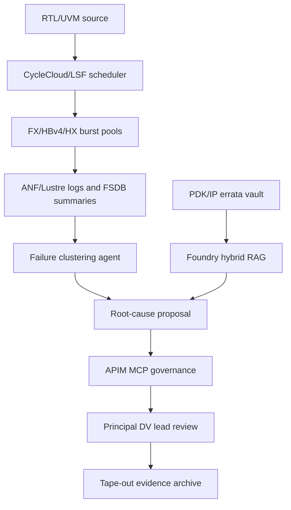
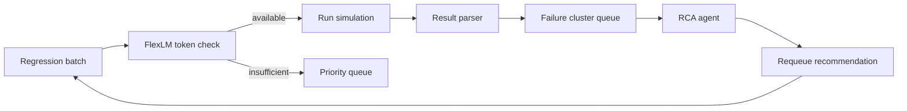

# Fabless Semiconductor EDA Agent Selection FAQ: Azure HPC Burst + ANF/Lustre vs Foundry NDA RAG vs LSF/FlexLM MCP Governance

> Audience: Cloud & AI Solution Architects, design-verification leads, physical-design sign-off owners, EDA platform engineers, security/compliance teams.  
> Decision scope: nightly RTL regression triage, coverage-closure support, and tape-out evidence preparation under strict NDA compartment controls.  
> Governance red line: agents can triage and propose, but must not autonomously modify sign-off constraints or directly alter GDSII release paths.

## 1. Executive summary: production EDA agents win by faster auditable convergence, not raw code generation

In large fabless programs, the bottleneck is rarely one simulation job.

The bottleneck is reducing thousands of failures into a small, defensible root-cause set before morning decisions.

At scale, recommendation quality and governance traceability matter more than generic coding fluency.

This guide compares:

- **Option A**: vendor-suite embedded copilots (Synopsys.ai / Cadence JedAI) as primary path.
- **Option B**: Azure multi-vendor burst plane + Foundry NDA RAG + controlled FlexLM/LSF MCP gateway.
- **Option C**: raw LLM agents directly editing RTL/SDC sign-off branches (and why that is usually unacceptable for production).

Summary:

A is fastest when single-vendor standardization dominates.

B is strongest for multi-vendor, high-scale, compliance-heavy environments.

C carries sign-off risk profiles that typically violate production governance expectations.

## 2. Domain boundary: this is fabless verification governance, not wafer-fab process APC

This topic does not center on fab cleanroom process control.

It centers on pre-silicon design verification and sign-off operations.

Primary artifacts include:

- RTL/UVM regression outputs,
- formal verification results,
- STA report deltas,
- license-token utilization and queue behavior.

Hard constraints include:

- strict PDK/IP NDA compartment isolation,
- high FlexLM token economics,
- and tape-out evidence traceability.

## 3. Option definitions: governance and control boundaries

### 3.1 Option A: vendor-locked embedded AI workflows

Benefits:

- consistent in-suite user experience,
- quicker onboarding inside established toolchains,
- lower immediate process disruption.

Limitations:

- weaker cross-vendor telemetry fusion,
- less control over independent license-governance orchestration.

### 3.2 Option B: Azure composable multi-vendor control plane

Benefits:

- unifies cross-vendor failure telemetry,
- combines errata evidence and waveform summary reasoning,
- supports policy-gated FlexLM/LSF interaction via MCP.

Limitations:

- higher platform engineering burden,
- requires disciplined governance ownership and operating cadence.

### 3.3 Option C: raw autonomous sign-off branch mutation

Appears highly automated.

But CDC/timing edits without deterministic verification controls can propagate high-cost failures.

For most organizations, this pattern is unsuitable as production default.

## 4. Reference architecture I: compute burst, evidence retrieval, and approval decoupling



This architecture separates throughput scaling from governance-sensitive decision gates.

Agents propose, accountable engineering leads approve.

## 5. NDA compartment design: zero-egress and project-level isolation

2nm/3nm foundry collateral and third-party IP must remain compartment-scoped.

Recommended controls:

- project-level network and identity boundaries,
- least-privilege RBAC,
- no cross-compartment vector index reuse,
- immutable audit snapshots for replay.

RAG queries should be rejected if project/tenant labels are missing.

Zero-egress enclaves reduce leakage risk for sensitive collateral.

## 6. FlexLM economics: token governance as first-order optimization target

In many programs, license tokens are scarcer than raw compute.

Symptoms:

- queue wait exceeds simulation runtime,
- token contention drives inefficient retries,
- fragmented idle windows reduce effective throughput.

Platform objective should shift from “max concurrency” to “max token-effective completion.”

Controlled MCP gateways enable auditable query, reservation, and release patterns.

## 7. Twelve-dimension comparison matrix

| Dimension | Option A Embedded Copilot | Option B Azure Multi-Vendor Plane | Option C Raw LLM Branch Mutation |
|---|---:|---:|---:|
| Time-to-adoption | 5 | 3 | 2 |
| Cross-vendor fusion capability | 2 | 5 | 4 |
| License governance depth | 3 | 5 | 2 |
| PDK/IP isolation control | 3 | 5 | 1 |
| Failure-cluster explainability | 3 | 5 | 3 |
| Sign-off risk control | 4 | 5 | 1 |
| Ops complexity (lower is better) | 4 | 2 | 3 |
| Burst scalability | 3 | 5 | 4 |
| Audit traceability | 4 | 5 | 2 |
| Cost optimization potential | 3 | 5 | 2 |
| Long-term extensibility | 3 | 5 | 3 |
| Organizational fit at scale | 4 | 4 | 1 |

Interpretation:

A is pragmatic for standardized single-vendor environments.

B is strongest for scale and multi-vendor complexity.

C has unacceptable governance risk in most tape-out programs.

## 8. Reference architecture II: license-aware requeue loop



This loop reduces blind reruns.

Combining token state with failure semantics improves schedule efficiency.

## 9. APIM/LSF MCP governance boundary: read and controlled preemption only

Allow:

- token utilization query,
- controlled preemption proposal,
- queue-reorder draft generation.

Deny:

- autonomous sign-off constraint mutation,
- direct bypass of lead approval gates.

```xml
<policies>
  <inbound>
    <base />
    <set-variable name="mcpAction" value="@(context.Request.Headers.GetValueOrDefault(&quot;x-mcp-action&quot;,&quot;read&quot;))" />
    <choose>
      <when condition="@((string)context.Variables[&quot;mcpAction&quot;] == &quot;modify_signoff_constraints&quot;)">
        <return-response>
          <set-status code="403" reason="Sign-off mutation requires principal DV approval" />
        </return-response>
      </when>
    </choose>
  </inbound>
  <backend><base /></backend>
  <outbound><base /></outbound>
  <on-error><base /></on-error>
</policies>
```

## 10. Azure sizing and 3-year TCO for nightly verification at scale

### 10.1 Baseline assumptions

- 180k nightly jobs,
- 12k failed samples requiring triage,
- strict annual token-license ceiling,
- 21-day hot retention for logs/waveform summaries.

### 10.2 Option A estimate

- Monthly average: `$612k`
- 3-year total: `$22.03M`
- Fast rollout, constrained cross-domain optimization headroom.

### 10.3 Option B estimate

- Monthly average: `$558k`
- 3-year total: `$20.09M`
- Higher platform burden, stronger long-run efficiency.

### 10.4 Option C estimate

- Monthly average: `$590k`
- 3-year total: `$21.24M`
- Hidden quality-rework risk cost offsets apparent automation gains.

## 11. Scenario A: 3nm data-center AI accelerator nightly triage at 180k jobs

Objective:

reduce 12k nightly failures into ~15 actionable root-cause groups before stand-up.

Required capabilities:

- cross-vendor log normalization,
- deterministic clustering with evidence links,
- controlled rerun recommendation sequencing.

Recommendation:

Option B as central triage and governance plane with strict review gates.

## 12. Scenario B: automotive ASIL-D multi-vendor PDK compartment audit

Objective:

demonstrate compartment integrity and tape-out evidence traceability.

Required capabilities:

- no cross-vendor IP leakage paths,
- immutable lineage for decision artifacts,
- explicit lead approval for sign-off-impacting changes.

Recommendation:

Option B with project-scoped enclaves and policy-enforced evidence workflows.

## 13. Risk position: why direct autonomous sign-off branch editing is dangerous

Risk is not merely model correctness.

Risk is systemic impact amplification in sign-off-critical paths.

Small CDC or timing-constraint mistakes can create large downstream respin exposure.

Given high NRE economics, uncontrolled automation in this layer is usually unjustifiable.

Hence the governance baseline should remain: autonomous analysis, human sign-off authority.

## 14. Quantitative deep Q&A

### 14.1 Q1: when is Option A best?

When toolchain is single-vendor dominant and governance model prioritizes rapid controlled rollout.

### 14.2 Q2: when does Option B ROI become clear?

When failure-volume and cross-vendor heterogeneity remain persistently high.

### 14.3 Q3: which KPIs prove license optimization?

Token-wait P95, token utilization rate, and successful rerun yield.

### 14.4 Q4: how do we constrain RAG leakage risk?

Project-scoped indexes, label enforcement, zero-egress enclaves, and auditable query controls.

### 14.5 Q5: how do we judge recommendation quality?

Root-cause hit rate, false-cluster rate, and verification replay pass rate.

### 14.6 Q6: why is Option C not production default?

Because sign-off mutation risk and audit defensibility gaps are usually incompatible with tape-out governance.

## 15. Five-step rollout and final recommendation (Good fit vs Not for)

**Step 1: establish license and queue observability first**

Unify token, queue, and failure-distribution telemetry in a single control dashboard.

**Step 2: build compartmented evidence retrieval**

Keep PDK/IP/errata retrieval project-scoped with strict boundary controls.

**Step 3: prioritize triage automation before execution automation**

Use agents for clustering and recommendation, not direct sign-off mutation.

**Step 4: enforce APIM/MCP policy gates**

Hard-block high-risk actions without explicit principal approval.

**Step 5: run quarterly cost-quality-governance reviews**

Track TCO, convergence speed, and audit events together.

**Good fit**:

- large multi-vendor verification programs with strict NDA and audit obligations.

**Not for**:

- small prototype teams without formal sign-off governance frameworks.

Final recommendation:

Use A for rapid controlled baseline where suitable, and B for scalable multi-vendor long-run operation.

Across both patterns, preserve principal DV human authority over tape-out-impacting edits.

### 15.7 Q7: how should we score failure-cluster quality?

Use four mandatory dimensions:

- semantic consistency within each cluster,
- reproducible root-cause validation pass rate,
- false-cluster ratio,
- morning-standup actionability score.

Quality should outrank raw cluster count.

### 15.8 Q8: how do we integrate coverage closure into agent recommendations?

Analyze functional, code, and assertion coverage together.

Recommendations should include both fix proposals and explicit coverage-gap hints.

Convert recurring blind spots into next-run scheduling priorities.

### 15.9 Q9: what if formal evidence conflicts with simulation evidence?

Define deterministic conflict precedence.

Present formal counterexamples and waveform evidence side by side.

Conflicted conclusions should default to manual review, not autonomous acceptance.

### 15.10 Q10: how do we prevent cross-project cache contamination?

Attach immutable project-scope labels to all cache artifacts.

Enforce label validation at both scheduler and storage layers.

Reject and alert on any mismatched scope at load time.

### 15.11 Q11: what is a practical emergency license strategy?

Define three escalation tiers:

- controlled throttling,
- workload slimming,
- critical-path reservation.

Each tier needs explicit trigger and exit criteria.

### 15.12 Q12: can waveform summaries fully replace raw waveforms?

No.

Summaries accelerate clustering and triage.

Raw waveforms remain required evidence for dispute replay and sign-off-critical review.

### 15.13 Q13: how should AI recommendations be attached to change-review templates?

Standardize CR attachments with:

- root-cause summary,
- evidence links,
- risk tier,
- rollback and containment actions.

Template consistency lowers review friction.

### 15.14 Q14: when does multi-model collaboration outperform a single model?

When workload heterogeneity is high across logs, waveform metadata, and constraint contexts.

Use specialized roles for clustering, retrieval, and explanation.

Require a shared evidence schema to preserve traceability.

### 15.15 Q15: what is the minimum bar for a “sign-off-ready suggestion”?

Three mandatory elements:

- verifiable evidence chain,
- explicit risk tag,
- rollback-safe action description.

Missing any one element means no sign-off candidacy.

### 15.16 Q16: how do we reduce rerun storms during night regressions?

Apply failure-cluster deduplication and priority reordering.

Down-weight repeated known failures.

Up-prioritize novel failure signatures for license and compute allocation.

### 15.17 Q17: how should global teams exchange triage outcomes across time zones?

Publish a fixed-structure “standup-ready package” every cycle.

Include root-cause clusters, impact radius, proposed actions, and evidence links.

Make handoff document-first instead of call-dependent.

### 15.18 Q18: how can ISO 26262 process controls be embedded?

Encode safety gates as non-skippable control points.

Require dual review for ASIL-impacting recommendations.

Attach traceability matrix references before approval.

### 15.19 Q19: when should we scale ANF versus Managed Lustre?

Scale ANF first for low-latency shared metadata patterns.

Scale Lustre first for high-throughput parallel I/O phases.

Hybrid sizing should be job-profile driven, not preference driven.

### 15.20 Q20: how do we avoid “cloud-bill savings, rework cost explosion”?

Include rework economics in TCO, not just compute and storage.

Track “cost per avoided sign-off rework” as a governance KPI.

This prevents false optimization incentives.

### 15.21 Q21: should recommendations carry confidence intervals?

Yes.

High-uncertainty suggestions should auto-downgrade to manual-first routing.

Confidence metadata improves reviewer trust and calibration.

### 15.22 Q22: how do we handle different tenant evidence-retention windows?

Allow tenant-specific retention only above platform minimum baselines.

Record retention-policy version metadata with every audit artifact.

Include policy context during export to avoid evidence-disposal disputes.

### 15.23 Q23: how do we productize this platform for multiple design teams?

Use a “shared control-plane + team-level policy profile” model.

Shared layers enforce governance and security baseline controls.

Team profiles tune scheduling and triage preferences safely.

### 15.24 Q24: what should a quarterly governance review dashboard include?

At minimum:

- pass/retry trend,
- cluster precision and adoption,
- token utilization and wait latency,
- storage hot/cold cost trajectory,
- rework and defect-escape trend.

### 15.25 Closing principle: make EDA AI triage a governed engineering system

The target is not a clever assistant but an accountable production capability.

Only systems with managed process, evidence, authority boundaries, and cost controls scale sustainably.

This is the practical path from pilot utility to tape-out-grade enterprise operation.

### 15.26 Governance continuity checklist for next quarter

Carry quarterly conclusions directly into the next capacity plan.

Synchronize three recurring updates:

- license policy recalibration,
- storage tiering economics refresh,
- failure-cluster model quality review.

Also bind platform KPIs to business review rituals, not engineering dashboards alone.

Track both pre-sign-off detection lift and post-sign-off defect escape trend together.

This dual-metric frame prevents speed-only optimization from eroding sign-off quality.

For platform leadership, keep a standing cross-functional review board.

Include DV, CAD, security, finance, and compliance stakeholders.

That governance cadence keeps architecture, policy, and economics aligned as scale grows.

With those controls in place, the platform can sustain throughput gains without compromising NDA boundaries.

This is the expected operating posture for enterprise tape-out programs under strict audit pressure.

In short: automate triage aggressively, automate sign-off changes conservatively, and keep evidence immutable.

That balance is what keeps tape-out velocity high without eroding verification integrity.
It is the operating principle this guide recommends for enterprise-scale deployment.
