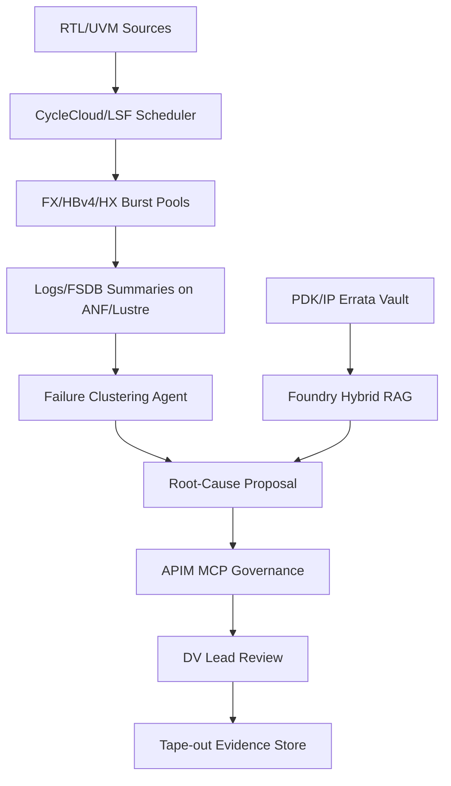
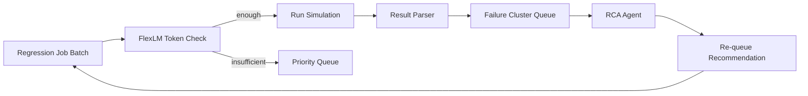

# Fabless 半导体 EDA 夜归验证与 Tape-out 签核智能体选型 FAQ：Azure HPC Burst + ANF/Lustre vs Foundry NDA RAG vs LSF/FlexLM MCP 治理

> 面向角色：Cloud & AI Solution Architect、DV/PD 负责人、EDA 平台工程、信息安全与合规审计团队。  
> 业务问题：在 `50,000–250,000` 夜间回归任务规模下，如何平衡验证吞吐、许可证利用率、IP/PDK 隔离和签核风险控制。  
> 治理红线：智能体可做日志聚类、根因建议和草案生成，但不得自动改写 sign-off 约束或直改 GDSII 分支。

## 1. 执行摘要：EDA 智能体平台的核心不是“更会写代码”，而是“更快收敛可审计结论”

Fabless 验证链路的痛点通常不在单个仿真任务。

而在海量失败日志与波形摘要的聚类归因速度。

每晚 10 万级任务中，真正影响晨会决策的是可解释的少量根因簇。

本指南比较三类路径：

- **方案 A**：单一厂商工具套件内置 AI 助手优先。
- **方案 B**：Azure 多厂商云突发平面 + Foundry NDA RAG + FlexLM/LSF MCP 受控网关。
- **方案 C**：通用 LLM 代码智能体直改 RTL/SDC 主签核分支（解释为何风险不可接受）。

结论先行：

若组织以套件一致性为先，A 上手快但跨工具域能力受限。

若组织存在多厂商工具链和许可证瓶颈，B 通常是长期最优平衡。

C 在量产签核路径风险过高，不建议作为生产默认。

## 2. 业务约束：与晶圆厂 APC/良率控制的场景边界

该主题不是晶圆厂制程控制。

这里关注的是 Fabless 设计验证与签核流程。

核心对象包括：

- RTL/UVM 回归日志。
- Formal 证明结果。
- STA 报告与约束冲突。
- 许可证令牌与作业队列。

约束重点包括：

- PDK/IP NDA 隔离，不同项目不可交叉暴露。
- FlexLM 成本高，令牌利用率是关键经济杠杆。
- Tape-out 前所有变更要保留审计证据。

## 3. 三方案定义：A/B/C 责任边界与可控性差异

### 3.1 方案 A：单厂商套件内置 AI（Synopsys.ai / Cadence JedAI）

优点：

- 工具链内体验一致。
- 部分工作流开箱即用。
- 组织变更成本较低。

局限：

- 跨厂商日志统一分析能力有限。
- 许可证与队列治理可编排空间受限。

### 3.2 方案 B：Azure 多厂商突发平面 + RAG 证据层 + MCP 许可证闸门

优点：

- 支持多厂商混合作业编排。
- 能把失败日志聚类、波形摘要与 errata 文档联动。
- 可在 APIM/LSF MCP 层实现令牌只读与受控预占。

局限：

- 平台工程复杂度提升。
- 需要强治理与运维制度保障。

### 3.3 方案 C：通用 LLM 直改签核分支

自动化表面上最高。

但 CDC、时序和跨域约束误改风险巨大。

一次错误改动可能触发高额 mask respin 成本。

因此通常不符合量产签核控制要求。

## 4. 端到端参考架构：回归计算、证据检索与治理闸门解耦



该设计把“计算扩展”与“决策治理”分离。

智能体产出建议，审批角色控制签核动作。

## 5. PDK/IP 隔离策略：零出网与多租户隔舱

Foundry 2nm/3nm PDK 文档与第三方 IP 库需分舱管理。

推荐原则：

- 项目级 VNet 隔离。
- 最小权限 RBAC。
- 禁止跨舱向量索引混用。
- 离线快照审计可回放。

RAG 检索必须附租户和项目标签。

任何缺失标签的查询应直接拒绝。

## 6. FlexLM 许可证经济学：令牌利用率决定年度成本斜率

许多组织的主要瓶颈不是算力而是令牌。

可见症状包括：

- 队列等待长于仿真执行时长。
- 高峰期许可证争抢导致重复失败重排。
- 许可证“碎片化空闲”无法被有效利用。

平台目标应从“最大并发”转向“最优令牌吞吐”。

受控 MCP 网关可实现令牌查询、预占和释放审计。

## 7. 12 维选型矩阵：A/B/C 横向对比

| 维度 | 方案 A 套件内置 AI | 方案 B Azure 多厂商平面 | 方案 C 通用 LLM 直改签核 |
|---|---:|---:|---:|
| 上线速度 | 5 | 3 | 2 |
| 多厂商融合能力 | 2 | 5 | 4 |
| 许可证治理深度 | 3 | 5 | 2 |
| PDK/IP 隔离可控性 | 3 | 5 | 1 |
| 失败聚类解释性 | 3 | 5 | 3 |
| 签核风险可控性 | 4 | 5 | 1 |
| 运维复杂度（低更优） | 4 | 2 | 3 |
| 扩展弹性 | 3 | 5 | 4 |
| 审计可回溯性 | 4 | 5 | 2 |
| 成本优化潜力 | 3 | 5 | 2 |
| 长期演进弹性 | 3 | 5 | 3 |
| 组织适配度 | 4 | 4 | 1 |

矩阵结论：

A 适合单厂商主导且快速落地诉求强的组织。

B 在多厂商与高规模夜归场景中优势明显。

C 主要风险在签核链路不可控，不建议主生产。

## 8. 架构图（二）：令牌感知调度与重排闭环



此闭环减少“盲目重跑”。

把许可证与失败聚类信息结合后，重排效率显著提升。

## 9. APIM/LSF MCP 受控策略：只读与受控预占边界

生产策略应限制智能体操作范围。

允许：

- 查询令牌使用率。
- 请求受控预占建议。
- 生成重排草案。

禁止：

- 绕过审批直接改优先级全局策略。
- 直接写入签核分支约束。

```xml
<policies>
  <inbound>
    <base />
    <set-variable name="mcpAction" value="@(context.Request.Headers.GetValueOrDefault(&quot;x-mcp-action&quot;,&quot;read&quot;))" />
    <choose>
      <when condition="@((string)context.Variables[&quot;mcpAction&quot;] == &quot;modify_signoff_constraints&quot;)">
        <return-response>
          <set-status code="403" reason="Sign-off constraint mutation requires human lead approval" />
        </return-response>
      </when>
    </choose>
  </inbound>
  <backend><base /></backend>
  <outbound><base /></outbound>
  <on-error><base /></on-error>
</policies>
```

## 10. Azure SKU 与 3 年 TCO：HPC + 存储 + 治理平面

### 10.1 基线假设

- 夜间回归任务 180,000 / 天。
- 失败样本聚类对象 12,000 / 天。
- 许可证池年度预算上限严格。
- 波形与日志保留 21 天热存储。

### 10.2 方案 A

- 月均 `$612k`
- 3 年 `$22.03M`
- 快速上线但跨域优化空间有限。

### 10.3 方案 B

- 月均 `$558k`
- 3 年 `$20.09M`
- 平台治理投入高，但长期成本效率更优。

### 10.4 方案 C

- 月均 `$590k`
- 3 年 `$21.24M`
- 表面自动化高，质量与返工风险成本高。

## 11. 场景一：3nm AI 加速器 18 万夜归任务根因收敛

目标是晨会前把 12,000 失败样本收敛到 15 个根因簇。

关键动作：

- 多厂商日志统一抽取。
- 失败特征聚类。
- 与 errata/已知缺陷库联动比对。

建议采用 B 形成统一 triage 控制平面。

## 12. 场景二：车规 ASIL-D 多供应商 PDK 隔舱审计

需求强调隔舱、可追溯、可证明。

关键要求：

- 不同供应商 IP 不可混检索。
- 所有证据链有时间戳与责任人。
- Tape-out 决策必须有人审签核。

B 能在隔舱治理和证据审计上提供更完整能力。

## 13. 风险面：为何不建议智能体直改 RTL/SDC 签核分支

原因不在“模型是否聪明”。

而在于签核链路的系统风险放大效应。

CDC 或时序约束的细微错误可能导致全局后果。

在高 NRE 背景下，错误代价远超自动化收益。

因此治理上应坚持“建议自动化、签核人工化”。

## 14. 深度问答：评审会常见 6 个量化问题

### 14.1 Q1：何时 A 是更优选择？

当工具链单一、团队求稳、跨域整合需求低时，A 更快见效。

### 14.2 Q2：何时 B 的 ROI 最明显？

当失败样本量和多厂商工具链复杂度持续高位时，B 的收益更显著。

### 14.3 Q3：如何衡量许可证优化成效？

看令牌等待时长、令牌利用率、重排成功率三指标。

### 14.4 Q4：如何约束 RAG 泄露风险？

用项目级索引隔离、查询标签校验和零出网策略。

### 14.5 Q5：如何评估智能体建议质量？

看根因命中率、误报率、复现实验通过率。

### 14.6 Q6：为何 C 不适合主生产？

因签核改动风险不可控，审计与责任链不完整。

## 15. 五步落地与最终建议（Good fit vs Not for）

**Step 1：先建许可证与调度可观测底座**

把令牌、队列、失败分布做统一看板。

**Step 2：建立隔舱式证据检索平面**

PDK/IP/Errata 必须项目级隔离。

**Step 3：智能体先做聚类与建议，不做签核执行**

保证价值先在分析效率而非执行自动化。

**Step 4：APIM/MCP 网关前置风险闸门**

把高风险动作硬性阻断到人工审批链。

**Step 5：季度复盘成本与质量**

联合看 TCO、根因收敛效率和审计事件。

**Good fit**：

- 多厂商 EDA、超大夜归规模、强 NDA 与审计要求组织。

**Not for**：

- 低规模原型团队且无正式签核流程的实验项目。

最终建议：

A 可用于快速起步，B 更适合规模化和多厂商复杂场景。

无论选择哪条路线，都应坚持签核变更由 Principal DV Lead 人工把关。

### 15.7 Q7：如何定义“失败簇质量”评估标准？

建议至少包含四个维度：

- 同簇日志语义一致性。
- 根因可复现实验通过率。
- 误聚类率。
- 晨会可执行性评分。

质量指标高于数量指标，才有真实工程价值。

### 15.8 Q8：如何把覆盖率闭环纳入智能体建议？

建议把功能覆盖率、代码覆盖率与断言覆盖率并列分析。

智能体不只给出失败修复建议，也要提示“覆盖盲区”。

可把覆盖盲区转为下一轮约束激励点。

这能防止“通过率提升但覆盖退化”的假繁荣。

### 15.9 Q9：Formal 与仿真证据冲突时如何处理？

应建立冲突优先级规则。

例如把 formal 反例与仿真失败波形并列呈现。

冲突结论默认进入人工审查而非自动采纳。

该规则可避免单一证据源主导错误决策。

### 15.10 Q10：如何防止跨项目缓存污染？

缓存必须带项目隔离标签。

调度层和存储层都要执行标签校验。

发现标签不匹配时应立即拒绝加载并告警。

跨项目缓存污染是 NDA 风险高发点。

### 15.11 Q11：如何设计“许可证应急策略”？

建议定义三级应急模式：

一级降频、二级精简任务、三级关键路径保底。

每级应急都有明确触发阈值与退出条件。

这样在令牌短缺时仍可保住关键签核路径。

### 15.12 Q12：波形摘要是否可替代原始波形？

不能完全替代。

摘要用于快速筛选和聚类。

原始波形仍是争议复盘与关键签核证据。

建议采用“摘要热层 + 原始冷层”双层策略。

### 15.13 Q13：如何把 AI 建议纳入 CR 审批模板？

建议输出统一 CR 附件：

- 根因摘要。
- 证据链接。
- 风险等级。
- 建议操作与回滚路径。

标准化模板可显著降低评审沟通成本。

### 15.14 Q14：何时应引入多模型协同而非单模型？

当日志类型与任务类型异构度高时可引入。

例如聚类模型、检索模型、解释模型分工。

但多模型协同要有统一证据 schema。

否则可观测性与追责会显著复杂化。

### 15.15 Q15：如何定义“可签核建议”的最低门槛？

建议满足三条件：

- 有证据链。
- 有风险标签。
- 有可回滚操作说明。

缺少任一条件都不应进入签核候选。

### 15.16 Q16：如何降低夜归重跑风暴？

可采用失败簇去重与优先级重排。

对重复已知失败可降频处理。

对新型失败优先分配令牌与算力。

该策略通常比简单扩容更经济。

### 15.17 Q17：跨时区团队如何共享 triage 结论？

建议建立“晨会就绪包”机制。

每晚固定输出统一结构化报告。

报告包含根因簇、影响范围、建议动作和证据链接。

这样交接不依赖口头同步。

### 15.18 Q18：如何把 ISO 26262 等安全流程映射进平台？

将安全流程节点建成不可跳过检查点。

例如 ASIL 相关模块建议必须双审通过。

关键路径建议需要附带追溯矩阵引用。

这能确保智能体增效不破坏安全流程完整性。

### 15.19 Q19：何时扩 ANF，何时扩 Lustre？

ANF 适合共享文件低延迟访问场景。

Lustre 适合高吞吐并行 I/O 场景。

可按作业类型混合配置。

关键是以作业画像驱动而非单点偏好。

### 15.20 Q20：如何避免“看似省钱、实则返工贵”？

必须把返工成本计入 TCO。

仅看算力账单会低估质量风险。

建议引入“每次签核返工成本”指标。

这能更真实反映平台价值。

### 15.21 Q21：智能体建议是否需要置信区间？

建议必须附置信区间与不确定性说明。

高不确定建议应自动降级为“人工优先”。

这比硬阈值单点判断更稳健。

对签核团队也更透明。

### 15.22 Q22：如何处理多租户审计留存周期差异？

租户可配置留存策略但不得低于平台基线。

平台应在元数据层记录租户留存策略版本。

导出审计时自动附带策略上下文。

避免后续出现“证据已清理”争议。

### 15.23 Q23：如何将平台能力产品化给多个设计团队？

建议按“共享核心 + 团队可配置参数”模式。

共享核心负责安全与合规能力。

团队参数负责作业优先级与分析偏好。

这样可兼顾规模化与差异化。

### 15.24 收官原则：把 AI triage 变成受控工程系统，而非个人工具

只有当流程、证据、权限、成本都可治理时，平台才具备长期价值。

这也是 EDA 智能体从试点走向组织级生产能力的关键路径。

坚持该原则，才能在 tape-out 压力周期内保持质量与速度双达标。

### 15.25 Q24：如何定义季度治理复盘看板？

建议至少包含五类指标：

- 作业成功率与重跑率。
- 失败簇精度与人工采纳率。
- 许可证利用率与等待时延。
- 存储冷热层成本曲线。
- 签核返工与缺陷逃逸率。

季度复盘应关联业务里程碑与项目交付质量。

只有“技术指标 + 业务结果”双维度对齐，平台治理才不会偏离价值目标。

同时建议将季度复盘结论反馈到下一季度容量规划。

把许可证策略、存储分层与失败簇模型迭代联动更新。

持续闭环是把平台从“可用”推进到“可持续高效”的关键。

在组织层面，还应把平台 KPI 纳入季度经营评审。

将“签核前发现率”与“签核后逃逸率”作为双核心指标。

这样才能避免只追求自动化速度而忽视质量风险。

对于跨项目共享平台，建议保留统一的治理委员会机制。
