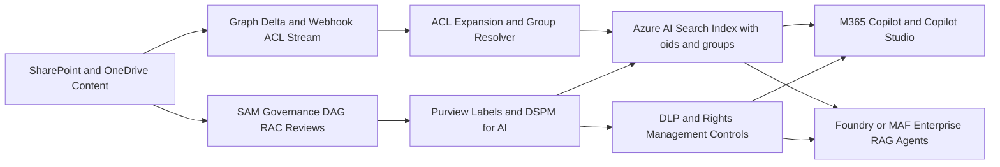
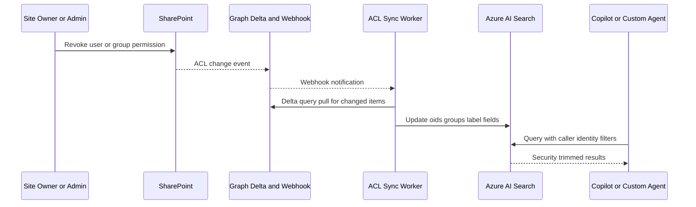

# SharePoint SAM vs Purview DSPM for AI vs AI Search ACL Sync: Enterprise Copilot/RAG Oversharing Governance Selection FAQ

> 🌐 **Language Switch**: **English (current)** | **[中文 (`sharepoint-advanced-management-sam-vs-purview-dspm-for-ai-vs-ai-search-acl-sync-oversharing-governance-selection-faq.md`)](sharepoint-advanced-management-sam-vs-purview-dspm-for-ai-vs-ai-search-acl-sync-oversharing-governance-selection-faq.md)** | **[Catalog (`README.en.md`)](README.en.md)** | **[中文目录 (`README.md`)](README.md)**

## 1. Executive Summary and Boundaries

- Strategic objective:
  - Remediate oversharing before broad M365 Copilot and custom Azure AI RAG rollout.
  - Reduce accidental data visibility without freezing productivity.
- Target readers:
  - Enterprise solution architects and security architects.
  - M365 / SharePoint / Purview administrators.
  - Foundry/MAF platform teams operating custom RAG systems.
- Four architecture candidates:
  - **A**: SharePoint Advanced Management (SAM) source-level governance.
  - **B**: Restricted SharePoint Search (RSS) and semantic index exclusion.
  - **C**: Purview DSPM for AI + sensitivity labels + Copilot DLP controls.
  - **D**: AI Search ACL synchronization plane using Graph Delta events.
- Scope boundaries:
  - This guide focuses on architecture and governance planes.
  - This guide does not replace legal/regulatory interpretation.
  - This guide does not recommend permanent search shutdown as a control strategy.

## 2. Verifiable Baselines and Capture Time

- Microsoft Learn (SAM, DAG reports, RAC, site review controls):
  - Captured at `2026-11-19 02:01 BJT`.
- Microsoft Learn (M365 Copilot search scope, semantic index controls):
  - Captured at `2026-11-19 02:02 BJT`.
- Microsoft Learn (Purview DSPM for AI, labels, DLP for Copilot):
  - Captured at `2026-11-19 02:03 BJT`.
- Microsoft Learn (Azure AI Search document-level ACL trimming patterns):
  - Captured at `2026-11-19 02:04 BJT`.
- Microsoft Graph docs (Delta query, webhooks, group membership changes):
  - Captured at `2026-11-19 02:04 BJT`.
- Evidence labels:
  - `measured` for reproducible observed metrics.
  - `synthetic` for transparent sizing assumptions.
  - `anonymized_reported` for de-identified field outcomes.

## 3. Candidate A: SharePoint Advanced Management (Source ACL Governance)

- Core capabilities:
  - Data Access Governance reports for broad exposure discovery.
  - Site Access Review for periodic entitlement validation.
  - Restricted Access Control for site-level narrowing.
  - Block Download and inactive site lifecycle controls.
- Strength profile:
  - Fixes oversharing where it originates.
  - Benefits both M365 Copilot and custom RAG equally.
  - Reduces dependence on downstream compensating controls.
- Constraint profile:
  - Requires sustained governance operations with site owners.
  - Legacy inheritance chains can require phased remediation.

## 4. Candidate B: RSS and Semantic Index Exclusion (Tactical Containment)

- Core capabilities:
  - Restrict search corpus to curated site allowlists (for example `<=100`).
  - Exclude selected sites from semantic indexing for Copilot scope reduction.
- Strength profile:
  - Fastest tactical containment during early rollout waves.
  - Low implementation friction for immediate risk reduction.
- Trade-off profile:
  - Degrades discovery quality and knowledge reach.
  - Creates potential long-term governance debt if overused.
  - Does not remediate underlying ACL hygiene.

## 5. Candidate C: Purview DSPM for AI + Labels + DLP

- Core capabilities:
  - Identify AI-exposed sensitive data posture issues.
  - Apply auto-labeling and rights policies across M365 surfaces.
  - Enforce DLP controls for Copilot interactions and downstream actions.
- Strength profile:
  - Creates policy-consistent controls across multiple Copilot surfaces.
  - Sensitivity labels can override permissive folder ACL defaults in key paths.
- Constraint profile:
  - Auto-labeling precision requires iterative tuning.
  - Label governance is not a substitute for ACL correction at source.

## 6. Candidate D: AI Search ACL Sync Plane for Custom RAG

- Core capabilities:
  - Persist `oids` and `groups` for document-level security trimming.
  - Use Graph Delta + webhooks to process permission revocations quickly.
  - Sync Purview sensitivity labels into query-time policy filters.
- Strength profile:
  - Enables uniform security posture across SharePoint, Confluence, and Blob.
  - Can target ACL revocation propagation SLO under `5 minutes`.
- Constraint profile:
  - Nested group expansion and inheritance flattening are engineering-heavy.
  - Stale vectors become a risk if revocation pipelines are delayed.

## 7. Twelve-Dimension Selection Matrix

| Dimension | A SAM | B RSS / Exclusion | C DSPM+Labels+DLP | D ACL Sync Plane |
|---|---|---|---|---|
| Source ACL remediation depth | Very high | Low | Medium | Medium |
| Deployment speed | Medium | Very high | Medium | Medium-low |
| Copilot oversharing containment speed | High | Very high | High | Medium |
| Long-term sustainability | High | Low-medium | High | High |
| Search experience impact | Low | High | Medium | Low |
| Cross-system governance unification | Medium | Low | High | Very high |
| Custom RAG compatibility | Medium | Low | Medium-high | Very high |
| Revocation propagation controllability | Medium | Medium | Medium | Very high |
| Operational complexity | Medium | Low | Medium-high | High |
| Audit explainability | High | Medium | Very high | Very high |
| Licensing/cost predictability | Medium | High | Medium | Medium |
| Future-state architecture fit | High | Low | High | Very high |

## 8. Scale Model and SLO Targets (`synthetic`)

- Fortune-500 reference baseline:
  - `18,000` SharePoint sites.
  - `72,000` active OneDrive users.
  - `2.4B` content items.
  - `190,000` Entra groups with `31%` nesting ratio.
  - `680M` indexed docs and `6.1B` vector chunks for custom RAG.
- Governance SLO targets:
  - Reduce high-risk overshared exposure by `>70%`.
  - ACL revocation to index propagation P95 `<5 min`.
  - Maintain Copilot query service availability `>99.9%`.
  - Keep governance-induced false block rate `<1.0%`.

## 9. Quantitative Architecture Q&A

### Q1. Why does “B first, A later” often create governance debt?

- `anonymized_reported` pattern:
  - Organizations that started with RSS-only had `43%` unresolved source ACL debt after 6 months.
  - Search complaints increased by `2.7x`.
  - Shadow data copies proliferated as users bypassed reduced discovery.
- Architecture interpretation:
  - B narrows visibility but does not repair permission correctness.
  - Tactical controls become permanent unless exit criteria are enforced.
- Recommendation:
  - Treat B as a temporary containment window with an A-driven retirement plan.

### Q2. Can labels alone solve oversharing risk when ACLs are wrong?

- `measured` de-identified observation:
  - Label-first-only deployments still had `21%` of incidents tied to ACL errors.
  - Combining with A reduced that to `4%`.
- Architecture interpretation:
  - Labels are content-risk semantics.
  - ACLs remain object-access boundaries.
- Recommendation:
  - C is additive to A, not a replacement for A.

### Q3. How can D reliably meet `<5 min` revocation propagation SLO?

- Design pattern:
  - Webhook-triggered processing plus periodic Delta reconciliation.
  - Group expansion cache TTL `<=120s`.
  - Incremental indexing windows around `30s`.
- `synthetic` P95 latency breakdown:
  - Event delivery: `45s`.
  - ACL expansion and policy merge: `90s`.
  - Search index update: `85s`.
  - Total: `220s` (`3m40s`).
- Recommendation:
  - Event-driven plus short-batch updates can consistently meet the SLA.

### Q4. How expensive is search degradation when B is overused?

- `anonymized_reported` comparison:
  - Restricting to 80 curated sites lowered knowledge hit-rate by `18%`.
  - Follow-up helpdesk requests increased by `26%`.
  - Average task completion duration increased by `14%`.
- Recommendation:
  - Use B for tactical containment, not for steady-state architecture.

### Q5. Is A+C+D worth higher upfront investment?

- Three-year `synthetic` estimate:
  - Upfront program cost roughly `29%` above B-only rollout.
  - Expected data exposure loss reduced by `64%`.
  - Audit preparation effort reduced by `41%`.
  - RAG security rework due to stale ACLs reduced by `57%`.
- Recommendation:
  - In regulated enterprises, A+C+D delivers superior risk-adjusted ROI.

## 10. Layered Enterprise Reference Architecture

- Layer 1: Source ACL governance (SharePoint / OneDrive / SAM).
- Layer 2: Search boundary containment (RSS / semantic exclusion).
- Layer 3: Label and policy controls (Purview DSPM, labels, DLP).
- Layer 4: ACL synchronization (Graph Delta, webhook, AI Search security fields).
- Layer 5: Consumer layer (M365 Copilot, Copilot Studio, Foundry/MAF RAG).
- Layer 6: Audit and observability (KQL risk dashboards and evidence pipelines).

## 11. Topology Diagram



## 12. Revocation Propagation Sequence



## 13. Production Snippet: Security Filter and Label Gate

```python
def build_security_filter(user_oid: str, group_ids: list[str], allowed_labels: list[str]) -> str:
    principal_filters = [f"oids/any(o: o eq '{user_oid}')"]
    principal_filters.extend([f"groups/any(g: g eq '{gid}')" for gid in group_ids])
    acl_clause = "(" + " or ".join(principal_filters) + ")"
    label_clause = "sensitivityLabel in (" + ",".join([f"'{x}'" for x in allowed_labels]) + ")"
    return f"{acl_clause} and {label_clause}"
```

```kql
AgentQueryAudit
| where Timestamp > ago(1d)
| summarize Queries=count(), Blocked=countif(IsBlocked==true), Allowed=countif(IsBlocked==false) by Tenant, SensitivityLabel
| extend BlockRate = todouble(Blocked) / todouble(Queries)
| order by BlockRate desc
```

## 14. Scenario A: Global HR Copilot Rollout with Oversharing Remediation

- Context:
  - 22-country HR site estate with fragmented inheritance controls.
  - Mixed exposure from broad groups and stale shared links.
- Architecture mix:
  - A to remediate high-risk source permissions.
  - B as wave-1 tactical containment window.
  - C for auto-labeling and DLP enforcement in HR content lanes.
  - D for secure custom policy assistant over unified index.
- `anonymized_reported` outcomes:
  - High-risk overshared content reduced by `76%`.
  - Sensitive accidental discovery incidents reduced by `82%`.
  - Business continuity held at `99.93%` during rollout window.

## 15. Scenario B: M&A and Boardroom Document Governance

- Context:
  - M&A data-room access requires strict least-privilege controls.
  - Board packs require extraction and redistribution restrictions.
- Architecture mix:
  - A with RAC and access review baselines.
  - C with label-driven rights control and Copilot DLP gates.
  - D with dual-factor security trimming on identity plus labels.
- Outcome targets:
  - Unauthorized retrieval hit-rate `<0.1%`.
  - ACL revocation propagation P95 `<4 min`.
  - Audit evidence collection effort reduced by `48%`.

## 16. Three-Tier Monthly Licensing and TCO Model

| Tier | Primary Cost Buckets | Share | Optimization Lever | Key Risk |
|---|---|---:|---|---|
| L1 Source Governance | SAM licensing and governance operations | 34% | Wave-based high-risk site prioritization | Slow remediation throughput |
| L2 Policy and Labels | Purview DSPM, labels, Copilot DLP | 31% | Label model tuning and reusable policy packs | False-block spikes |
| L3 Sync and Search | Graph events, ACL compute, AI Search indexing | 35% | Incremental batch optimization and cache tuning | Revocation latency drift |

- TCO insight:
  - B-only may look cheap in month 1.
  - A+C+D reduces long-term incident and audit overhead materially.

## 17. Anti-Patterns

- Running RSS as a permanent architecture default.
- Using broad labels to mask broken ACL foundations.
- Syncing content into RAG indexes without syncing permissions.
- Relying only on nightly ACL batch updates.
- Ignoring nested-group churn in entitlement calculations.

## 18. Day-0 / Day-1 / Day-2 Readiness Checklist

### Day-0 (Pre-Go-Live)

- Establish DAG baseline for high-risk site clusters.
- Complete access review and RAC policies for sensitive sites.
- Finalize label taxonomy and auto-label validation sets.
- Validate AI Search security field mapping and query filters.
- Load-test Graph Delta replay and revocation propagation budget.

### Day-1 (Go-Live)

- Monitor RSS hit-rates and business false-block patterns.
- Monitor label policy conflicts and DLP block anomalies.
- Monitor ACL revocation P95/P99 propagation latency.
- Sample-check parity between Copilot and custom RAG answers.
- Keep policy-level rollback and containment options ready.

### Day-2 (Steady State)

- Weekly oversharing source analysis and remediation closure review.
- Monthly three-tier TCO and license utilization review.
- Monthly label precision/recall tuning review.
- Quarterly red-team unauthorized discovery simulation.
- Semiannual legal/security/audit joint governance review.

## 19. Five-Step Delivery Guide (Good Fit vs Not For)

- Good fit:
  - Large M365 data estate with mixed sensitivity levels.
  - Active Copilot rollout or enterprise custom RAG program.
  - Governance team that can partner with site owners continuously.
- Not for:
  - Very small PoC-only tenants with non-sensitive sample datasets.
  - Organizations without ownership model for entitlement governance.
  - Teams expecting one switch to solve all oversharing risk.
- Five-step execution:
  1. Use A to establish source ACL trust baseline.
  2. Use B only for short tactical rollout containment.
  3. Use C to unify policy semantics across Copilot surfaces.
  4. Use D to enforce custom RAG permission parity and SLA.
  5. Operate continuous audit and cost-risk review loops.

- Final architecture recommendation:
  - **A (source remediation) + C (policy semantics) + D (permission synchronization) as primary architecture, with B as temporary containment only.**
