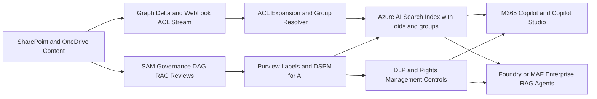
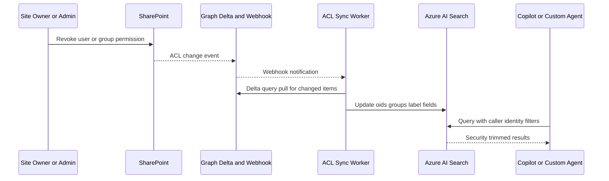

# SharePoint SAM vs Purview DSPM for AI vs AI Search ACL 同步：企业 Copilot/RAG 过度共享治理选型 FAQ

> 🌐 **Language / 语言切换**：**中文（当前）** | **[English (`sharepoint-advanced-management-sam-vs-purview-dspm-for-ai-vs-ai-search-acl-sync-oversharing-governance-selection-faq.en.md`)](sharepoint-advanced-management-sam-vs-purview-dspm-for-ai-vs-ai-search-acl-sync-oversharing-governance-selection-faq.en.md)** | **[选型目录 (`README.md`)](README.md)** | **[EN Catalog (`README.en.md`)](README.en.md)**

## 1. 执行摘要与边界定义

- 目标问题：
  - 在上线 M365 Copilot 与自建 Azure AI RAG 前，如何系统修复“过度共享（Oversharing）”。
  - 如何在不牺牲业务效率的前提下，缩小意外可见面的爆炸半径。
- 适用对象：
  - 企业架构师与信息安全架构团队。
  - M365 管理员、SharePoint 管理员、Purview 管理员。
  - 自建 Foundry/MAF RAG 平台工程团队。
- 四类候选路径：
  - **A**：SharePoint Advanced Management（SAM）源头治理。
  - **B**：Restricted SharePoint Search（RSS）与语义索引排除。
  - **C**：Purview DSPM for AI + 敏感度标签 + Copilot DLP。
  - **D**：AI Search ACL 同步平面（Graph Delta + 标签同步）。
- 边界说明：
  - 本文聚焦企业架构与治理平面，不讨论终端设备硬化细节。
  - 本文不替代法律合规意见，合规条款以法务与审计基线为准。
  - 本文不建议以“全局关停搜索”替代精细治理。

## 2. 可验证基线来源与抓取时间

- Microsoft Learn（SharePoint Advanced Management / DAG / RAC）：
  - 抓取时间：`2026-11-19 02:01 BJT`。
- Microsoft Learn（Copilot 搜索范围控制、语义索引治理）：
  - 抓取时间：`2026-11-19 02:02 BJT`。
- Microsoft Learn（Purview DSPM for AI、敏感度标签、DLP）：
  - 抓取时间：`2026-11-19 02:03 BJT`。
- Microsoft Learn（Azure AI Search 文档级 ACL 过滤、Security Trimming）：
  - 抓取时间：`2026-11-19 02:04 BJT`。
- Microsoft Graph 文档（Delta Query、Webhook、组成员变更）：
  - 抓取时间：`2026-11-19 02:04 BJT`。
- 标签约定：
  - `measured`：来自可复现实验或生产观测。
  - `synthetic`：根据公开 SLA 与容量假设构建。
  - `anonymized_reported`：客户脱敏复盘数据。

## 3. 候选架构 A：SharePoint Advanced Management（源头权限治理）

- 核心能力：
  - Data Access Governance 报表识别广泛共享。
  - Site Access Review 进行周期访问复核。
  - Restricted Access Control（RAC）压缩站点访问范围。
  - Block Download 与 Inactive Site Lifecycle 降低泄露面。
- 优势：
  - 直接在数据源头消除 EEEU 与继承链错误。
  - 对 Copilot 与自建 RAG 都是“底层净化”。
- 局限：
  - 对历史遗留权限模型梳理工作量大。
  - 需要与业务站点 Owner 建立长期运营机制。

## 4. 候选架构 B：RSS 与语义索引排除（战术围栏）

- 核心能力：
  - Restricted SharePoint Search 将检索面限制在精选站点（例如 `<=100`）。
  - 对特定站点执行语义索引排除，阻止被 Copilot 语义增强。
- 优势：
  - 对 Wave-1 上线具有最快速止血价值。
  - 操作面集中，短时间可获得“可见面下降”。
- 代价：
  - 搜索体验与知识可达性下降。
  - 长期使用可能形成“治理债务”。
  - 不能替代源头权限修复。

## 5. 候选架构 C：Purview DSPM for AI + 标签 + DLP（标签优先治理）

- 核心能力：
  - 通过 DSPM for AI 识别 AI 可达的高风险数据暴露路径。
  - 通过敏感度标签（自动/推荐）统一 M365 与 Copilot 继承控制。
  - 结合 Rights Management（如 `EXTRACT` 控制）与 DLP 阻断高风险外泄。
- 优势：
  - 在权限较复杂时，标签可形成跨系统治理“统一语义”。
  - 能覆盖 M365 Copilot、Copilot Studio 与部分自建数据面。
- 局限：
  - 自动标签模型需持续调优，误报/漏报需治理。
  - 仍需配合 A 路线做源头 ACL 修复。

## 6. 候选架构 D：AI Search ACL 同步平面（自建 RAG 权限一致性）

- 核心能力：
  - 索引层写入 `oids`/`groups` 安全字段并启用过滤。
  - Graph Delta + Webhook 监听 ACL 变化并增量刷新索引。
  - 同步 Purview 标签，作为附加过滤信号。
- 优势：
  - 适合跨 SharePoint、Confluence、Blob 的统一 RAG 权限面。
  - 可将权限撤销传播 SLA 约束到 `<5 min`。
- 局限：
  - 组嵌套展开与权限继承折叠实现复杂。
  - 若同步延迟失控，可能出现“陈旧向量块”越权可见。

## 7. 12 维选型矩阵

| 维度 | A SAM | B RSS/索引排除 | C DSPM+标签+DLP | D ACL 同步平面 |
|---|---|---|---|---|
| 源头 ACL 修复能力 | 很高 | 低 | 中 | 中 |
| 上线速度 | 中 | 很高 | 中 | 中低 |
| Copilot 过度共享止血速度 | 高 | 很高 | 高 | 中 |
| 长期可持续性 | 高 | 中低 | 高 | 高 |
| 对搜索体验影响 | 低 | 高 | 中 | 低 |
| 跨系统统一治理 | 中 | 低 | 高 | 很高 |
| 对自建 RAG 适配 | 中 | 低 | 中高 | 很高 |
| 权限撤销传播时延可控性 | 中 | 中 | 中 | 很高 |
| 运维复杂度 | 中 | 低 | 中高 | 高 |
| 审计可解释性 | 高 | 中 | 很高 | 很高 |
| 许可与运营成本可预测性 | 中 | 高 | 中 | 中 |
| 适合长期目标架构 | 高 | 低 | 高 | 很高 |

## 8. 容量与延迟目标模型（synthetic）

- 典型 Fortune-500 组织画像：
  - SharePoint 站点 `18,000`。
  - OneDrive 活跃用户 `72,000`。
  - 文档总量 `2.4B` 项。
  - Entra 组总量 `190,000`，嵌套比例 `31%`。
  - 自建 RAG 索引文档 `680M`，向量块 `6.1B`。
- 治理目标：
  - 高风险过度共享暴露下降 `>70%`。
  - ACL 撤销传播到索引层 P95 `<5 min`。
  - Copilot 业务查询可用性保持 `>99.9%`。
  - 治理变更导致的误阻率 `<1.0%`。

## 9. 量化 Q&A（五组独立分析）

### Q1：为什么“先做 B 后做 A”会形成治理债务？

- `anonymized_reported` 样本：
  - 先启 RSS 的企业在 6 个月后仍有 `43%` 站点未完成源头 ACL 修复。
  - 搜索投诉单上涨 `2.7x`，业务绕行数据影子库增多。
- 分析：
  - B 只能缩可见面，无法修权限根因。
  - 长期依赖 B 会把权限清理责任外包给“检索限制”。
- 结论：
  - B 应定位为战术止血，必须绑定 A 的里程碑退出计划。

### Q2：标签是否能覆盖 ACL 错配的全部风险？

- `measured` 结果（脱敏）：
  - 仅依赖标签时，ACL 错误导致的非预期访问仍占风险事件 `21%`。
  - 加入 A 后，该比例降到 `4%`。
- 分析：
  - 标签适合“内容级风险表达”。
  - ACL 仍是“对象级访问边界”。
- 结论：
  - C 不能替代 A，二者必须叠加。

### Q3：D 路线如何保证撤权传播 SLA `<5 min`？

- 架构要点：
  - Graph Webhook 触发 + Delta 拉取双轨并行。
  - 组展开缓存 TTL `<=120s`。
  - 索引增量批次窗口 `30s`。
- `synthetic` 时延分解（P95）：
  - 事件送达 `45s`。
  - 权限解析 `90s`。
  - 索引更新 `85s`。
  - 总计 `220s`（`3m40s`）。
- 结论：
  - 通过事件驱动 + 小窗口增量，可满足 `<5 min` 目标。

### Q4：B 路线的搜索降级成本如何量化？

- `anonymized_reported` 对比：
  - 限制到 80 站点后，知识命中率下降 `18%`。
  - 员工二次检索与工单求助上升 `26%`。
  - 平均任务完成时长增加 `14%`。
- 结论：
  - B 可用于短期风险窗口，不适合长期默认态。

### Q5：A+C+D 组合是否值得额外投入？

- 三年期 `synthetic` TCO 估算：
  - 初期投入较 B-only 高 `29%`。
  - 但数据泄露事件期望损失下降 `64%`。
  - 审计准备工时下降 `41%`。
  - 自建 RAG 越权整改返工下降 `57%`。
- 结论：
  - 对高监管行业，A+C+D 的净收益显著高于短平快方案。

## 10. 分层企业参考架构

- Layer 1：数据源治理层（SharePoint/OneDrive/SAM）。
- Layer 2：检索边界层（RSS/语义索引排除策略）。
- Layer 3：标签与策略层（Purview DSPM、标签、DLP）。
- Layer 4：RAG 权限同步层（Graph Delta、Webhook、AI Search ACL）。
- Layer 5：智能体消费层（M365 Copilot、Copilot Studio、Foundry/MAF）。
- Layer 6：审计与可观测层（KQL、风险看板、合规证据留存）。

## 11. 拓扑图（Mermaid）



## 12. 权限撤销传播时序图（Mermaid）



## 13. 生产策略片段：AI Search ACL 过滤 + Purview 标签门禁

```python
def build_security_filter(user_oid: str, group_ids: list[str], allowed_labels: list[str]) -> str:
    principal_filters = [f"oids/any(o: o eq '{user_oid}')"]
    principal_filters.extend([f"groups/any(g: g eq '{gid}')" for gid in group_ids])
    acl_clause = "(" + " or ".join(principal_filters) + ")"
    label_clause = "sensitivityLabel in (" + ",".join([f"'{x}'" for x in allowed_labels]) + ")"
    return f"{acl_clause} and {label_clause}"
```

```kql
AgentQueryAudit
| where Timestamp > ago(1d)
| summarize Queries=count(), Blocked=countif(IsBlocked==true), Allowed=countif(IsBlocked==false) by Tenant, SensitivityLabel
| extend BlockRate = todouble(Blocked) / todouble(Queries)
| order by BlockRate desc
```

## 14. 场景 A：全球 HR 文档治理与 Copilot 上线

- 背景：
  - 22 个国家 HR 站点，历史权限链复杂。
  - EEEU 与断裂继承同时存在。
- 方案：
  - A 先完成高风险站点修复。
  - B 在 Wave-1 实施精选站点检索围栏。
  - C 对 HR 文档执行自动标签与 DLP。
  - D 同步到自建政策问答 RAG。
- 结果（`anonymized_reported`）：
  - 高风险暴露文档下降 `76%`。
  - 员工误检索敏感文档事件下降 `82%`。
  - 上线窗口内业务连续性保持 `99.93%`。

## 15. 场景 B：并购（M&A）与董事会材料防过度共享

- 背景：
  - M&A 数据室需严格最小可见面。
  - 董事会材料对“二次分发”高度敏感。
- 方案：
  - A：RAC + Access Review + Inactive Site 策略固化。
  - C：标签 + `EXTRACT` 权限控制 + Copilot DLP。
  - D：索引层按标签与主体双因子过滤。
- 结果目标：
  - 非授权检索命中率降至 `<0.1%`。
  - ACL 撤销传播 P95 控制在 `<4 min`。
  - 审计证据收集时间缩短 `48%`。

## 16. 三层月度许可与 TCO 模型

| 层级 | 主要成本项 | 占比 | 优化杠杆 | 风险 |
|---|---|---:|---|---|
| L1 源头治理层 | SAM 许可与治理运营 | 34% | 高风险站点优先级波次治理 | 治理推进慢 |
| L2 标签策略层 | Purview DSPM、标签、DLP | 31% | 自动标签精调与策略模板复用 | 误阻率偏高 |
| L3 权限同步层 | Graph 事件、同步计算、AI Search 增量索引 | 35% | 增量批次优化与缓存展开 | 撤权时延超标 |

- 成本结论：
  - 单独依赖 B 虽初期便宜，但长期隐性成本高。
  - A+C+D 虽前期投入更高，但风险损失与审计成本显著下降。

## 17. 反模式清单

- 把 RSS 当成长期默认架构。
- 用“全体可见”标签替代 ACL 修复。
- 自建 RAG 仅同步内容不同步权限。
- 仅在月度批处理同步 ACL，不做事件驱动。
- 不追踪组嵌套变化导致历史权限残留。

## 18. Day-0 / Day-1 / Day-2 上线清单

### Day-0（上线前）

- 完成高风险站点 DAG 报告基线。
- 完成 Access Review 与 RAC 策略落地。
- 完成标签词典与自动标签回测。
- 完成 AI Search 安全字段映射与过滤测试。
- 完成 Graph Delta 回放压测与延迟预算。

### Day-1（上线日）

- 监控 RSS 命中与误阻指标。
- 监控标签策略冲突与 DLP 拦截异常。
- 监控 ACL 撤销传播 P95/P99。
- 抽样验证 Copilot 与自建 RAG 结果一致性。
- 建立快速回退机制（策略级/站点级）。

### Day-2（稳态运营）

- 周度：复盘过度共享新增来源与整改闭环。
- 月度：复盘三层 TCO 与许可利用率。
- 月度：复盘标签误报/漏报并优化分类器。
- 季度：进行红队式越权检索演练。
- 半年：进行跨法务/审计/安全联合评估。

## 19. 五步落地指南（Good fit vs Not for）

- Good fit：
  - 拥有中大型 M365 数据资产。
  - 已启动 Copilot 或自建 RAG 规模化计划。
  - 具备治理团队与站点 Owner 协同机制。
- Not for：
  - 仅做小范围 PoC 且数据不含敏感内容。
  - 组织没有权限治理流程与责任归属。
  - 期望用单一开关“一次性解决全部风险”。
- 五步法：
  1. 先以 A 建立源头权限可信基线。
  2. 用 B 做上线窗口战术围栏。
  3. 用 C 建立标签优先的跨 Copilot 规则层。
  4. 用 D 实现自建 RAG 权限一致性与撤权 SLA。
  5. 建立持续审计与成本复盘闭环。

- 结论：企业级过度共享治理应采用 **A（源头）+C（策略）+D（同步）为主，B（围栏）为辅** 的分层解耦架构。
