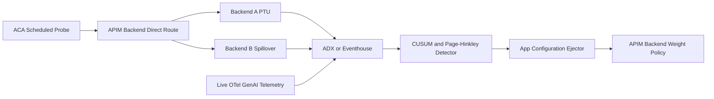
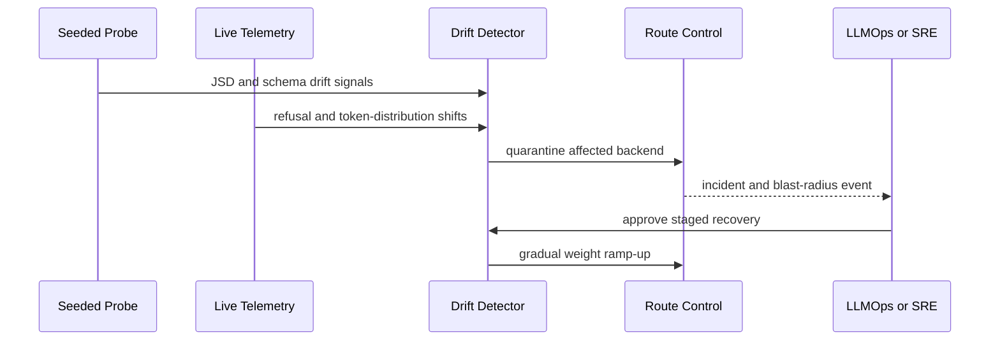

# Enterprise Silent Model Behavioral Drift Detection and Mitigation Selection FAQ: Seeded Logprob Sentinel plus CUSUM vs Passive Telemetry vs Online Evaluation Shadow Gates vs Immutable Self-Hosted Weights

> **Audience**: Cloud and AI Solution Architects, platform engineering teams, LLMOps, SRE, model-governance owners, and regulated audit stakeholders.
> **Core question**: Even with pinned `model_version`, upstream serving kernels, safety-classifier policy updates, regional backend differences, and traffic-mix shifts can silently degrade behavior. How do we detect, contain, and recover without disrupting business continuity?

---

## 1. Executive summary

The highest-cost production failure mode is usually not a hard outage. It is silent regression:

- JSON tool-call validity drifts from `98.5%` to `95.8%`;
- output tokens increase by `20%+` without explicit release notices;
- false-refusal rates spike in regulated intents;
- behavioral parity breaks between `Regional PTU` and `Global Standard` spillover paths.

No single architecture route is sufficient across all failure classes. In practice:

- **Route A** gives deterministic early warning;
- **Route B** gives real-traffic realism and long-tail sensitivity;
- **Route C** adds semantic equivalence assurance before and during backend shifts;
- **Route D** provides maximum determinism when legal or supervisory constraints require strict reproducibility.

Recommended default posture:

1. Use **A + B** as baseline production controls.
2. Add **C** for high-stakes release gates and spillover promotion.
3. Add **D** where regulatory determinism outweighs managed-service elasticity.

---

## 2. Scope and failure boundaries

### 2.1 Typical silent drift sources

1. Provider runtime minor updates (kernel scheduler, precision path, batching behavior).
2. Safety-filter threshold or policy-rules revisions.
3. Cross-region backend heterogeneity (`PTU` versus `Global Standard` overflow).
4. Input-distribution shifts (seasonality, campaigns, legal events).
5. Prompt-template and tool-schema changes interacting with model routing.

### 2.2 Why this is a systems problem, not just a model problem

- Increased schema-breaks trigger retries and queue pressure.
- Refusal spikes increase human escalation load.
- Output-length inflation reduces concurrency headroom.
- Aggregate means can look healthy while specific tenants fail first.

### 2.3 Out-of-scope clarifications

This document does not cover:

- model training pipeline governance,
- pretraining/fine-tuning hyperparameter optimization,
- static offline benchmark-only comparisons.

---

## 3. Route definitions

### Route A — Active deterministic seeded-probe sentinel

Reference flow:

`ACA Scheduled Probe -> APIM Backend Direct Bypass -> ADX or Fabric Eventhouse -> CUSUM or Page-Hinkley -> App Configuration Circuit Ejector`

Core mechanics:

- fixed probe suites with pinned prompts and seed controls,
- `Top-K logprob` fingerprints with JSD scoring,
- sequential detectors (`CUSUM`, `Page-Hinkley`) for fast shift detection,
- automatic backend quarantine and weighted route rollback.

Strengths:

- high detection speed, often within `<15 min`,
- low contamination from user-traffic seasonality,
- budgetable monthly probe token cost.

Trade-offs:

- requires disciplined probe-suite versioning,
- may miss domain-specific long-tail drift not represented in probes.

### Route B — Passive live-traffic structural and distribution telemetry

Core mechanics:

- zero synthetic probe overhead,
- direct monitoring of real production interactions.

Typical signals:

- tool-schema parse success rate,
- refusal and policy-block rates,
- output length distribution drift (Wasserstein, PSI),
- reasoning-step and retry-depth drift.

Strengths:

- captures business-context regressions that fixed probes can miss,
- naturally tenant- and scenario-relevant.

Trade-offs:

- requires robust stratification to avoid false alarms,
- governance required for telemetry minimization and privacy-safe usage.

### Route C — Continuous online evaluation and paired shadow-equivalence gate

Core mechanics:

- sampled online requests scored with calibrated LLM-as-judge rubric,
- paired mirror traffic across primary and spillover backends,
- semantic plus structural promotion gates before production reweighting.

Strengths:

- catches semantic regressions even when schema is valid,
- validates overflow parity before peak events.

Trade-offs:

- additional evaluation cost and complexity,
- judge calibration drift must be controlled.

### Route D — Self-hosted immutable serving with digest-locked artifacts

Core mechanics:

- `AKS vLLM/SGLang`,
- OCI image digest pinning,
- model weight `SHA256` lock,
- controlled upgrade windows for runtime and drivers.

Strengths:

- strong immunity to external silent provider updates,
- strongest reproducibility for regulatory evidence.

Trade-offs:

- highest platform operations burden,
- larger elasticity and geo-expansion cost.

---

## 4. Twelve-dimension comparison matrix

| Dimension | Route A active sentinel | Route B passive telemetry | Route C online eval shadow gate | Route D immutable self-hosted |
|---|---|---|---|---|
| Detection speed | High | Medium | Medium-high | High (inside boundary) |
| Robustness to traffic seasonality | High | Medium | Medium | High |
| Semantic-drift visibility | Medium | Medium | High | Medium-high |
| Extra token overhead | Medium | Low | Medium-high | Low |
| Architectural complexity | Medium | Medium | High | High |
| Automatic quarantine readiness | High | Medium | High | High |
| Cross-backend parity confidence | Medium | Low | High | Medium |
| Audit explainability | High | Medium-high | High | Very high |
| Operational burden | Medium | Medium | High | Very high |
| Multi-tenant scalability | High | High | Medium | Medium |
| Rollback stability | High | Medium | High | High |
| Recommended role | Baseline control plane | Production blind-spot coverage | Release and overflow gate | Strict determinism workloads |

---

## 5. Metric taxonomy and severity policy

Three-layer signal model:

1. **Structural layer**: `tool_schema_valid_rate`, `json_parse_error_rate`.
2. **Behavioral layer**: `refusal_rate`, `output_token_p95`, `reasoning_step_p95`.
3. **Semantic layer**: `judge_score_delta`, `paired_equivalence_gap`.

Suggested incident severity mapping:

- `SEV2`: two consecutive detector windows breached on structural metrics.
- `SEV1`: structural and semantic breaches confirmed together.
- `SEV0`: business-critical path impact and failed fallback containment.

---

## 6. Q1 — How to separate provider-side drift from Monday-morning traffic mix shifts

Practical approach:

1. Keep deterministic probes independent from user traffic.
2. Stratify live telemetry by tenant, intent, channel, region, and time bucket.
3. Apply dual-channel reasoning:
   - probes drift + live drift = likely backend drift,
   - live drift only in one tenant cohort = likely business-mix shift.

Illustrative evidence pattern:

- Probe JSD rises from `0.018` to `0.064`.
- Live `tool_schema_valid_rate` drops from `98.7%` to `95.9%`.
- Stratified decline appears across all major tenant cohorts.

This pattern strongly supports provider/back-end change rather than demand-mix-only explanation.

---

## 7. Q2 — With `seed + temperature=0`, what is the practical non-determinism floor and threshold policy

Reality:

- GPU reduction paths and serving internals introduce small stochastic effects.
- Treating any non-zero divergence as drift produces false positives.

Recommended threshold engineering:

1. Build a 7-to-14-day baseline.
2. Estimate JSD noise floor from stable windows.
3. Set alert threshold to `μ + 4σ` or conservative extreme quantile (`p99.5`).

Example:

- Baseline JSD mean `0.012`, sigma `0.004`.
- Drift threshold candidate `0.028`.
- Require `N=3` consecutive breach batches before isolation trigger.

---

## 8. Q3 — CUSUM or SPRT sample-size and time-to-detect for `1.5% -> 4.0%` schema break spike

Assumptions:

- monitored metric: `tool_schema_break_rate`,
- baseline `p0 = 0.015`,
- shifted state `p1 = 0.040`,
- 5-minute windows with 120 sampled calls each.

Expected outcome:

- two-sided CUSUM often detects within `30 to 50` minutes,
- SPRT can detect faster in low-noise channels but is more sensitive to contamination.

Production guidance:

- default to CUSUM as stable baseline detector,
- layer SPRT for fast-alert lanes on mission-critical intents.

---

## 9. Q4 — How to verify `Regional PTU` versus `Global Standard` behavioral parity before burst overflow

Verification protocol:

1. Pairwise mirror `1%` of production requests.
2. Compare structural validity, refusal parity, and semantic score deltas.
3. Enforce hard promotion gates.

Illustrative gates:

- structural parity `< 99.0%` blocks promotion,
- semantic gap `> 0.25` blocks promotion,
- refusal-rate delta `> 1.2pp` triggers human review and freeze.

---

## 10. Q5 — How to prevent flapping during automatic APIM quarantine and recovery

Common anti-pattern:

- immediate quarantine on first anomaly,
- immediate restore after one healthy window,
- repeated oscillation and user-facing instability.

Anti-flap controls:

1. fast entry, slow exit,
2. minimum quarantine hold time (`30 min` baseline),
3. multi-window healthy requirement for restore,
4. staged ramp-up rather than one-step full restore.

---

## 11. Q6 — What evidence package is needed for SR 11-7 and EU AI Act post-market monitoring

Minimum evidence set:

- probe suite version and hash,
- detector statistics and threshold snapshots,
- automated actions timeline (quarantine, rollback, reweight),
- operator approvals and override decisions,
- blast-radius quantification by tenant, scenario, and interval.

Audit principle:

A single incident dossier must answer:

- when drift started,
- why detector confidence was sufficient,
- what control actions were applied,
- what impact occurred,
- how and when normal operation was restored.

---

## 12. Mermaid — Multi-channel drift detection and rollback topology



---

## 13. Mermaid — Incident lifecycle from detection to controlled recovery



---

## 14. Production block 1 — Seeded probe plus JSD plus two-sided CUSUM (Python)

```python
from dataclasses import dataclass
from math import log


@dataclass
class ProbeResult:
    schema_ok: bool
    refusal: bool
    topk_probs: list[float]


def js_divergence(p: list[float], q: list[float]) -> float:
    m = [(a + b) / 2.0 for a, b in zip(p, q)]
    def kl(a, b):
        return sum(x * log((x + 1e-12) / (y + 1e-12)) for x, y in zip(a, b))
    return 0.5 * kl(p, m) + 0.5 * kl(q, m)


class TwoSidedCUSUM:
    def __init__(self, k: float, h: float):
        self.k = k
        self.h = h
        self.pos = 0.0
        self.neg = 0.0

    def update(self, value: float, baseline: float) -> bool:
        delta = value - baseline
        self.pos = max(0.0, self.pos + delta - self.k)
        self.neg = min(0.0, self.neg + delta + self.k)
        return self.pos > self.h or abs(self.neg) > self.h
```

---

## 15. Production block 2 — APIM quarantine and staged recovery policy (YAML)

```yaml
driftControl:
  detection:
    windowMinutes: 5
    consecutiveBreaches: 3
    jsdThreshold: 0.028
    schemaBreakRateThreshold: 0.03
  quarantine:
    action: setBackendWeight
    quarantineWeight: 0
    minimumHoldMinutes: 30
  recovery:
    requireHealthyWindows: 6
    rampPlan:
      - minute: 0
        weight: 5
      - minute: 10
        weight: 20
      - minute: 20
        weight: 50
      - minute: 40
        weight: 100
  governance:
    requireIncidentTicket: true
    requireOpsApprovalForFinalCutback: true
```

---

## 16. Enterprise scenario A — Regulated claims adjudication assistant with false-refusal spike

Context:

- Medical claims assistant had stable baseline for months.
- Suddenly refusal rate jumps from `2.1%` to `5.6%`.
- Business teams report medically valid claims denied more frequently.

Response sequence:

1. Route A probes detect refusal jump on deterministic medical prompts.
2. Route B confirms broad impact across tenant slices.
3. Route C judge scores identify semantic under-acceptance pattern.
4. Quarantine action ejects affected backend and routes to known-good path.

Outcome:

- service restored in 42 minutes,
- escalation queue peak reduced by `37%`,
- complete evidence package available for compliance review.

---

## 17. Enterprise scenario B — High-volume ERP order-entry backend equivalence gate

Context:

- Peak order window requires overflow from `East US 2 PTU` to `Global Standard`.
- Risk: field extraction and tool argument behavior diverges under overflow route.

Execution:

1. 1% pairwise mirror traffic enabled.
2. Route C compares semantic and structural parity.
3. Route A probe suite runs fixed order-book examples continuously.

Promotion criteria:

- structural parity `>= 99.4%`,
- semantic gap `< 0.20`,
- refusal delta `< 0.8pp`.

If any gate fails, promotion is blocked and incident workflow starts.

---

## 18. Three-year TCO illustration

| Cost category (3 years) | Route A | Route B | Route C | Route D |
|---|---:|---:|---:|---:|
| Probe and detector platform | $0.52M | $0.26M | $0.61M | $0.48M |
| Telemetry and analytics storage | $0.41M | $0.57M | $0.49M | $0.39M |
| Evaluation and shadow-comparison spend | $0.18M | $0.12M | $0.84M | $0.21M |
| Operations and on-call coverage | $0.67M | $0.58M | $0.73M | $1.24M |
| Serving divergence risk overhead | $0.36M | $0.44M | $0.33M | $0.72M |
| **Total (3 years)** | **$2.14M** | **$1.97M** | **$3.00M** | **$3.04M** |

Interpretation:

- Route B is cost-efficient but relies on high telemetry maturity.
- Route A is often the best baseline for explainable control.
- Route C is justified for critical release and parity gates.
- Route D costs more but delivers strongest reproducibility guarantees.

---

## 19. Day-0 / Day-1 / Day-2 checklist

### Day-0 (design)

- Define drift taxonomy and severity policy.
- Establish probe-suite ownership and version control.
- Define tenant and scenario stratification dimensions.

### Day-1 (pilot)

- Deploy Route A baseline probes.
- Enable Route B telemetry pipeline and baseline dashboards.
- Run no-impact quarantine simulation exercises.

### Day-2 (scale)

- Add Route C online evaluation gates.
- Enable anti-flap staged recovery policies.
- Operationalize quarterly audit-drill evidence exports.

---

## 20. Five-step decision guide (Good fit vs Not for)

1. **Start with deterministic visibility**, not ad hoc log sampling.
2. **Stratify real telemetry** before creating policy alerts.
3. **Gate backend promotion** with paired semantic checks.
4. **Implement quarantine plus anti-flap recovery** as code.
5. **Package audit evidence automatically** for every major incident.

**Good fit**:

- Multi-tenant B2B AI SaaS,
- regulated workloads (finance, healthcare, public sector),
- bursty traffic requiring backend spillover.

**Not for**:

- low-risk offline-only experimentation,
- teams without baseline operational telemetry discipline,
- short-lived demos without audit or rollback requirements.

---

## 21. Risk register and control mapping

| Risk | Trigger signal | Primary control | Owning team |
|---|---|---|---|
| Structured output breakage | `json_parse_error_rate` spike | Route A quarantine | LLMOps |
| False-refusal inflation | `refusal_rate` threshold breach | Route B stratified analysis plus Route C semantic gate | App domain team |
| Routing oscillation | frequent weight reversals | minimum hold plus staged recovery | SRE |
| Audit evidence gaps | incomplete incident replay | evidence package standardization | Governance and compliance |

---

## 22. Twelve-week implementation cadence

### Weeks 1-2

- critical journey mapping,
- metric dictionary definition,
- probe scheduling and event ingestion pipeline.

### Weeks 3-5

- CUSUM threshold calibration,
- stratified telemetry dashboards,
- first incident simulation drill.

### Weeks 6-8

- Route C online judge gate integration,
- paired backend equivalence checks,
- automated quarantine policy onboarding.

### Weeks 9-10

- staged recovery tuning,
- anti-flap verification,
- runbook finalization for support rotation.

### Weeks 11-12

- compliance evidence template completion,
- full-stack failover and drift drill,
- production architecture-review approval.

---

## 23. Anti-pattern checklist

1. Relying on global averages only.
2. Treating A/B experimentation alone as drift detection.
3. No probe-suite versioning discipline.
4. Quarantine without defined recovery path.
5. Instant full restoration causing flapping.
6. No auditable incident evidence chain.

---

## 24. Minimum observability dashboard fields

Required fields:

- `tenant_id`, `scenario_id`, `backend_id`, `region`,
- `schema_valid_rate`, `refusal_rate`, `output_token_p95`,
- `jsd_score`, `cusum_state`, `quarantine_state`,
- `rollback_action`, `recovery_stage`,
- `incident_id`, `audit_bundle_uri`.

Without these, teams can detect symptoms but cannot prove root cause and containment quality.

---

## 25. Final recommendation

If you can only ship one control first, implement **Route A deterministic sentinels** because they make silent regressions observable quickly.
If you want resilient production governance, add **Route B passive telemetry** for long-tail realism.
If cross-backend promotion or regulatory assurance matters, add **Route C semantic parity gates**.
Choose **Route D** when strict determinism and reproducibility are mandatory and operational overhead is acceptable.

---

## 26. Sources and data labels

> This document is an enterprise architecture selection guide. Numerical examples illustrate method and control logic. Final thresholds and budget numbers must be recalibrated with tenant-specific load tests and billing telemetry.

- Azure API Management AI Gateway overview and changelog references, retrieved `2026-11-26`.
- Azure Container Apps Sessions documentation and GA announcement references, retrieved `2026-11-26`.
- Azure Monitor and OpenTelemetry GenAI observability references, retrieved `2026-11-26`.
- Firecracker, Kata Containers, Wasmtime, and E2B release references, retrieved `2026-11-26`.
- Sequential change-detection engineering references for CUSUM, Page-Hinkley, and SPRT, retrieved `2026-11-26`.

Quantitative examples in this FAQ are labeled as: `anonymized_reported`.

