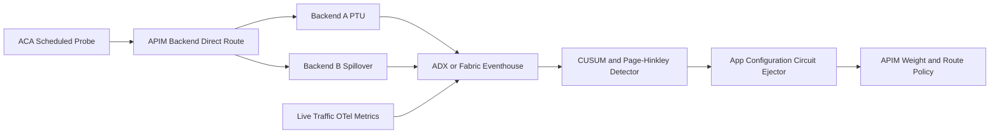
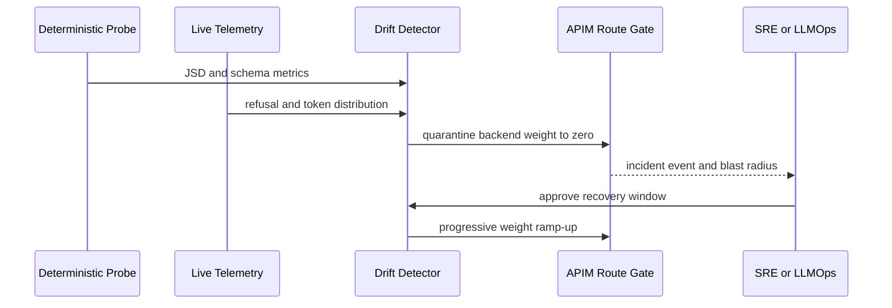

# 企业静默模型行为漂移检测与缓释选型 FAQ：Seeded Logprob Sentinel + CUSUM vs 被动流量遥测 vs 在线评测影子门禁 vs 自托管不可变权重

> **适用对象**：Cloud & AI Solution Architect、平台工程、LLMOps、SRE、模型治理与合规审计团队。
> **核心问题**：即使 `model_version` 固定，仍可能因上游推理内核、内容安全策略、区域后端硬件或流量分布变化导致行为漂移，如何在不牺牲业务连续性的前提下做到快速发现、隔离与自动回退。

---

## 1. 执行摘要（先看结论）

当企业 Agent 进入生产后，最危险的问题不是“明显不可用”，而是“静默退化”：

- JSON tool-call 结构有效率从 `98.5%` 缓慢跌到 `95.8%`；
- 平均输出 token 悄悄上涨 `22%`；
- 医疗、法务等敏感词误拒率出现阶跃；
- `PTU` 与 `Global Standard` 溢出路径语义等价性破坏。

四条架构路线中没有单一路线可以覆盖全部风险，建议采用分层组合：

- **Route A（主动哨兵）**：确定性探针 + `Top-K Logprob` 指纹 + `CUSUM/Page-Hinkley` 顺序告警；
- **Route B（被动遥测）**：真实流量结构化指标 + 分布漂移统计；
- **Route C（语义影子评测）**：在线抽样判分 + 后端镜像等价门禁；
- **Route D（不可变自托管）**：模型权重与镜像摘要锁定，换取极高确定性。

生产建议：

1. 大多数企业优先 **A + B** 作为底盘；
2. 高合规行业叠加 **C** 做发布前后语义一致性闸门；
3. 监管要求“可证明确定性”场景再引入 **D**。

---

## 2. 问题边界与失效模式

### 2.1 典型静默漂移来源

1. 供应商推理 runtime 小版本更新（kernel、scheduler、quantization path）。
2. 内容安全分类器阈值调整或策略规则更新。
3. 跨区域后端（`Regional PTU`、`Global Standard`）硬件路径不同。
4. 节假日、促销日导致用户输入分布突变。
5. 上下文模板变更造成隐式提示偏移。

### 2.2 业务影响不是单点，而是连锁

- 结构化工具调用失败率提升，触发补偿重试，进一步放大延迟与成本；
- 误拒率上升导致人工升级队列拥堵；
- 推理长度膨胀挤压并发容量；
- 监控只看均值时，尾部租户先出问题但全局均值不报警。

### 2.3 非目标说明

本指南不覆盖：

- 训练数据漂移治理流程；
- 模型训练阶段超参数优化；
- 单一 benchmark 离线评分的学术比较。

---

## 3. 四路线定义（Route A / B / C / D）

### Route A：主动确定性探针哨兵

架构链路：

`ACA Scheduled Probe -> APIM Backend Direct Bypass -> ADX/Fabric Eventhouse -> CUSUM -> App Configuration Ejector`

关键能力：

- 使用固定 `seed`、`temperature=0`、固定 prompt 套件；
- 采集 `Top-K logprob` 并构建指纹；
- 用 `JSD`、`Page-Hinkley`、`CUSUM` 判定漂移；
- 触发后端权重降级或隔离。

优点：

- 能在 `<15 min` 内捕捉后端行为变化；
- 不受用户业务分布波动干扰；
- 成本可控，月度探针 token 可预算化。

挑战：

- 需要维护探针题库和版本；
- 探针覆盖不到所有长尾业务语境。

### Route B：被动真实流量遥测

核心思路：

- 不额外消耗探针 token；
- 直接从生产流量提取结构指标与分布指标。

关键指标：

- Tool schema parse 成功率；
- 拒答率与安全拦截率；
- 输出长度分布（Wasserstein/PSI）；
- 推理步数、调用链深度、重试率。

优点：

- 可以发现“只在真实业务里出现”的漂移；
- 对领域样本最敏感。

挑战：

- 必须做分层分桶，否则容易把业务季节性当漂移；
- 数据治理要求高，防止遥测误用。

### Route C：在线语义评测 + 影子镜像

核心思路：

- 在线抽样小流量做 LLM-as-Judge；
- 并行镜像 `PTU` 与 `Spillover` 后端；
- 通过语义一致性分值决定是否允许切换。

优点：

- 能识别“结构正确但语义偏差”的问题；
- 可在高峰溢出前验证跨后端一致性。

挑战：

- 判分链路本身有成本与噪声；
- 需要校准评审模型与 rubric 稳定性。

### Route D：自托管不可变权重与镜像

核心思路：

- `AKS vLLM/SGLang`；
- OCI digest 固定；
- 模型权重 `SHA256` 固定；
- 基础镜像与驱动版本受控升级。

优点：

- 对上游“静默更新”天然免疫；
- 可做审计级可复现。

挑战：

- 运维复杂度最高；
- 弹性与跨区域扩展成本更高。

---

## 4. 十二维度对比矩阵

| 维度 | Route A 主动哨兵 | Route B 被动遥测 | Route C 在线评测镜像 | Route D 不可变自托管 |
|---|---|---|---|---|
| 漂移发现速度 | 高 | 中 | 中高 | 高（环境内） |
| 对业务分布变化鲁棒性 | 高 | 中 | 中 | 高 |
| 语义偏差可见性 | 中 | 中 | 高 | 中高 |
| 额外 token 成本 | 中 | 低 | 中高 | 低 |
| 架构复杂度 | 中 | 中 | 高 | 高 |
| 自动隔离能力 | 高 | 中 | 高 | 高 |
| 跨后端等价验证 | 中 | 低 | 高 | 中 |
| 合规审计可解释性 | 高 | 中高 | 高 | 极高 |
| 运维门槛 | 中 | 中 | 高 | 极高 |
| 多租户可扩展性 | 高 | 高 | 中 | 中 |
| 回退稳定性 | 高 | 中 | 高 | 高 |
| 推荐定位 | 默认底盘 | 生产补盲 | 发布与切流门禁 | 强监管确定性 |

---

## 5. 指标体系与告警分级

建议分三层指标：

1. **结构层**：`tool_schema_valid_rate`、`json_parse_error_rate`；
2. **行为层**：`refusal_rate`、`output_token_p95`、`reasoning_step_p95`；
3. **语义层**：`judge_score_delta`、`paired_equivalence_gap`。

告警分级建议：

- `SEV2`：连续两个窗口触发 `CUSUM` 且结构层指标越阈；
- `SEV1`：结构层 + 语义层同时越阈；
- `SEV0`：影响关键业务路径且回退失败。

---

## 6. Q1：如何区分“供应商静默漂移”与“周一流量分布变化”

分离策略：

1. 主动探针走固定题库，独立于用户流量；
2. 被动流量按租户、意图、渠道、时段分层；
3. 做双通道对照：若探针异常且真实流量异常，同时发生，多半是后端变化。

可量化判据（示例）：

- 探针 `JSD` 从 `0.018` 升到 `0.064`；
- 同时真实流量 `tool_schema_valid_rate` 从 `98.7%` 跌到 `95.9%`；
- 若分层后每个租户都同步下降，优先判为后端漂移。

---

## 7. Q2：`seed + temperature=0` 仍有噪声，阈值如何设

现实情况：

- GPU kernel 调度与并行归约仍会带来微小差异；
- 不能把任何差异都当漂移。

阈值建议：

1. 先做 7~14 天基线；
2. 计算 `Top-5` logprob `JSD` 噪声地板；
3. 告警阈值设为 `μ + 4σ` 或分位阈值（如 `p99.5`）。

示例：

- 基线 `JSD` 均值 `0.012`，标准差 `0.004`；
- 阈值可设 `0.028`；
- 超过阈值连续 `N=3` 个批次再触发一级告警。

---

## 8. Q3：`CUSUM/SPRT` 对 `1.5% -> 4.0%` 结构破坏的检测时间

设定：

- 目标监控指标：`tool_schema_break_rate`；
- 基线 `p0 = 0.015`；
- 异常水平 `p1 = 0.040`。

经验估算：

- 采样批次每 5 分钟一次、每批 120 条；
- 两侧 `CUSUM` 在 `30~50` 分钟内可稳定告警；
- `SPRT` 在样本质量高时可更快，但对噪声更敏感。

建议：

- 生产默认 `CUSUM`；
- 高风险通道叠加 `SPRT` 快速前置告警。

---

## 9. Q4：如何验证 `Regional PTU` 与 `Global Standard` 溢出等价性

验证步骤：

1. 对同一请求做 `1%` 成对镜像；
2. 记录结构一致性、拒答一致性、语义评分差；
3. 建立“允许差异带宽”。

门禁规则（示例）：

- 结构一致率 < `99.0%`：禁止切流；
- 语义评分差 > `0.25`：禁止切流；
- 误拒率差 > `1.2pp`：触发人工复核。

---

## 10. Q5：自动隔离与回退如何避免“来回振荡”

常见反模式：

- 触发阈值后立即切换；
- 指标一恢复又立即切回；
- 导致后端反复抖动，业务体验更差。

抗振荡设计：

1. 进入隔离要快，退出隔离要慢；
2. 使用最短保持时间（如 `30 min`）；
3. 恢复条件要求“多窗口连续健康”；
4. 回切权重采用斜坡而非一步到位。

---

## 11. Q6：如何满足 SR 11-7 / EU AI Act 事后审计证据

证据包最少字段：

- 探针输入版本与哈希；
- 告警触发时的统计量与阈值；
- 自动动作（降权/隔离/回退）时间线；
- 人工审批与解除记录；
- 影响范围（租户、场景、请求量）。

审计可读性要求：

- 一次事件可以在单报告里回答“何时发现、为何判断、做了什么、影响多大、如何恢复”。

---

## 12. Mermaid：多通道漂移检测与回退拓扑



---

## 13. Mermaid：告警、隔离、回切时序



---

## 14. 生产代码片段 1：Seeded Probe + JSD + 双侧 CUSUM（Python）

```python
from dataclasses import dataclass
from math import log


@dataclass
class ProbeResult:
    schema_ok: bool
    refusal: bool
    topk_probs: list[float]


def js_divergence(p: list[float], q: list[float]) -> float:
    m = [(a + b) / 2.0 for a, b in zip(p, q)]
    def kl(a, b):
        return sum(x * log((x + 1e-12) / (y + 1e-12)) for x, y in zip(a, b))
    return 0.5 * kl(p, m) + 0.5 * kl(q, m)


class TwoSidedCUSUM:
    def __init__(self, k: float, h: float):
        self.k = k
        self.h = h
        self.pos = 0.0
        self.neg = 0.0

    def update(self, value: float, baseline: float) -> bool:
        s = value - baseline
        self.pos = max(0.0, self.pos + s - self.k)
        self.neg = min(0.0, self.neg + s + self.k)
        return self.pos > self.h or abs(self.neg) > self.h
```

---

## 15. 生产代码片段 2：APIM 后端隔离与斜坡回切策略（YAML）

```yaml
driftControl:
  detection:
    windowMinutes: 5
    consecutiveBreaches: 3
    jsdThreshold: 0.028
    schemaBreakRateThreshold: 0.03
  quarantine:
    action: setBackendWeight
    quarantineWeight: 0
    minimumHoldMinutes: 30
  recovery:
    requireHealthyWindows: 6
    rampPlan:
      - minute: 0
        weight: 5
      - minute: 10
        weight: 20
      - minute: 20
        weight: 50
      - minute: 40
        weight: 100
  governance:
    requireIncidentTicket: true
    requireOpsApprovalForFinalCutback: true
```

---

## 16. 企业场景 A：理赔审核智能体误拒率突增

背景：

- 医保理赔审核 Agent 长期稳定；
- 某日误拒率从 `2.1%` 升到 `5.6%`；
- 业务方反馈“医学术语被大量拒绝”。

处置路径：

1. Route A 发现探针拒答率同步上升；
2. Route B 发现真实流量同类指标同步异常；
3. Route C 语义判分显示“充分证据请求被拒”；
4. 自动隔离异常后端并回退到上个稳定路由。

结果：

- 42 分钟内恢复；
- 客服升级队列峰值降低 `37%`；
- 审计证据包可追溯。

---

## 17. 企业场景 B：ERP 订单录入智能体跨区域等价性验证

背景：

- 订单录入高峰需要从 `East US 2 PTU` 溢出到 `Global Standard`；
- 风险是字段映射与工具调用行为偏移。

实施：

1. 路由层做 `1%` 成对镜像；
2. Route C 比较结构一致率与语义评分；
3. Route A 持续跑固定订单样例探针。

判定：

- 若结构一致率保持 `>=99.4%` 且语义差 < `0.2`，允许逐级放量；
- 否则禁止切流并告警。

---

## 18. 三年 TCO（示例）

| 成本项（3 年） | Route A | Route B | Route C | Route D |
|---|---:|---:|---:|---:|
| 探针与检测平台 | $0.52M | $0.26M | $0.61M | $0.48M |
| 遥测与存储分析 | $0.41M | $0.57M | $0.49M | $0.39M |
| 评测判分与镜像成本 | $0.18M | $0.12M | $0.84M | $0.21M |
| 运行与值班运维 | $0.67M | $0.58M | $0.73M | $1.24M |
| 基础模型与推理差异损耗 | $0.36M | $0.44M | $0.33M | $0.72M |
| **总计（3 年）** | **$2.14M** | **$1.97M** | **$3.00M** | **$3.04M** |

解读：

- B 成本最低但对治理成熟度要求高；
- A 是通用性与可解释性平衡最佳；
- C 适合发布门禁与高价值流程；
- D 成本高但确定性和审计可复现最强。

---

## 19. Day-0 / Day-1 / Day-2 落地清单

### Day-0（设计阶段）

- 定义漂移事件分级与响应剧本；
- 固化探针题库版本管理规范；
- 约定指标口径与分层维度（租户、意图、区域、后端）。

### Day-1（小流量阶段）

- 上线 Route A 基线探针；
- 打通 Route B 遥测采集与看板；
- 建立隔离动作演练（不影响主业务）。

### Day-2（规模化阶段）

- 引入 Route C 影子等价门禁；
- 加入回切抗振荡策略；
- 做季度审计演练并导出证据包模板。

---

## 20. 选型决策树（Good fit vs Not for）

### Good fit

- 多租户 SaaS Agent 平台；
- 监管行业（金融、医疗、公共部门）；
- 高峰期必须跨后端溢出的业务。

### Not for

- 仅离线批处理、无实时 SLA 的实验环境；
- 无法投入基础观测与值班流程的团队；
- 对审计与可追溯没有要求的短周期 PoC。

---

## 21. 风险登记与控制映射

| 风险 | 触发信号 | 控制措施 | 责任团队 |
|---|---|---|---|
| 结构化输出破坏 | `json_parse_error_rate` 突增 | Route A + 自动隔离 | LLMOps |
| 误拒率上升 | `refusal_rate` 越阈 | Route B 分层复核 + Route C 语义判分 | 应用团队 |
| 频繁抖动切流 | 路由权重频繁反转 | 最短保持时间 + 斜坡回切 | SRE |
| 审计证据缺失 | 事件无法复盘 | 证据包标准化与工单关联 | 治理团队 |

---

## 22. 十二周实施节奏建议

### 第 1-2 周

- 梳理关键链路；
- 建立指标字典；
- 接通探针调度与数据落库。

### 第 3-5 周

- 完成 `CUSUM` 阈值校准；
- 建立分层遥测看板；
- 首轮告警演练。

### 第 6-8 周

- 接入 Route C 在线评测；
- 完成跨后端等价镜像；
- 引入自动隔离策略。

### 第 9-10 周

- 打磨恢复与回切策略；
- 完成抗振荡验证；
- 形成值班 runbook。

### 第 11-12 周

- 完成审计证据模板；
- 做全链路故障演练；
- 通过架构评审与生产门禁。

---

## 23. 架构反模式清单

1. 只看平均值，不看分层与尾部；
2. 把 A/B 测试系统当漂移检测系统；
3. 无探针题库版本控制；
4. 自动隔离后无恢复策略；
5. 回切没有斜坡导致振荡；
6. 漂移事件没有审计证据闭环。

---

## 24. 可观测看板最小字段建议

必须包含：

- `tenant_id`、`scenario_id`、`backend_id`、`region`；
- `schema_valid_rate`、`refusal_rate`、`output_token_p95`；
- `jsd_score`、`cusum_state`、`quarantine_state`；
- `rollback_action`、`recovery_stage`；
- `incident_id`、`audit_bundle_uri`。

---

## 25. 最终建议

若只能先做一件事，优先落地 **Route A 主动哨兵**，因为它最能把“静默问题”显性化。
若要形成生产闭环，必须叠加 **Route B 被动遥测**。
若存在跨后端切流、监管审计与高价值业务，再加 **Route C**。
仅当确定性与可复现性要求远高于弹性时，采用 **Route D**。

---

## 26. 来源与数据标签

> 本文用于企业架构决策，数值示例用于估算方法说明，需结合企业真实压测与成本账单复核。

- Azure API Management AI Gateway 文档与更新说明，访问日期：`2026-11-26`。
- Azure Container Apps Sessions 文档与官方发布说明，访问日期：`2026-11-26`。
- Azure Monitor / OpenTelemetry GenAI 可观测最佳实践文档，访问日期：`2026-11-26`。
- Firecracker、Kata Containers、Wasmtime、E2B 官方发布页，访问日期：`2026-11-26`。
- 模型漂移检测相关统计方法（CUSUM/Page-Hinkley/SPRT）公开工程资料，访问日期：`2026-11-26`。

本文中量化示例标签：`anonymized_reported`。

