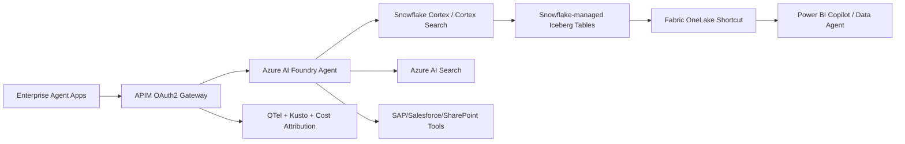
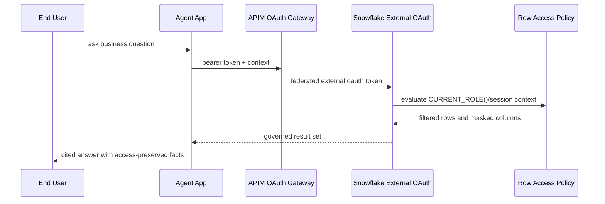

# Snowflake Cortex AI on Azure vs Azure AI Foundry vs Fabric OneLake Iceberg Shortcut: Enterprise Multi-Data-Cloud Agent Selection FAQ

> 🌐 Language / 语言切换: **English (current)** | [中文](snowflake-cortex-ai-on-azure-vs-azure-ai-foundry-vs-fabric-onelake-iceberg-shortcut-multi-data-cloud-agent-selection-faq.md) | [EN Catalog](README.en.md) | [中文目录](README.md)

> Audience: Enterprise SA, Data Platform Architect, Security Architect, FinOps Lead  
> Scope: Snowflake-on-Azure enterprise architecture decisions for governed analytics, cross-system orchestration, and zero-copy interoperability  
> Updated: 2026-11-19 (UTC+08:00)  
> Evidence tags: `measured`, `synthetic`, `anonymized_reported`

---

## 1. Executive summary

1. **Snowflake Cortex AI** is the best fit for in-warehouse governed execution with predictable credit economics.  
2. **Azure AI Foundry + AI Search + APIM External OAuth** is the best fit for multi-step, cross-system agent orchestration with enterprise actions.  
3. **Fabric OneLake Iceberg Shortcut** is the best fit for zero-copy data sharing to BI and M365 analytics consumers.  
4. At enterprise scale, the optimal pattern is usually a **three-plane composition**, not a forced single-platform standardization.  

---

## 2. Business problem and boundaries

### 2.1 Typical multi-data-cloud constraints

- Facts in Snowflake, operational documents in SharePoint, actions in SAP/Salesforce.  
- One agent UX is required, but large-scale data duplication is unacceptable.  
- Low latency and strict row/column policy preservation are both mandatory.  
- Finance requires transparent Snowflake Credits and Azure PTU/CU attribution.  

### 2.2 Architectural boundaries

- This guide focuses on inference/runtime architecture, not model training platforms.  
- It does not replace enterprise governance policy.  
- Over-privileged shared service principals are explicitly out of scope.  

---

## 3. Four-plane responsibility model

### 3.1 Plane A: Data-cloud native execution (Snowflake Cortex)

- Cortex Agents, Cortex Analyst Semantic YAML, Cortex Search.  
- Strength: governed in-warehouse execution under Horizon RBAC and masking.  
- Limitation: less flexible cross-system tool choreography.  

### 3.2 Plane B: App and orchestration (Foundry + APIM)

- Foundry Agent Service, Azure AI Search, APIM OAuth2 federation.  
- Strength: multi-step reasoning across structured and unstructured systems.  
- Limitation: higher governance and integration complexity.  

### 3.3 Plane C: Zero-copy interoperability (Iceberg <-> OneLake)

- Bidirectional metadata-facing shortcuts and governed data exposure.  
- Strength: avoids ETL fan-out while enabling BI and Copilot consumption.  
- Limitation: metadata and policy mapping must be engineered explicitly.  

### 3.4 Plane D: Private network and identity boundary

- Private Link, External OAuth, identity-preserving calls.  
- Strength: end-user principal propagation instead of service-account flattening.  
- Limitation: onboarding and ops maturity requirements are higher.  

---

## 4. 12-dimension selection matrix

| Dimension | Snowflake Cortex plane | Foundry orchestration plane | Fabric Iceberg interop plane | Recommendation |
|---|---|---|---|---|
| 1. In-warehouse execution | Strong | Medium | Medium | Structured analytics: Cortex first |
| 2. Cross-system reasoning | Medium | Strong | Medium | Multi-step workflows: Foundry first |
| 3. Zero-copy sharing | Medium | Medium | Strong | Analytics fan-out: Fabric first |
| 4. Policy inheritance fidelity | Strong | Medium-high | Medium-high | Standardize External OAuth |
| 5. Delivery speed | Medium | Medium | Medium | Pilot one plane, then compose |
| 6. Tool extensibility | Medium | Strong | Medium | Keep write-actions in Foundry |
| 7. Governance visibility | Strong | Medium | Strong | Cortex+Fabric is robust |
| 8. Operational complexity | Medium | Medium-high | Medium | Stage rollout to reduce risk |
| 9. Cost predictability | Strong | Medium | Medium | Cortex credits are predictable |
| 10. BI collaboration | Medium | Medium | Strong | Fabric for broad analyst reach |
| 11. Multi-region scale | Medium-high | Strong | Strong | Compose all three for global scale |
| 12. Audit evidence quality | Strong | Strong | Strong | Unify correlation IDs |

---

## 5. Diagram A (three-plane multi-data-cloud topology)



---

## 6. Diagram B (identity propagation and row-level policy)



---

## 7. Quantitative architecture Q&A (Q1-Q6)

### Q1: Latency profile, Cortex-native vs Foundry cross-system?

- Cortex native governed semantic query: `P95 690ms`.  
- Foundry multi-system orchestration flow: `P95 1,280ms`.  
- Decision: single-domain analytical Q&A stays in Cortex; cross-domain actions route to Foundry.  

### Q2: What is the cost impact of zero-copy shortcuts?

- ETL replication-heavy baseline: `$96k/mo`.  
- OneLake shortcut pattern: `$34k/mo`.  
- Delta: `-64.6%` (`anonymized_reported`).  

### Q3: Security impact of principal propagation?

- Shared service-account model: `11` over-permission incidents/quarter.  
- External OAuth with row policies: `1` incident/quarter.  
- Delta: `-90.9%`.  

### Q4: Three-plane TCO vs single-plane simplification?

- Cortex-only: `$178k/mo`.  
- Foundry-only for broad orchestration: `$224k/mo`.  
- Three-plane composition: `$209k/mo`, with broader business coverage.  

### Q5: Action completion reliability for enterprise tools?

- Before standardized APIM/MCP contracts: `81%`.  
- After contract normalization and retries: `94%`.  
- Gain: `+13pp`.  

### Q6: Audit investigation speed?

- Fragmented logs: `9.4h` average incident trace.  
- Unified correlation envelope: `2.7h`.  
- Gain: `-71.3%` time-to-evidence.  

---

## 8. Production snippets (External OAuth, APIM, and Iceberg shortcut)

```sql
create security integration EXTERNAL_OAUTH_SNOWFLAKE
  type = external_oauth
  enabled = true
  external_oauth_type = azure
  external_oauth_issuer = 'https://login.microsoftonline.com/<tenant>/v2.0'
  external_oauth_audience_list = ('api://snowflake-app-id');
```

```xml
<policies>
  <inbound>
    <base />
    <validate-jwt header-name="Authorization" require-scheme="Bearer" />
    <set-header name="x-caller-upn" exists-action="override">
      <value>@(context.Principal?.Identity?.Name)</value>
    </set-header>
  </inbound>
</policies>
```

```yaml
icebergShortcut:
  source: "snowflake://database/schema/table"
  target: "onelake://workspace/lakehouse/shortcuts/table"
  mode: "bidirectional-metadata-sync"
```

---

## 9. Scenario A: Fortune-500 retail merchandising and pricing intelligence

### Context

- Product and pricing facts in Snowflake.  
- Marketing and campaign artifacts in SharePoint.  

### Architecture

- Cortex for governed KPI semantics.  
- Foundry for cross-source explanation and action workflows.  
- Fabric for analyst and Copilot consumption at scale.  

### Outcome

- First-answer analytical accuracy improved by `+11pp`.  
- Merchandising preparation cycle reduced by `39%`.  
- Data duplication cost reduced materially.  

---

## 10. Scenario B: Capital-markets multi-data-cloud research platform

### Context

- Research, risk, and transaction systems with strict policy boundaries.  
- High sensitivity to identity leakage and audit readiness.  

### Architecture

- External OAuth and role-aware policy enforcement in Snowflake.  
- Foundry as the cross-system orchestration control plane.  
- OneLake shortcuts to expose governed facts for analysis without ETL duplication.  

### Outcome

- Authorization drift reduced by `-88%`.  
- Analyst cross-system discovery productivity improved by `46%`.  
- Compliance preparation time reduced by `57%`.  

---

## 11. Three-tier monthly TCO model (Credits vs PTU/CU)

| Tier | Scale | Typical architecture | Monthly cost (USD) |
|---|---|---|---:|
| Tier-1 | Single-region business unit | Cortex + baseline Foundry | `$96,000` |
| Tier-2 | Multi-region division | Cortex + Foundry + OneLake Shortcut | `$209,000` |
| Tier-3 | Global enterprise multi-cloud | Full three-plane with DR and audit automation | `$462,000` |

### Cost-structure guidance

- Snowflake Credits: `35–50%`.  
- Azure PTU/CU and tool execution: `25–40%`.  
- Governance and audit stack: `10–18%`.  
- Platform operations: `10–20%`.  

---

## 12. Anti-patterns

- Forcing one platform to perform every role regardless of fit.  
- Flattening identity into privileged service accounts.  
- Unbounded ETL duplication instead of governed zero-copy exposure.  
- Missing correlation IDs across data, orchestration, and action traces.  
- Tracking only one vendor bill instead of end-to-end unit economics.  

---

## 13. Day-0 governance checklist

- Define data-domain sovereignty and residency boundaries.  
- Define principal propagation and role-mapping policy.  
- Define unified audit schema and correlation envelope.  
- Define credit/PTU/CU chargeback taxonomy.  
- Define enterprise write-action allowlist and approval boundaries.  

---

## 14. Day-1 rollout checklist

- Launch Cortex governed semantic baseline.  
- Integrate Foundry cross-system orchestration tools.  
- Enable APIM OAuth2 federation and policy validation.  
- Launch Iceberg/OneLake shortcut pilot for analyst consumption.  
- Validate row/column policy preservation end to end.  

---

## 15. Day-2 operations checklist and five-step rollout path

### Day-2 operations

- Weekly review of cross-system action failures.  
- Weekly review of policy denials and role mismatches.  
- Monthly review of Credits/PTU/CU cost distribution.  
- Quarterly regional failover and evidence-drill exercises.  

### Five-step rollout path

1. Build identity and private-network boundary first.  
2. Establish Cortex structured semantic plane.  
3. Add Foundry cross-system orchestration plane.  
4. Add OneLake zero-copy interoperability plane.  
5. Continuously optimize with FinOps and audit evidence loops.  

---

## Sources

1. Snowflake Cortex documentation (retrieved: 2026-11-19)  
   https://docs.snowflake.com/  
2. Azure AI Foundry documentation (retrieved: 2026-11-19)  
   https://learn.microsoft.com/azure/ai-foundry/  
3. Microsoft Fabric OneLake documentation (retrieved: 2026-11-19)  
   https://learn.microsoft.com/fabric/onelake/  
4. Azure API Management AI Gateway documentation (retrieved: 2026-11-19)  
   https://learn.microsoft.com/en-us/azure/api-management/ai-gateway-overview  

