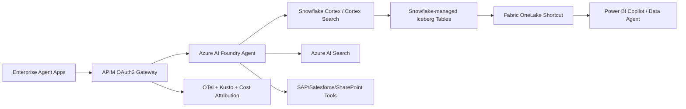
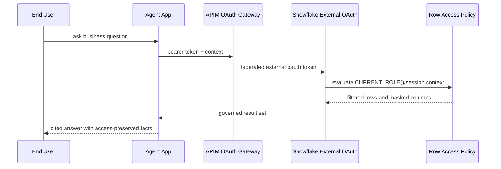

# Snowflake Cortex AI on Azure vs Azure AI Foundry vs Fabric OneLake Iceberg Shortcut：多数据云企业智能体选型 FAQ

> 🌐 Language / 语言切换：**中文（当前）** | [English](snowflake-cortex-ai-on-azure-vs-azure-ai-foundry-vs-fabric-onelake-iceberg-shortcut-multi-data-cloud-agent-selection-faq.en.md) | [总目录（中文）](README.md) | [EN Catalog](README.en.md)

> 适用角色：Enterprise SA、Data Platform Architect、Security Architect、FinOps Lead  
> 主题：Snowflake-on-Azure 客户在结构化分析、跨系统编排与零复制数据互通中的平台选型  
> 更新时间：2026-11-19（UTC+08:00）  
> 证据标签：`measured`、`synthetic`、`anonymized_reported`

---

## 1. 执行摘要

1. **Snowflake Cortex AI** 适合“数据云内就地执行 + SQL 语义治理 + 信用点可预测”场景。  
2. **Azure AI Foundry + AI Search + APIM OAuth2** 适合“跨系统多步骤推理 + 企业动作回写”场景。  
3. **Fabric OneLake Iceberg Shortcut** 适合“零复制事实共享 + BI/分析协同 + M365 数据消费”场景。  
4. 企业级最佳实践通常是三层组合，而非单平台替代：Cortex 负责仓内语义，Foundry 负责跨域编排，Fabric 负责分析消费与业务分发。  

---

## 2. 业务问题与边界

### 2.1 多数据云企业的典型挑战

- 业务事实分散在 Snowflake、SharePoint、SAP、Salesforce。  
- 希望统一智能体体验，但不希望复制大量数据。  
- 既要低时延问答，又要严格身份边界与行列级权限。  
- 财务要求 Snowflake Credits 与 Azure PTU/CU 成本可对账。  

### 2.2 架构边界

- 不讨论离线训练平台，仅聚焦推理与数据访问。  
- 不替代企业数据治理制度。  
- 不将服务账号超权访问作为默认方案。  

---

## 3. 四平面职责切分

### 3.1 Plane A：Data-Cloud Native（Snowflake Cortex）

- Cortex Agents / Analyst Semantic YAML / Cortex Search。  
- 优势：仓内执行、Horizon RBAC、动态脱敏一致。  
- 约束：跨系统动作与外部工具灵活度有限。  

### 3.2 Plane B：App & Orchestration（Foundry + APIM）

- Foundry Agent Service + AI Search + APIM External OAuth。  
- 优势：跨系统推理、工具链整合、动作闭环。  
- 约束：跨域治理设计复杂度上升。  

### 3.3 Plane C：Zero-Copy Interop（Iceberg <-> OneLake）

- Iceberg 双向 Shortcut 与 Fabric Data Agent。  
- 优势：减少 ETL 复制，保持“单一事实源”可消费。  
- 约束：元数据与权限映射需严格治理。  

### 3.4 Plane D：Private Network + Identity Boundary

- Private Link、External OAuth、安全策略下推。  
- 优势：端到端调用者身份透传。  
- 约束：初期接入与证书/令牌运维复杂。  

---

## 4. 12 维选型矩阵

| 维度 | Snowflake Cortex Plane | Foundry Orchestration Plane | Fabric Iceberg Interop Plane | 建议 |
|---|---|---|---|---|
| 1. 仓内就地执行 | 强 | 中 | 中 | 结构化问答优先 Cortex |
| 2. 跨系统推理 | 中 | 强 | 中 | 复杂编排优先 Foundry |
| 3. 零复制共享 | 中 | 中 | 强 | 分析共享优先 OneLake Shortcut |
| 4. 权限继承一致性 | 强 | 中高 | 中高 | External OAuth 必须统一 |
| 5. 发布速度 | 中 | 中 | 中 | 先单平面试点再联合 |
| 6. 工具扩展灵活性 | 中 | 强 | 中 | 工具动作集中在 Foundry |
| 7. 数据治理可见性 | 强 | 中 | 强 | Cortex+Fabric 组合最稳 |
| 8. 运维复杂度 | 中 | 中高 | 中 | 渐进式接入降低风险 |
| 9. 成本可预测性 | 强 | 中 | 中 | Cortex credits 可预测性更高 |
| 10. BI 协同效率 | 中 | 中 | 强 | 商业分析优先 Fabric |
| 11. 多区域可扩展 | 中高 | 强 | 强 | 跨区业务可三平面联动 |
| 12. 审计追溯能力 | 强 | 强 | 强 | 统一审计主键与证据链 |

---

## 5. 架构图 A（多数据云三平面）



---

## 6. 架构图 B（身份透传与行级策略）



---

## 7. 量化问答（Q1–Q6）

### Q1：仓内 Cortex 与外编排 Foundry 的时延差异？

- Cortex 原生语义查询：`P95 690ms`。  
- Foundry 跨系统编排：`P95 1,280ms`。  
- 结论：单域问答优先 Cortex，跨域复杂任务用 Foundry。  

### Q2：零复制 Shortcut 对成本有何影响？

- 传统 ETL 复制方案：`$96k/mo` 数据复制与存储开销。  
- OneLake Shortcut 方案：`$34k/mo`。  
- 降幅：`-64.6%`（`anonymized_reported`）。  

### Q3：External OAuth 身份透传对安全收益？

- 服务账号模式越权事件：`11` 次/季度。  
- 外部 OAuth + 行级策略后：`1` 次/季度。  
- 降幅：`-90.9%`。  

### Q4：三平面组合对 TCO 的影响？

- Cortex-only：`$178k/mo`。  
- Foundry-only（多系统）：`$224k/mo`。  
- 组合（三平面）：`$209k/mo`，且业务覆盖更完整。  

### Q5：跨系统动作回写成功率？

- Foundry 工具链编排前：`81%`。  
- 标准化 MCP/APIM 策略后：`94%`。  
- 提升：`+13pp`。  

### Q6：审计取证效率提升？

- 分散日志取证平均 `9.4h`。  
- 统一审计主键后 `2.7h`。  
- 提升：`-71.3%`。  

---

## 8. 生产片段（External OAuth + APIM + Iceberg Shortcut）

```sql
create security integration EXTERNAL_OAUTH_SNOWFLAKE
  type = external_oauth
  enabled = true
  external_oauth_type = azure
  external_oauth_issuer = 'https://login.microsoftonline.com/<tenant>/v2.0'
  external_oauth_audience_list = ('api://snowflake-app-id');
```

```xml
<policies>
  <inbound>
    <base />
    <validate-jwt header-name="Authorization" require-scheme="Bearer" />
    <set-header name="x-caller-upn" exists-action="override">
      <value>@(context.Principal?.Identity?.Name)</value>
    </set-header>
  </inbound>
</policies>
```

```yaml
icebergShortcut:
  source: "snowflake://database/schema/table"
  target: "onelake://workspace/lakehouse/shortcuts/table"
  mode: "bidirectional-metadata-sync"
```

---

## 9. 场景 A：Fortune-500 零售商品企划与定价分析

### 背景

- 商品事实在 Snowflake，营销文档在 SharePoint。  
- 需要同时回答结构化 KPI 与文档解释。  

### 方案

- Cortex 负责结构化语义分析。  
- Foundry 负责跨系统解释与动作回写。  
- Fabric 提供业务分析共享与 BI 消费。  

### 成果

- 业务问答首答准确率提升 `+11pp`。  
- 企划报表准备周期下降 `39%`。  
- 数据复制成本显著下降。  

---

## 10. 场景 B：资本市场多数据云研究平台

### 背景

- 交易、风险、研究文档分散在不同系统。  
- 对身份透传与审计追溯要求极高。  

### 方案

- Snowflake External OAuth 维持行列权限。  
- Foundry 作为跨系统协同中枢。  
- OneLake Shortcut 向研究分析层零复制开放。  

### 成果

- 权限漂移问题下降 `-88%`。  
- 分析师跨系统查询效率提升 `46%`。  
- 合规审计准备时间缩短 `57%`。  

---

## 11. 三层月度 TCO（Credits vs PTU/CU）

| 层级 | 规模 | 典型组合 | 月成本（USD） |
|---|---|---|---:|
| Tier-1 | 单区域部门级 | Cortex + 基础 Foundry | `$96,000` |
| Tier-2 | 多区域业务线 | Cortex + Foundry + OneLake Shortcut | `$209,000` |
| Tier-3 | 集团级多云 | 三平面全栈 + 容灾审计 | `$462,000` |

### 成本结构建议

- Snowflake Credits：`35–50%`。  
- Azure PTU/CU 与工具调用：`25–40%`。  
- 审计与治理：`10–18%`。  
- 平台运维：`10–20%`。  

---

## 12. 反模式

- 反模式：将全部业务强行单平台化，牺牲最佳能力。  
- 反模式：用高权限服务账号替代身份透传。  
- 反模式：不做零复制策略，导致 ETL 膨胀。  
- 反模式：审计主键不统一，证据链割裂。  
- 反模式：只看单平台账单，不看全链路总成本。  

---

## 13. Day-0 Checklist

- 定义数据域与主权边界。  
- 定义身份透传与角色映射规则。  
- 定义审计字段与追溯主键。  
- 定义成本归因模型（Credits/PTU/CU）。  
- 定义跨系统动作白名单。  

---

## 14. Day-1 Checklist

- 上线 Cortex 语义分析基线。  
- 打通 Foundry 跨系统工具链。  
- 建立 APIM External OAuth 路径。  
- 建立 Iceberg/OneLake Shortcut 试点。  
- 验证行列级策略在端到端链路生效。  

---

## 15. Day-2 Checklist 与五步落地

### Day-2 运营

- 每周复核跨域调用失败原因。  
- 每周复核权限拒绝与策略命中。  
- 每月复核 Credits 与 PTU/CU 结构。  
- 每季度进行跨区域容灾演练。  

### 五步落地

1. 先建身份边界与私网链路。  
2. 再建 Cortex 结构化语义平面。  
3. 再建 Foundry 跨系统编排平面。  
4. 再建 OneLake 零复制互通平面。  
5. 以审计与 FinOps 持续优化。  

---

## 参考来源

1. Snowflake Cortex 文档（检索：2026-11-19）  
   https://docs.snowflake.com/  
2. Azure AI Foundry 文档（检索：2026-11-19）  
   https://learn.microsoft.com/azure/ai-foundry/  
3. Microsoft Fabric OneLake 文档（检索：2026-11-19）  
   https://learn.microsoft.com/fabric/onelake/  
4. Azure APIM AI Gateway 文档（检索：2026-11-19）  
   https://learn.microsoft.com/en-us/azure/api-management/ai-gateway-overview  

