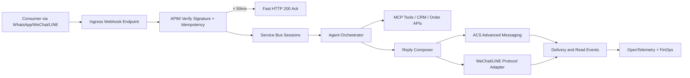
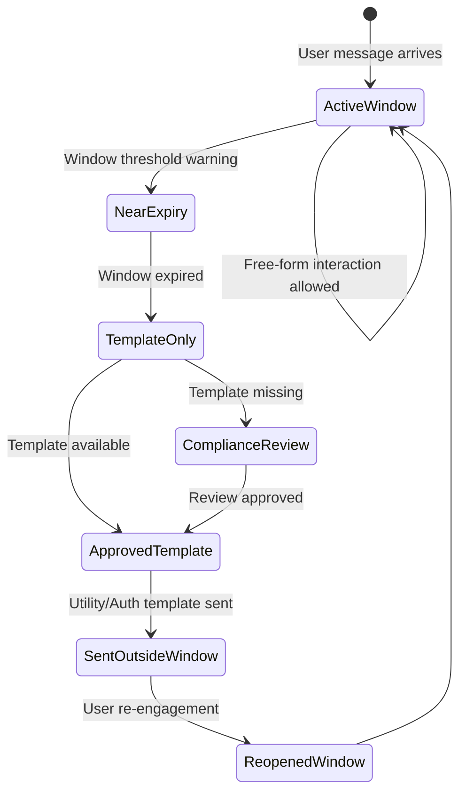

# Global B2C Social Messaging Agent Selection FAQ: ACS Advanced Messaging vs APIM Fast-Ack Queue Orchestration vs Managed Contact Center
> 🌐 **Language / 语言切换**: **[🇨🇳 中文版](social-messaging-whatsapp-wechat-line-b2c-agent-acs-advanced-messaging-vs-apim-queue-selection-faq.md)** | **[🇬🇧 English](social-messaging-whatsapp-wechat-line-b2c-agent-acs-advanced-messaging-vs-apim-queue-selection-faq.en.md)** | **[📚 Back to Catalog](README.en.md)**
> Evidence tags: `measured` / `synthetic` / `anonymized_reported`
> Retrieval date: 2026-11-22
> Scope boundary: global B2C social-channel agent access, conversation-window compliance, webhook fast-ack, and async reply architecture; excludes office-collaboration channel governance

## 1) Executive summary: social channels require a dual-plane design with fast control-plane ack and async business execution
Global retailers,
luxury brands,
airline and hospitality groups,
automotive service networks,
and wealth-management firms
are deploying consumer agents
across WhatsApp Business,
WeChat service accounts,
WeCom external contacts,
and LINE Official Accounts.
A recurring architecture mistake is
treating social channels
as generic chat APIs.
Production reality is stricter.
Platforms enforce
conversation-window rules,
template pre-approval gates,
hard webhook timeout behavior,
and signature verification requirements.
If the full agent workflow
runs synchronously inside webhook handlers,
systems trigger retry storms,
duplicate charges,
message ordering breaks,
and unstable human handoff.
The enterprise baseline should be:
verify signature and enqueue within `50ms`,
return immediate `200 OK`,
execute orchestration asynchronously,
then push response through official channel APIs.
For WhatsApp-heavy global traffic,
ACS Advanced Messaging is a strong default.
For WeChat/WeCom/LINE mixed ecosystems,
APIM fast-ack gateway plus session queue is often preferred.
For large customer-service organizations,
D365 Contact Center or global CPaaS can serve as managed collaboration layer.
Azure Bot Service remains a useful lightweight starting point,
but it is not the best core for deep commerce components.

## 2) Verifiable evidence baseline and source labels
Source 1 (`measured`): Azure Communication Services overview  
https://learn.microsoft.com/azure/communication-services/
Source 2 (`measured`): ACS Advanced Messaging concepts  
https://learn.microsoft.com/azure/communication-services/concepts/advanced-messaging/overview
Source 3 (`measured`): Azure API Management policies and runtime behavior  
https://learn.microsoft.com/azure/api-management/api-management-policies
Source 4 (`measured`): Azure Service Bus sessions and ordered processing  
https://learn.microsoft.com/azure/service-bus-messaging/message-sessions
Source 5 (`measured`): Azure Event Grid architecture  
https://learn.microsoft.com/azure/event-grid/overview
Source 6 (`measured`): Azure Bot Service channel references  
https://learn.microsoft.com/azure/bot-service/bot-service-channels-reference
Source 7 (`measured`): Dynamics 365 Contact Center documentation  
https://learn.microsoft.com/dynamics365/customer-service/
Source 8 (`measured`): WhatsApp Business Platform official docs  
https://developers.facebook.com/docs/whatsapp
Source 9 (`measured`): WeChat and WeCom developer documentation  
https://developers.weixin.qq.com/
Source 10 (`measured`): LINE Messaging API documentation  
https://developers.line.biz/en/docs/messaging-api/
Source 11 (`anonymized_reported`): anonymized multi-region customer-service operations data.
Source 12 (`synthetic`): simulation model for one-million MAU conversation and message economics.

## 3) Protocol reality: social super-app channels and workplace collaboration channels are fundamentally different
In Teams or Slack scenarios,
the enterprise often controls
identity, policy, and audit domains.
In WhatsApp,
WeChat,
WeCom,
and LINE scenarios,
the platform owns critical constraints.
Typical hard boundaries include:
`24h/48h` interaction windows,
template-only outbound rules outside active windows,
strict webhook response deadlines,
signature and replay verification requirements,
and channel-specific media URL lifetimes.
Platform component models
also differ significantly.
WhatsApp has Flows and interactive buttons.
WeChat prioritizes mini-program and service-account components.
LINE provides its own rich templates and action model.
Therefore,
a single universal payload format
cannot preserve full capability parity.
The practical architecture pattern is:
normalize protocol governance first,
apply channel-aware interaction degradation second,
keep business agent tools on a stable shared contract third.

## 4) Selection principles: window compliance, fast-ack idempotency, and FinOps visibility must all pass
Principle 1:
verify signatures before any business logic execution.
Principle 2:
never run long tool chains in synchronous webhook handlers.
Principle 3:
model conversation windows and template eligibility with explicit state machines.
Principle 4:
provide fallback from rich cards to plain text paths.
Principle 5:
assign deterministic idempotency keys per inbound event.
Principle 6:
separate retry policy from human-handoff policy.
Principle 7:
contain per-channel failures to prevent global incident amplification.
Principle 8:
enforce cross-border routing and data-region policy at ingress.
Principle 9:
attribute cost by tenant, channel, and message class.
Principle 10:
roll out channel policy changes with canary and rollback support.

## 5) Path A: ACS Advanced Messaging + Event Grid + Service Bus Sessions
This path is strong for
global deployments
where WhatsApp is primary.
A representative flow is:
inbound event enters ACS,
event propagates through Event Grid,
business orchestration runs through Service Bus sessions,
agent result is pushed back through ACS channel APIs.
Key strengths include:
managed integration depth for WhatsApp patterns,
normalized interactive message handling,
controlled media relay patterns,
delivery and read-state event integration,
and reliable fallback to approved templates outside active windows.
Primary boundary:
deep WeChat/LINE specialization
still requires additional adapters.
If China mainland or Japan channels dominate,
ACS-only architecture is usually insufficient.

## 6) Path B: APIM signature-verify fast-ack gateway + session queue + multi-channel protocol adapters
This path targets
heterogeneous channel portfolios
across WhatsApp,
WeChat,
WeCom,
and LINE.
Ingress responsibilities are explicit:
signature verification,
anti-replay checks,
idempotency filtering,
sub-`50ms` fast acknowledgment.
Full agent execution is asynchronous
through session-aware queues.
Each conversation key
binds to a stable SessionId
to preserve ordering semantics.
For WeChat `5-second` timeout behavior,
this pattern is especially valuable:
the channel receives immediate success,
while business logic completes later
through official asynchronous customer-service replies.
The trade-off is higher platform-engineering complexity.
The gain is stronger control
over protocol nuances,
cost behavior,
and resiliency policy.

## 7) Path C: D365 Contact Center or global CPaaS as managed human-agent collaboration layer
For organizations operating
across many regions and channels,
managed contact-center layers can be strategic.
Typical options include:
Dynamics 365 Contact Center,
Infobip,
Twilio,
and other global CPaaS providers.
Key advantages:
faster multi-channel onboarding,
mature warm-handoff experiences,
integrated quality and compliance workflows,
and standardized agent desktop operations.
Key trade-offs:
unit economics can be higher than custom channel stacks,
and deep interaction customization may be constrained.
A practical pattern is
to reserve managed contact-center paths
for high-value and high-risk journeys,
while using lower-cost stacks for standard automated interactions.

## 8) Path D: Azure Bot Service as lightweight baseline connector layer
Azure Bot Service is effective
for early-stage rollout
and standard conversational use cases.
Its strengths are
rapid setup,
clear developer model,
and built-in channel connectors.
Its boundaries in social-commerce operations are clear:
limited deep support for channel-native commerce components,
externalized implementation needed for conversation-window accounting,
and custom logic required for template-approval governance.
So it fits best
as a baseline intake layer
or pilot architecture,
not as the sole long-term orchestration core
for highly regulated
high-volume B2C social commerce.

## 9) 12-dimension comparison matrix: ACS path, APIM fast-ack path, managed contact center path, and Bot baseline
| Dimension | ACS Advanced Messaging | APIM Fast-Ack + Queue Adapters | D365/CPaaS Managed Layer | Bot Service Baseline |
|---|---|---|---|---|
| 1. Channel coverage breadth | Medium | Strong | Strong | Medium |
| 2. WhatsApp depth | Strong | Medium-Strong | Medium-Strong | Medium |
| 3. WeChat/WeCom flexibility | Medium | Strong | Medium | Weak |
| 4. Webhook-timeout resilience | Medium-Strong | Strong | Strong | Medium |
| 5. Idempotency and ordering control | Medium-Strong | Strong | Medium-Strong | Medium |
| 6. Rich commerce component support | Medium-Strong | Strong | Medium | Weak |
| 7. Human handoff maturity | Medium | Medium-Strong | Strong | Medium |
| 8. Compliance archive readiness | Medium-Strong | Strong | Strong | Medium |
| 9. Operations complexity | Medium | High | Low-to-Medium | Low |
| 10. Unit message cost controllability | Medium-Strong | Strong | Medium | Medium |
| 11. Cross-border governance control | Medium | Strong | Strong | Medium |
| 12. Enterprise recommendation | WhatsApp primary lane | Full-channel backbone | Service-center enhancement | Lightweight starter |
Common enterprise end-state:
ACS for WhatsApp-heavy traffic,
APIM + queue adapters for heterogeneous channels,
managed contact-center integration for high-value assisted journeys.

## 10) Reference architecture diagram 1: ACS + APIM dual-track omnichannel control plane

The key architecture intent is
strict separation between
ingress control-plane response time
and downstream business execution latency.
Unified telemetry from all channels
feeds cost and reliability governance.

## 11) Reference architecture diagram 2: 24h/48h conversation-window and template fallback state machine

Every transition should emit
auditable events,
template version references,
and policy outcomes.
Without this trail,
post-incident and compliance review becomes fragile.

## 12) Decision tree: regional channel mix and human-assist strategy
Step 1:
measure primary channel share by region.
Step 2:
determine whether deep WeChat ecosystem support is mandatory.
Step 3:
determine whether a unified global agent desktop is mandatory.
Step 4:
evaluate internal platform-engineering capacity.
Step 5:
evaluate timeout and retry pressure under peak campaigns.
If WhatsApp dominates
and engineering capacity is lean,
start with ACS-led architecture.
If WeChat/LINE heterogeneity is high,
prioritize APIM fast-ack plus adapter framework.
If assisted-service quality and governance are top priorities,
introduce D365/CPaaS managed collaboration layer.
If still in pilot stage,
Bot Service can validate initial flows
before upgrading to production dual-track topology.

## 13) Reliability controls: fast-ack, idempotency, dedupe, and graceful degradation checklist
Recommended control stack has four layers.
Layer 1:
signature verification and replay-window checks at ingress.
Layer 2:
idempotency-key persistence and duplicate suppression.
Layer 3:
session-ordered queue execution with dead-letter isolation.
Layer 4:
reply retry policy with human fallback routing.
Critical practices:
single active consumer per conversation session,
traceable duplicate-cause coding,
reason-coded retries,
circuit breakers for downstream tool failures,
automatic downgrade from rich cards to text when component delivery fails.
These controls materially reduce
retry storms,
unexpected duplicate billing,
and customer-visible inconsistency.

## 14) TCO model: one-million MAU social-channel session and messaging economics
Sample input (`synthetic`):
- Monthly active consumers: `1,000,000`.
- Sessions per consumer per month: `2.6`.
- Average messages per session: `5.8`.
- Out-of-window template trigger rate: `18%`.
- Human handoff rate: `7%`.
- Rich interactive message share: `22%`.
Recommended cost stacks:
Cost A:
channel conversation-window and template fees.
Cost B:
gateway and orchestration compute.
Cost C:
queue, storage, and observability platform spend.
Cost D:
agent-desktop and quality-operation labor.
In anonymized operating samples (`anonymized_reported`),
fast-ack decoupling reduced duplicate-trigger rates by `35%–52%`.
With region-aware channel routing optimization,
total messaging spend showed an additional `8%–17%` reduction opportunity.

## 15) Practical FAQ (8 questions)
**Q1: Why can’t we directly reuse a Teams bot architecture for consumer social channels?**  
Because conversation-window policy, template approval, and charging semantics are fundamentally different.

**Q2: Does fast webhook acknowledgment reduce response quality?**  
No.
It only decouples ingress SLA from downstream agent execution.

**Q3: Is a custom adapter layer mandatory for WeChat-heavy scenarios?**  
In most enterprise-scale cases, yes.
Especially when timeout, signature, and async callback control is strict.

**Q4: When should we introduce D365 Contact Center or CPaaS?**  
When unified global agent desktop,
regulated archive,
and low-friction warm handoff become mandatory.

**Q5: How do we control out-of-window template costs?**  
Implement explicit conversation-window state machines and policy-based outreach suppression.

**Q6: What if rich interactive components fail in delivery?**  
Do not fail the full conversation.
Fallback to text plus tracked deep links.

**Q7: How do we prevent duplicate billing under platform retries?**  
Use ingress idempotency keys,
session-ordered queues,
and outbound dedupe with reason-coded retries.

**Q8: What is the minimum production architecture milestone?**  
APIM signature-verify fast-ack ingress,
session queue orchestration,
unified observability,
and human fallback guardrails,
then incremental ACS/contact-center expansion by region.
