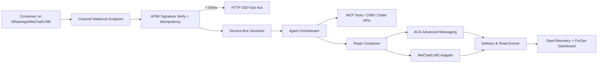
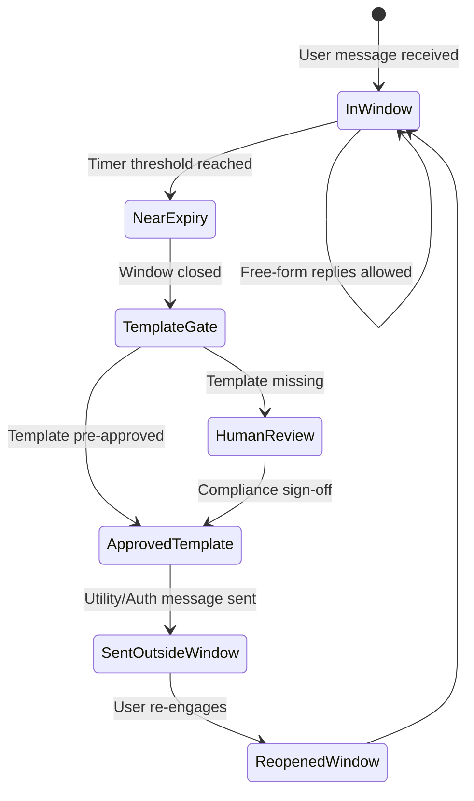

# 全球 B2C 社交消息智能体选型 FAQ：ACS Advanced Messaging vs APIM 快回队列编排 vs 全托管联络中心
> 🌐 **Language / 语言切换**: **[🇨🇳 中文版](social-messaging-whatsapp-wechat-line-b2c-agent-acs-advanced-messaging-vs-apim-queue-selection-faq.md)** | **[🇬🇧 English](social-messaging-whatsapp-wechat-line-b2c-agent-acs-advanced-messaging-vs-apim-queue-selection-faq.en.md)** | **[📚 返回目录](README.md)**
> 证据标签：`measured` / `synthetic` / `anonymized_reported`
> 抓取日期：2026-11-22
> 主题边界：聚焦全球 B2C 社交渠道智能体接入、会话窗口合规、Webhook 快回与异步回推架构，不讨论办公协同通道治理

## 1) 执行摘要：社交渠道必须采用“快回控制面 + 异步业务面”双层架构
跨国企业把智能体接入
WhatsApp、
微信服务号、
企业微信外部联系、
LINE Official Account 时，
最常见失误是
把社交通道当成普通聊天 API。
现实并非如此。
平台对响应时限、
模板审批、
会话窗口计费、
消息签名验真
都有硬性规则。
若直接把智能体执行链
挂在同步 Webhook 上，
就会出现重推风暴、
重复扣费、
连发错答和人工接管失败。
企业生产推荐基线是：
控制面在 `50ms` 内验签并入队回 `200`，
业务面异步执行工具链，
最终经官方客服接口回推。
在海外 WhatsApp 主场景，
优先使用 ACS Advanced Messaging。
在微信/企微/LINE 混合场景，
优先使用 APIM 快回网关加会话队列。
在多地区大型客服中心，
可引入 D365 Contact Center 或 CPaaS 全托管层。
Bot Service 适合作为轻量基线，
不宜承载复杂商业组件编排。

## 2) 可验证来源与证据标签
来源 1（`measured`）：Azure Communication Services 概览  
https://learn.microsoft.com/azure/communication-services/
来源 2（`measured`）：ACS Advanced Messaging 文档  
https://learn.microsoft.com/azure/communication-services/concepts/advanced-messaging/overview
来源 3（`measured`）：Azure API Management 策略与网关  
https://learn.microsoft.com/azure/api-management/api-management-policies
来源 4（`measured`）：Azure Service Bus Sessions 与顺序保证  
https://learn.microsoft.com/azure/service-bus-messaging/message-sessions
来源 5（`measured`）：Azure Event Grid 事件驱动集成  
https://learn.microsoft.com/azure/event-grid/overview
来源 6（`measured`）：Azure Bot Service 通道能力说明  
https://learn.microsoft.com/azure/bot-service/bot-service-channels-reference
来源 7（`measured`）：Dynamics 365 Contact Center 公开资料  
https://learn.microsoft.com/dynamics365/customer-service/
来源 8（`measured`）：WhatsApp Business Platform 官方文档  
https://developers.facebook.com/docs/whatsapp
来源 9（`measured`）：微信公众平台/企业微信开发文档  
https://developers.weixin.qq.com/
来源 10（`measured`）：LINE Messaging API 文档  
https://developers.line.biz/en/docs/messaging-api/
来源 11（`anonymized_reported`）：零售与航旅匿名多区域客服运营数据。
来源 12（`synthetic`）：百万月活消息量和窗口计费仿真模型。

## 3) 协议现实：全球社交通道与办公协同通道是两套规则系统
Teams/Slack 场景中，
企业通常掌握主身份域和审计域。
而在 WhatsApp、微信、LINE 上，
企业必须遵守平台托管规则。
典型硬约束包括：
`24h/48h` 会话互动窗口。
窗口外只能发送预审模板。
Webhook 有秒级硬超时。
签名验真失败必须直接拒绝。
重复推送需要幂等去重。
媒体下载地址具有短时效。
此外，
平台商业组件能力并不一致。
WhatsApp 有 Flows 与交互按钮。
微信生态偏小程序卡片和客服回推。
LINE 的模板交互也有独立约束。
因此企业不能指望单一消息格式
跨渠道无损复用。
正确做法是：
协议层先标准化，
交互层按渠道能力分级降级，
业务层保持统一智能体工具契约。

## 4) 生产选型原则：窗口合规、快回幂等、成本可解释必须同时满足
原则一：
所有入口都要先验签再入队。
原则二：
同步入口不做长耗时工具调用。
原则三：
按会话窗口和模板类别做显式状态机。
原则四：
富交互组件必须提供纯文本降级路径。
原则五：
每条消息都要有业务幂等键。
原则六：
重试策略和人工转接策略分离。
原则七：
渠道失败不可扩散为全链路失败。
原则八：
跨境合规路由要前置到入口层。
原则九：
成本归因应细化到租户与渠道。
原则十：
平台变更要可灰度、可回滚。

## 5) 路线 A：ACS Advanced Messaging + Event Grid + Service Bus Sessions
该路线适合
以 WhatsApp Business 为主的全球业务。
核心价值是 Azure 原生托管整合，
减少自建协议适配负担。
典型链路为：
消息入站到 ACS。
事件进入 Event Grid。
业务编排进入 Service Bus Session。
智能体完成工具调用后
通过 ACS 回推消息。
架构优势包括：
统一交互消息模型。
媒体附件受控中转。
送达/已读状态可观测。
窗口外模板切换可自动化。
主要边界在于：
微信和 LINE 深度能力仍需旁路适配。
若企业主战场是中国大陆或日本，
单靠 ACS 难以覆盖全部业务深度。

## 6) 路线 B：APIM 快回验签网关 + Session 队列 + 多渠道协议适配层
这一路线面向
微信/企微/LINE 与 WhatsApp 混合布局。
入口关键动作是：
在 APIM 上完成签名校验、
重放防护、
幂等去重、
快速回 `200`。
把智能体执行放到异步层，
并通过会话队列维持同用户顺序。
推荐每个会话键
绑定固定 SessionId。
这样可避免并行处理
造成上下文错乱。
针对微信 `5 秒` 硬超时，
快回后再异步客服回推
可显著降低平台重试风暴。
该路线的工程收益是
对渠道差异有更高掌控度。
代价是适配层研发和运维复杂度更高。
适合有平台工程能力的企业中台团队。

## 7) 路线 C：D365 Contact Center 或全球 CPaaS 托管人机协同
当企业覆盖十余地区和多渠道，
并要求统一坐席工作台、
统一质检、
统一会话留存时，
可采用全托管联络中心方案。
典型候选包含：
Dynamics 365 Contact Center、
Infobip、
Twilio 等。
优势在于：
多渠道接入速度快。
坐席转人工链路成熟。
质检与报表体系完整。
合规留存能力内建。
但要注意两点：
一是单位消息成本常高于自建。
二是深度定制能力受产品边界限制。
因此建议将其用于
高价值客户旅程和复杂转人工场景，
把标准问答留在成本更优通道。

## 8) 路线 D：Azure Bot Service 通用连接器轻量基线
Bot Service 能快速接入
常见消息通道，
适合早期验证和标准问答场景。
其优势是上手快、
开发模型清晰、
通道连接器现成。
但在超级应用商业交互场景中，
存在明显边界：
复杂组件映射能力有限。
会话窗口计费状态机需自建。
跨渠道模板审批流程需外置。
因此它更适合
作为统一机器人入口层，
而非复杂 B2C 社交商业编排中枢。
企业若要规模化生产，
仍需补齐 APIM、队列和审计能力。

## 9) 12 维选型对比：ACS 路线、APIM 快回路线、全托管联络中心、Bot 基线
| 维度 | ACS Advanced Messaging | APIM 快回 + Queue 适配层 | D365/CPaaS 全托管 | Bot Service 基线 |
|---|---|---|---|---|
| 1. 渠道覆盖广度 | 中 | 强 | 强 | 中 |
| 2. WhatsApp 深度能力 | 强 | 中强 | 中强 | 中 |
| 3. 微信/企微适配弹性 | 中 | 强 | 中 | 弱 |
| 4. Webhook 超时抗压 | 中强 | 强 | 强 | 中 |
| 5. 幂等与顺序控制 | 中强 | 强 | 中强 | 中 |
| 6. 富交互组件支持 | 中强 | 强 | 中 | 弱 |
| 7. 转人工闭环成熟度 | 中 | 中强 | 强 | 中 |
| 8. 合规留存能力 | 中强 | 强 | 强 | 中 |
| 9. 运维复杂度 | 中 | 高 | 低到中 | 低 |
| 10. 单位消息成本可控性 | 中强 | 强 | 中 | 中 |
| 11. 跨境多区域治理 | 中 | 强 | 强 | 中 |
| 12. 企业推荐定位 | 海外主通道 | 全渠道主干 | 客服中心增强层 | 轻量起步层 |
结论：
全球企业常见最优组合是
ACS 承接 WhatsApp 主流量，
APIM + Queue 处理多渠道异构入口，
再把高价值对话升级到联络中心坐席。

## 10) 参考架构图 1：ACS + APIM 双轨全渠道控制面

图中关键点是
快回与业务执行解耦，
并通过 Session 维持顺序一致性。
所有渠道回执统一进入观测层，
支持窗口计费与失败重试分析。

## 11) 参考架构图 2：24h/48h 互动窗口与模板回落状态机

状态机必须记录
每次窗口切换事件，
并保留模板版本与审批证据。
否则在客诉或审计时
无法解释消息发送合法性。

## 12) 决策树：区域渠道成熟度与人机协同策略怎么分流
第一步：
识别目标区域主渠道占比。
第二步：
判断是否必须支持微信生态深交互。
第三步：
判断是否要求统一全球坐席平台。
第四步：
评估平台工程团队是否具备协议适配能力。
第五步：
评估消息峰值与超时重试风险。
若以 WhatsApp 为主且中台较轻，
优先 ACS 主链路。
若微信/LINE 与本地化要求强，
优先 APIM 快回加适配层。
若坐席转人工和质检要求极高，
引入 D365/CPaaS 作为协同层。
若仍在试点，
可先用 Bot Service 验证路径，
再逐步升级到双轨生产架构。

## 13) 可靠性设计：快回、幂等、去重与熔断的落地清单
建议采用四级防线。
第一级：
入口签名与时间戳校验。
第二级：
消息幂等键落库与去重。
第三级：
会话顺序队列与死信隔离。
第四级：
回推失败重试与人工兜底。
关键实践包括：
同一用户同一会话
仅允许单活消费者。
重复消息要可追踪来源。
每次重试要附带原因码。
下游工具超时要可熔断降级。
富交互发送失败时
自动降级到文本+链接。
这套机制能显著降低
重推风暴造成的成本失控和体验抖动。

## 14) TCO 测算：百万月活消费者的会话窗口与通道成本模型
样例输入（`synthetic`）：
- 月活消费者：`1,000,000`。
- 人均月会话：`2.6`。
- 平均每会话消息：`5.8`。
- 窗口外模板触发率：`18%`。
- 人工接管率：`7%`。
- 富交互消息占比：`22%`。
测算口径建议分为四层：
成本层 A：
渠道会话窗口与模板费。
成本层 B：
消息平台与网关计算费。
成本层 C：
队列、存储和观测费。
成本层 D：
坐席与质检运营费。
在匿名企业样本（`anonymized_reported`）中，
采用快回解耦后，
重复触发率可下降 `35%–52%`，
并将窗口外误发降到可控范围。
若进一步按区域优化渠道路由，
总消息成本还有 `8%–17%` 的压缩空间。

## 15) 实战 FAQ（8 题）
**Q1：为什么社交渠道不能直接复用 Teams 机器人架构？**  
因为互动窗口、模板审批与计费模型完全不同。

**Q2：Webhook 快回是不是会降低回答质量？**  
不会。
它只把同步入口与异步业务解耦，
不影响智能体推理质量。

**Q3：微信场景必须自建适配层吗？**  
多数企业级场景是的，
尤其涉及 5 秒超时和客服异步回推时。

**Q4：什么时候应引入 D365 Contact Center？**  
当你需要统一全球坐席、
合规留存、
和秒级转人工闭环时。

**Q5：如何控制窗口外模板成本？**  
建立窗口状态机，
并在编排层限制非必要触达。

**Q6：富交互组件失败会不会导致会话中断？**  
不应中断。
要有文本降级和链接回退机制。

**Q7：如何避免平台重试导致重复扣费？**  
入口幂等键、
会话队列顺序消费、
回推去重三者必须同时开启。

**Q8：里程碑阶段的最小可行生产架构是什么？**  
APIM 快回验签、
Session 队列、
统一观测和人工兜底，
然后按区域逐步接入 ACS 与联络中心能力。
