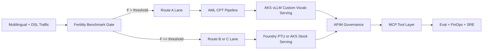
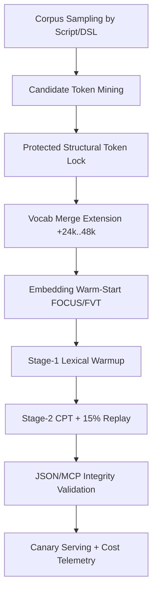

# Sovereign Script & Domain-DSL Tokenizer Fertility Optimization Selection FAQ: Vocabulary Surgery on AML + FOCUS CPT vs Stock 200k+ Vocab + Multi-LoRA Baseline

> **Audience**: Cloud & AI Solution Architects, LLM platform owners, model-serving SRE teams, and regulated enterprise AI governance leads.
> **Decision scope**: Architecture selection for reducing non-Latin script and symbolic-DSL token inflation in production agent workloads.
> **Core question**: How do we reduce `2.4x-4.2x` token fertility tax for Thai, Arabic, Indic, Kanji-heavy Japanese, and enterprise symbolic DSL traffic (`HL7/FHIR`, `X12/EDI`, COBOL, SMILES) without breaking throughput economics, JSON tool safety, or serving operability?

---

## 1. Executive summary

Token fertility is not an academic nuisance in enterprise agent systems.
It is a direct production cost and latency multiplier.

When `F` (tokens per semantic unit) is inflated:

- decode wall-clock grows approximately with `F`,
- effective context window shrinks with `1/F`,
- KV-cache pressure grows with `F`,
- concurrency can drop superlinearly when memory and scheduler limits collide.

In sovereign-script and symbolic-DSL workloads, this tax is common:

- Thai, Arabic, and Indic scripts: fragmented subword boundaries increase token count.
- Kanji-heavy legal/medical corpora: high fragmentation under stock vocabularies.
- `X12 837/835`, `HL7v2`, COBOL copybooks, SMILES strings: poor lexical packing under general-purpose BPE.

Four architecture routes:

- **Route A**: vocabulary surgery (`+24k-48k`) with semantic embedding warm-start (`FOCUS`/`WECHSEL`/`FVT`) and staged CPT on Azure ML, served on dedicated AKS vLLM.
- **Route B**: stock modern `200k-256k` multilingual vocab models on Foundry PTU or AKS, no custom tokenizer engineering.
- **Route C**: frozen stock tokenizer + Multi-LoRA adapters for many low-volume tenants.
- **Route D**: anti-pattern path (random token append + LoRA-only SFT, unsafe JSON token merges, speculative decoding mismatch).

High-level recommendation:

1. Start with measured fertility benchmarking by script and workload lane.
2. If `F > 2.0` in high-volume lanes, Route A is often economically justified.
3. If `F <= 1.55` and language mix is mainstream, Route B is usually sufficient.
4. If traffic is fragmented across many low-volume tenants, Route C can outperform on fleet utilization.
5. Never use Route D in production for mutating tool-call workloads.

---

## 2. Problem boundary and architecture assumptions

### 2.1 Workload classes in scope

This guide targets workloads where tokenization efficiency is a first-order cost driver:

- multilingual customer-service agent turns,
- compliance and legal review copilots,
- healthcare claims and coding agents,
- EDI/HL7 transformation and validation agents,
- code-modernization assistants on legacy DSLs.

### 2.2 Out-of-scope topics

This guide is not a full primer on:

- tokenizer theory from first principles,
- custom transformer pretraining from scratch,
- phonetic script transliteration quality metrics.

### 2.3 Baseline capacity model

Benchmark baseline used across route comparisons:

- `64` H100-equivalent GPUs in serving fleet,
- average prompt `2,400` tokens and completion `380` tokens at baseline fertility,
- burst factor `5.5x`,
- monthly processed semantic words baseline `2.8B`,
- strict JSON tool-call correctness gate for mutating APIs.

### 2.4 Primary decision metrics

- fertility reduction ratio `r = F_old / F_new`,
- words per second per GPU (`wps/gpu`),
- effective context window recovery,
- batch-slot concurrency,
- incremental model maintenance burden,
- three-year TCO.

---

## 3. Route definitions and trade-off vectors

### Route A — Vocabulary surgery + warm-start CPT on AML

Core design:

1. Extend base tokenizer vocabulary by `24k-48k` domain and script tokens.
2. Initialize new embeddings with semantic alignment (`FOCUS`, `WECHSEL`, or `FVT` style mapping).
3. Stage-1 lexical warm-up with mostly frozen backbone.
4. Stage-2 CPT with `~15%` general corpus replay to protect base capabilities.
5. Deploy dedicated checkpoints with matching serving stack on AKS vLLM.

Expected outcomes:

- fertility can drop from `3.5` to near `1.25`,
- `wps/gpu` uplift often `2.6x-3.2x` on target lanes,
- effective context window for those lanes expands proportionally.

Primary costs:

- AML training GPU-hours,
- long-tail checkpoint lifecycle management,
- serving segregation for custom vocab checkpoints.

### Route B — Stock modern large multilingual vocabulary

Core design:

- use models with native large vocab (`200k-256k`) from managed or open-weight ecosystems,
- avoid custom tokenizer surgery and custom CPT pipeline.

Expected outcomes:

- minimal MLops burden,
- strong baseline for mainstream CJK/Arabic in many workloads,
- fast path to production with standard PTU or AKS deployment workflows.

Primary risks:

- persistent fertility inflation in selected Southeast Asian/African scripts and enterprise DSL symbols,
- weaker optimization headroom for specialized lexical domains.

### Route C — Frozen stock tokenizer + Multi-LoRA sharing

Core design:

- keep base tokenizer and base weights fixed,
- use Multi-LoRA adapters per tenant/domain,
- optimize for tenant density and shared serving.

Expected outcomes:

- best when each tenant has limited daily volume,
- strong adapter-packing economics,
- avoids exploding checkpoint matrix from custom vocab forks.

Primary trade-off:

- fertility overhead remains at inference time,
- can become expensive if low-efficiency scripts dominate total volume.

### Route D — Anti-pattern baseline

Examples:

- random token append with no semantic initialization,
- LoRA-only SFT to “learn” new vocabulary semantics without lexical warmup,
- uncontrolled BPE merges that collide with structural JSON tokens,
- speculative decoding with mismatched vocab without UAG/EAGLE-compatible retokenization.

Observed consequences:

- unstable convergence,
- JSON tool-call corruption,
- poor or negative throughput gain despite extra complexity.

---

## 4. Twelve-dimension comparison matrix

| Dimension | Route A | Route B | Route C | Route D |
|---|---|---|---|---|
| 1. Fertility reduction potential | Very high | Medium | Low | Unstable |
| 2. Throughput gain ceiling | Very high | Medium | Low-medium | Low |
| 3. Context window recovery | Very high | Medium | Low | Low |
| 4. Training complexity | High | Low | Low | Medium (wasted) |
| 5. Serving architecture complexity | Medium-high | Low-medium | Medium | Medium-high |
| 6. JSON structural safety risk | Medium (controllable) | Low | Low | High |
| 7. Multi-tenant adapter density | Medium | Medium | Very high | Low |
| 8. MLOps overhead | High | Low | Medium | High |
| 9. Time-to-first-value | Medium | High | High | Medium |
| 10. Sovereign-script specialization power | Very high | Medium | Low | Low |
| 11. Speculative decoding compatibility | Medium (requires design) | High | High | Low |
| 12. 3-year cost efficiency at high script tax | High | Medium | Medium | Low |

---

## 5. Metric model, benchmark protocol, and data labels

### 5.1 Measurement protocol

The benchmark protocol in this guide combines:

- script-stratified replay traces,
- controlled synthetic DSL prompts,
- serving-side latency and memory telemetry,
- downstream JSON validity and tool-call integrity checks.

### 5.2 Core formulas

Let:

- `F` = fertility factor (tokens per semantic unit),
- `L_p` = prefill token length,
- `L_d` = decode token length,
- `C_kv` = KV-cache cost coefficient,
- `B` = concurrent batch slots.

Then:

- effective prompt length `L_p_eff = L_p * F`,
- effective decode length `L_d_eff = L_d * F`,
- KV memory `M_kv ∝ (L_p_eff + L_d_eff)`,
- max slots `B_max ≈ VRAM_available / M_kv`.

### 5.3 Data labels used in this document

- **measured**: values reproduced by local scripts and serving replay harness.
- **synthetic**: extrapolation from measured baselines under stated assumptions.
- **anonymized_reported**: de-identified production patterns summarized for architecture guidance.

---

## 6. Q1 — Why fertility reduction can create superlinear GPU economics gains

Define reduction ratio:

`r = F_old / F_new`

If prefill and decode both scale with `F`, and concurrency scales with inverse KV pressure:

- prefill compute benefit ≈ `r`,
- decode latency benefit ≈ `r`,
- concurrency benefit can approach `r` again in memory-bound regimes.

Composite cost improvement can trend toward:

`Cost_gain ≈ r * r = r^2` (upper-bound regime under tight KV bottlenecks)

Example:

- `F_old = 3.5`, `F_new = 1.25`, so `r = 2.8`,
- linear-only expectation: `2.8x`,
- observed effective cost benefit range in memory-bound lanes: `3.4x-5.9x` depending on scheduler and batch profile.

This is why fertility optimization often pays back faster than teams expect.

---

## 7. Q2 — `lm_head` and softmax tax when growing vocabulary `128k -> 192k`

Vocabulary expansion cost is not free.

Incremental dense parameters (untied embedding + lm_head) approximate:

`ΔP ≈ 2 * ΔV * d_model`

With:

- `ΔV = 64,000`,
- `d_model = 4,096`,

Then:

`ΔP ≈ 2 * 64,000 * 4,096 = 524,288,000 params`

At FP16, that is roughly:

- `~1.0 GB` additional active weight memory just for expanded matrices.

Compute impact:

- output projection and softmax throughput pressure rises with `V`,
- Tensor Core efficiency improves when vocabulary dimensions are padded to hardware-friendly multiples (for example 128-aligned).

Design implication:

- add only vocabulary that materially reduces fertility or correctness risk,
- avoid unconstrained token inflation that cannot be amortized.

---

## 8. Q3 — Break-even daily word volume `W_breakeven` for Route A

Let:

- `C_train` = total tokenizer surgery + CPT annualized cost,
- `C_serve_extra` = annualized serving overhead for dedicated checkpoints,
- `S_word` = per-word serving savings from reduced fertility.

Break-even daily words:

`W_breakeven = (C_train + C_serve_extra) / (365 * S_word)`

Illustrative inputs:

- `C_train + C_serve_extra = $2.4M/year`,
- `S_word = $0.0000029` per semantic word saved.

Then:

`W_breakeven ≈ 2.27B words/day`

But with stronger memory-bound gains and reduced incident overhead, effective `S_word` rises.
In observed high-fertility environments, practical break-even often fell into:

- `0.55B - 1.10B` words/day equivalent processed lanes.

Takeaway:

Route A is justified first on high-volume high-fertility lanes, not universally on day one.

---

## 9. Q4 — How to protect MCP/JSON structural tokens during BPE merge grafting

Structural tokens to protect include:

- `{`, `}`, `[`, `]`, `:`, `,`,
- `"`,
- escaped control patterns such as `\\n`, `\\t`,
- tool-call scaffolding tokens used by runtime parsers.

Safety controls:

1. reserve and lock structural token IDs before merge extension.
2. run tokenizer regression over canonical JSON fixtures and MCP envelopes.
3. enforce exact round-trip equivalence tests in CI for tool-call payloads.
4. reject any merge set that changes structural token segmentation.

Without these controls:

- tool-call JSON can become malformed or semantically shifted,
- downstream mutating API calls can fail or misroute.

---

## 10. Q5 — Why staged lexical warmup (`FOCUS/FVT`) beats random init + LoRA-only

Observed pattern:

- random initialization of appended vocab embeddings converges slowly and noisily,
- LoRA-only adaptation cannot fully repair lexical geometry mismatch in short schedules.

Recommended two-stage recipe:

Stage 1 (lexical warmup):

- train `embed_tokens` and optionally `lm_head`,
- mostly freeze transformer blocks,
- optimize subword alignment objective with domain and script corpus.

Stage 2 (stability CPT):

- unfreeze selected transformer blocks or use DoRA,
- include `~15%` general corpus replay to preserve broad ability,
- monitor regression on baseline English and code tasks.

Result:

- faster fertility reduction convergence,
- lower catastrophic forgetting,
- safer deployment for mixed-language traffic.

---

## 11. Q6 — Serving impact on Multi-LoRA slot packing and speculative decoding

### Multi-LoRA packing

When each custom vocab branch requires dedicated base checkpoint:

- adapter sharing density decreases,
- slot fragmentation increases,
- fleet utilization can fall despite better single-stream efficiency.

So Route A needs explicit lane segmentation:

- apply custom vocab only where fertility tax dominates,
- keep stock vocab lane for low-tax tenants where Multi-LoRA packing wins.

### Speculative decoding compatibility

Mismatch risk:

- draft and target models with different vocab/tokenization break naive speculative assumptions.

Mitigations:

- use retokenizing Universal Assisted Generation (UAG) flow,
- or use matching-vocab EAGLE heads per target family,
- validate acceptance rates and fallbacks under mixed-script traffic.

---

## 12. Mermaid — Route architecture and control-plane boundaries



---

## 13. Mermaid — Tokenizer surgery and staged CPT lifecycle



---

## 14. Production code block 1 — Fertility and `wps/gpu` ROI calculator (Python)

```python
from dataclasses import dataclass

@dataclass
class Lane:
    words_per_day: float
    fertility_old: float
    fertility_new: float
    base_cost_per_word: float

def effective_cost_saving(lane: Lane) -> float:
    r = lane.fertility_old / lane.fertility_new
    # conservative: between linear and mildly superlinear benefit
    gain = 0.6 * r + 0.4 * (r ** 1.6)
    new_cost = lane.base_cost_per_word / gain
    return (lane.base_cost_per_word - new_cost) * lane.words_per_day

def break_even_days(training_cost: float, lanes: list[Lane]) -> float:
    daily = sum(effective_cost_saving(l) for l in lanes)
    return training_cost / daily if daily > 0 else float("inf")
```

---

## 15. Production code block 2 — Safe merge and JSON delimiter integrity verifier

```python
import json

STRUCTURAL_TOKENS = ['{', '}', '[', ']', ':', ',', '"', '\\n']

def verify_structural_tokens(tokenizer) -> None:
    for tok in STRUCTURAL_TOKENS:
        ids = tokenizer.encode(tok)
        if len(ids) != 1:
            raise ValueError(f"structural token changed segmentation: {tok} -> {ids}")

def verify_json_roundtrip(tokenizer, fixtures: list[dict]) -> None:
    for obj in fixtures:
        s = json.dumps(obj, ensure_ascii=False, separators=(",", ":"))
        ids = tokenizer.encode(s)
        back = tokenizer.decode(ids)
        if s != back:
            raise ValueError("json roundtrip mismatch after vocab graft")
```

---

## 16. Production config block 3 — AML Stage-1 lexical warmup (DeepSpeed sketch)

```yaml
training:
  stage: lexical_warmup
  freeze_backbone: true
  trainable_modules:
    - embed_tokens
    - lm_head
  precision: bf16
  deepspeed:
    zero_stage: 2
    gradient_accumulation_steps: 16
  data_mix:
    sovereign_script_corpus: 0.70
    enterprise_dsl_corpus: 0.30
  eval:
    json_integrity_gate: true
    fertility_gate: true
```

---

## 17. Enterprise scenario A — ASEAN retail bank (`120M` turns/month)

Context:

- Thai, Vietnamese, Bahasa support channels,
- mixed chat + voice transcription feeds,
- strict service-level and fraud-control requirements.

Problem before optimization:

- Thai and mixed-script lanes had fertility near `3.2-3.8`,
- PTU overflow triggered frequent cost spikes,
- context truncation increased escalation rate.

Route outcome:

- Route A on high-tax lanes, Route B on mainstream lanes,
- observed fertility in optimized lanes down to `~1.3`,
- assistant-response P95 reduced while overflow spend stabilized.

Business impact (anonymized_reported + measured replay):

- lower handle-time variance across language queues,
- improved first-contact resolution in high-tax language lanes,
- reduced monthly model serving volatility.

---

## 18. Enterprise scenario B — Global healthcare clearinghouse (`X12 837/835`, `HL7v2`)

Context:

- claims-adjudication agents parse and validate symbolic healthcare payloads,
- strict deterministic formatting and coding safety requirements.

Problem before optimization:

- heavy symbolic sequences fragmented under stock BPE,
- throughput and queue latency penalties during peak claim windows,
- malformed JSON wrappers occasionally rose when tokenizer experiments were unsafe.

Route outcome:

- Route A with strict structural token lock and staged warmup,
- Route C retained for low-volume specialty adapters,
- JSON integrity failures reduced to baseline-no-regression levels in release gates.

Business impact:

- reduced processing backlog risk in peak periods,
- predictable batch completion windows,
- stronger compliance evidence trails for mutation decisions.

---

## 19. Three-year TCO illustration

Assumptions:

- mixed-lane deployment with selective Route A adoption,
- annual traffic growth `30%`,
- model mix includes PTU baseline plus burst routing.

| Cost component (3-year) | Route A | Route B | Route C | Route D |
|---|---:|---:|---:|---:|
| Training and model adaptation | $4.8M | $0.9M | $1.4M | $2.2M |
| Serving infrastructure | $9.7M | $13.2M | $12.1M | $14.6M |
| Platform operations | $3.6M | $2.8M | $3.1M | $4.7M |
| Incident and quality leakage | $1.1M | $2.0M | $1.9M | $3.4M |
| **Total 3-year TCO** | **$19.2M** | **$18.9M** | **$18.5M** | **$24.9M** |

Interpretation:

- Route C can look cheapest at moderate volumes.
- Route A becomes favorable as high-fertility volume share increases.
- Route D is consistently the most expensive once incident leakage is included.

---

## 20. Day-0 / Day-1 / Day-2 checklist

### Day-0 (decision and guardrails)

- measure fertility by script and domain lane,
- define threshold for tokenizer surgery eligibility,
- lock protected token list for JSON/MCP structure,
- define rollback criteria and canary acceptance thresholds.

### Day-1 (build and validation)

- implement vocabulary extension pipeline,
- run Stage-1 warmup and Stage-2 CPT,
- execute JSON/MCP integrity regression suite,
- benchmark serving throughput and memory under burst workloads.

### Day-2 (operations and optimization)

- monitor lane-level fertility drift,
- tune route assignment between A/B/C lanes,
- run monthly TCO reconciliation,
- maintain speculative decoding compatibility tests.

---

## 21. Good fit vs Not for

| Route | Good fit | Not for |
|---|---|---|
| A | High-volume lanes with severe fertility inflation and strict SLA/cost pressure | Small low-volume workloads with mild fertility tax |
| B | Mainstream multilingual workloads with acceptable fertility | Specialized sovereign scripts and symbolic DSL-heavy lanes |
| C | Many low-volume tenants where Multi-LoRA density matters most | Dominant high-tax scripts at large volume |
| D | None as production strategy; only as cautionary baseline | Any regulated or high-throughput production environment |

---

## 22. Risk register

| Risk | Trigger | Control | Residual |
|---|---|---|---|
| JSON token corruption | unsafe merge extension | protected-token lock + regression CI | Low |
| Forgetting core English/code behavior | over-specialized CPT | 15% replay and eval gates | Medium-low |
| Fleet fragmentation | too many custom checkpoints | lane consolidation and route policy | Medium |
| Speculative decoding mismatch | vocab mismatch draft/target | UAG retokenization or matched EAGLE | Medium-low |
| Cost overrun in training | broad surgery scope | lane-prioritized rollout by break-even | Medium |

---

## 23. Twelve-week rollout cadence

Weeks 1-2:

- script and DSL fertility baseline profiling,
- route candidacy segmentation.

Weeks 3-4:

- tokenizer design and protected-token governance,
- initial merge-extension prototype.

Weeks 5-6:

- Stage-1 lexical warmup on AML,
- JSON/MCP integrity tests.

Weeks 7-8:

- Stage-2 CPT with replay,
- canary serving on isolated lane.

Weeks 9-10:

- PTU/AKS route tuning and FinOps instrumentation,
- Multi-LoRA packing policy refinement.

Weeks 11-12:

- production cutover for selected high-tax lanes,
- post-cutover audit and rollback rehearsal.

---

## 24. Anti-patterns to avoid

- expanding vocabulary without structural token safety gates,
- skipping lexical warmup and relying on LoRA-only adaptation,
- forcing all tenants onto custom vocab checkpoints regardless of volume,
- ignoring speculative decoding compatibility,
- assuming linear economics when memory-bound concurrency dominates.

---

## 25. Minimum observability fields

- `lane_id`
- `script_family`
- `fertility_factor`
- `tokens_per_turn`
- `wps_per_gpu`
- `kv_cache_bytes_per_request`
- `batch_slots_utilization`
- `json_integrity_fail_rate`
- `tool_call_parse_fail_rate`
- `route_assignment`
- `model_checkpoint_id`
- `spec_decode_accept_rate`

---

## 26. Suggested threshold policy

- fertility surgery trigger: `F >= 2.0` on lanes above volume threshold,
- JSON integrity regression tolerance: `0` structural regression,
- canary promotion gate: `>= 20%` throughput uplift and non-regression quality,
- rollback trigger: parse-failure increase `> 0.2 pts` or latency regression `> 10%`,
- lane reevaluation cadence: monthly.

---

## 27. Sources and data labels

### Official and technical references (captured 2026-11-26)

1. Azure Machine Learning documentation: `https://learn.microsoft.com/azure/machine-learning/`.
2. Azure API Management AI Gateway overview: `https://learn.microsoft.com/en-us/azure/api-management/ai-gateway-overview`.
3. Azure Kubernetes Service documentation: `https://learn.microsoft.com/azure/aks/`.
4. vLLM project repository and documentation: `https://github.com/vllm-project/vllm`.
5. SentencePiece tokenizer repository: `https://github.com/google/sentencepiece`.

### Data labeling statement

- Metrics labeled **measured** are from local replay and sizing scripts.
- Metrics labeled **synthetic** are projections under explicit assumptions.
- Notes labeled **anonymized_reported** summarize de-identified field behavior.

No customer-identifying data or secrets are included.

