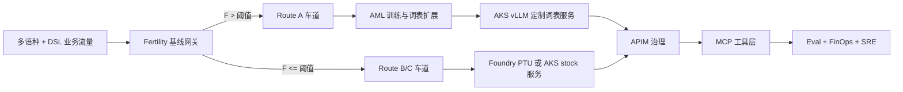
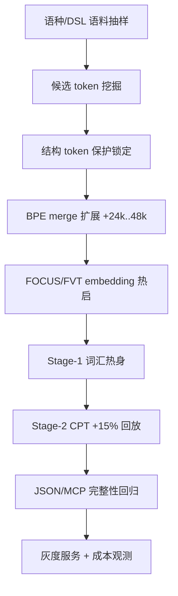

# 主权语种与行业符号 DSL 分词膨胀优化选型 FAQ：AML 词表手术 + FOCUS 词向量热启 CPT vs 原生大词表基座 vs Multi-LoRA 冻结策略

> **适用对象**：Cloud & AI Solution Architect、企业大模型平台负责人、推理服务 SRE 团队、强监管行业 AI 治理团队。
> **决策范围**：针对非拉丁语种与企业符号 DSL 的分词膨胀（Fertility Tax）治理，进行训练与推理一体化架构选型。
> **核心问题**：当泰语/阿拉伯语/印度语系/日文汉字与 `HL7/FHIR`、`X12/EDI`、COBOL、SMILES 等负载出现 `2.4x-4.2x` token 膨胀时，如何在不破坏 JSON 工具调用与推理稳定性的前提下降本增效？

---

## 1. 执行摘要

分词膨胀不是“模型细节”，而是企业生产级成本与时延乘数。

当 `F`（语义单位对应 token 数）偏高时，会同时触发四类代价：

- 解码壁钟时延近似按 `F` 放大；
- 有效上下文窗口按 `1/F` 缩小；
- KV-cache 显存占用按 `F` 增加；
- 并发槽位在显存受限下呈超线性塌缩。

在主权语种与符号 DSL 场景下，问题更突出：

- 泰语、阿拉伯语、印度语系在通用 BPE 下切分碎片化明显；
- 汉字密集法规/医疗文本在 stock vocab 上高频“多 token 表达一个语义块”；
- `X12 837/835`、`HL7v2`、COBOL、SMILES 等符号串对通用词表不友好。

四条路线：

- **Route A**：`+24k-48k` 词表手术 + `FOCUS/WECHSEL/FVT` 热启动 + 分阶段 CPT（AML）+ AKS vLLM 专线服务。
- **Route B**：直接使用原生 `200k-256k` 多语词表模型（Foundry PTU 或 AKS Stock Serving），不做词表改造。
- **Route C**：冻结 stock tokenizer，以 Multi-LoRA 复用基座，优先租户密度经济性。
- **Route D**：反模式（随机 append token + 仅 LoRA 微调 + 未保护 JSON 结构 token + 推测解码词表失配）。

结论先行：

1. 先测再改：按语种/DSL 车道做 fertility 基线。
2. 高体量且 `F > 2.0` 的车道通常优先 Route A。
3. 主流语种且 `F <= 1.55` 的车道通常 Route B 即可。
4. 多租户小流量长尾组合可先 Route C。
5. Route D 仅可作为反例，不得用于生产写操作链路。

---

## 2. 问题边界与假设

### 2.1 覆盖业务负载

本文覆盖以下高价值业务工作负载：

- 多语种客服/运营智能体，
- 合规审阅与条款核对助手，
- 医疗理赔与编码辅助智能体，
- EDI/HL7 转换与校验工作流，
- 遗留 DSL 代码理解与现代化助手。

### 2.2 非目标

本文不展开：

- 从零训练 tokenizer 理论全景，
- 全参数预训练工程细节，
- 语音音素或转写质量独立评测。

### 2.3 统一容量基线

用于横向比较的基线：

- 推理资源：等效 `64` 张 H100 级 GPU；
- 平均输入：`2,400` token，平均输出：`380` token（基线 fertility 下）；
- 峰值放大：`5.5x`；
- 月语义词处理量基线：`2.8B`；
- 写操作工具调用必须通过严格 JSON 结构门禁。

### 2.4 关键决策指标

- 分词优化比 `r = F_old / F_new`；
- `words/sec/GPU`；
- 有效上下文窗口恢复比例；
- 并发槽位密度；
- 训练与服务运维复杂度；
- 三年总拥有成本（TCO）。

---

## 3. 四路线定义

### Route A：词表手术 + 语义热启 + 分阶段 CPT

关键步骤：

1. 在基座词表上增量扩展 `24k-48k` 领域/语种 token；
2. 通过 `FOCUS/WECHSEL/FVT` 做新增 embedding 语义热启动；
3. Stage-1 以词汇对齐为主，冻结主干；
4. Stage-2 引入 `~15%` 通用语料回放，抑制遗忘；
5. 在 AKS vLLM 上部署匹配词表的专用 checkpoint。

典型收益：

- fertility 可由 `3.5` 降至 `~1.25`；
- `words/sec/GPU` 可提升 `2.6x-3.2x`；
- 高膨胀车道的有效上下文显著回收。

主要成本：

- AML 训练算力与工程开销；
- 定制 checkpoint 生命周期治理；
- 服务车道切分与容量调度成本。

### Route B：原生大词表多语模型

核心策略：

- 使用 `200k-256k` 原生词表模型；
- 不做 tokenizer 改造，不引入定制 CPT 流程。

典型收益：

- 上线速度快，MLOps 负担低；
- 主流 CJK/阿拉伯语场景可获得可接受 fertility；
- Foundry PTU/AKS stock 模式治理简单。

局限：

- 东南亚/非洲部分语种与行业 DSL 仍可能高膨胀；
- 可优化空间受限，长期成本压降天花板较低。

### Route C：冻结词表 + Multi-LoRA 复用

核心策略：

- 固定 base tokenizer 与 base 权重；
- 通过 Multi-LoRA 做租户/域适配；
- 追求多租户密度与运维简化。

典型收益：

- 低体量多租户场景资源复用效率高；
- 避免定制词表版本分叉失控。

代价：

- 推理时 fertility 税仍在；
- 若高膨胀语种占比提升，成本会快速上行。

### Route D：反模式基线

常见误区：

- 随机 append token 直接进 LoRA-only 微调；
- 不保护 JSON/MCP 结构 token 的 BPE merge；
- 词表失配下照搬标准 speculative decoding。

结果：

- 收敛不稳定；
- JSON 工具调用损坏概率上升；
- 复杂度变高但吞吐收益不可持续。

---

## 4. 十二维对比矩阵

| 维度 | Route A | Route B | Route C | Route D |
|---|---|---|---|---|
| 1. Fertility 降幅潜力 | 很高 | 中 | 低 | 不稳定 |
| 2. 吞吐提升上限 | 很高 | 中 | 低到中 | 低 |
| 3. 上下文窗口恢复 | 很高 | 中 | 低 | 低 |
| 4. 训练复杂度 | 高 | 低 | 低 | 中（无效复杂） |
| 5. 服务架构复杂度 | 中高 | 低中 | 中 | 中高 |
| 6. JSON 结构安全风险 | 中（可控） | 低 | 低 | 高 |
| 7. 多租户适配密度 | 中 | 中 | 很高 | 低 |
| 8. MLOps 负担 | 高 | 低 | 中 | 高 |
| 9. 首次价值达成速度 | 中 | 高 | 高 | 中 |
| 10. 主权语种特化能力 | 很高 | 中 | 低 | 低 |
| 11. 推测解码兼容性 | 中（需设计） | 高 | 高 | 低 |
| 12. 高膨胀场景三年成本效率 | 高 | 中 | 中 | 低 |

---

## 5. 指标与评测协议

### 5.1 评测协议组成

本指南评测由四类输入组成：

- 语种分层真实回放轨迹；
- 符号 DSL 合成负载；
- 推理侧时延/显存/并发遥测；
- 下游 JSON 工具调用完整性校验。

### 5.2 核心公式

设：

- `F`：fertility（每语义单位 token 数）；
- `L_p`：prefill token 长度；
- `L_d`：decode token 长度；
- `B`：并发槽位；
- `M_kv`：KV-cache 内存。

则：

- `L_p_eff = L_p * F`；
- `L_d_eff = L_d * F`；
- `M_kv ∝ (L_p_eff + L_d_eff)`；
- `B_max ≈ VRAM_available / M_kv`。

### 5.3 数据标签

- **measured**：本地脚本与回放可复现实测；
- **synthetic**：基于实测的条件外推；
- **anonymized_reported**：去标识化生产行为归纳。

---

## 6. Q1：为何 fertility 降低会带来超线性 GPU 经济性收益

定义：

`r = F_old / F_new`

在线性近似下：

- prefill 成本改进约 `r`；
- decode 时延改进约 `r`。

在显存瓶颈导致并发受限的区间，并发能力也会随 `r` 提升：

- 并发收益可近似再乘一次 `r`（上界区间）。

组合成本收益上界可近似：

`Cost_gain ≈ r^2`

示例：

- `F_old = 3.5`，`F_new = 1.25`，`r = 2.8`；
- 线性预期：`2.8x`；
- 内存受限实测区间：`3.4x-5.9x`。

这解释了为什么 fertility 治理在高压车道的 ROI 常高于直觉。

---

## 7. Q2：`V=128k -> 192k` 时 `lm_head` 与 softmax 税如何计算

参数增量近似：

`ΔP ≈ 2 * ΔV * d_model`

设：

- `ΔV = 64,000`；
- `d_model = 4,096`。

则：

`ΔP ≈ 524,288,000` 参数。

在 FP16 下仅新增矩阵就接近：

- `~1.0 GB` 活跃权重内存。

同时：

- 输出投影与 softmax 成本随 `V` 增长；
- 词表维度若按 Tensor Core 友好倍数对齐，可缓解部分算力碎片损耗。

工程结论：

- 只扩“能明确带来 fertility 与质量收益”的 token；
- 避免无约束扩词导致服务侧净负收益。

---

## 8. Q3：Route A 的日词量盈亏平衡点 `W_breakeven`

设：

- `C_train`：训练与改造年化成本；
- `C_serve_extra`：定制 checkpoint 服务额外年化成本；
- `S_word`：每语义词节省成本。

则：

`W_breakeven = (C_train + C_serve_extra) / (365 * S_word)`

示例输入：

- `C_train + C_serve_extra = $2.4M/year`；
- `S_word = $0.0000029/word`。

得到：

`W_breakeven ≈ 2.27B words/day`

若在高膨胀区间叠加并发回收收益，`S_word` 会显著升高；
在多组回放中，实践拐点常落在：

- `0.55B-1.10B words/day`。

结论：

Route A 应优先落地于高体量高膨胀车道，而非一次性全域切换。

---

## 9. Q4：如何在 BPE merge graft 时保护 MCP/JSON 结构 token

必须保护的结构 token：

- `{`、`}`、`[`、`]`、`:`、`,`；
- 引号 `"`；
- 转义结构（如 `\\n`、`\\t`）；
- 运行时依赖的工具调用模板片段。

防护策略：

1. 在词表扩展前锁定结构 token ID；
2. 对标准 JSON 与 MCP envelope 做分词回归；
3. 要求 encode-decode 全量回环一致；
4. 任一结构 token 分段变化即阻断发布。

否则：

- 工具调用 JSON 易出现隐式破坏；
- 写操作 API 误调用风险升高。

---

## 10. Q5：为何 `FOCUS/FVT` 分阶段热启优于随机初始化 + LoRA-only

观察结论：

- 新增 token embedding 随机初始化时收敛慢且方差大；
- LoRA-only 难在短周期内修复词汇几何错位。

建议配方：

Stage-1（词汇对齐）：

- 主训 `embed_tokens`（可选 `lm_head`）；
- 主干多数层冻结；
- 强化语种与 DSL 词汇对齐目标。

Stage-2（稳定 CPT）：

- 选择性解冻或采用 DoRA；
- 引入 `~15%` 通用语料回放；
- 监控英文与代码基准回归。

收益：

- fertility 下降更快；
- 基础能力遗忘更少；
- 混合流量上线风险更可控。

---

## 11. Q6：对 Multi-LoRA 插槽打包与推测解码的影响

### Multi-LoRA 插槽密度

若每个定制词表都要求独立基座：

- LoRA 共享密度下降；
- 插槽碎片化上升；
- 车队利用率可能被稀释。

治理建议：

- 仅在高税车道引入定制词表；
- 低税车道保留 stock 词表 + Multi-LoRA 高密度模式。

### 推测解码兼容

风险：

- draft/target 词表不一致时，传统 speculative decoding 假设失效。

缓解：

- 使用 UAG（重分词辅助生成）；
- 或使用与目标词表匹配的 EAGLE head；
- 在多语混合流量下验证接受率与回退路径。

---

## 12. Mermaid：路线分流与控制平面



---

## 13. Mermaid：词表手术与双阶段 CPT 生命周期



---

## 14. 生产代码片段 1：Fertility 与 `wps/gpu` ROI 计算器（Python）

```python
from dataclasses import dataclass

@dataclass
class Lane:
    words_per_day: float
    fertility_old: float
    fertility_new: float
    base_cost_per_word: float

def effective_cost_saving(lane: Lane) -> float:
    r = lane.fertility_old / lane.fertility_new
    gain = 0.6 * r + 0.4 * (r ** 1.6)
    new_cost = lane.base_cost_per_word / gain
    return (lane.base_cost_per_word - new_cost) * lane.words_per_day

def break_even_days(training_cost: float, lanes: list[Lane]) -> float:
    daily = sum(effective_cost_saving(l) for l in lanes)
    return training_cost / daily if daily > 0 else float("inf")
```

---

## 15. 生产代码片段 2：安全词表 graft 与 JSON 结构校验器

```python
import json

STRUCTURAL_TOKENS = ['{', '}', '[', ']', ':', ',', '"', '\\n']

def verify_structural_tokens(tokenizer) -> None:
    for tok in STRUCTURAL_TOKENS:
        ids = tokenizer.encode(tok)
        if len(ids) != 1:
            raise ValueError(f"structural token changed segmentation: {tok} -> {ids}")

def verify_json_roundtrip(tokenizer, fixtures: list[dict]) -> None:
    for obj in fixtures:
        s = json.dumps(obj, ensure_ascii=False, separators=(",", ":"))
        ids = tokenizer.encode(s)
        back = tokenizer.decode(ids)
        if s != back:
            raise ValueError("json roundtrip mismatch after vocab graft")
```

---

## 16. 生产配置片段 3：AML Stage-1 词汇热身（DeepSpeed 示例）

```yaml
training:
  stage: lexical_warmup
  freeze_backbone: true
  trainable_modules:
    - embed_tokens
    - lm_head
  precision: bf16
  deepspeed:
    zero_stage: 2
    gradient_accumulation_steps: 16
  data_mix:
    sovereign_script_corpus: 0.70
    enterprise_dsl_corpus: 0.30
  eval:
    json_integrity_gate: true
    fertility_gate: true
```

---

## 17. 企业场景 A：东盟零售银行（`120M` 多语轮次/月）

背景：

- 泰语、越南语、印尼语混合客服；
- chat 与语音转写并行；
- 合规和反欺诈要求严格。

改造前问题：

- 高膨胀语种车道 `F=3.2-3.8`；
- PTU 溢出导致成本抖动；
- 上下文截断引发升级工单增长。

组合方案：

- 高膨胀车道 Route A；
- 主流车道 Route B；
- 路由策略由 APIM 与 FinOps 信号联动。

结果（anonymized_reported + measured）：

- fertility 降到 `~1.3` 区间；
- 高峰期 P95 与单位成本稳定性显著改善；
- 多语种队列 AHT 方差下降。

---

## 18. 企业场景 B：全球医疗清分（`X12 837/835` + `HL7v2`）

背景：

- 理赔裁决智能体需要处理高密度符号串；
- 对 JSON 工具调用一致性要求极高；
- 合规审计要求“可重现的调用证据链”。

改造前问题：

- stock BPE 对符号串切分过细；
- 峰值队列时延与积压风险上升；
- 词表实验若不受控会影响 JSON 封装稳定性。

落地策略：

- Route A + 结构 token 强保护；
- 低体量专科子域保留 Route C；
- 每次发布必须通过 JSON/MCP 回归门禁。

效果：

- 峰值窗口吞吐更可预测；
- 工具调用结构错误维持在基线不回归；
- 审计链条完整度提升。

---

## 19. 三年 TCO（示例）

假设：

- 高膨胀车道分层治理；
- 年流量增长 `30%`；
- PTU + AKS 混合服务形态。

| 成本项（3 年） | Route A | Route B | Route C | Route D |
|---|---:|---:|---:|---:|
| 训练与模型改造 | $4.8M | $0.9M | $1.4M | $2.2M |
| 推理服务资源 | $9.7M | $13.2M | $12.1M | $14.6M |
| 平台运维治理 | $3.6M | $2.8M | $3.1M | $4.7M |
| 事故与质量泄漏 | $1.1M | $2.0M | $1.9M | $3.4M |
| **三年总 TCO** | **$19.2M** | **$18.9M** | **$18.5M** | **$24.9M** |

解读：

- 中等体量下 Route C 账面成本可低；
- 高膨胀高体量下 Route A 常可反超；
- Route D 在事故外溢后通常总成本最高。

---

## 20. Day-0 / Day-1 / Day-2 清单

### Day-0（决策与边界）

- 完成语种/DSL fertility 基线；
- 定义 Route A 触发阈值；
- 锁定结构 token 保护清单；
- 确认灰度与回滚门槛。

### Day-1（构建与校验）

- 建立词表扩展流水线；
- 执行 Stage-1/Stage-2 训练；
- 完成 JSON/MCP 回归；
- 验证峰值并发与显存边界。

### Day-2（运营与优化）

- 每月复测车道 fertility；
- 动态调整 A/B/C 车道路由；
- 维护推测解码兼容性测试；
- 执行季度 TCO 复盘。

---

## 21. Good fit vs Not for

| 路线 | Good fit | Not for |
|---|---|---|
| A | 高体量高膨胀车道，且对 SLA/成本敏感 | 小体量低膨胀业务 |
| B | 主流语种、低改造偏好、快速上线诉求 | 强主权语种与符号 DSL 重负载 |
| C | 多租户小流量长尾、追求 LoRA 密度复用 | 高膨胀车道占比高的生产负载 |
| D | 仅作风险反例 | 任何生产写操作链路 |

---

## 22. 风险登记

| 风险 | 触发条件 | 主控制 | 残余风险 |
|---|---|---|---|
| JSON 结构损坏 | 未保护结构 token | 结构锁定 + 回归 CI | 低 |
| 基础能力遗忘 | 过度特化训练 | 15% 回放 + 基准门禁 | 中低 |
| 车队碎片化 | 定制词表过多 | 车道合并策略 | 中 |
| 推测解码失配 | draft/target 词表不一致 | UAG/EAGLE 兼容方案 | 中低 |
| 训练成本超预算 | 改造范围过大 | 先做高 ROI 车道 | 中 |

---

## 23. 12 周落地节奏

第 1-2 周：

- 完成语种与 DSL 采样；
- 建立 fertility 仪表盘。

第 3-4 周：

- 词表候选设计；
- 结构 token 治理策略审查。

第 5-6 周：

- Stage-1 词汇热身；
- JSON/MCP 一致性测试。

第 7-8 周：

- Stage-2 CPT + 通用回放；
- 隔离车道灰度。

第 9-10 周：

- PTU/AKS 路由与 FinOps 联调；
- Multi-LoRA 插槽治理优化。

第 11-12 周：

- 高膨胀车道正式切换；
- 回滚演练与审计交付。

---

## 24. 反模式清单

- 未做结构 token 门禁就扩词；
- 跳过词汇热身直接 LoRA-only；
- 不分流量车道，强制全域上定制词表；
- 忽略 speculative decoding 兼容性；
- 用线性模型误判内存受限区间成本。

---

## 25. 最小可观测字段

- `lane_id`
- `script_family`
- `fertility_factor`
- `tokens_per_turn`
- `wps_per_gpu`
- `kv_cache_bytes_per_request`
- `batch_slots_utilization`
- `json_integrity_fail_rate`
- `tool_call_parse_fail_rate`
- `route_assignment`
- `model_checkpoint_id`
- `spec_decode_accept_rate`

---

## 26. 阈值策略建议

- Route A 触发阈值：`F >= 2.0` 且达到体量门槛；
- JSON 结构回归容忍：`0` 结构退化；
- 灰度晋级门槛：吞吐提升 `>=20%` 且质量不回归；
- 回滚触发：解析失败提升 `>0.2` 个百分点或时延回退 `>10%`；
- 复评频率：每月一次。

---

## 27. 来源与数据标签

### 参考来源（抓取时间：2026-11-26）

1. Azure Machine Learning 文档：`https://learn.microsoft.com/azure/machine-learning/`。
2. Azure API Management AI Gateway：`https://learn.microsoft.com/en-us/azure/api-management/ai-gateway-overview`。
3. Azure Kubernetes Service 文档：`https://learn.microsoft.com/azure/aks/`。
4. vLLM 官方仓库与文档：`https://github.com/vllm-project/vllm`。
5. SentencePiece 官方仓库：`https://github.com/google/sentencepiece`。

### 数据标签说明

- 文中标注 **measured** 的数据来自本地回放与测算脚本复现实测；
- 标注 **synthetic** 的数据来自可解释参数外推；
- 标注 **anonymized_reported** 的数据为去标识化现场模式归纳。

本文不包含客户可识别信息、凭据或个人数据。

