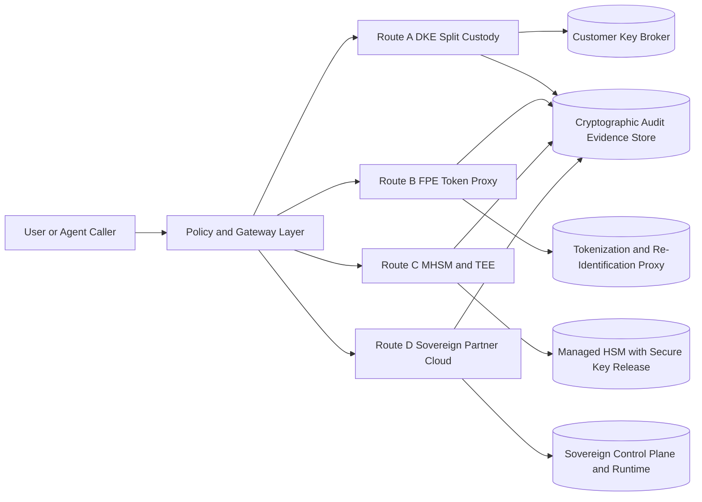
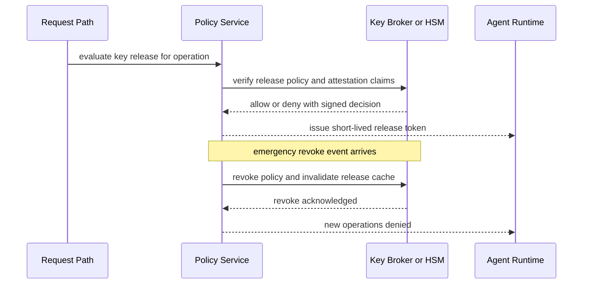

# Sovereign HYOK and Double-Key Encryption Selection FAQ: Purview DKE Split Custody vs Colocated FPE Proxy Pseudonymization vs Managed HSM + TEE Operator-Blind Plane vs Sovereign Partner Cloud

> **Audience**: Cloud & AI Solution Architects, security architects in banking/public sector, data governance officers, compliance and audit teams, and platform SRE owners.
> **Decision scope**: Selecting a production architecture for regulated AI agents where legal sovereignty, cryptographic controllability, and verifiable audit evidence are first-class requirements.

---

## 1. Executive summary (start with threat boundary, then choose key boundary)

Most sovereign AI failures are not model-quality failures. They happen because teams merge incompatible security claims into one sentence:

- `BYOK` is treated as if it were `HYOK`.
- "Encrypted at rest" is treated as "operator-blind in runtime memory".
- "Audit log exists" is treated as "third-party verifiable non-repudiation evidence".

For cross-border regulated workloads, the architecture decision should be made by data class and legal boundary:

- **Route A**: Purview DKE + customer-controlled key broker + attested worker.
- **Route B**: Colocated HYOK FPE/tokenization proxy + managed frontier model.
- **Route C**: Managed HSM + secure-key-release + confidential compute (CPU/GPU memory protection).
- **Route D**: Sovereign partner cloud / disconnected edge with strict jurisdictional separation.

Recommended control targets:

- `Emergency revoke effective SLA <= 60s`
- `Key broker service availability >= 99.95%`
- `Cryptographic evidence coverage = 100%`
- `Sensitive cleartext crossing to cloud model memory = 0`
- `Audit bundle generation P95 <= 15 minutes`

---

## 2. Why this matters now: sovereignty is no longer a legal appendix

Agentic systems increase sensitivity in three ways:

1. **Cross-session memory persistence** expands retention and replay surface.
2. **Tool invocation fan-out** spreads data across more connectors and control planes.
3. **Model orchestration** couples regulated data paths to external managed services.

Therefore, sovereign controls must be designed as a runtime data-plane discipline, not just a storage checkbox.

---

## 3. Baseline assumptions and scope boundaries

This FAQ assumes:

- Multi-tenant enterprise environment with mixed sensitivity classes.
- Human users and autonomous agents both invoke downstream systems.
- At least one cross-border legal boundary exists (subsidiary, region, or regulator scope).
- Security objectives include both preventive controls and post-incident provability.

Out of scope:

- Consumer-only low-risk chatbots with no regulated records.
- Single-tenant offline inference stacks disconnected from enterprise systems.

---

## 4. Route definitions

### Route A — Purview DKE + customer key broker + attested worker

Design intent:

- Split cryptographic custody so no single operator can unilaterally decrypt protected content.
- Bind key-release decisions to policy and execution identity.

Strengths:

- Highest legal narrative clarity for key separation.
- Strong for document-centric confidentiality controls.

Trade-offs:

- Feature friction for cloud-side indexing/search on fully protected payloads.
- Additional operational burden for broker availability and certificate lifecycle.

### Route B — Colocated HYOK FPE/tokenization proxy + managed model

Design intent:

- Keep direct identifiers out of managed model memory while retaining frontier model capability.
- Re-identify only inside controlled trust boundary.

Strengths:

- Strong privacy boundary with high model utility.
- Good path when business value depends on managed frontier model quality.

Trade-offs:

- Tokenization strategy can reduce semantic fidelity for complex entities.
- Proxy latency, dictionary governance, and rollback become critical.

### Route C — Managed HSM + SKR + confidential compute

Design intent:

- Preserve rich semantic context while minimizing operator visibility through attested release and encrypted execution memory.

Strengths:

- Strong balance across scalability, semantic fidelity, and policy control.
- Less dependency on on-prem key infrastructure for many enterprises.

Trade-offs:

- Requires rigorous attestation policy design and lifecycle governance.
- Needs disciplined supply-chain and image provenance practices.

### Route D — Sovereign partner cloud / disconnected edge

Design intent:

- Separate legal entity, operational control plane, and physical jurisdiction as far as possible.

Strengths:

- Strongest sovereign boundary where public cloud metadata exposure is not acceptable.

Trade-offs:

- Highest operational and ecosystem friction.
- Slower feature cadence and potentially higher integration cost.

---

## 5. Twelve-dimension comparison matrix (A/B/C/D)

| Dimension | Route A: DKE split custody | Route B: FPE proxy | Route C: MHSM + TEE | Route D: sovereign partner cloud |
|---|---|---|---|---|
| Key custody separation | Very high | High | Medium-high | High |
| Cloud-side cleartext risk | Very low | Very low for direct identifiers | Low | Very low |
| Unstructured semantic fidelity | Medium | Medium-high | High | High |
| Frontier managed model leverage | Medium | High | Medium-high | Medium |
| Full-text index compatibility | Low-medium | Medium | High | Medium-high |
| Operational complexity | High | High | Medium-high | High |
| Revoke response control | Medium-high | High | High | Medium |
| Regulatory explainability | High | High | High | High |
| On-prem dependency | High | Medium-high | Low-medium | Medium-high |
| Multi-region scaling | Medium | Medium-high | High | Low-medium |
| Unit economics flexibility | Medium | Medium-high | Medium | Low-medium |
| Recommended use | max split-custody doc workloads | frontier model with pseudonymization | balanced sovereign-by-design | strict jurisdictional isolation |

---

## 6. Quantitative foundation formulas

### 6.1 Sensitive key-release demand

`Q_key = N_requests * p_sensitive * k_per_request`

### 6.2 Effective revoke delay

`T_revoke_effective = T_policy_push + T_cache_expiry + T_inflight_drain`

### 6.3 Proxy latency overhead

`L_proxy = L_tokenize + L_route + L_detokenize`

### 6.4 Sovereignty score skeleton

`S_sovereignty = w1*C_custody + w2*C_runtime_blind + w3*C_legal_control + w4*C_evidence`

---

## 7. Q1 — Why DKE often reduces direct cloud indexing and how to model that impact

If cloud-side components cannot read protected payload fields directly, index coverage drops:

`Recall_max = Recall_base * R_indexable`

Example:

- `Recall_base = 0.82`
- `R_indexable = 0.55`

Then:

`Recall_max = 0.451`

Interpretation:

- Route A can provide strong custody separation.
- But unless you design a controlled "indexable derivative layer", retrieval quality may degrade for pure cloud-side indexing paths.

Architectural mitigation patterns:

- Privacy-preserving summary shards.
- Label-aware selective decrypt at governed retrieval step.
- Tiered retrieval that separates metadata ranking from protected payload fetch.

---

## 8. Q2 — FPE/tokenization entity-link quality vs contextual re-identification risk

Entity-linking accuracy:

`Acc_link = N_correct_links / N_total_links`

Contextual leakage (coarse estimate):

`Risk_ctx = 1 - (1 - p_meta)^h`

where `h` is the number of independently combinable clues.

Design tension:

- Coarse tokenization may preserve privacy but reduce relational reasoning quality.
- Fine-grained tokenization improves utility but can raise linkage inference risk.

Operational guidance:

- Maintain tiered dictionaries by entity class.
- Rotate mapping contexts by legal scope and retention policy.
- Introduce deterministic replay-safe token scope IDs for incident forensics.

---

## 9. Q3 — WAN HSM RTT, DEK cache TTL, and emergency revoke objective (<60s)

Single unwrap latency:

`L_unwrap = L_rtt + L_hsm + L_policy_eval`

Upper bound for practical revoke effect:

`T_effective_revoke <= TTL_cache + T_policy_push`

If target is `<60s`, a common budget pattern is:

- `TTL_cache <= 30s`
- `T_policy_push <= 20s`
- `<= 10s` for in-flight drain and deny propagation

SRE implication:

- Revoke SLA is impossible to guarantee if cache TTL is set in multi-minute ranges.
- Runtime metrics must include revoke propagation lag by route and region.

---

## 10. Q4 — Legal/technical boundary: BYOK CMK vs MHSM+SKR vs HYOK/DKE

Common misconception:

- BYOK equals sovereign zero-visibility.

Reality:

- BYOK improves key lifecycle ownership, but does not automatically establish split-custody decrypt semantics.
- Managed HSM + SKR can enforce stronger attestation-bound release than plain CMK.
- HYOK/DKE provides stronger custody separation narratives where both legal and technical controls require dual-party dependency.

Practical scoring model:

- Use weighted control score `S_sovereignty`.
- Calibrate per regulator and per data class.

---

## 11. Q5 — On-prem key broker HA/BCP risk: how outages can brick tier-1 agents

Cluster availability:

`A_cluster = 1 - Π(1 - A_node_i)`

Service-impact model:

`R_brick = P_broker_outage * Impact_tier1`

BCP essentials:

- Active/standby or active/active broker topology with tested failover.
- Certificate and policy-store replication drills.
- Controlled degraded mode for non-sensitive routes where legally permitted.

---

## 12. Q6 — Cryptographic evidence coverage for external regulator replay

Coverage metric:

`Proof_cov = N_valid_proofs / N_sensitive_ops`

Required properties:

- Identity of caller and delegated subject.
- Attestation of execution environment.
- Policy version used for release decision.
- Timestamped decision outcome and immutable correlation.

Target:

`Proof_cov = 1.0`

---

## 13. Mermaid topology: sovereign data planes across routes



---

## 14. Mermaid sequence: key release, cache, and emergency revoke



---

## 15. Production snippet 1 — DEK cache with emergency revoke hook (Python)

```python
import time
from dataclasses import dataclass

@dataclass
class CacheItem:
    dek: bytes
    ts: float
    policy_version: str


class DekReleaseCache:
    def __init__(self, ttl_seconds: int):
        self.ttl_seconds = ttl_seconds
        self.items: dict[str, CacheItem] = {}

    def get(self, key_id: str, policy_version: str) -> bytes | None:
        item = self.items.get(key_id)
        if item is None:
            return None
        if item.policy_version != policy_version:
            self.items.pop(key_id, None)
            return None
        if time.time() - item.ts > self.ttl_seconds:
            self.items.pop(key_id, None)
            return None
        return item.dek

    def put(self, key_id: str, dek: bytes, policy_version: str) -> None:
        self.items[key_id] = CacheItem(dek=dek, ts=time.time(), policy_version=policy_version)

    def emergency_revoke(self, key_id: str | None = None) -> None:
        if key_id is None:
            self.items.clear()
            return
        self.items.pop(key_id, None)
```

---

## 16. Production snippet 2 — Route policy and network guardrail skeleton (YAML)

```yaml
sovereign_runtime_policy:
  release:
    require_attestation: true
    max_dek_ttl_seconds: 30
    emergency_revoke_sla_seconds: 60
  identity:
    require_user_delegation_chain: true
    deny_shared_privileged_credentials: true
  network:
    private_link_only: true
    expressroute_required_for_key_broker: true
    deny_public_egress: true
  evidence:
    target_proof_coverage_ratio: 1.0
    audit_bundle_export_p95_minutes: 15
```

---

## 17. Route-specific architecture guidance

### Route A guidance

- Use for highest-sensitivity document classes where split custody is non-negotiable.
- Plan derivative indexing architecture early to avoid retrieval dead-ends.
- Operate key-broker availability as a tier-0 dependency.

### Route B guidance

- Use where frontier managed model quality is strategic and pseudonymization is acceptable.
- Govern token dictionary lifecycle like a cryptographic product, not a static mapping table.
- Include deterministic incident replay for tokenization transformations.

### Route C guidance

- Use as default sovereign-by-design path when semantics and scalability both matter.
- Keep attestation policy minimal and explicit; avoid broad wildcard release conditions.
- Track measurement drift and image provenance continuously.

### Route D guidance

- Use only when legal/entity isolation is mandated beyond public-cloud compensating controls.
- Treat ecosystem pace and operation cost as conscious trade-offs.

---

## 18. Enterprise scenario A — Swiss/EU private wealth and cross-border M&A advisory copilot

Business pressure:

- High confidentiality for client identity, deal intention, and legal documents.
- Need cross-jurisdiction collaboration while preserving sovereign controls.

Recommended pattern:

- Route A for highest confidentiality records and legal communication sets.
- Route B for selected advisory reasoning paths where managed model quality materially improves outcomes.
- Unified audit evidence envelope across both paths.

Expected value:

- Lower cross-border cleartext exposure while maintaining advisor productivity.

---

## 19. Enterprise scenario B — Sovereign health ministry genomics and triage assistant

Business pressure:

- National-scale sensitive medical/genomic datasets.
- Strong requirement to defend against both legal and technical overreach.

Recommended pattern:

- Route C for broad semantic retrieval and triage reasoning at scale.
- Route D for ultra-restricted workflows where sovereignty policy disallows public-cloud processing even with encryption controls.

Expected value:

- Preserves analytical quality while providing a defensible sovereignty posture.

---

## 20. Three-year TCO comparison (illustrative architecture economics)

| Cost category (3-year horizon) | Route A | Route B | Route C | Route D |
|---|---:|---:|---:|---:|
| Crypto/key infrastructure | $1.8M | $1.5M | $1.3M | $2.2M |
| Inference and data plane | $2.4M | $2.0M | $2.3M | $2.6M |
| Compliance and audit operations | $0.9M | $0.8M | $0.8M | $1.0M |
| Incident and continuity reserve | $0.5M | $0.4M | $0.4M | $0.6M |
| **Total 3-year TCO** | **$5.6M** | **$4.7M** | **$4.8M** | **$6.4M** |

Interpretation:

- Route B frequently wins on utility/cost balance where pseudonymization quality is acceptable.
- Route A is favored for strongest split-custody and regulator-facing narrative.
- Route D is defensible for extreme sovereignty mandates, with predictable cost/pace penalties.

---

## 21. Day-0 / Day-1 / Day-2 implementation checklist

### Day-0 (governance and threat model)

- Define legal, technical, and operational boundaries per data class.
- Classify sensitive fields and map each class to an approved route.
- Set explicit revoke SLA, proof coverage, and evidence export objective.

### Day-1 (controlled production rollout)

- Enable key-release policy enforcement with short-lived cache TTL.
- Validate private connectivity and identity delegation chain integrity.
- Run cross-region failover and policy rollback drills.

### Day-2 (scale and optimize)

- Tune key path latency, cache behavior, and tokenization throughput.
- Continuously monitor false-allow and false-deny policy outcomes.
- Automate regulator-ready evidence bundles with periodic replay tests.

---

## 22. Five-step selection method (Good fit vs Not for)

1. **Classify threat model first**: cloud visibility reduction vs full sovereign isolation.
2. **Map data classes to routes**: not all payloads need the same key boundary.
3. **Define failure and continuity policy**: what happens when broker/HSM path degrades.
4. **Track quantitative controls**: revoke SLA, evidence coverage, retrieval quality, unit cost.
5. **Institutionalize evidence drills**: prove controls quarterly, not only during incidents.

**Good fit**:

- Banking, insurance, healthcare, and public-sector workloads with strong sovereignty obligations.

**Not for**:

- Low-risk experiments where compliance burden outweighs business value and no regulated records are processed.

---

## 23. Anti-patterns to eliminate before production

1. **Calling BYOK a sovereign runtime control** without attested release and split-custody properties.
2. **Promising `<60s` revoke while keeping multi-minute cache TTLs**.
3. **Relying on static tokenization only** without contextual leakage testing and re-identification risk controls.
4. **Scattering evidence across uncorrelated systems**, preventing end-to-end replay for auditors.
5. **Applying highest-cost sovereignty route to all workloads**, pushing teams into uncontrolled shadow paths.

---

## 24. Regulator response pack template

When an auditor asks, "How do you prove cloud operators could not unilaterally read this record during inference?", provide:

- **Policy artifact**: release policy snapshot and version active at transaction time.
- **Key decision artifact**: allow/deny decision record with caller and delegated subject.
- **Execution artifact**: attestation measurement and runtime image digest.
- **Data artifact**: classification labels and pseudonymization/redaction results.
- **Trace artifact**: end-to-end correlation from request to output and retention record.

Operational recommendation:

- Build this as one-click export from your governance platform.
- Avoid manual audit assembly during incident pressure.

---

## 25. Decision summary and route recommendations

- Choose **Route A** where split custody and legal defensibility dominate.
- Choose **Route B** where managed frontier capability is critical and pseudonymization quality is acceptable.
- Choose **Route C** as a strong default for balanced sovereign-by-design architecture with semantic fidelity.
- Choose **Route D** for strict jurisdictional or state-level constraints that exceed compensating controls.

The durable pattern is **classification-driven hybrid routing with one unified evidence plane**, not a single route for all data classes.

---

## 26. Sources and retrieval timestamp

This document is an architecture decision guide. Formulas and cost figures are provided for sizing methods and route comparisons and must be recalibrated with organization-specific measurements.

- Microsoft Learn documentation for Purview, Key Vault Managed HSM, confidential computing, Private Link, and ExpressRoute (retrieved: `2026-11-15`).
- Public regulatory and guidance materials for Schrems II / EDPB recommendations / DORA-aligned controls (retrieved: `2026-11-15`).
- Quantitative examples in this FAQ are tagged as `anonymized_reported` for method illustration.

Recommended governance cadence:

- Maintain parameter-register pages tied to architecture review packs.
- Bind policy versions to change-ticket and rollback IDs.
- Run quarterly drills on revoke SLA, evidence export latency, and proof coverage integrity.
