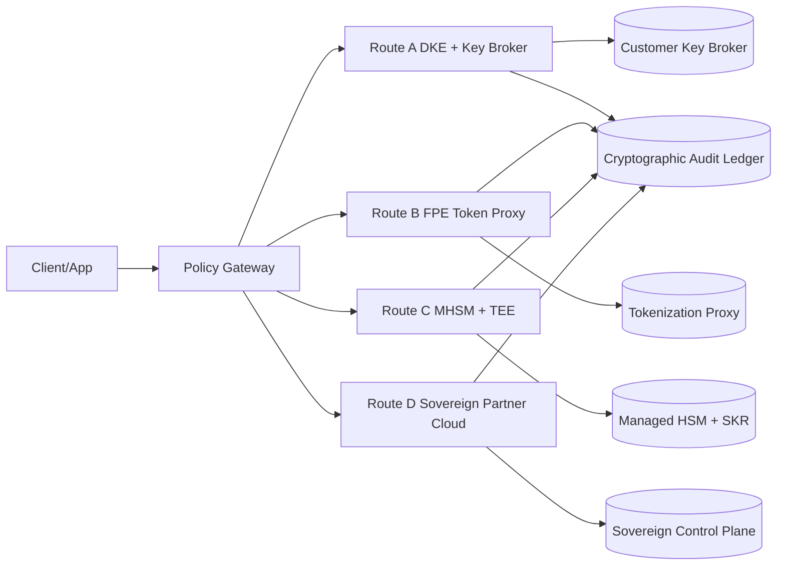
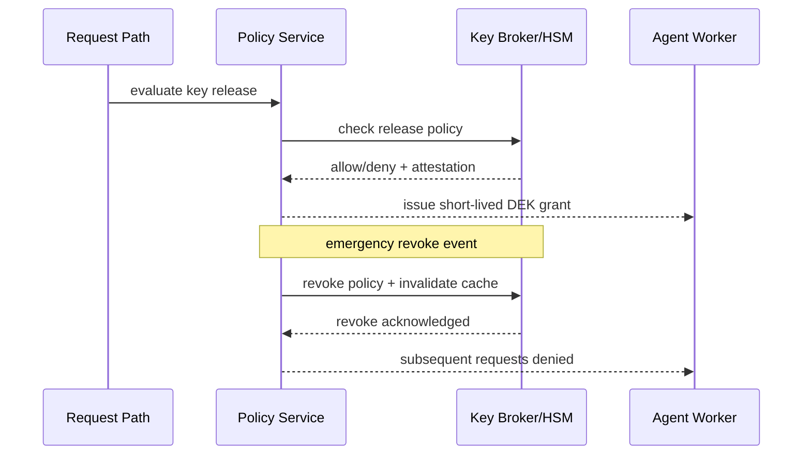

# 主权 HYOK 与双重密钥加密选型 FAQ：Purview DKE 分权托管 vs 同城 FPE 代理化去标识 vs Managed HSM + TEE 盲操作平面 vs 主权伙伴云

> **适用对象**：Cloud & AI Solution Architect、金融与公共部门安全架构师、数据合规与审计团队、平台治理团队。
> **核心问题**：在跨境监管与域外强制披露压力下，如何构建“云运营方不可见明文”的 AI Agent 数据平面，并在可用性、模型能力和审计证明之间取得平衡。

---

## 1. 执行摘要（先定义威胁边界，再做密钥路线）

主权与合规场景下，技术选型失败通常不是算法问题，而是把不同威胁模型混为一谈：

- `BYOK CMK` 并不等于 `HYOK/DKE`。
- “加密存储”并不自动代表“推理内存不可见”。
- “有证书”不代表“可对监管方举证”。

四路线建议：

- **Route A（Purview DKE + 客户密钥代理 + 受证明执行单元）**：适合最强密钥分权诉求。
- **Route B（同城 HYOK FPE 代理 + 云侧伪标识推理）**：适合希望使用前沿托管模型又要控制明文出境。
- **Route C（Managed HSM + 远程证明 SKR + 机密计算）**：适合追求语义完整保真与云侧可扩展治理。
- **Route D（主权伙伴云/断连边缘）**：适合“连加密元数据都不允许入公共云”的高主权场景。

建议硬指标：

- `紧急吊销生效 SLA <= 60s`
- `密钥代理可用性 >= 99.95%`
- `审计证据完整率 = 100%`
- `敏感实体出云明文泄露率 = 0`
- `合规审计包生成时延 P95 <= 15min`

---

## 2. 法规驱动与威胁建模前提

典型监管关注：

- Schrems II 与 EDPB 01/2020 对跨境可访问性的约束。
- 金融监管对外包与可审计控制链条的要求。
- DORA 类规则对关键数字运营韧性的要求。

威胁边界要拆分为三层：

1. **法律访问面**：运营方、供应商、司法协助链路。
2. **技术访问面**：控制平面、数据平面、运行内存、备份副本。
3. **运营访问面**：管理员、运维自动化、应急账户。

---

## 3. 四条路线定义（A/B/C/D）

### Route A：Purview DKE + 客户密钥代理 + 受证明执行单元

核心机制：

- 文档与状态密钥拆分 custody。
- 客户侧 Key Broker 与云侧服务双因素联合才能解密。
- Agent Worker 运行在受证明执行环境中，确保密钥释放受策略约束。

优点：

- 密钥分权最强，监管叙事清晰。
- 适合高敏标签文档保护与协作治理。

约束：

- 某些云侧索引/推理能力受限。
- Key Broker 可用性成为关键依赖。

### Route B：同城 HYOK FPE 代理 + 伪标识化上下文进入托管模型

核心机制：

- 在同城节点执行格式保持加密与可逆 token 映射。
- 云侧仅看到伪标识上下文，不接触真实标识符。
- 结果回流后在受控代理端完成 re-identification。

优点：

- 可以利用托管前沿模型能力。
- 明文标识符不进入云侧推理内存。

约束：

- 语义损失与实体链接偏差需额外评估。
- 代理层可用性与延迟成为核心指标。

### Route C：Managed HSM + MAA 证明释放 + 机密计算

核心机制：

- 密钥在 Managed HSM 内托管，按证明策略释放。
- 机密 CPU/GPU 内存加密执行，限制宿主层观察能力。
- 通过证明链路把“谁、何时、在何环境拿到密钥”固化审计。

优点：

- 保持非结构化语义与 RAG 保真能力。
- 不依赖本地 HSM 机房即可规模化。

约束：

- 对证明策略设计要求高。
- 对运行时与供应链合规治理要求高。

### Route D：主权伙伴云 / 断连边缘

核心机制：

- 控制平面、运维实体和物理边界独立。
- 适用于国家级与防务级严苛主权场景。

优点：

- 法律与运营边界最清晰。

约束：

- 能力更新节奏慢，生态集成成本高。

---

## 4. 12 维对比矩阵

| 维度 | Route A DKE 分权 | Route B FPE 代理 | Route C MHSM+TEE | Route D 主权伙伴云 |
|---|---|---|---|---|
| 密钥分权强度 | 极高 | 高 | 中高 | 高 |
| 云侧明文暴露风险 | 极低 | 极低（标识符） | 低 | 极低 |
| 非结构化语义保真 | 中 | 中高 | 高 | 高 |
| 托管模型能力利用率 | 中 | 高 | 中高 | 中 |
| 索引/RAG 兼容性 | 低中 | 中 | 高 | 中高 |
| 运营复杂度 | 高 | 高 | 中高 | 高 |
| 吊销响应速度 | 中高 | 高 | 高 | 中 |
| 监管举证清晰度 | 高 | 高 | 高 | 高 |
| 本地设施依赖 | 高 | 中高 | 低中 | 中高 |
| 多区域扩展性 | 中 | 中高 | 高 | 低中 |
| 单位成本可控性 | 中 | 中高 | 中 | 低中 |
| 推荐等级 | 高监管文档协作 | 前沿模型+去标识 | 平衡路线 | 极端主权场景 |

---

## 5. 基础模型与容量公式

### 5.1 密钥请求负载

`Q_key = N_req * p_sensitive * k_per_req`

### 5.2 吊销传播时延

`T_revoke = T_policy_push + T_cache_expire + T_inflight_drain`

### 5.3 代理链路额外时延

`L_proxy = L_tokenize + L_route + L_detokenize`

---

## 6. 定量 Q1：DKE 对云侧索引与 RAG 的功能折损

在 DKE 场景下，若云侧无法直接读取敏感正文，则：

- 可直接建立的全文索引比例下降为 `R_indexable`。
- RAG 召回上限近似为 `Recall_max = Recall_base * R_indexable`。

示例：

- `Recall_base=0.82`
- `R_indexable=0.55`

则：

`Recall_max = 0.451`

结论：

- Route A 安全边界最强，但需要额外设计“可索引摘要层”或“受控解密检索层”来补齐能力。

---

## 7. 定量 Q2：FPE/tokenization 的实体链接准确率与泄露风险

实体链接准确率：

`Acc_link = N_entity_correct / N_entity_total`

上下文泄露风险近似：

`Risk_ctx = 1 - (1 - p_meta)^h`

其中 `h` 为可组合的上下文线索数量。

当 token 化策略过粗时：

- `Acc_link` 下降，影响多实体推理正确率。

当策略过细时：

- `Risk_ctx` 上升，重识别风险增加。

设计建议：

- 采用分层 token 词典（强标识、弱标识、行业语义）与最小可逆窗口。

---

## 8. 定量 Q3：WAN HSM 解封 RTT、DEK 缓存 TTL 与吊销 SLA

单次密钥解封时延：

`L_unwrap = L_rtt + L_hsm + L_policy_eval`

若缓存 TTL 为 `TTL_cache`，吊销生效上界近似：

`T_effective_revoke <= TTL_cache + T_policy_push`

要满足 `<60s` 吊销目标，可采用：

- `TTL_cache <= 30s`
- `T_policy_push <= 20s`
- 预留 `10s` 在途请求清理窗口。

---

## 9. 定量 Q4：BYOK 与 HYOK/DKE 的法律-技术边界

定义能力得分：

`S_sovereignty = w1*C_custody + w2*C_runtime_blind + w3*C_legal_control + w4*C_audit_evidence`

常见排序（示意）：

- `BYOK CMK < Managed HSM + SKR < HYOK/DKE`

原因：

- BYOK 主要提升“客户可控密钥生命周期”，并不自动实现双边不可单独解密。

---

## 10. 定量 Q5：本地 HSM 集群 HA/BCP 风险

集群可用性：

`A_cluster = 1 - Π(1 - A_node_i)`

若 Key Broker 仅单活单站点，则：

`R_brick = P_outage * Impact_tier1`

建议：

- 双站点活备 + 同城低时延链路。
- 故障演练覆盖“证书失效、网络分区、策略回滚”。

---

## 11. 定量 Q6：监管可验的密码学审计证明

审计证明完整度：

`Proof_cov = N_proofs_valid / N_sensitive_ops`

要求：

- 每次解密授权都有可验证证明链（身份、策略、时间、环境哈希）。
- 可导出监管审计包并支持第三方重放校验。

目标：

`Proof_cov = 1.0`

---

## 12. Mermaid：四路线主权数据平面拓扑



---

## 13. Mermaid：密钥吊销与请求拦截时序



---

## 14. 生产实现片段 1：DEK 解封与紧急吊销缓存策略（Python）

```python
import time

class DekCache:
    def __init__(self, ttl_seconds: int):
        self.ttl = ttl_seconds
        self.cache = {}

    def get(self, key_id: str):
        item = self.cache.get(key_id)
        if not item:
            return None
        value, ts = item
        if time.time() - ts > self.ttl:
            self.cache.pop(key_id, None)
            return None
        return value

    def put(self, key_id: str, dek: bytes):
        self.cache[key_id] = (dek, time.time())

    def emergency_revoke(self, key_id: str):
        self.cache.pop(key_id, None)
```

---

## 15. 生产实现片段 2：SKR/网络治理策略示例（YAML）

```yaml
sovereignPolicy:
  releaseControl:
    requireAttestation: true
    maxDekTtlSeconds: 30
    emergencyRevokeSlaSeconds: 60
  networking:
    privateLinkOnly: true
    expressRouteRequiredForBroker: true
    denyPublicEgress: true
  audit:
    proofCoverageTarget: 1.0
    exportBundleP95Minutes: 15
```

---

## 16. 企业场景 A：瑞士/欧盟私银与跨境并购顾问智能体

挑战：

- 客户身份、交易意向、尽调文档均高度敏感。
- 需满足跨境合规与客户主权诉求。

建议：

- 采用 Route A 或 B 作为主路径。
- 对高敏文档启用 DKE 分权。
- 对前沿模型需求强的问答场景采用 FPE 代理化路线。

收益：

- 在保持投顾效率的同时降低明文跨境暴露风险。

---

## 17. 企业场景 B：主权卫生部门基因组与临床分诊智能体

挑战：

- 数据主权极强，公有云暴露容忍度极低。
- 需要大规模检索与模型推理能力。

建议：

- Route C 用于语义保真与可扩展推理。
- 若政策要求更严，关键工作流落在 Route D。

收益：

- 在主权边界内实现可解释的 AI 辅助决策。

---

## 18. 三年 TCO 对比（示例）

| 成本项 | Route A | Route B | Route C | Route D |
|---|---:|---:|---:|---:|
| 加密与密钥基础设施（3y） | $1.8M | $1.5M | $1.3M | $2.2M |
| 推理与数据平面（3y） | $2.4M | $2.0M | $2.3M | $2.6M |
| 合规与审计运营（3y） | $0.9M | $0.8M | $0.8M | $1.0M |
| 业务中断与应急成本（3y） | $0.5M | $0.4M | $0.4M | $0.6M |
| **总计（3y）** | **$5.6M** | **$4.7M** | **$4.8M** | **$6.4M** |

解读：

- Route B 在“能力与成本平衡”常见场景可能最优。
- Route A 在超高主权文档协作场景更具监管说服力。
- Route D 适用于极端主权场景但成本与复杂度较高。

---

## 19. Day-0 / Day-1 / Day-2 清单

### Day-0（制度与威胁模型）

- 明确法律边界、技术边界、运营边界。
- 定义敏感数据分级与路线映射。
- 确认吊销 SLA 与审计证据格式。

### Day-1（灰度上线）

- 上线密钥释放策略、缓存 TTL 与紧急吊销流程。
- 建立可追责身份链与操作账本。
- 做跨区域故障与策略回滚演练。

### Day-2（规模化）

- 优化 proxy/HSM 热点与容量。
- 定期复盘误放行与吊销时延。
- 对监管审计包做演练抽检。

---

## 20. 五步选型指南（Good fit vs Not for）

1. **确认威胁模型**：是“防云侧明文可见”还是“防任何外部可见”。
2. **映射数据分级**：哪些必须 DKE、哪些可 FPE、哪些可在 TEE 内处理。
3. **定义可用性目标**：Key Broker/HSM 失效时业务可接受降级策略。
4. **量化治理指标**：吊销、审计、召回、成本四类统一看板。
5. **持续合规演练**：按季度输出可重放审计包。

**Good fit**：

- 金融、公共部门、跨境高敏数据协作场景。

**Not for**：

- 无主权合规压力且以低成本快速迭代为唯一目标的轻量应用。

---

## 21. 最终建议

- 需要最强密钥分权与监管叙事时优先 Route A。
- 需要前沿托管模型且可接受去标识代理复杂度时优先 Route B。
- 需要语义保真与规模能力平衡时优先 Route C；极端主权约束走 Route D。
- 最终落地应采用“分级路由 + 统一审计”而非单一路线覆盖全部数据等级。

---

## 22. 反模式清单（上线前必须排除）

1. **把 BYOK 当成 HYOK**：仅轮换 CMK，不做运行时最小可见性与证明策略，导致监管审计无法说明“谁在何时看到过明文”。
2. **把缓存 TTL 设成分钟级却承诺秒级吊销**：策略文档写 `SLA <= 60s`，实际 `TTL=300s`，应急时等价于“吊销无效窗口 5 分钟”。
3. **只做静态脱敏，不做上下文泄露评估**：实体本身隐藏了，但上下文组合仍可逆推出客户身份。
4. **将证据留在多个孤岛系统**：日志、策略、密钥操作、推理追踪无法拼接，外部审计只能得到“片段正确”而非“链路可证明”。
5. **把最严格路线强推到全部数据等级**：导致成本和延迟全面上升，业务绕行出影子系统，反而破坏治理初衷。

---

## 23. 监管问询应答模板（建议）

当审计方提出“你如何证明云侧在某次推理中无法单方解密某客户材料”时，建议按以下证据序列输出：

- **证据 1（策略）**：当次密钥释放策略快照，含身份、环境证明约束与生效版本号。
- **证据 2（密钥）**：对应 key release/deny 记录，包含时间戳、调用主体、策略评估结果。
- **证据 3（执行）**：受证明执行环境测量值（measurement）与镜像摘要哈希。
- **证据 4（数据）**：输入数据标签、脱敏规则命中结果与出云字段审计。
- **证据 5（回溯）**：从请求 ID 到输出响应的全链路关联 ID。

建议把该模板固化为“审计一键导出包”，以避免人工拼装造成遗漏与解释分歧。

---

## 24. 来源与时间标注（治理交付要求）

> 本文为架构选型方法文档，定量公式与成本示例用于容量建模与路线比较，实际值需以组织内压测与财务参数为准。

- Microsoft Learn（Purview、Key Vault Managed HSM、Confidential Computing、Private Link、ExpressRoute）：访问日期 `2026-11-15`。
- 金融与主权合规公开框架（Schrems II / EDPB / DORA 等）官方公开文本：访问日期 `2026-11-15`。
- 本文定量示例数据标签：`anonymized_reported`（用于说明计算方法，不替代组织内实测）。

交付建议：

- 与平台落地评审材料同步附带“参数口径页”。
- 对所有路由策略版本启用变更单号与回滚点映射。
- 每季度对“紧急吊销 SLA、审计包导出、证据覆盖率”做演练并留档。

