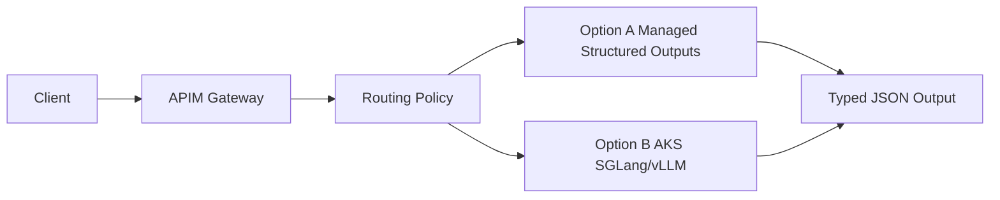
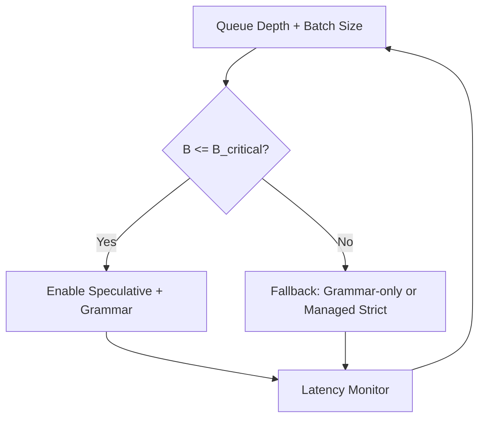

# Enterprise Structured Generation Selection FAQ: Speculative Decoding + Grammar-Constrained JSON (AKS vLLM/SGLang) vs Foundry Structured Outputs

## 1. Background: agent tool orchestration bottlenecks are now structure reliability + tail latency

In multi-step agent systems, failures often come from malformed tool payloads rather than intent misunderstanding.

Frequent failure patterns:

- missing required keys,
- wrong scalar types,
- enum violations,
- invalid brackets or nesting.

With large schemas (for example 80+ fields), prompt-only JSON generation can produce non-trivial failure rates.

Repair loops then amplify latency and token spend.

So production design must optimize three goals together:

- low latency,
- near-zero syntax error rate,
- stable throughput under concurrency.

## 2. Three options

**Option A: Azure AI Foundry / Azure OpenAI Structured Outputs (`strict: true`)**

Fastest enterprise rollout.

Low operational burden.

Good baseline reliability.

**Option B: AKS self-hosted vLLM/SGLang + XGrammar/llguidance + speculative decoding**

Highest tuning flexibility and performance headroom.

Supports jump-forward constrained decoding and dynamic bypass strategies.

Higher platform complexity.

**Option C: unconstrained decoding + retry/repair (Instructor/Pydantic)**

Simple to prototype.

Commonly unstable at scale due to retry storms and tail-latency amplification.

## 3. 12-dimension production matrix

| Dimension | Option A: Managed Strict Outputs | Option B: AKS Constrained + Speculative | Option C: Retry/Repair |
|---|---|---|---|
| Time to production | high | medium-low | high |
| Syntax correctness | high | highest | medium |
| Latency optimization ceiling | medium | highest | low |
| Concurrency stability | high | medium-high | low |
| p99 predictability | high | medium-high | low |
| Cost controllability | medium | high after tuning | low |
| Platform complexity | low | high | low |
| Observability granularity | medium | high | medium |
| Ops skill requirement | low | high | low |
| Regulated workload fit | high | high | low |
| Extensibility | medium | high | low |
| Long-run TCO | medium | medium-low | high |

## 4. Option A deep dive: strengths and cold-schema considerations

Option A is ideal for organizations prioritizing fast standardization and managed operations.

Strengths:

- managed reliability,
- consistent API surface,
- smoother governance integration.

Watch-outs:

- first-use schema compilation can spike TTFT,
- very large schemas still need decomposition strategies,
- warmup and pre-registration flows are important for critical paths.

## 5. Option B deep dive: speculative + constrained decoding in real production

Option B improves efficiency by reducing unnecessary token generation.

Two cooperating mechanisms:

1. speculative decoding (draft-target acceptance),
2. finite-state constrained decoding.

At healthy acceptance rates, TPOT can improve significantly.

At higher batch concurrency, benefits can flatten or reverse.

Typical causes:

- GPU saturation,
- CPU-side mask overhead,
- queue wait inflation.

Hence dynamic bypass policy is mandatory.

## 6. Option C deep dive: why simple repair loops degrade at scale

Option C can work in low-traffic paths.

At scale it often creates three amplification loops:

- retry amplification,
- queue amplification,
- cost amplification.

For strict SLAs, it is rarely suitable as a long-term primary architecture.

## 7. Latency mechanics: TTFT, TPOT, batch size, and acceptance-rate coupling

Track metrics separately:

- TTFT,
- TPOT,
- end-to-end P95/P99.

Speculative decoding often helps TPOT first.

TTFT may still be dominated by schema compile and queueing.

Operationally, optimize long-tail percentiles, not only averages.

## 8. Adaptive policy: critical batch threshold and automatic bypass

Define `B_critical`.

When `B <= B_critical`:

- enable speculative + constrained mode.

When `B > B_critical`:

- switch to grammar-only constrained mode,
- or route to managed strict outputs.

This prevents benefit inversion during peak traffic windows.

## 9. AKS reference snippet: vLLM/SGLang + xgrammar + speculative + KEDA

```yaml
apiVersion: apps/v1
kind: Deployment
metadata:
  name: sglang-json-serving
spec:
  replicas: 4
  template:
    spec:
      containers:
      - name: server
        image: ghcr.io/example/sglang:latest
        args:
        - "--model"
        - "your-model"
        - "--guided-decoding-backend"
        - "xgrammar"
        - "--speculative-config"
        - "{\"method\":\"eagle3\",\"acceptance_min\":0.75}"
        - "--max-batch-size"
        - "48"
---
apiVersion: keda.sh/v1alpha1
kind: ScaledObject
metadata:
  name: sglang-json-serving-keda
spec:
  scaleTargetRef:
    name: sglang-json-serving
  minReplicaCount: 2
  maxReplicaCount: 20
  triggers:
  - type: prometheus
    metadata:
      metricName: queue_depth
      threshold: "120"
```

The key is adaptive policy plus observability, not static parameter values.

## 10. Azure sizing and 3-year TCO (`$k/month`)

### 10.1 Assumptions

- peak 20k RPS tool-dispatch requests,
- average schema size 80 fields,
- concurrency envelope 16–64 batch width,
- target `p99 < 400ms`.

### 10.2 Option A estimate

- managed structured inference: `$168k/month`
- gateway + telemetry: `$22k/month`
- operations: `$12k/month`
- total: `$202k/month`
- 3-year: `$7.27M`

### 10.3 Option B estimate

- AKS H100 serving cluster: `$141k/month`
- control plane + observability: `$29k/month`
- platform engineering: `$33k/month`
- total: `$203k/month`
- 3-year: `$7.31M`

### 10.4 Option C estimate

- inference plus retries: `$186k/month`
- repair services and queues: `$31k/month`
- operations: `$18k/month`
- total: `$235k/month`
- 3-year: `$8.46M`

Option C often underestimates retry-driven hidden cost until production traffic scales.

## 11. Scenario A: real-time e-commerce checkout router (`p99 < 280ms`, 45 tools)

Requirements:

- high concurrency,
- strict typed payload quality,
- tight tail-latency target.

Recommended pattern:

Option B primary with adaptive batch-threshold bypass.

Low-load windows keep speculative acceleration on.

Peak windows auto-switch to preserve p99.

## 12. Scenario B: healthcare HL7 FHIR R4 bundle extraction (120-schema, zero syntax errors)

Requirements:

- strict schema conformance,
- downstream rejection risk if malformed,
- compliance-friendly replayability.

Recommended pattern:

Option A for managed reliability where platform simplicity is prioritized.

Option B for maximum tuning control where teams can operate custom serving safely.

## 13. Diagram A: managed + self-hosted dual path routing



## 14. Diagram B: adaptive concurrency bypass loop



## 15. Deep Q&A and implementation guidance

### 15.1 Q1: when should Option A be the default?

When teams prioritize reliable delivery speed and managed operations over deep kernel-level optimization.

### 15.2 Q2: when should Option B be preferred?

When latency/throughput targets are aggressive and platform engineering maturity is strong.

### 15.3 Q3: how should speculative bypass be triggered?

Use combined acceptance-rate and p99 thresholds.

### 15.4 Q4: how do we avoid schema-evolution release spikes?

Pre-register and pre-warm new schemas.

Canary route before full rollout.

### 15.5 Q5: what KPIs prove constrained-decoding value?

Track:

- syntax error rate,
- retry rate,
- p99 latency,
- token cost per request.

### 15.6 Q6: good fit vs not for

**Good fit**

- high-concurrency tool orchestration,
- strict structured payload requirements,
- hard tail-latency SLOs.

**Not for**

- low-volume prototypes,
- teams lacking observability and automatic fallback controls.

### 15.7 closing recommendation

Structured generation success at scale depends on correctness constraints, latency elasticity, and cost governance operating together.

A/B dual-track design is usually safer than long-term dependence on C.

### 15.8 Q7: how should pre-release capacity tests be designed?

Test at least three concurrency bands:

- nominal traffic,
- 2x peak,
- burst spike.

Record p95/p99/error-rate behavior per band.

### 15.9 Q8: how do we govern prompt-schema coupling?

Version prompt templates and schemas independently.

Validate compatibility matrix on release.

### 15.10 Q9: when is human audit sampling required?

High-risk field changes.

High-value transactions.

Early phase of new model rollout.

### 15.11 final closure

Only when syntax error approaches zero and tail latency remains stable under load does agent tool orchestration realize its intended business value.

### 15.12 Q10: how should hard quality red lines be defined?

Set at least three hard limits:

- JSON syntax error ceiling,
- required-field omission ceiling,
- downstream parse-failure ceiling.

Any breach should block release.

### 15.13 Q11: when should speculative mode be disabled automatically?

When acceptance rate keeps falling while p99 keeps rising.

That indicates speculative benefit inversion.

Auto-switch to grammar-only or managed strict mode.

### 15.14 Q12: how should schema complexity be tiered operationally?

A practical model:

- simple schemas: direct strict output,
- medium schemas: strict output plus lightweight validators,
- complex schemas: segmented generation and merge validation.

Tiering is more robust than one global strategy.

### 15.15 Q13: how do we prevent CPU-side constrained decoding from becoming bottleneck?

Focus on:

- grammar precompile cache,
- hot-state machine reuse,
- thread affinity and NUMA tuning.

Continuously track mask-time share in end-to-end latency.

### 15.16 Q14: when is jump-forward decoding most valuable?

When JSON boilerplate and repeated key patterns are common.

Template-heavy tool-call payloads often gain the most.

### 15.17 Q15: how should multi-tenant fairness be governed?

Use per-tenant token budgets and concurrency quotas.

Add reserved lanes for high-priority transactions.

Avoid one-tenant spikes degrading global tail latency.

### 15.18 Q16: how do we avoid schema-compile cache stampede?

Recommended controls:

- two-level cache (local + shared),
- background prewarm jobs,
- phased rollout by schema version.

Avoid all-tenant cold-start activation windows.

### 15.19 Q17: how do we make structured generation auditable?

Log for each response:

- schema version,
- constrained-decoding backend version,
- bypass decision reason,
- post-generation validation summary.

This supports incident forensics and compliance audits.

### 15.20 Q18: how should peak-time fallback be staged?

Use three levels:

1. speculative + grammar,
2. grammar-only,
3. managed strict outputs.

Define explicit trigger and recovery thresholds for each level.

### 15.21 Q19: how can retry-storm risk be measured?

Track:

- retries per request,
- queue wait growth rate,
- retry traffic ratio.

If all trend upward together, trigger protection controls quickly.

### 15.22 Q20: how should quarterly architecture reviews be run?

Review performance, quality, cost, and compliance in a single dashboard.

Compare strategy outcomes by business domain.

Feed decisions into next-quarter parameter baselines.

### 15.23 Final closure

The target is not a one-time benchmark win.

The target is stable correctness and predictable tail latency under sustained high load with controlled cost.

### 15.24 Q21: how should field-level error profiling be implemented?

Classify failures by field category:

- missing required fields,
- type mismatches,
- enum violations,
- constraint conflicts.

Field-level profiling separates schema-design issues from prompt-pattern issues.

### 15.25 Q22: how do we de-risk grammar backend migration?

In canary windows, compare:

- syntax correctness,
- p99 latency,
- CPU overhead.

Pause migration if any metric crosses regression guardrails.

### 15.26 Q23: what is a practical DR strategy for structured outputs?

Keep a managed strict-output fallback path in DR regions.

If primary self-hosted path degrades, fail over quickly to preserve correctness and SLA continuity.

### 15.27 Additional final recommendation

Long-run reliability requires all three:

- switchable serving paths,
- auditable quality gates,
- deterministic peak-load fallback controls.

When these three are in place together, structured generation can support enterprise agent orchestration with predictable reliability.

### 15.28 Operational rollout note

Review top schema-failure fields monthly.

Prioritize fixes for recurrent high-impact fields.

Steady incremental correction is usually safer than infrequent large rewrites.

This cadence helps keep both latency and correctness stable as schemas evolve.

It also reduces emergency rollback frequency during peak business windows.
That operational discipline is a practical differentiator for enterprise-scale agent platforms.
It keeps structured generation dependable during continuous model and schema evolution.
