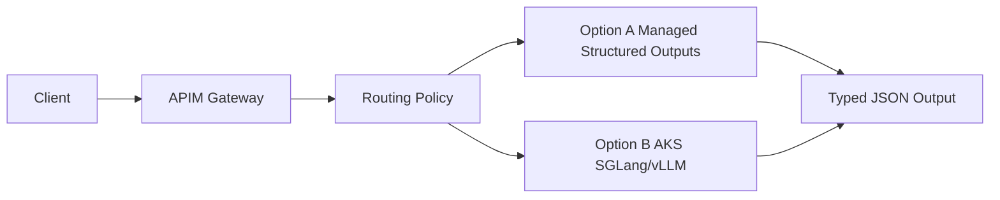
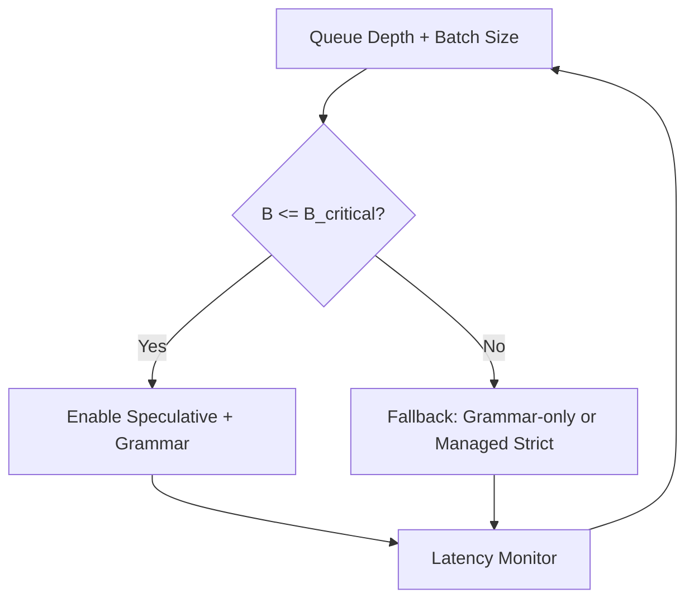

# 企业级结构化生成选型 FAQ：Speculative Decoding + Grammar Constrained JSON（AKS vLLM/SGLang）vs Foundry Structured Outputs

## 1. 背景：Agent 工具编排的核心瓶颈从“模型能力”转向“结构化输出延迟与可靠性”

多步 Agent 工作流中，最终失败往往不在语义理解。

而在结构化输出不稳定。

常见故障包括：

- JSON 缺字段。
- 类型错误。
- 枚举越界。
- 括号不闭合。

在 80 字段以上工具 schema 下，prompt-only JSON 失败率常显著上升。

失败后进入 retry/repair 会触发连锁放大。

结果是 p99 延迟被拉高。

token 成本也同步上升。

因此本指南聚焦“低延迟 + 零语法错误 + 可控吞吐退化”三目标。

## 2. 三种路线：A 托管 Structured Outputs，B 自建受约束推理栈，C 非约束生成 + 修复回环

**Option A：Azure AI Foundry / Azure OpenAI Structured Outputs（strict: true）**

托管能力完善。

落地速度快。

运维成本低。

适合大多数团队先建立稳定结构化输出基线。

**Option B：AKS vLLM/SGLang + XGrammar/llguidance + Speculative Decoding**

可深度优化延迟与吞吐。

可加入 jump-forward 与动态批量旁路策略。

但平台复杂度更高。

**Option C：非约束生成 + Pydantic/Instructor 修复重试**

实现简单。

短期可用。

但高并发下易产生 retry storm。

通常不适合严苛 p99 SLA 的生产路径。

## 3. 12 维度选型矩阵

| 维度 | Option A：托管 Structured Outputs | Option B：AKS 自建约束推理栈 | Option C：重试修复 |
|---|---|---|---|
| 上线速度 | 高 | 中低 | 高 |
| 语法正确率 | 高 | 最高 | 中 |
| 延迟优化潜力 | 中 | 最高 | 低 |
| 并发稳定性 | 高 | 中高（依赖调优） | 低 |
| p99 可预测性 | 高 | 中高 | 低 |
| 成本可控性 | 中 | 高（调优后） | 低 |
| 平台复杂度 | 低 | 高 | 低 |
| 观测细粒度 | 中 | 高 | 中 |
| 运维门槛 | 低 | 高 | 低 |
| 高风险适配 | 高 | 高 | 低 |
| 扩展灵活度 | 中 | 高 | 低 |
| 长期 TCO | 中 | 中低 | 高 |

## 4. Option A 深入：托管 strict JSON 的优势与冷启动注意点

Option A 适合“先稳定后优化”的组织策略。

优势：

- 接口统一。
- 合规与治理成熟。
- 与现有云服务集成顺滑。

注意点：

- 新 schema 首次编译可能带来 TTFT 抖动。
- 极复杂 schema 仍需设计拆分策略。
- 需为关键路径配置 warmup 与预热。

## 5. Option B 深入：Speculative + Grammar 的性能上限与并发拐点

Option B 的关键思想是“减少无效 token 生成”。

两类技术协同：

1. speculative decoding（draft-target 接受）。
2. constrained decoding（有限状态约束）。

当 token acceptance rate 高时，TPOT 可明显改善。

但并发超过某阈值后，收益会递减。

常见拐点来自：

- GPU 计算饱和。
- CPU 约束掩码开销。
- 批处理队列等待抬升。

所以生产中要配动态旁路策略，而非固定启用。

## 6. Option C 深入：为什么“修一修就好”常在规模化时失效

Option C 在低流量场景可行。

但在大流量下会出现三重放大：

- 失败重试放大。
- 队列拥塞放大。
- 成本放大。

如果没有强约束生成，复杂 schema 迟早会把重试链路拖垮。

## 7. 延迟机理：TTFT、TPOT、并发批量与 acceptance rate 的联动

需区分三类指标：

- TTFT（首 token）。
- TPOT（每 token 时间）。
- E2E p95/p99。

speculative 往往显著改善 TPOT。

但 TTFT 可能被 schema 编译或队列等待主导。

治理上不能只看平均值。

必须看长尾分位。

## 8. 生产参数建议：批量阈值自适应与旁路

建议定义 `B_critical`。

当并发批量 `B <= B_critical`：

- 开启 speculative + grammar。

当 `B > B_critical`：

- 降级为非 speculative grammar-only。
- 或切换托管 Structured Outputs 路线。

这种策略可避免高峰期收益反转。

## 9. AKS 参考配置片段（vLLM/SGLang + xgrammar + speculative + KEDA）

```yaml
apiVersion: apps/v1
kind: Deployment
metadata:
  name: sglang-json-serving
spec:
  replicas: 4
  template:
    spec:
      containers:
      - name: server
        image: ghcr.io/example/sglang:latest
        args:
        - "--model"
        - "your-model"
        - "--guided-decoding-backend"
        - "xgrammar"
        - "--speculative-config"
        - "{\"method\":\"eagle3\",\"acceptance_min\":0.75}"
        - "--max-batch-size"
        - "48"
---
apiVersion: keda.sh/v1alpha1
kind: ScaledObject
metadata:
  name: sglang-json-serving-keda
spec:
  scaleTargetRef:
    name: sglang-json-serving
  minReplicaCount: 2
  maxReplicaCount: 20
  triggers:
  - type: prometheus
    metadata:
      metricName: queue_depth
      threshold: "120"
```

核心不是固定参数，而是“可观测 + 自适应”。

## 10. Azure SKU 与 3 年 TCO（USD $k/month）

### 10.1 假设

- 峰值：20k RPS 工具调度请求。
- 平均 schema 字段数：80。
- 高峰并发批量：16–64 波动。
- 目标：`p99 < 400ms`。

### 10.2 Option A

- 托管推理与结构化输出：`$168k/月`
- 可观测与网关：`$22k/月`
- 运维：`$12k/月`
- 合计：`$202k/月`
- 三年：`$7.27M`

### 10.3 Option B

- AKS H100 推理集群：`$141k/月`
- 控制平面与观测：`$29k/月`
- 平台工程：`$33k/月`
- 合计：`$203k/月`
- 三年：`$7.31M`

### 10.4 Option C

- 推理与重试增量：`$186k/月`
- 修复链路与队列：`$31k/月`
- 运维：`$18k/月`
- 合计：`$235k/月`
- 三年：`$8.46M`

Option C 常因重试风暴导致隐性成本超预期。

## 11. 场景一：实时电商结账路由器，45 工具分发，`p99 < 280ms`

业务要求：

- 高并发。
- 强结构化参数。
- 严格长尾延迟目标。

建议：

核心路径采用 Option B。

并配置批量阈值自适应旁路。

低峰保持 speculative 提速。

高峰降级以保 p99。

## 12. 场景二：医疗 HL7 FHIR R4 Bundle 抽取，120 schema 零语法错误

业务要求：

- 输出必须严格符合 FHIR schema。
- 错误字段可能触发下游拒收。
- 合规审计要求可回放。

建议：

Option A 或 B 均可。

若团队偏平台轻运营，优先 A。

若极致性能与可定制优先，选 B 并加人工审计抽检。

## 13. 架构图一：托管与自建双轨路由



## 14. 架构图二：批量阈值自适应旁路



## 15. 深度 Q&A 与落地指南

### 15.1 Q1：何时应优先 Option A？

当组织首先追求稳定交付与低运维复杂度时。

### 15.2 Q2：何时应优先 Option B？

当对延迟与吞吐有极致要求，且具备平台工程能力时。

### 15.3 Q3：如何定义 speculative 失效条件？

可用 acceptance rate 与 p99 联合阈值触发旁路。

### 15.4 Q4：如何避免 schema 演进导致线上抖动？

新 schema 先预热编译。

灰度切流再全量发布。

### 15.5 Q5：如何衡量约束解码收益？

跟踪 JSON 语法错误率、重试率、p99、token/请求成本四指标。

### 15.6 Q6：Good fit vs Not for

**Good fit：**

- 高并发工具编排。
- 严格结构化输出。
- 强 SLA 场景。

**Not for：**

- 低流量实验项目。
- 无可观测与自动降级能力的团队。

### 15.7 收官建议

生产级结构化生成的核心不是单项技术名词，而是“约束正确性 + 延迟弹性 + 成本可控”的系统协同。

默认建议采用 A/B 双轨架构，避免 C 成为长期主路径。

### 15.8 Q7：如何做发布前容量压测？

建议压测三挡并发：

- 常态并发。
- 双倍峰值并发。
- 突发尖峰并发。

并记录三挡下的 p95/p99 与错误率。

### 15.9 Q8：如何治理提示词与 schema 版本耦合？

将 prompt 与 schema 分别版本化。

发布时做兼容性矩阵验证。

避免单点变更引发大面积回滚。

### 15.10 Q9：何时需要引入人工抽检？

高风险字段变更。

关键业务高价值交易。

新模型首发阶段。

### 15.11 最终收束

当结构化输出错误率趋近零且长尾延迟稳定时，Agent 工具编排的工程收益才会真正释放。

### 15.12 Q10：如何定义结构化输出质量红线？

建议至少设三条硬线：

- JSON 语法错误率上限。
- 必填字段缺失率上限。
- 下游解析失败率上限。

任一超线即阻断发布。

### 15.13 Q11：如何判断 speculative 是否“应该关掉”？

当 acceptance rate 连续下降且 p99 上升。

说明 speculative 开始失去收益。

此时应自动切到 grammar-only 或托管 strict 路径。

### 15.14 Q12：如何做 schema 分层治理？

可按复杂度划分：

- 简单 schema：直接 strict 输出。
- 中等 schema：strict + 轻量校验。
- 超复杂 schema：分段生成 + 合并校验。

分层治理比“一刀切”更稳健。

### 15.15 Q13：如何避免 CPU 成为约束解码瓶颈？

重点优化：

- grammar 预编译缓存。
- 热路径状态机复用。
- 线程亲和与 NUMA 调优。

并持续观测 CPU mask 时间占比。

### 15.16 Q14：何时引入 jump-forward 解码最划算？

当 JSON 模板键值重复率高、固定样板多时收益最大。

在强模板化工具调用场景，常可显著减少输出步数。

### 15.17 Q15：如何做多租户公平性治理？

建议每租户设令牌预算与并发配额。

并对高优先级交易配置保底通道。

防止单租户尖峰拖垮全局 p99。

### 15.18 Q16：如何防止 schema 编译缓存击穿？

可采用：

- 双层缓存（本地 + 共享）。
- 预热任务。
- 版本逐步切流。

上线窗口避免全量冷启动。

### 15.19 Q17：如何把结构化输出纳入审计链？

每次响应应记录：

- schema 版本。
- 约束后端版本。
- 旁路决策原因。
- 校验结果摘要。

这能支持事后审计与责任追踪。

### 15.20 Q18：高峰期回退策略如何设计？

可采用三级回退：

1. speculative+grammar。
2. grammar-only。
3. managed strict。

每级都有明确触发与恢复阈值。

### 15.21 Q19：如何评估“重试风暴风险指数”？

指标可用：

- 单请求平均重试次数。
- 队列等待增速。
- 重试流量占比。

指数连续升高时应快速限流并切换策略。

### 15.22 Q20：如何做季度架构复盘？

建议把性能、质量、成本、合规放在同一看板。

按业务域比较不同路由策略收益。

将复盘结论回写到下一季度参数基线。

### 15.23 最终收束

结构化生成体系的目标不是“某次压测快”，而是“长期在高负载下稳定正确且成本可控”。

这需要技术优化与治理机制同时到位。

### 15.24 Q21：如何做“字段级错误画像”？

建议把错误细分到字段层级：

- 缺失字段。
- 类型不匹配。
- 枚举越界。
- 约束冲突。

字段级画像能精准定位 schema 设计问题与 prompt 模板问题。

### 15.25 Q22：如何评估 grammar 后端切换风险？

在灰度阶段对比三类指标：

- 语法正确率。
- p99 延迟。
- CPU 占用。

任何单项恶化超阈值都应暂停切换。

### 15.26 Q23：如何设计灾备场景的结构化输出策略？

建议在灾备区域保留托管 strict 路径。

当主路径性能异常时可快速切换。

这样可避免高压下因自建路径故障导致级联中断。

### 15.27 最终建议补充

结构化生成体系要长期可靠，必须同时具备：

- 技术路径可切换。
- 质量门禁可审计。
- 高峰策略可降级。

只有三者同时成立，结构化生成平台才能稳定支撑企业级 Agent 编排。

### 15.28 运营落地提示

建议每月复盘一次 schema 失败 Top10。

对高频失败字段优先修复。

通过持续小步优化，通常比一次性大改更稳健。
