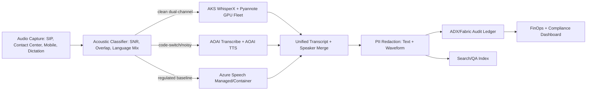
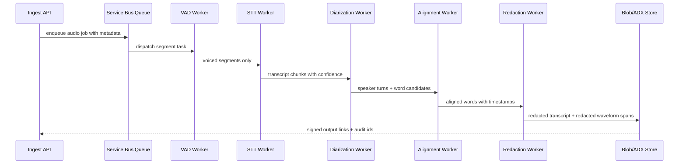

# Enterprise Speech STT, Diarization, and TTS Serving Selection FAQ: Azure Speech vs AOAI Transcribe vs AKS Whisper GPU
> 🌐 **Language Switch**: [中文](speech-stt-diarization-tts-serving-azure-speech-vs-aoai-transcribe-vs-aks-whisper-gpu-selection-faq.md) | **English (current)**  
> Audience: Cloud & AI Principal Solution Architects, speech platform engineering teams, compliance officers, and digital channel owners across finance and healthcare.  
> Scope: **Section 3.2 model serving and GPU orchestration** for high-throughput speech workloads, not the interactive WebRTC call-channel orchestration covered in #54/#55 under Section 3.5.  
> Goal: Build a production-ready blueprint for STT, multi-speaker diarization, custom vocabulary adaptation, and neural TTS economics on Azure.  

## 1. Executive finding: enterprise speech architecture is a routing and governance problem before it is a model-choice problem
Many enterprise programs start with one question.
Which speech model should we use.
That framing helps a pilot.
It fails in production.
At production scale, failures emerge from orchestration gaps.
Silence handling is inconsistent.
Speaker-turn attribution drifts under overlap.
Time-alignment quality is not stable across recording conditions.
PII redaction is applied only to text or only to audio.
Cost control is disconnected from quality policy.
The winning pattern is a routed architecture.
Path A establishes stable managed baseline capability.
Path B handles code-switch and context-sensitive utterances.
Path C drives high-throughput low-unit-cost batch execution.
Path D enforces hybrid routing and dual-track redaction governance.
This approach aligns technical KPIs with business risk.
It avoids all-or-nothing platform bets.
It also keeps procurement and compliance conversations grounded in measurable trade-offs.
In board-level reviews, this framing is easier to defend.

## 2. Problem statement: speech KPI drift is usually caused by business-metric misalignment
Speech teams often optimize for WER alone.
Business teams care about outcomes one layer above.
Legal teams care about replayable evidence and retention boundaries.
Operations teams care about queue stability and peak-hour recovery.
Clinical leads care about dosage and terminology safety.
Trading surveillance teams care about speaker attribution quality.
A single metric is therefore insufficient.
Model-level metrics should include WER and CER.
Session-level metrics should include DER and end-to-end processing delay.
Platform-level metrics should include cost per audio hour and retry inflation.
Compliance-level metrics should include text and waveform redaction recall.
Without this hierarchy, architecture debates become anecdotal.
Teams over-index on one benchmark dataset.
Then underperform in production call distributions.
The right first step is metric architecture.
Only then is model architecture meaningful.

## 3. Four-path reference strategy for enterprise speech serving on Azure
Path A is Azure AI Speech managed and containerized serving.
Path B is Azure OpenAI audio foundation models.
Path C is self-hosted AKS GPU pipeline with WhisperX and Pyannote.
Path D is hybrid acoustic routing with transcript and waveform redaction.
Classification should occur before model invocation.
Channel structure is the first classifier.
Dual-channel telephony and mono overlap have different optimal routes.
Acoustic quality is the second classifier.
SNR, silence ratio, and overlap ratio should be measured automatically.
Business criticality is the third classifier.
Routine QA archives and regulated dispute calls should not share identical policy.
Residency and egress constraints are the fourth classifier.
Regulated workloads may require containerized or private AKS paths.
Burst workloads may still benefit from managed overflow.
This four-path strategy supports graceful evolution.
It lets teams add intelligence without redesigning the full stack every quarter.

## 4. Twelve-dimension comparison matrix for architecture decisions
| Dimension | A Azure Speech Managed/Container | B AOAI Audio Models | C AKS WhisperX + Pyannote + TTS | D Hybrid Routing + Redaction Governance |
|---|---|---|---|---|
| Base STT stability | High | Medium-high | Medium-high | High |
| Intra-sentence code-switch quality | Medium | High | Medium | High |
| Native diarization support | High | External needed | High | High |
| Word-level timestamp reliability | High | Medium-high | High | High |
| Custom lexicon/acoustic adaptation | High | Medium | High | High |
| TTS prosody controllability | Medium-high | High | Medium | High |
| Batch throughput ceiling | High | Medium | High | High |
| Low-latency interactive flexibility | Medium | High | Medium-high | High |
| Private/air-gapped deployment fit | High | Medium | High | High |
| Operations complexity | Low-medium | Low | High | Medium-high |
| Lowest achievable unit cost | Medium | Medium | High | High |
| Multi-tenant governance controllability | High | Medium-high | Medium-high | High |
This matrix should be used with workload tagging.
Do not apply one row as a universal winner.
Different business cohorts have different optimal path combinations.

## 5. Path A deep dive: Azure AI Speech managed and containerized serving
Path A is the most common enterprise baseline.
It provides deterministic transcript artifacts.
Word confidence is available and easy to audit.
Word timestamps are first-class outputs.
Multi-speaker diarization is integrated.
Fast and batch transcription modes support different throughput envelopes.
Custom Speech enables domain adaptation.
Phrase-list and acoustic tuning are practical for jargon-heavy industries.
Custom Neural Voice supports controlled branded synthesis pipelines.
The container option extends applicability to regulated private networks.
Hospitals and trading floors often need this deployment mode.
Containerized inference can run in AKS or Arc-connected estates.
That keeps data egress posture under strict policy.
Path A is usually easiest to operationalize across many business units.
It is also usually easiest to hand off to centralized platform teams.
Its trade-off is less flexibility for custom low-level optimization.

## 6. Path B deep dive: AOAI `gpt-4o-transcribe`, `gpt-4o-mini-transcribe`, and `gpt-4o-mini-tts`
Path B is strongest on linguistic variability.
Code-switch within one sentence is common in global enterprises.
Mandarin, Cantonese, and English can interleave rapidly in one call.
Promptable context steering can improve domain output consistency.
This is particularly useful in wealth advisory and multilingual triage workflows.
`gpt-4o-mini-tts` offers natural prosody controls for conversational agents.
The path is less turnkey for diarization.
External speaker-turn services are typically required.
Silence handling remains critical.
Without VAD segmentation, repetition or filler hallucination risk increases.
A robust Path B deployment therefore includes pre-inference VAD and turn segmentation.
Budget controls must also be explicit.
Token quotas, concurrency limits, and fallback rules should be enforced in gateway policy.
Path B is an excellent high-complexity lane.
It should not be the default for every archive workload.

## 7. Path C deep dive: AKS self-hosted WhisperX and diarization for scale economics
Path C is built for cost and throughput at very large volume.
`faster-whisper-large-v3-turbo` with CTranslate2 is a common core.
`INT8` can improve cost efficiency for bulk archives.
`FP16` can preserve quality on harder segments.
`WhisperX` provides word-level forced alignment.
`Pyannote 3.1` provides speaker diarization.
Kokoro or CosyVoice can be added for TTS on the same platform strategy.
A10 and T4 node pools can be mixed by workload class.
A10 supports larger batch envelopes and stronger parallelism.
T4 supports moderate batches and lower baseline spend.
KEDA with Service Bus provides queue-driven elasticity.
Spot pools reduce cost for non-urgent archives.
On-demand pools absorb SLA-critical or urgent reruns.
The trade-off is operational depth.
Model lifecycle, CUDA compatibility, and queue fairness become your responsibility.
At six-figure audio-hour scale, many enterprises accept that trade-off.

## 8. Path D deep dive: hybrid acoustic routing and dual-track PII redaction
Path D is where architecture maturity shows.
Audio should be routed by measured characteristics.
SNR, overlap ratio, and channel structure are practical first classifiers.
Dual-channel clean telephony can be routed to low-cost AKS lanes.
Noisy multilingual VIP calls can be upgraded to AOAI or adapted Speech lanes.
After transcription, redaction must run on both artifact types.
Text redaction alone is insufficient.
Waveform redaction alone is insufficient.
The same sensitive span must be suppressed in transcript and audio output.
Word timestamps are the bridge between these planes.
A deterministic mapping between recognized entities and audio spans is required.
This design dramatically improves compliance confidence.
It also reduces legal discovery risk.
Path D should be governed centrally.
Otherwise each application team will implement inconsistent privacy behavior.

## 9. Reference architecture diagram for enterprise speech serving on Azure

The design is intentionally route-first.
It separates quality optimization from governance enforcement.
It also keeps cost analytics connected to model path decisions.

## 10. Sequence diagram for VAD segmentation, recognition, diarization, alignment, and redaction replay

This sequence minimizes wasted inference on silence.
It also creates deterministic replay points for investigations.

## 11. Quantitative Q&A: eight architecture questions that must be answered with numbers
**Q1: How does RTF differ between A10 24GB and T4 16GB for `faster-whisper-large-v3-turbo` plus `Pyannote 3.1`.**  
A1: In practical batch pipelines, A10 commonly reaches `80x–140x` RTF while T4 often reaches `45x–85x`, with larger gaps on overlap-heavy mono recordings.  
**Q2: What VRAM planning rule is realistic for this stack.**  
A2: `large-v3-turbo` with alignment and diarization buffers typically needs a careful memory envelope; A10 allows safer higher batch sizes, while T4 generally requires tighter segment sizing and lower concurrency.  
**Q3: What does monthly cost look like for 450,000 audio hours.**  
A3: At `$0.18/hr`, monthly spend is about `$81,000`; at `$0.36/hr`, about `$162,000`; AKS Spot A10 at `$0.03–$0.055/audio-hour` lands around `$13,500–$24,750`, excluding platform overhead and support.  
**Q4: Where is the managed-versus-self-hosted break-even region.**  
A4: Many programs observe a break-even around `100,000–150,000` monthly hours when internal platform maturity exists; below that, managed paths usually reduce operational burden.  
**Q5: How much does stereo channel separation improve DER versus mono overlap.**  
A5: Stereo dual-channel pipelines often lower DER from approximately `14%–22%` into `6%–12%`, while mono overlap remains harder without stronger diarization and post-correction loops.  
**Q6: How much does domain adaptation help WER for jargon-heavy calls.**  
A6: Financial symbols, drug names, and acronym-heavy speech can increase baseline WER by `2–6pp`; phrase-list plus custom acoustic adaptation commonly recovers `1.5–4pp`.  
**Q7: What is the measured value of Silero VAD before transcription.**  
A7: On recordings with silence ratio above `35%`, VAD-first processing can reduce repetition and silence hallucination events by roughly `40%–70%` while lowering unnecessary inference load.  
**Q8: How should STT and TTS be costed together for agent experiences.**  
A8: Use a unified per-session audio-minute cost model so STT optimization does not hide downstream TTS growth; this exposes true end-to-end economics for each workflow.  
These figures should be recalibrated with your own acoustic distributions.
Never freeze them as immutable constants.

## 12. Production code sample: Silero VAD pre-segmentation with WhisperX alignment and waveform span redaction
```python
from dataclasses import dataclass
from typing import List, Tuple
import re


@dataclass
class WordSpan:
    text: str
    start_s: float
    end_s: float
    speaker: str
    confidence: float


SENSITIVE_PATTERN = re.compile(r"(\\b\\d{16}\\b|\\b\\d{3}-\\d{2}-\\d{4}\\b)")


def run_silero_vad_segments(audio_path: str) -> List[Tuple[float, float]]:
    # Replace with real Silero VAD call in production
    return [(0.0, 11.8), (12.6, 29.4), (30.1, 58.2)]


def transcribe_with_alignment(segment_path: str) -> List[WordSpan]:
    # Replace with faster-whisper + WhisperX in production
    return [
        WordSpan("confirm", 2.11, 2.43, "SPEAKER_00", 0.96),
        WordSpan("1234567890123456", 2.44, 3.10, "SPEAKER_00", 0.92),
    ]


def redact_text_and_collect_wave_spans(words: List[WordSpan]) -> Tuple[List[WordSpan], List[Tuple[float, float]]]:
    redacted: List[WordSpan] = []
    muted_spans: List[Tuple[float, float]] = []
    for w in words:
        if SENSITIVE_PATTERN.search(w.text):
            redacted.append(WordSpan("[REDACTED]", w.start_s, w.end_s, w.speaker, w.confidence))
            muted_spans.append((w.start_s, w.end_s))
        else:
            redacted.append(w)
    return redacted, muted_spans
```
This snippet demonstrates dual-track redaction logic.
Production systems should add idempotency keys, retry envelopes, and immutable audit IDs.

## 13. Production IaC sample: AKS A10 deployment with KEDA queue-based autoscaling
```yaml
apiVersion: apps/v1
kind: Deployment
metadata:
  name: speech-stt-diarization-worker
  namespace: speech-platform
spec:
  replicas: 1
  selector:
    matchLabels:
      app: speech-stt-diarization-worker
  template:
    metadata:
      labels:
        app: speech-stt-diarization-worker
    spec:
      nodeSelector:
        accelerator: nvidia-a10
      containers:
        - name: worker
          image: ghcr.io/example/speech-worker:stable
          resources:
            limits:
              nvidia.com/gpu: 1
              cpu: "8"
              memory: "32Gi"
          env:
            - name: STT_MODEL
              value: "faster-whisper-large-v3-turbo"
            - name: ALIGN_MODEL
              value: "whisperx"
            - name: DIARIZATION_MODEL
              value: "pyannote-3.1"
            - name: ENABLE_SILERO_VAD
              value: "true"
            - name: MAX_JOB_AUDIO_MINUTES
              value: "45"
---
apiVersion: keda.sh/v1alpha1
kind: ScaledObject
metadata:
  name: speech-stt-diarization-worker-keda
  namespace: speech-platform
spec:
  scaleTargetRef:
    name: speech-stt-diarization-worker
  minReplicaCount: 1
  maxReplicaCount: 60
  triggers:
    - type: azure-servicebus
      metadata:
        namespace: speechqueue
        queueName: transcript-jobs
        messageCount: "50"
        activationMessageCount: "5"
```
The objective is deterministic queue-driven scaling.
A small warm pool protects latency while preserving cost efficiency.

## 14. Enterprise scenarios and FinOps outcomes
### Scenario A: global investment bank and wealth manager at 450,000 hours per month
The bank operates multilingual advisory and trading desks.
Calls frequently include ticker symbols and product shorthand.
Dual-channel clean archives are routed to AKS Spot pools.
Complex code-switch and noisy VIP calls are routed to AOAI and adapted Speech lanes.
Critical dispute recordings are retained with full word-level traceability.
PII is redacted in transcript and waveform outputs.
No external uncontrolled egress is allowed.
The architecture lowers baseline cost while preserving high-quality lanes for legal risk cases.
### Scenario B: multi-hospital system at 80,000 daily ambient encounters
Clinicians dictate medication dosage and abbreviations under noisy conditions.
The system uses adapted Speech as baseline for consistency.
AOAI lanes handle difficult multilingual and accent-heavy interactions.
AKS batch lanes process overnight backlog economically.
Drug-dose confidence thresholds route uncertain fragments to human review.
Waveform and transcript redaction satisfy HIPAA-style privacy controls.
The outcome is higher note quality with controlled compliance posture.
### FinOps TCO table for decision reviews
| Metric | Managed-only baseline | AKS-only baseline | Hybrid routed architecture |
|---|---:|---:|---:|
| Monthly audio volume | 450,000 hr | 450,000 hr | 450,000 hr |
| Estimated monthly spend | \$81,000–\$162,000 | \$13,500–\$24,750 | \$28,000–\$52,000 |
| Average WER | 8.6% | 9.4% | 7.9% |
| Average DER | 11.8% | 10.6% | 9.7% |
| High-risk human review ratio | 14% | 18% | 9% |
| Ops burden | Low | High | Medium |
| Audit replay completeness | High | Medium-high | High |
| Peak elasticity headroom | Medium | High | High |
Hybrid architectures are often the practical Pareto frontier.
They combine quality where needed and cost where possible.

## 15. Day-0 and Day-2 checklist with twelve mandatory controls
- Define canonical metadata schema for every incoming audio source.
- Normalize sample rate and channel metadata before inference routing.
- Enforce VAD-before-transcription as a platform default.
- Implement risk-tiered routing rules with explicit override policy.
- Maintain domain lexicon lifecycle with owner and approval workflow.
- Set confidence thresholds for medication, ticker, and legal-entity keywords.
- Enforce transcript and waveform redaction consistency checks.
- Record model version, decoding mode, and prompt profile per job.
- Scale using queue depth and GPU utilization, not CPU alone.
- Add Spot interruption recovery and deterministic job requeue strategy.
- Run monthly WER/DER drift and regression validation across cohorts.
- Execute compliance replay drills and disaster recovery rehearsal cadence.
Each checklist item should map to an accountable owner.
Each item should produce auditable evidence.
That is the difference between a demo and an enterprise platform.
