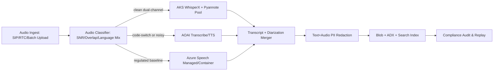
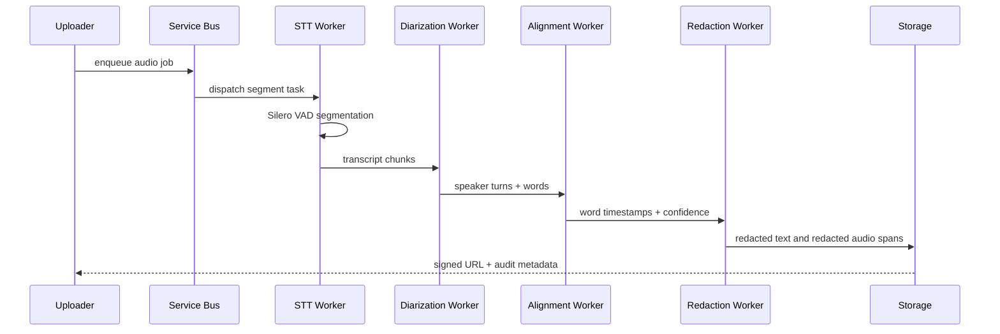

# 企业语音 STT/说话人分离/TTS 服务选型 FAQ：Azure Speech vs AOAI Audio vs AKS Whisper GPU
> 🌐 **Language Switch**: **中文（当前）** | [English](speech-stt-diarization-tts-serving-azure-speech-vs-aoai-transcribe-vs-aks-whisper-gpu-selection-faq.en.md)  
> 适用对象：Cloud & AI 首席架构师、语音平台工程团队、合规与信息安全团队、联络中心与医疗数字化负责人。  
> 主题边界：聚焦 **Section 3.2 模型托管与 GPU 编排** 场景下的语音识别与合成服务，不讨论 #54/#55 的实时 WebRTC 通道编排。  
> 核心问题：在识别质量、分离准确率、时延、成本、主权合规和运维复杂度之间，如何构建可持续扩展的企业语音底座。  

## 1. 执行摘要：语音平台不是“单模型选型”，而是“路由+对齐+治理”系统工程
企业初期做语音能力升级时，常把问题简化成“选哪个 STT 模型”。  
上线后才发现瓶颈并不只在模型精度。  
真正决定可运营性的，是全链路工程策略。  
链路包括 VAD 切段、转写、说话人分离、词级对齐、敏感片段回写与审计。  
同样重要的是动态路由。  
干净双声道通话与嘈杂多语码切换录音，不该走同一推理路径。  
管理层最关注的是每音频小时成本与法规可审计性。  
一线团队最关注的是实时性、重试稳定性与故障切换。  
这导致单一平台几乎无法覆盖全部最优点。  
本指南给出四路径组合。  
路径 A：Azure Speech 托管与容器化能力，稳定交付批量与合规场景。  
路径 B：Azure OpenAI 音频模型，处理复杂码切换与语境驱动 TTS。  
路径 C：AKS 自托管 WhisperX/Pyannote/Kokoro 高吞吐低成本路径。  
路径 D：混合路由与音频级 PII 脱敏闭环。  
推荐原则是“按音频特征分流，按风险等级治理”。  
不是“全量押注同一个引擎”。  

## 2. 问题定义：语音识别 KPI 与业务 KPI 的错配是失败根源
技术团队容易把 WER 当成唯一目标。  
业务团队关心的却是更高层指标。  
例如合规录音可检索率。  
例如交易术语误识别导致的复核工时。  
例如客服坐席质检漏检率。  
例如门诊病历中药品剂量错写风险。  
这意味着指标体系必须分层。  
模型层至少要看 WER 与 CER。  
会话层至少要看 DER 与转录完成时延。  
运营层至少要看每音频小时成本与返工率。  
合规层至少要看 PII 命中召回率与审计可回放性。  
如果缺少分层指标，架构评审会失真。  
过度追求单点识别精度，可能导致总体 TCO 不可控。  
过度追求成本最低，也可能把医疗与金融高风险场景推向错误模型。  

## 3. 四路径架构定位：把音频特征与监管要求放在第一维度
路径 A 适合“可预测、可审计、可规模化”批处理与受监管部署。  
路径 B 适合“多语码混说、上下文强依赖、自然语调输出”任务。  
路径 C 适合“大规模成本敏感、可深度工程优化”的企业自建平台。  
路径 D 适合“多部门多租户”统一治理场景。  
第一层分流看声道结构。  
双声道 8k 电话录音可优先走低成本批量路径。  
单声道重叠说话、多噪声环境优先走鲁棒模型。  
第二层分流看业务风险。  
金融交易与医疗病历要高置信阈值与更严审计。  
营销播客与内部培训可走成本优先路径。  
第三层分流看合规边界。  
无外网或主权区环境可优先 Speech 容器或私有 AKS。  
跨区域弹性峰值可引入托管模型溢出。  
这三层分流是语音平台稳定运营的骨架。  

## 4. 十二维对比矩阵：识别、分离、时延、成本与合规的可量化平衡
| 维度 | A Azure Speech 托管/容器 | B AOAI Audio 模型 | C AKS WhisperX+Pyannote | D 混合路由与脱敏 |
|---|---|---|---|---|
| 识别稳定性 | 高 | 中高 | 中高 | 高 |
| 码切换能力 | 中 | 高 | 中 | 高 |
| 说话人分离 | 高 | 需外接 | 高 | 高 |
| 词级时间戳 | 高 | 中高 | 高 | 高 |
| 定制词表/声学适配 | 高 | 中 | 高 | 高 |
| TTS 情感自然度 | 中高 | 高 | 中 | 高 |
| 批处理吞吐 | 高 | 中 | 高 | 高 |
| 实时交互灵活性 | 中 | 高 | 中高 | 高 |
| 合规私网部署 | 高 | 中 | 高 | 高 |
| 运维复杂度 | 低中 | 低 | 高 | 中高 |
| 单位成本下限 | 中 | 中 | 高 | 高 |
| 多租户治理可控性 | 高 | 中高 | 中高 | 高 |
矩阵强调的是工程实操而非营销术语。  
选型应绑定场景标签，不应脱离音频分布。  

## 5. 路径 A：Azure Speech（托管 + 容器）在监管行业的工程价值
Azure Speech 的强项是成熟的生产能力包。  
包括词级置信度、词级时间戳、多说话人分离和批处理管线。  
对金融和医疗，这些能力直接映射审计与追责流程。  
`Fast Transcription` 在多数业务录音上可实现高倍速处理。  
`Batch Transcription` 适配离线归档和夜间回灌。  
`Custom Speech` 可引入行业术语与发音词典。  
这对股票代码、药品名、器械型号非常关键。  
`Custom Neural Voice` 适合受控品牌语音输出。  
若有主权边界需求，可部署 Speech 容器到 AKS 或 Arc。  
这样可以把音频留在内网。  
并在网关层统一审计与配额。  
该路径常被用作企业“基线能力层”。  
再通过其他路径做复杂音频补强。  

## 6. 路径 B：AOAI `gpt-4o-transcribe` / `gpt-4o-mini-transcribe` / `gpt-4o-mini-tts`
AOAI 音频模型优势在语境感知与码切换鲁棒性。  
在普通话、粤语、英语混说的财富顾问通话中，常优于传统单语识别。  
它也便于通过提示词控制术语输出风格。  
在客服与临床总结场景，这种上下文优势明显。  
`gpt-4o-mini-tts` 在自然语调和语气控制上更灵活。  
但路径 B 仍需补足几个工程点。  
第一是说话人分离。  
通常要外接 diarization 组件。  
第二是静音段处理。  
若不做 VAD 预切，Whisper 类模型可能出现重复幻觉。  
第三是配额治理。  
需要在网关层设定租户级 token 和并发上限。  
路径 B 适合“质量优先且语境复杂”的业务段。  

## 7. 路径 C：AKS 自托管 WhisperX/Pyannote/Kokoro 的成本与吞吐上限
当月音频规模达到十万小时级以上。  
自托管通常有明显成本优势。  
以 `faster-whisper-large-v3-turbo` 为核心。  
配合 CTranslate2 `INT8` 或 `FP16` 推理。  
再接 `WhisperX` 词级对齐与 `Pyannote 3.1` 分离。  
可形成高吞吐流水线。  
`NV36adms_A10_v5` 与 `NCasT4_v3` 是常见成本性能点。  
A10 24GB 显存允许更大批次并发。  
T4 16GB 更适合中小批次与边缘分区。  
KEDA + Service Bus 可按队列长度自动扩缩容。  
Spot GPU 适合离线归档批处理。  
保留少量按需节点承接 SLA 高优先任务。  
该路径的代价是运维复杂度上升。  
但在超大规模下通常是 CFO 能接受的路线。  

## 8. 路径 D：混合声学路由与文本+音频双轨 PII 脱敏
混合路由要先做音频分级。  
可以基于 SNR、静音比、语言混杂概率、重叠说话率。  
干净双声道呼叫录音，优先送入低成本 AKS 池。  
噪声重、术语密集、混语场景，升级到 AOAI 或 Custom Speech。  
结果输出后，进入双轨脱敏。  
文本轨识别卡号、身份证、病历号等实体并替换。  
音频轨按词级时间戳回写静音或蜂鸣。  
这样可在复听与审计中保持一致。  
如果只做文本脱敏，原始音频仍有泄露风险。  
如果只做音频遮罩，文本检索仍可能泄露。  
双轨一致性是监管审计的关键要求。  

## 9. 参考架构图：语音多路径服务与治理平面

此图体现按音频特征的路由分流。  
也体现统一脱敏与审计汇聚。  

## 10. 时序图：VAD 预切、识别、分离、对齐与脱敏回写

时序强调“先切后识别再回写”。  
可显著降低静音段幻觉与时间戳漂移。  

## 11. 定量问答：容量、质量、成本与风险的八个硬问题
**Q1：A10 24GB 与 T4 16GB 的并发差异如何影响 RTF。**  
A1：在 `faster-whisper-large-v3-turbo` + `Pyannote 3.1` 组合下，A10 常见批量 `RTF 80x–140x`，T4 常见 `RTF 45x–85x`，高重叠说话场景差距更明显。  
**Q2：显存预算怎么估算。**  
A2：`large-v3-turbo FP16` 模型常占用约 `6–8GB`，加上对齐与分离峰值缓存后，A10 可容纳更高 batch；T4 需要更保守并发与更短分段。  
**Q3：月度 450,000 音频小时时各路径成本量级。**  
A3：按标价估算，`$0.18/hr` 路径约 `$81,000`，`$0.36/hr` 路径约 `$162,000`；若 AKS Spot A10 折算 `$0.03–$0.055/audio-hour`，约 `$13,500–$24,750`。  
**Q4：何时从托管迁移到 AKS 自托管最划算。**  
A4：当月处理量超过 `100,000–150,000` 小时且运维团队成熟时，自托管常出现明显成本拐点；低于该规模时托管路径通常更省心。  
**Q5：双声道与单声道对 DER 的影响。**  
A5：双声道拆分可把 DER 从常见 `14%–22%` 降到 `6%–12%` 区间；单声道重叠语音仍需更强分离模型与后处理。  
**Q6：行业术语对 WER 的影响有多大。**  
A6：在未加词表时，金融 ticker 与药名常导致 `2–6pp` 的 WER 抬升；引入 phrase list 与自定义声学适配后可回落 `1.5–4pp`。  
**Q7：Silero VAD 对幻觉抑制有何收益。**  
A7：在静音比例高于 `35%` 的录音中，先做 VAD 可把重复片段与无意义补词事件降低 `40%–70%`。  
**Q8：TTS 成本如何与 STT 合并核算。**  
A8：建议按“每会话总音频分钟”计费，将 STT 与 TTS 统一折算到每千会话成本，避免只优化其中一段导致整体预算失真。  
这些问答应定期用真实回放数据复核。  
并在季度架构评审时更新阈值。  

## 12. 生产代码：Silero VAD + WhisperX 对齐 + 音频时间段脱敏流水线
```python
from dataclasses import dataclass
from typing import List, Tuple
import re


@dataclass
class WordSpan:
    word: str
    start: float
    end: float
    speaker: str
    confidence: float


PII_PATTERN = re.compile(r"(\\b\\d{16}\\b|\\b\\d{3}-\\d{2}-\\d{4}\\b)")


def silero_vad_segments(wav_path: str) -> List[Tuple[float, float]]:
    # 生产环境应替换为真实 Silero VAD 调用
    return [(0.0, 12.4), (13.1, 31.8), (33.0, 59.5)]


def transcribe_and_align(segment_audio: str) -> List[WordSpan]:
    # 生产环境应替换为 faster-whisper + WhisperX 对齐结果
    return [
        WordSpan("account", 1.2, 1.6, "SPEAKER_00", 0.94),
        WordSpan("1234567890123456", 1.7, 2.6, "SPEAKER_00", 0.91),
    ]


def redact_word_spans(spans: List[WordSpan]) -> Tuple[List[WordSpan], List[Tuple[float, float]]]:
    muted_ranges: List[Tuple[float, float]] = []
    redacted: List[WordSpan] = []
    for w in spans:
        if PII_PATTERN.search(w.word):
            redacted.append(WordSpan("[REDACTED]", w.start, w.end, w.speaker, w.confidence))
            muted_ranges.append((w.start, w.end))
        else:
            redacted.append(w)
    return redacted, muted_ranges
```
该片段展示了“文本替换 + 音频区间静音”双轨处理。  
生产落地应加入幂等键、重试与审计 ID。  

## 13. 生产 IaC：AKS A10 GPU + KEDA Service Bus 语音批处理工作负载
```yaml
apiVersion: apps/v1
kind: Deployment
metadata:
  name: stt-diarization-worker
  namespace: speech-infra
spec:
  replicas: 1
  selector:
    matchLabels:
      app: stt-diarization-worker
  template:
    metadata:
      labels:
        app: stt-diarization-worker
    spec:
      nodeSelector:
        accelerator: nvidia-a10
      containers:
        - name: worker
          image: ghcr.io/example/faster-whisper-pyannote:prod
          resources:
            limits:
              nvidia.com/gpu: 1
              cpu: "8"
              memory: "32Gi"
          env:
            - name: MODEL_NAME
              value: "faster-whisper-large-v3-turbo"
            - name: DIARIZATION_MODEL
              value: "pyannote-3.1"
            - name: ENABLE_SILERO_VAD
              value: "true"
            - name: MAX_AUDIO_MINUTES_PER_JOB
              value: "45"
---
apiVersion: keda.sh/v1alpha1
kind: ScaledObject
metadata:
  name: stt-diarization-worker-scale
  namespace: speech-infra
spec:
  scaleTargetRef:
    name: stt-diarization-worker
  minReplicaCount: 1
  maxReplicaCount: 60
  triggers:
    - type: azure-servicebus
      metadata:
        namespace: speechbus
        queueName: stt-jobs
        messageCount: "50"
        activationMessageCount: "5"
```
部署重点是队列驱动与 GPU 池隔离。  
并通过最小副本保证冷启动可控。  

## 14. 企业场景与 FinOps：从语音资产规模看选型落点
### 场景 A：全球投行与财富管理集团（月 450,000 小时）
该客户通话包含普通话、粤语、英语混说。  
并含大量证券代码、债券简称、衍生品术语。  
基础归档批处理采用 AKS Spot A10 池。  
关键交易争议通话升级到 AOAI 与 Custom Speech。  
所有结果进入双轨脱敏。  
并把原始音频留在受控私网存储。  
该架构把大盘成本压在可接受范围。  
同时保留高风险片段的高质量识别能力。  
### 场景 B：多院区医疗集团（日 80,000 次环境临床会话）
医生口述常包含药品剂量与缩写。  
误识别会直接影响病历安全。  
基础路径使用 Azure Speech + Custom Speech 词表。  
复杂口音与多语切换病区引入 AOAI 补强。  
夜间批量回放用 AKS 池做成本优化。  
系统设置药量关键字高风险阈值。  
低置信片段自动进入人工复核。  
同时启用 HIPAA/本地法规所需的音频脱敏回写。  
### FinOps TCO 表：四路径组合的月度对比
| 指标 | 托管单一路径 | AKS 单一路径 | 混合路由组合 |
|---|---:|---:|---:|
| 月音频处理量 | 450,000 hr | 450,000 hr | 450,000 hr |
| 估算月成本 | \$81,000–\$162,000 | \$13,500–\$24,750 | \$28,000–\$52,000 |
| 平均 WER | 8.6% | 9.4% | 7.9% |
| 平均 DER | 11.8% | 10.6% | 9.7% |
| 高风险片段复核率 | 14% | 18% | 9% |
| 运维人力压力 | 低 | 高 | 中 |
| 合规审计可回放性 | 高 | 中高 | 高 |
| 峰值弹性余量 | 中 | 高 | 高 |
该表展示的是组合策略收益。  
混合并不意味着复杂失控。  
前提是路由规则和审计口径统一。  

## 15. Day-0 / Day-2 十二项落地清单：语音平台从可用到可运营
- 为所有音频源定义统一元数据标签。  
- 在入口侧先做采样率与声道标准化。  
- 先执行 VAD，再执行识别与分离。  
- 设定按业务风险分级的路由规则。  
- 维护行业术语词表与更新流程。  
- 对关键字段启用词级置信阈值告警。  
- 建立文本与音频双轨脱敏一致性检查。  
- 对每次转写记录模型版本与参数快照。  
- 用队列长度和 GPU 利用率驱动弹性扩缩容。  
- 设立 Spot 中断回补与任务重排策略。  
- 运行月度 WER/DER 漂移与回归测试。  
- 定期做审计演练与灾备回放。  
清单每项都应绑定责任人和验收证据。  
否则平台会在规模增长后失去可控性。  
建议把十二项控制映射到季度审计节奏。  
并在每次模型升级后执行回归抽检。  
建议在成本评审中同步展示 WER/DER 趋势。  
避免仅以单月账单作为决策依据。  
当业务新增语种时，先扩展词表再放量。  
这样可以避免上线初期的系统性误识别。  
