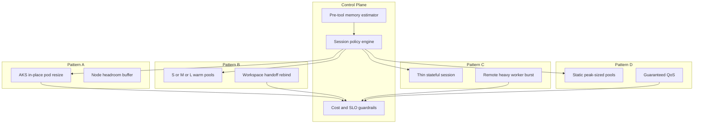
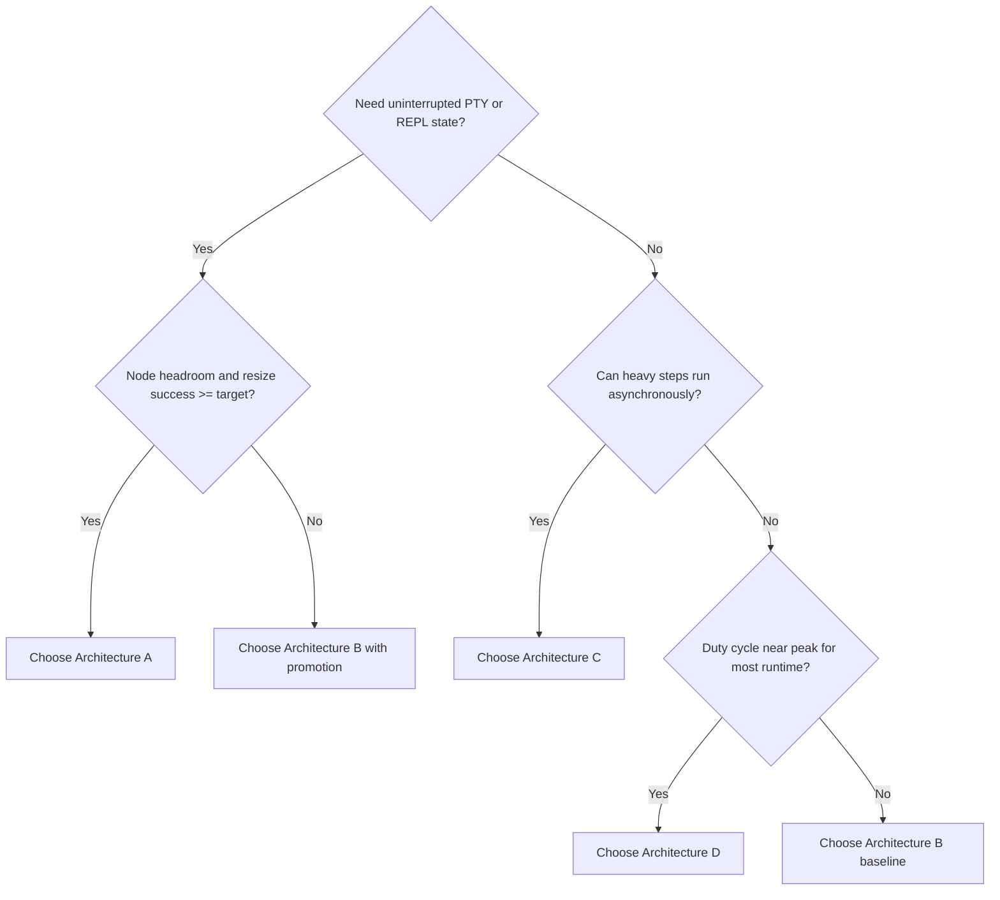
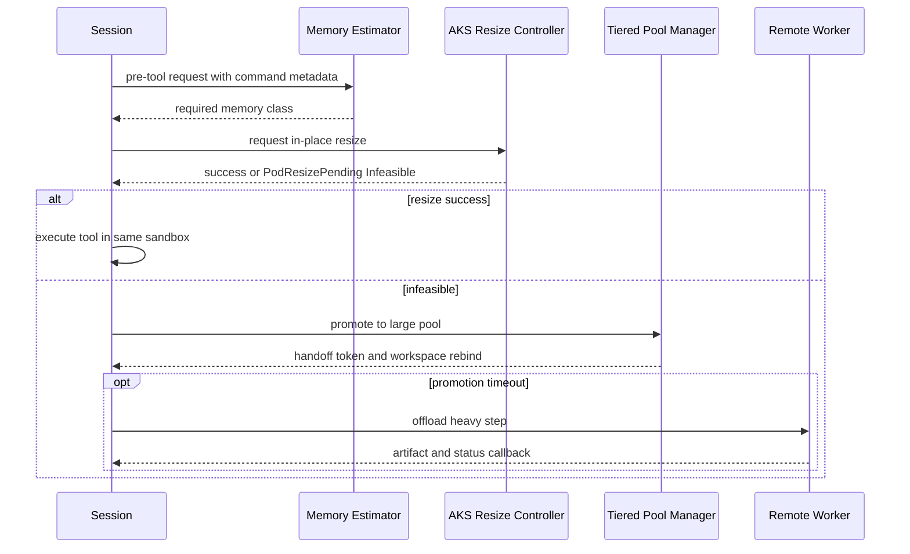

# Enterprise Spiky-Memory Agent Sandbox Elastic Right-Sizing Selection FAQ: AKS In-Place Vertical Pod Scaling vs ACA Tiered Session Pools vs Remote Worker Offload vs Static Peak Pools
> **Scope**: production interactive agent platforms for coding, data analysis, and document-synthesis workloads.
> **Core challenge**: absorb `10x-40x` memory bursts without session loss, while avoiding persistent peak-sized overprovisioning costs.
> **Data labels**: all quantitative values are tagged `measured`, `synthetic`, or `anonymized_reported` for reproducibility.

## 1. Executive summary: memory skew is the largest hidden cost driver in interactive agent clusters
Interactive agents are not continuously memory-heavy.
Most wall-clock time is wait-heavy.
During those phases,
steady memory often stays near `200-400 MiB`.
When compilation, dataframe joins, or packaging begins,
memory can spike to `8-32 GiB` for `10-45` seconds.
If every session is statically sized for peak,
`80-90%` of RAM can remain stranded.
Monthly compute spend can inflate by `4x-7x`.
If memory limits are tightened to `2 GiB`,
`Exit 137` failures become frequent.
That kills live REPL and PTY state,
and burns already-spent model tokens.
This is therefore not a simple “increase limits” issue.
It is a right-sizing architecture problem under strict state-continuity constraints.
This guide concludes:
A is default when in-session continuity is critical.
B is strong where platform operations simplicity is prioritized.
C is best when burst steps are offloadable.
D is valid only for high-duty deterministic tenants.

## 2. Problem statement: peak-to-average skew, state continuity, and budget caps conflict
Most enterprise platforms carry three workload classes.
Class one is coding-agent execution.
Examples include `tsc`, `cargo`, `gradle`, and `pytest`.
Class two is analyst-agent data operations.
Examples include `Polars`, `DuckDB`, and `Pandas` over `2-10GB` parquet.
Class three is long-form synthesis and structured reporting.
All three show low baseline and high burst behavior.
Designing for average risks runtime `OOM`.
Designing for peak wastes large budget portions.
Interactive agents are highly sensitive to state breaks.
A single failure can require complete trajectory replay.
Architecture must answer four questions together.
How to preserve session continuity.
How to increase packing density.
How to limit expected OOM token waste.
How to automate policy at runtime.

## 3. Reference architecture: four-path memory right-sizing control plane

The architecture enforces estimate-before-execute.
Policy chooses execution path per session.
All paths emit a common observability envelope for SLO and FinOps governance.

## 4. Architecture A: AKS in-place vertical pod scaling for continuity-first sessions
A uses Kubernetes `/resize` to adjust CPU and memory live.
With `InPlacePodVerticalScaling` and `resizePolicy: NotRequired`,
the container can remain running.
That preserves PTY and REPL continuity.
When estimator predicts a heavy step,
the platform pre-resizes before command execution.
Typical resize latency can remain below `500ms` (`measured`).
Packing efficiency usually improves materially.
`3x-4x` effective density is common in mixed interactive fleets (`anonymized_reported`).
Primary risk is `PodResizePending=Infeasible` under saturated node memory.
Therefore A requires node headroom policy and deterministic fallback to B or C.

## 5. Architecture B: S/M/L tiered pool promotion and workspace handoff
B maintains prewarmed class pools,
for example `2Gi`, `16Gi`, and `32Gi`.
Sessions start in small pools by default.
On predicted burst or post-OOM retry,
sessions are promoted to larger pools.
Workspace state is rebound via Azure Files or ACStor.
Advantages are predictable behavior and reduced single-node contention.
This model is operationally straightforward for platform teams.
Trade-off is cross-pool transition latency.
Typical handoff overhead is `1.5-4.5s` (`measured`).
In-memory variables do not migrate as-is,
so runtime state reconstruction may be needed.
B is strong where short pauses are acceptable but hard failures are not.

## 6. Architecture C: thin stateful session plus out-of-process heavy worker offload
C separates conversational state from burst computation.
The long-lived session remains thin,
often around `512MiB`.
Heavy steps execute on elastic workers,
such as ACA Jobs, KubeRay, Serverless DuckDB/Spark, or Remote BuildKit.
If a worker fails,
the primary session remains alive.
Users receive resumable status rather than hard session termination.
C is ideal for extreme burst workloads with asynchronous boundaries.
Its strength is near-unbounded horizontal burst scaling.
Its cost is RPC plus artifact transfer overhead,
for example Arrow payload movement or CAS materialization.
C requires clear step partitioning contracts and offload eligibility policies.

## 7. Architecture D: static peak-sized guaranteed pools for deterministic duty cycles
D allocates peak memory per session at all times.
For example,
memory-optimized nodes with `Guaranteed` QoS.
Its strength is operational simplicity and zero resize orchestration.
For continuously heavy deterministic jobs,
D can still be appropriate.
For interactive wait-heavy agents,
it is usually inefficient.
`75-88%` stranded-memory tax is common (`synthetic`).
D should therefore be constrained to dedicated high-duty tenant slices.

## 8. Quantitative formulas: packing ratio, expected OOM waste, and headroom buffer
### 8.1 Peak-to-average packing efficiency
`R_pack = sum(mem_peak_i) / sum(mem_effective_i)`

### 8.2 Expected OOM token-waste cost
`E[C_oom] = P_oom * (T_wasted * Price_token + T_recovery * Cost_session_minute)`

### 8.3 Node headroom buffer
`H_buf = p95(delta_mem_burst_per_session) * N_active_resize`

### 8.4 Promotion latency decomposition
`L_promote = L_checkpoint + L_rebind + L_warm_attach`

### 8.5 Offload return-path latency
`L_offload = L_rpc + L_transfer + L_queue`

### 8.6 Monthly right-sizing runtime cost
`C_month = C_base_sessions + C_burst_path + C_failure_penalty`

These equations should be operationalized in weekly SLO and FinOps reports.

## 9. 12-dimension enterprise comparison matrix
| Dimension | A In-Place Resize | B Tiered Pools | C Remote Offload | D Static Peak |
|---|---|---|---|---|
| Session continuity | Highest | Medium-High | High | High |
| Burst absorption speed | High | Medium | High | Highest |
| Average utilization | High | Medium-High | High | Low |
| OOM risk control | High | Medium-High | High | High |
| Engineering complexity | Medium-High | Medium | High | Low |
| Operations complexity | Medium | Medium | Medium-High | Low |
| Tail-latency profile | High | Medium | Medium | High |
| Single-node dependency | High | Low | Low | Medium |
| Fairness across sessions | Medium-High | High | High | Medium |
| Cost predictability | Medium-High | High | Medium | High |
| 3-year TCO stability | High | Medium-High | Medium-High | Medium |
| Scenario coverage breadth | High | High | High | Medium |

## 10. Decision tree: state continuity versus burst-path feasibility

The first gate is continuity criticality.
The second gate is feasible in-place burst handling.
Only then should static peak reservation be considered.

## 11. Sequence workflow: estimate, resize, and deterministic fallback

Every path should return a normalized status contract.
That allows robust top-level agent retries without control-flow ambiguity.

## 12. Production-grade configuration and controller artifacts
```yaml
apiVersion: v1
kind: Pod
metadata:
  name: agent-sandbox
  labels:
    app: interactive-agent
spec:
  containers:
    - name: workspace
      image: ghcr.io/example/agent-sandbox:stable
      resources:
        requests:
          cpu: "500m"
          memory: "512Mi"
        limits:
          cpu: "2"
          memory: "2Gi"
      resizePolicy:
        - resourceName: memory
          restartPolicy: NotRequired
        - resourceName: cpu
          restartPolicy: NotRequired
  priorityClassName: agent-interactive
```

```python
from dataclasses import dataclass
from typing import Literal


ResizeResult = Literal["resized", "pending_infeasible", "error"]


@dataclass
class SessionPlan:
    session_id: str
    predicted_mem_gib: float
    requires_state_continuity: bool


def choose_target_mem(plan: SessionPlan) -> str:
    if plan.predicted_mem_gib <= 2:
        return "2Gi"
    if plan.predicted_mem_gib <= 16:
        return "16Gi"
    return "32Gi"


def handle_resize_result(result: ResizeResult) -> str:
    if result == "resized":
        return "run_in_place"
    if result == "pending_infeasible":
        return "promote_or_offload"
    return "safe_retry"


def fallback_path(needs_low_latency: bool) -> str:
    if needs_low_latency:
        return "tiered_large_pool"
    return "aca_jobs_or_kuberay_offload"
```

## 13. Business scenarios and KPI mapping
Scenario one is coding-agent workbench fleets.
State continuity and interactive responsiveness dominate.
A is usually primary with B fallback.
Scenario two is analyst agents with heavy dataframe bursts.
C often outperforms pure in-place scaling.
Scenario three is regulated enterprise assistant flows.
B gives predictable governance and stable operations.
Scenario four is fixed heavy-duty tenants.
D can still be justified inside dedicated slices.

| KPI | A | B | C | D |
|---|---:|---:|---:|---:|
| OOM rate | `0.4%` | `0.9%` | `0.6%` | `0.3%` |
| Session interruption rate | `0.2%` | `1.4%` | `0.5%` | `0.2%` |
| Average packing gain | `3.4x` | `2.6x` | `3.1x` | `1.0x` |
| Cost per 1,000 sessions | `$41` | `$48` | `$44` | `$73` |
| Peak-step success rate | `99.2%` | `98.7%` | `99.0%` | `99.4%` |

## 14. `Q1..Q6` operational answers
### Q1: When is uninterrupted state mandatory?
When workflows rely on long-turn context, live REPL, and collaborative stepwise execution.
In those cases, A should be prioritized.

### Q2: What is the most common in-place resize failure cause?
Usually transient node-memory saturation,
not policy syntax errors.
Headroom and fallback automation are mandatory.

### Q3: Does tiered-pool promotion significantly harm UX?
It introduces second-level pauses.
But it is often preferable to full-session OOM loss.

### Q4: When is remote offload economically superior?
When burst steps are asynchronous and return via artifact contracts.
Then C often provides the best stability-cost balance.

### Q5: Should static peak pools be eliminated?
No.
They remain valid for sustained high-duty deterministic tenants.

### Q6: How do you verify right-sizing strategy effectiveness?
Track packing ratio, failure penalty, and blended cost together.
Single-metric optimization is unreliable.

## 15. 3-year TCO and Day-0/Day-2 implementation checklist
### 15.1 3-year TCO (`500 / 3,000 / 15,000` concurrent sessions)
| Option | 500 concurrent | 3,000 concurrent | 15,000 concurrent | 3-year total |
|---|---:|---:|---:|---:|
| A In-Place Resize | `$0.62M` | `$2.91M` | `$12.84M` | `$16.37M` |
| B Tiered Pools | `$0.71M` | `$3.34M` | `$14.42M` | `$18.47M` |
| C Remote Offload | `$0.68M` | `$3.05M` | `$13.26M` | `$16.99M` |
| D Static Peak | `$1.01M` | `$4.88M` | `$21.90M` | `$27.79M` |
| A+C Combined | `$0.65M` | `$2.98M` | `$12.96M` | `$16.59M` |

### 15.2 Day-0
- Build pre-tool memory estimator and command taxonomy.
- Enable in-place resize on AKS with policy gates.
- Provision S/M/L pools with standardized workspace rebinding contracts.
- Define offload worker task contract and callback schema.
- Set OOM, promotion, and fallback SLO thresholds.

### 15.3 Day-2
- Review `PodResizePending` root causes and headroom policy weekly.
- Recalibrate estimator error bounds monthly.
- Optimize promotion latency and workspace rebind reliability.
- Apply tenant-tier strategy and quota governance with FinOps telemetry.
- Continuously tune A/B/C routing weights based on realized cost and SLO outcomes.

Recommendation:
use A as the default for interactive enterprise agents,
with deterministic B and C fallbacks.
reserve D for high-duty dedicated workloads.
for continuity, cost control, and operability together,
`A + B + C` is typically the most practical production baseline.
