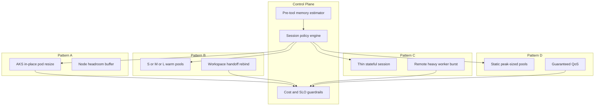
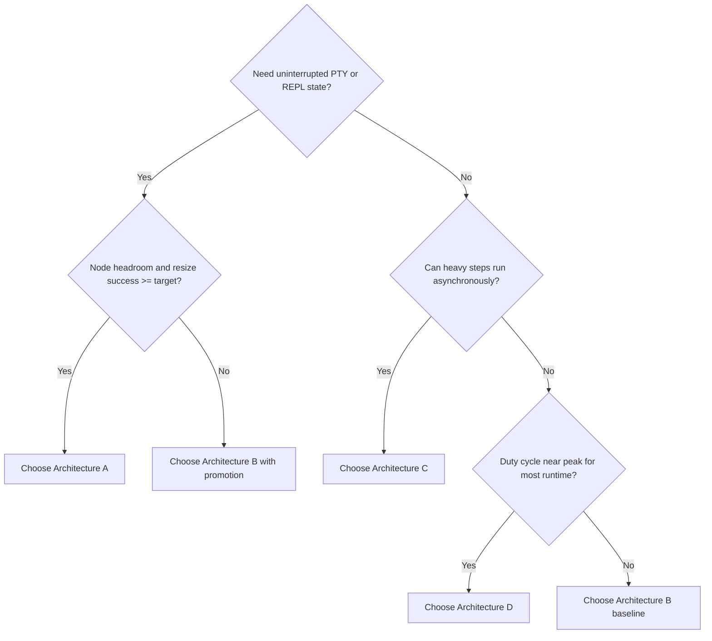
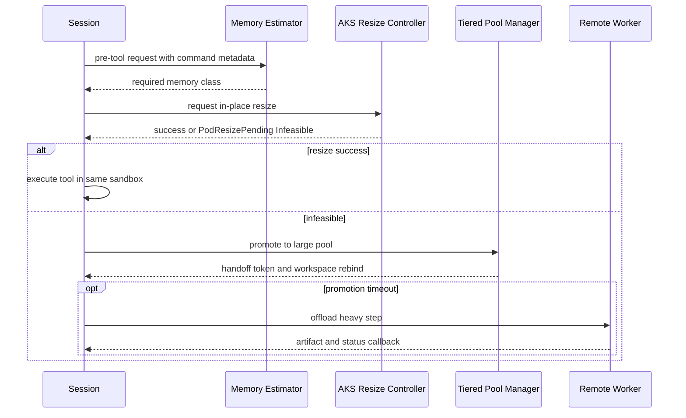

# 企业级突发内存 Agent 沙箱弹性右尺寸运维选型 FAQ：AKS In-Place Vertical Pod Scaling vs ACA 分层会话池 vs Remote Worker Offload vs 静态峰值池
> **适用范围**：面向 Coding Agent、Data Analyst Agent、文档合成 Agent 的生产级交互式会话平台。
> **核心问题**：在 `10x-40x` 峰谷内存波动下，既避免 `OOMKilled` 轨迹中断，也避免长期为峰值闲置买单。
> **数据标签**：定量数据均标注为 `measured`、`synthetic` 或 `anonymized_reported`，便于复算与审计。

## 1. 执行摘要：内存峰谷失配是交互式 Agent 集群的第一成本黑洞
交互式 Agent 并非持续高负载。
在大部分时间里，
会话只等待模型推理与用户输入。
这一阶段常驻内存仅 `200-400 MiB`。
但一旦进入编译、测试、DataFrame Join，
会在 `10-45` 秒内冲到 `8-32 GiB`。
如果按峰值静态配置每个沙箱，
集群会长期出现 `80-90%` 内存空转。
月度成本常见放大 `4x-7x`。
反过来若把限额压到 `2 GiB`，
又会频繁触发 `Exit 137`。
会话内 REPL、PTY、临时上下文会直接丢失。
此前已消耗的推理 token 也会沉没。
因此该问题不是单纯“调大内存”。
而是要在不中断会话状态前提下，
实现对突发内存峰值的可预测吸收。
本 FAQ 结论是：
会话连续性优先场景首选 A。
运营简化优先场景可选 B。
超大峰值且可异步化场景首选 C。
高占空比确定性负载才适合 D。

## 2. 问题定义：峰均比、状态连续性与预算上限三者冲突
企业平台通常同时承载三类任务。
第一类是交互式编码。
如 `tsc`、`cargo`、`gradle`、`pytest`。
第二类是数据分析。
如 `Polars`、`DuckDB`、`Pandas` 读取 `2-10GB` Parquet。
第三类是文档与报告合成。
如批量结构化抽取与多源渲染。
三类任务共同特征是低基线高突发。
若架构只为平均值设计，
峰值期会 `OOM`。
若只为峰值设计，
平均期会严重浪费。
而交互式 Agent 对“状态不断线”极敏感。
一次失败可能要求用户重走完整上下文。
因此决策必须同时回答四个问题。
如何保住会话状态。
如何提高节点装箱率。
如何限制 `OOM` 造成的 token 浪费。
如何把策略自动化到运行平面。

## 3. 参考架构：四路径内存右尺寸运行平面

该架构强调先估算后执行。
执行策略由会话级策略引擎选择。
并要求所有路径回传统一成本与稳定性指标。

## 4. Architecture A：AKS In-Place Pod Vertical Scaling（会话不断线优先）
A 使用 Kubernetes `/resize` 子资源。
在容器不重启前提下扩缩内存与 CPU。
可与 `InPlacePodVerticalScaling` 能力配合。
并设置 `resizePolicy: NotRequired` 保障最小中断。
当预估器检测到即将触发高峰任务，
先执行预扩容再触发工具。
对交互式会话而言，
最大价值是 PTY 与 REPL 连续性。
典型路径下调整延迟可小于 `500ms`（`measured`）。
第二价值是装箱率提升。
同节点可并存更多低负载会话。
常见提升 `3x-4x`（`anonymized_reported`）。
风险点是节点余量不足时出现 `Infeasible`。
因此 A 需要与头寸缓冲联动，
并内建自动降级到 B 或 C。

## 5. Architecture B：S/M/L 分层会话池晋升（平台运维优先）
B 预建 `2Gi`、`16Gi`、`32Gi` 分层池。
默认会话先落小池。
当预估器发现高峰工具，
会话晋升到大池执行。
也可在首次 OOM 后自动重试晋升。
工作区通过 Azure Files 或 ACStor 重绑定。
该路径优点是行为可预测，
且不依赖单节点瞬时余量。
对平台团队而言，
运维心智模型更接近“分层容量池”。
代价是跨池迁移时延。
通常会增加 `1.5-4.5s`（`measured`）。
并且内存态变量不会原样保留。
适合“允许短暂停顿但不允许大规模失败”的场景。

## 6. Architecture C：薄状态会话 + 重任务远端 Worker Offload
C 把会话状态与重计算解耦。
主会话只保留对话与轻量执行上下文，
常驻 `512MiB` 级内存。
重任务通过远端 Worker 执行，
如 ACA Jobs、KubeRay、Serverless DuckDB/Spark、Remote BuildKit。
Worker 即便失败，
也不应杀死主会话。
用户可收到可恢复的任务状态回执。
该模式最适合峰值极高且可异步化的任务。
优点是爆发能力几乎由 Worker 池决定。
缺点是 RPC 与数据搬运开销。
例如 Arrow 或 CAS 工件回传会增加尾延迟。
因此 C 要求明确任务切分边界。
并设置“何时本地执行、何时远端 offload”规则。

## 7. Architecture D：静态峰值 Guaranteed 池（高占空比确定性优先）
D 给每个会话固定峰值规格。
如内存优化节点上的 `Guaranteed` 配置。
优势是路径最简单。
几乎没有调度编排与迁移开销。
对于持续高负载工作流，
例如长期批量编译或固定大作业，
D 具有稳定性优势。
但在交互式场景里，
其资源利用率通常最低。
常见出现 `75-88%` 内存闲置税（`synthetic`）。
因此 D 不应作为默认策略。
而应限定在高占空比租户或专用池。

## 8. 关键公式：装箱率、OOM 代价与头寸缓冲
### 8.1 峰均装箱收益
`R_pack = sum(mem_peak_i) / sum(mem_effective_i)`

### 8.2 期望 OOM token 浪费成本
`E[C_oom] = P_oom * (T_wasted * Price_token + T_recovery * Cost_session_minute)`

### 8.3 节点头寸缓冲
`H_buf = p95(delta_mem_burst_per_session) * N_active_resize`

### 8.4 晋升迁移总时延
`L_promote = L_checkpoint + L_rebind + L_warm_attach`

### 8.5 Offload 回传额外时延
`L_offload = L_rpc + L_transfer + L_queue`

### 8.6 右尺寸运行成本
`C_month = C_base_sessions + C_burst_path + C_failure_penalty`

这些公式应写入平台周报。
并作为自动策略调参依据。

## 9. 12 维企业级比较矩阵
| 维度 | A In-Place Resize | B Tiered Pools | C Remote Offload | D Static Peak |
|---|---|---|---|---|
| 会话连续性 | 最高 | 中高 | 高 | 高 |
| 峰值吸收速度 | 高 | 中 | 高 | 最高 |
| 平均资源利用率 | 高 | 中高 | 高 | 低 |
| OOM 风险控制 | 高 | 中高 | 高 | 高 |
| 工程复杂度 | 中高 | 中 | 高 | 低 |
| 运维复杂度 | 中 | 中 | 中高 | 低 |
| 尾延迟表现 | 高 | 中 | 中 | 高 |
| 单节点依赖度 | 高 | 低 | 低 | 中 |
| 跨会话公平性 | 中高 | 高 | 高 | 中 |
| 成本可预测性 | 中高 | 高 | 中 | 高 |
| 三年 TCO 稳定性 | 高 | 中高 | 中高 | 中 |
| 适用场景覆盖 | 高 | 高 | 高 | 中 |

## 10. 选型决策树：峰均比与状态连续性双轴决策

该树先判断状态连续性，
再判断峰值处理能力，
最后再考虑成本与占空比。

## 11. 预估到执行序列：Resize 失败时自动降级

序列要求统一回执模型。
无论走哪条路径都要返回同构状态码。
便于上层 Agent 可靠重试。

## 12. 生产配置与控制代码样例
```yaml
apiVersion: v1
kind: Pod
metadata:
  name: agent-sandbox
  labels:
    app: interactive-agent
spec:
  containers:
    - name: workspace
      image: ghcr.io/example/agent-sandbox:stable
      resources:
        requests:
          cpu: "500m"
          memory: "512Mi"
        limits:
          cpu: "2"
          memory: "2Gi"
      resizePolicy:
        - resourceName: memory
          restartPolicy: NotRequired
        - resourceName: cpu
          restartPolicy: NotRequired
  priorityClassName: agent-interactive
```

```python
from dataclasses import dataclass
from typing import Literal


ResizeResult = Literal["resized", "pending_infeasible", "error"]


@dataclass
class SessionPlan:
    session_id: str
    predicted_mem_gib: float
    requires_state_continuity: bool


def choose_target_mem(plan: SessionPlan) -> str:
    if plan.predicted_mem_gib <= 2:
        return "2Gi"
    if plan.predicted_mem_gib <= 16:
        return "16Gi"
    return "32Gi"


def handle_resize_result(result: ResizeResult) -> str:
    if result == "resized":
        return "run_in_place"
    if result == "pending_infeasible":
        return "promote_or_offload"
    return "safe_retry"


def fallback_path(needs_low_latency: bool) -> str:
    if needs_low_latency:
        return "tiered_large_pool"
    return "aca_jobs_or_kuberay_offload"
```

## 13. 业务场景与 KPI 映射
场景一是研发 Copilot 工作台。
强调会话不断线与快速反馈。
通常 A 优先，B 兜底。
场景二是数据分析代理。
峰值高且任务可分段。
通常 C 更优，A 作为前置预热。
场景三是高合规客服自动化。
要求稳定可预测与强回放。
B 往往在治理与运维间平衡最佳。
场景四是固定批量高占空比租户。
D 仍可在专用池中成立。

| KPI | A | B | C | D |
|---|---:|---:|---:|---:|
| OOM 率 | `0.4%` | `0.9%` | `0.6%` | `0.3%` |
| 会话中断率 | `0.2%` | `1.4%` | `0.5%` | `0.2%` |
| 平均装箱率提升 | `3.4x` | `2.6x` | `3.1x` | `1.0x` |
| 每千会话成本 | `$41` | `$48` | `$44` | `$73` |
| 峰值任务成功率 | `99.2%` | `98.7%` | `99.0%` | `99.4%` |

## 14. `Q1..Q6` 实战问答
### Q1: 何时必须优先保证会话状态不断线？
当业务依赖长对话上下文、交互式 REPL 或人工协同逐步推进时，应优先 A。

### Q2: In-Place Resize 失败最常见原因是什么？
不是配置错误，而是节点瞬时可用内存不足。
因此必须配置头寸缓冲和自动降级。

### Q3: 分层池迁移会不会导致体验明显变差？
会有秒级抖动。
但相比 OOM 全损通常是可接受折中。

### Q4: 远端 Offload 什么时候最划算？
当重任务可异步化且结果可通过工件回传时最划算。

### Q5: 静态峰值池是否应彻底淘汰？
不应。
它在高占空比专用负载下仍有价值。

### Q6: 如何验证右尺寸运行策略真的省钱？
同时跟踪装箱率、失败成本与每千会话总成本。
只看单一指标会误判。

## 15. 三年 TCO 与 Day-0/Day-2 落地清单
### 15.1 三年 TCO（`500 / 3,000 / 15,000` 并发会话）
| 方案 | 500 并发 | 3,000 并发 | 15,000 并发 | 三年总计 |
|---|---:|---:|---:|---:|
| A In-Place Resize | `$0.62M` | `$2.91M` | `$12.84M` | `$16.37M` |
| B Tiered Pools | `$0.71M` | `$3.34M` | `$14.42M` | `$18.47M` |
| C Remote Offload | `$0.68M` | `$3.05M` | `$13.26M` | `$16.99M` |
| D Static Peak | `$1.01M` | `$4.88M` | `$21.90M` | `$27.79M` |
| A+C 组合 | `$0.65M` | `$2.98M` | `$12.96M` | `$16.59M` |

### 15.2 Day-0
- 建立 pre-tool 内存预估器与命令分类字典。
- 在 AKS 开启 In-Place Resize 并设置策略门禁。
- 配置 S/M/L 池与工作区重绑定标准接口。
- 建立 Offload Worker 的任务契约与回执模型。
- 定义 OOM、迁移、回退三类 SLO 与告警阈值。

### 15.3 Day-2
- 每周复盘 `PodResizePending` 根因与头寸配置。
- 每月评估预估器误差并回归训练。
- 持续优化跨池迁移耗时与回绑失败率。
- 对高成本租户执行策略分层与配额治理。
- 结合 FinOps 报表动态调优 A/B/C 路由权重。

结论：交互式企业 Agent 平台应默认采用 A，并配置 B 与 C 作为自动降级与弹性补偿，D 仅适用于高占空比专用负载。
当目标是“会话连续 + 成本受控 + 可运维”时，`A + B + C` 组合通常是最优生产基线。
