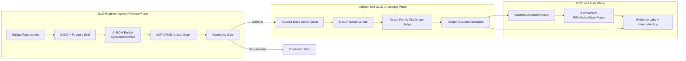
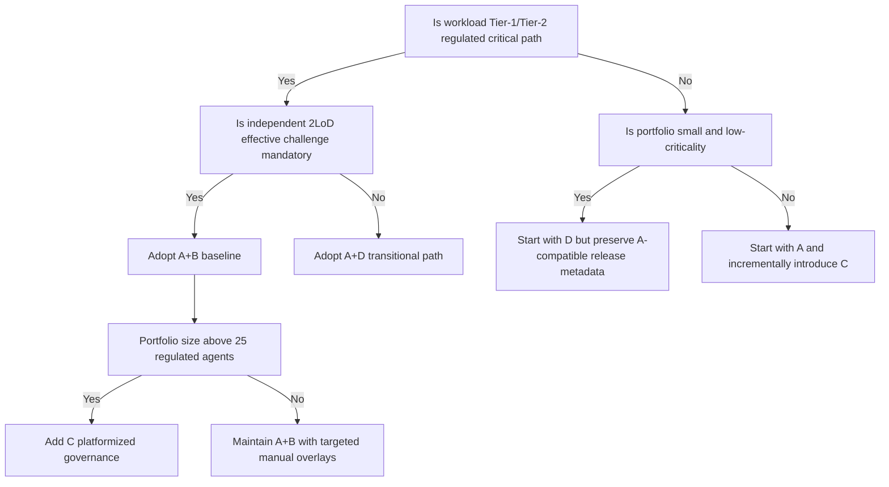

# Enterprise Regulated Model Risk Management (MRM) and Machine-Readable AI-BOM Governance Selection FAQ: SR 11-7 + CycloneDX 1.6/SPDX 3.0 vs Independent 2LoD Challenge vs GRC Platforms

> 🌐 **Language Switch**: [中文](./sr11-7-model-risk-management-mrm-aibom-cyclonedx-foundry-lineage-vs-2lod-challenger-vs-validmind-grc-selection-faq.md) | **English (current)**
> **Audience**: Cloud & AI Solution Architects, bank/insurance/asset-management model-risk leads, independent 2LoD validation teams, enterprise GRC/internal-audit leaders, and LLMOps platform owners.
> **Scope**: Decision framework for `Fed SR 11-7`, `OCC 2011-12`, `PRA SS1/23`, and `OSFI E-23` control expectations when governing compound AI agents with machine-readable `CycloneDX 1.6 ML-BOM` and `SPDX 3.0 AI-BOM`.

## 1. Problem framing: why regulated agent delivery stalls in 16-week committee loops
Most regulated institutions no longer evaluate AI risk at the single-model boundary, because production agents are compound systems where base model versions, adapter weights, system prompts, retrieval schema, safety thresholds, and tool contracts jointly determine business risk.  
When that compound reality is managed with document-first manual governance, every small prompt or retrieval fix re-enters full committee review, evidence assembly, and sign-off circulation, turning hour-level engineering fixes into multi-week release freezes.  
The bottleneck is not only speed; it is control quality drift, because policy intent is encoded in human interpretation instead of executable rules, producing inconsistent outcomes across teams, geographies, and audit cycles.  
The architecture goal is therefore twofold: preserve strict 1LoD/2LoD separation of duties and effective challenge, while allowing non-material changes to flow through deterministic, machine-verifiable gates without violating regulatory expectations.  
In practice, that means binding each release to an immutable AI-BOM, applying pre-approved materiality envelopes with statistical non-inferiority checks, and escalating only true material drift into independent 2LoD challenge workflows.  

## 2. Four architecture patterns (A/B/C/D) and boundary of responsibility
**Architecture A (GitOps AI-BOM + materiality-tiered change envelopes):** build and sign machine-readable `CycloneDX 1.6` or `SPDX 3.0` manifests for each compound agent release, then apply pre-approved equivalence bounds to auto-clear low-risk deltas and escalate material deltas.  
**Architecture B (Independent 2LoD clean-room challenge harness):** run blind holdout validation and cross-family challenger testing in an isolated identity and subscription boundary so independent challenge cannot inherit 1LoD tuning bias.  
**Architecture C (Enterprise MRM/GRC lifecycle platforms):** integrate ValidMind/Monitaur/Credo AI with ServiceNow IRM/Archer/OpenPages to scale conceptual-soundness evidence, outcomes monitoring, annual re-attestation, and remediation tracking across large model estates.  
**Architecture D (Native Foundry + Purview + manual sign-off):** low-entry-cost baseline for low-criticality internal copilots, but usually constrained by evidence throughput and consistency once regulated Tier-1/Tier-2 scope expands.  
These patterns are composable: A establishes release facts, B enforces independence, C scales organizational governance, and D can serve as a transitional path for low-maturity domains.  

## 3. End-to-end reference architecture: machine-readable release facts, independent challenge, and evidence-grade governance

The design decouples release-fact generation, independent challenge, and governance orchestration so each control objective can evolve without collapsing role boundaries.  
The AI-BOM digest acts as the cross-plane primary key, allowing every evaluation run, approval action, and production rollout to be traced back to one immutable component graph instead of loosely coupled document snapshots.  

## 4. Architecture A deep dive: CycloneDX/SPDX compound agent BOM and pre-approved materiality envelopes
Architecture A treats change governance as executable policy rather than narrative procedure, requiring each release to carry signed component fingerprints for base model digest, adapter digest, prompt hash, retrieval schema version, safety profile, and MCP tool-contract bundle.  
When a delta arrives, BOM diff classification runs before deployment and evaluates pre-approved bounds such as `ΔPass@1 >= -0.5%`, `ΔHallucination <= +0.2%`, and zero safety regression; compliant changes can move through fast lanes in under two hours.  
Any out-of-bound metric, tool-surface expansion, or lineage uncertainty marks the release as material and routes it to independent challenge workflows, preventing silent scope creep behind “minor prompt update” labels.  
This pattern reduces committee load not by weakening controls, but by making controls deterministic, measurable, and automatically enforceable at release time.  

## 5. Architecture B deep dive: independent 2LoD clean-room validation and effective challenge
Architecture B enforces true independence by separating identity, infrastructure, and evaluation assets: 2LoD validators do not reuse 1LoD tuned judges, do not share mutable golden corpora, and do not execute in the same operational tenancy.  
Blind holdout packs and adversarial probes are executed in clean-room environments with strict ingress contracts, and challenge outcomes are signed into immutable attestations linked to release digests and decision IDs.  
This design directly supports SR 11-7 effective-challenge expectations by preventing “self-validation by architecture,” where convenience-driven shared tooling can mask systemic blind spots.  
Although B adds operational overhead, it materially improves evidentiary defensibility under regulator and internal-audit review, especially for high-impact credit, fraud, and suitability workflows.  

## 6. Architecture C deep dive: platformized MRM/GRC lifecycle for large regulated portfolios
At enterprise scale, model governance constraints are dominated by coordination overhead rather than isolated technical checks, making lifecycle platforms essential for maintaining consistency across hundreds of models and agents.  
Architecture C automates conceptual-soundness documentation, outcomes-analysis refreshes, issue workflows, remediation evidence, and annual recertification against policy control maps, reducing duplicated analyst effort.  
With IRM integration, findings flow into existing risk-management operating models, ensuring AI controls are not treated as stand-alone artifacts outside enterprise governance.  
The net effect is governance elasticity: as portfolio size grows, evidence quality and cycle-time remain predictable instead of degrading into ad hoc spreadsheet and email operations.  

## 7. Architecture D deep dive: Foundry + Purview inventory with manual sign-off baseline
Architecture D is a pragmatic starting point when regulated scope is small and organizational readiness is still forming, because it minimizes upfront integration complexity and can establish baseline inventory and lineage discipline quickly.  
Typical deployment combines Foundry artifact lineage, Purview catalog metadata, and manual sign-off packages in collaboration tools for governance checkpoints.  
The challenge appears with scale: manual evidence curation and review routing become non-linear, causing cycle-time variance, audit friction, and inconsistent interpretation of materiality boundaries.  
For this reason, D is best treated as an entry pattern for low-criticality workloads, with migration paths toward A/B/C once model count and risk tier increase.  

## 8. Twelve-dimension comparison matrix: independence, throughput, audit strength, and operating economics
| Dimension | A GitOps AI-BOM | B Independent 2LoD | C GRC Platformized | D Foundry+Purview Manual |
|---|---|---|---|---|
| Separation-of-duties strength | Medium-high | Very high | High | Medium |
| Non-material change throughput | Very high | Low | Medium-high | Medium |
| Material-change challenge quality | Medium | Very high | High | Low-medium |
| Machine-readable evidence quality | Very high | High | Very high | Low |
| Shared-bias resistance | Medium | Very high | High | Low |
| Multi-jurisdiction mapping | Medium | Medium | Very high | Low |
| Day-2 operating complexity | Medium | High | Medium-high | Low |
| Integration complexity | Medium-high | High | High | Low |
| Time-to-initial rollout | Medium | Medium-high | High | Low |
| Three-year cost predictability | High | Medium | Medium-high | Low |
| Organizational maturity requirement | Medium | High | Medium-high | Low |
| Best-fit profile | High-frequency regulated delivery | Highest-criticality controls | Large portfolio governance | Low-risk starter workloads |

The matrix indicates that A+B+C typically yields the strongest long-term operating frontier in regulated environments, while D is economical only under low scale and low criticality constraints.  

## 9. Quantitative foundations: release-cycle compression, FTE load, and TOST non-inferiority bounds
### 9.1 Time-to-production and staffing math
Define manual validation lead time as `T_manual = 18 weeks`, automated non-material path as `T_auto < 2h`, and material 2LoD dossier generation as `T_2lod = 10 days`.  
For annual change volume `N` and non-material share `p`, effective saved engineering-review weeks can be approximated as:  
`Saved_weeks = N * p * (18 - 2/40)` (assuming `40h` work weeks).  
For `N=120` and `p=0.7`, the pipeline recovers roughly `~1,507` week-equivalents of review latency capacity, allowing scarce validation resources to focus on high-risk challenge depth rather than repetitive control narration.  

### 9.2 TOST and bootstrap non-inferiority control
To classify a change as non-material, evaluate metric deltas `Δ` against pre-approved equivalence bounds using two one-sided tests (TOST).  
For pass-rate delta bounds `[L,U]`, require both `P(Δ>L)` and `P(Δ<U)` at policy-defined confidence; for non-normal distributions use bootstrap confidence intervals and require `CI_low > L` and `CI_high < U`.  
Any bound violation or unstable interval indicates material drift and mandates independent challenge, preventing release acceleration from masking quality degradation.  

### 9.3 Composite materiality risk score
A practical release guardrail can combine multiple control dimensions:  
`RiskScore = w1*Drift + w2*SafetyRegression + w3*ToolSurfaceDelta + w4*LineageUncertainty`.  
When `RiskScore >= θ_material`, escalation to 2LoD is mandatory even if single-metric thresholds appear nominal, addressing multi-factor risk accumulation.  

## 10. Decision tree: prioritize regulatory tier, then change velocity and governance scale

The tree intentionally starts from control obligations, because architecture selected from tooling convenience alone rarely survives regulator challenge once operational scale and model criticality increase.  

## 11. Production snippet #1: CycloneDX 1.6 compound agent BOM example
```json
{
  "bomFormat": "CycloneDX",
  "specVersion": "1.6",
  "version": 1,
  "metadata": {
    "timestamp": "2026-11-23T01:30:00Z",
    "component": {
      "type": "application",
      "name": "credit-risk-compound-agent",
      "version": "2026.11.23.1"
    },
    "properties": [
      { "name": "regulatory.frameworks", "value": "SR11-7,OCC2011-12,PRA-SS1-23,OSFI-E-23" },
      { "name": "materiality.envelope.pass_at_1_delta_min", "value": "-0.5%" },
      { "name": "materiality.envelope.hallucination_delta_max", "value": "+0.2%" },
      { "name": "materiality.envelope.safety_regression_max", "value": "0" }
    ]
  },
  "components": [
    {
      "type": "machine-learning-model",
      "name": "base-model",
      "version": "gpt-4.1-2026-10",
      "hashes": [{ "alg": "SHA-256", "content": "6f0f8f9e3b...a1" }]
    },
    {
      "type": "machine-learning-model",
      "name": "lora-adapter",
      "version": "credit-risk-lora-v14",
      "hashes": [{ "alg": "SHA-256", "content": "2cc7a4f89e...7d" }]
    },
    {
      "type": "data",
      "name": "rag-index-schema",
      "version": "v9",
      "hashes": [{ "alg": "SHA-256", "content": "95b2d9ab1c...4f" }]
    },
    {
      "type": "service",
      "name": "mcp-tool-contract-bundle",
      "version": "2026-11-23",
      "externalReferences": [
        { "type": "bom", "url": "oras://acr-registry/agent-mcp-contracts:sha256-3ea1..." }
      ]
    }
  ],
  "dependencies": [
    { "ref": "credit-risk-compound-agent", "dependsOn": ["base-model", "lora-adapter", "rag-index-schema", "mcp-tool-contract-bundle"] }
  ]
}
```
The essential implementation invariant is immutable component identity: every release-significant asset must be versioned and digest-bound so policy and audit engines can evaluate facts instead of prose descriptions.  

## 12. Production snippet #2: 1LoD/2LoD materiality gate evaluator (Python)
```python
from dataclasses import dataclass
from typing import Dict

@dataclass
class Envelope:
    pass_at_1_min_delta: float = -0.5
    hallucination_max_delta: float = 0.2
    safety_regression_max: int = 0
    tost_lower: float = -0.5
    tost_upper: float = 0.5


def classify_change(metrics: Dict[str, float], envelope: Envelope) -> str:
    if metrics["pass_at_1_delta_pct"] < envelope.pass_at_1_min_delta:
        return "material_escalate_2lod"
    if metrics["hallucination_delta_pct"] > envelope.hallucination_max_delta:
        return "material_escalate_2lod"
    if int(metrics["safety_regression_count"]) > envelope.safety_regression_max:
        return "material_escalate_2lod"
    if metrics["tost_ci_low"] <= envelope.tost_lower:
        return "material_escalate_2lod"
    if metrics["tost_ci_high"] >= envelope.tost_upper:
        return "material_escalate_2lod"
    return "non_material_autoclear"


def render_attestation(decision: str, bom_digest: str, run_id: str) -> Dict[str, str]:
    return {
        "run_id": run_id,
        "bom_digest": bom_digest,
        "decision": decision,
        "lineage_state": "signed_pending_2lod" if decision.startswith("material") else "signed_autoclear",
    }
```
This pattern keeps policy intent executable and testable: change classification can be replayed deterministically from metrics and release digests, enabling robust audit reconstruction and control tuning.  

## 13. Enterprise scenario A: retail banking credit agent with weekly policy micro-updates
A global bank operated credit-risk and customer-support agents with `8-15` policy-driven changes per week, where manual MRM routing repeatedly delayed urgent fixes and expanded known-risk exposure windows.  
After deploying A+B, non-material prompt and retrieval adjustments moved through pre-approved envelopes within hours, while material deltas entered independent challenge workflows with signed evidence packs in about ten days.  
Within twelve months, median change lead time fell from `11.5` weeks to `2.3` days, and governance teams reported improved consistency because release decisions were computed from explicit criteria rather than ad hoc interpretation.  

## 14. Enterprise scenario B: multi-jurisdiction insurance group annual recertification
The insurer faced overlapping review calendars across UK, Canada, and US entities, where audit friction stemmed less from missing controls and more from inconsistent evidence formats and fragmented ownership.  
By integrating C with existing IRM platforms, the organization unified lineage ingestion, challenge attestations, remediation evidence, and recertification workflows into reusable dossier templates aligned to jurisdictional requirements.  
Annual recertification preparation effort dropped by approximately `42%`, and cross-entity evidence conflict tickets declined materially due to stronger digest-linked provenance discipline.  

## 15. Three-year TCO, quantitative Q&A, Day-0/Day-2 checklist, and fit guidance
### 15.1 Three-year TCO (`25 / 80 / 220` regulated-agent scale)
| Cost component (3-year) | A | A+B | A+B+C | D |
|---|---:|---:|---:|---:|
| Platform and infrastructure | `$0.74M` | `$1.06M` | `$1.42M` | `$0.39M` |
| Validation and governance labor | `$1.88M` | `$1.26M` | `$0.98M` | `$2.11M` |
| Audit readiness and inquiry response | `$0.63M` | `$0.44M` | `$0.28M` | `$0.91M` |
| Change-delay opportunity cost | `$1.37M` | `$0.58M` | `$0.41M` | `$1.62M` |
| Total three-year cost | `$4.62M` | `$3.34M` | `$3.09M` | `$5.03M` |

The model shows why low-entry-cost manual governance can become the most expensive long-run option once regulated portfolio scale and change frequency increase.  

### 15.2 Quantitative Q&A (6)
**Q1: Why codify non-material envelopes with explicit `ΔPass@1` and `ΔHallucination` bounds?**  
Because control consistency requires deterministic thresholds; narrative-only interpretation leads to review variance and governance drift across teams.  

**Q2: Why must 2LoD avoid reusing 1LoD LLM-as-a-judge assets?**  
Shared judges can inherit the same bias vectors as development workflows, undermining independent challenge and weakening regulator confidence in validation objectivity.  

**Q3: Does Architecture A increase false-clear risk?**  
It can if envelopes are poorly calibrated, so production deployments should combine hard safety constraints, TOST bounds, and periodic random challenge sampling.  

**Q4: When does Architecture C become mandatory rather than optional?**  
Usually when regulated model/agent count exceeds roughly `25` and multiple audit calendars overlap, making manual evidence operations operationally fragile.  

**Q5: How do we verify speed gains did not reduce challenge quality?**  
Track material-change challenge coverage, challenge fail-detection rates, and remediation closure times, not only release throughput metrics.  

**Q6: How should teams choose between CycloneDX and SPDX for AI-BOM?**  
Prefer CycloneDX when component-graph relationships and SBOM-style dependency modeling are central; prefer SPDX when existing enterprise governance already standardizes on SPDX artifacts and extensions.  

### 15.3 Day-0 checklist
- Map SR 11-7/OCC/PRA/OSFI controls to concrete technical guardrails with clear ownership.  
- Approve non-material envelope thresholds through risk governance forums before automation cutover.  
- Implement AI-BOM build/sign pipelines and enforce digest binding for release-critical components.  
- Provision independent 2LoD challenge environments with separated identity and data boundaries.  
- Connect attestation storage and immutable logging to release identifiers and decision IDs.  
- Define escalation and exception pathways for envelope violations and lineage uncertainty events.  

### 15.4 Day-2 checklist
- Review envelope hit-rate distributions weekly and recalibrate drift boundaries when evidence warrants.  
- Perform weekly sample reconciliation between auto-cleared changes and manual reviewer outcomes.  
- Run monthly clean-room failover and replay drills to validate challenge reproducibility.  
- Refresh challenger corpora monthly using recent incident and near-miss patterns.  
- Re-baseline three-year TCO assumptions quarterly using observed staffing and throughput telemetry.  
- Conduct quarterly multi-jurisdiction inquiry drills to ensure response readiness under compressed timelines.  

### 15.5 Good fit vs Not for
| Decision | Guidance |
|---|---|
| ✅ Good fit | Regulated enterprises with high change frequency, strict separation-of-duties expectations, and evidence-grade audit traceability requirements. |
| ⛔ Not for | Small low-risk internal assistant estates with minimal independence requirements and acceptable manual review overhead. |

Recommended path: establish **A** as the machine-readable release-fact baseline, add **B** for independent challenge integrity, scale with **C** for enterprise portfolio operations, and reserve **D** as a starter pattern rather than long-term control architecture.  
In regulated environments, sustainable release acceleration comes from codifying governance into verifiable engineering systems, not from bypassing review intent.  

### 15.6 Governance operating dashboard and escalation thresholds
In production programs, control failure often appears as observability failure rather than policy absence, so MRM pipelines should expose release and validation controls as measurable SLO-like operating indicators.  
A practical dashboard should combine throughput, challenge coverage, evidence integrity, and remediation closure performance, with each threshold mapped to an explicit escalation action rather than passive reporting.  

| Metric domain | Target baseline | Alert threshold | Preferred response pattern |
|---|---:|---:|---|
| Non-material auto-clear lead time P95 | `<2h` | `>4h` for 3 windows | Inspect eval queue saturation, BOM build retries, and execution concurrency limits |
| Material-change challenge coverage | `100%` | `<99%` in any week | Freeze affected release ring and force 2LoD challenge completion |
| Evidence-chain completeness (run->digest->attestation) | `100%` | `<99.5%` in any day | Block release promotion and trigger evidence backfill workflow |
| Remediation ticket overdue ratio | `<5%` | `>10%` for 2 weeks | Trigger management escalation and rebalance owner workload |
| Annual recertification on-time completion | `100%` | `<95%` | Re-sequence GRC calendar and reserve cross-jurisdiction review windows |

### 15.7 0–90 day implementation milestones
Phase one (day 0–30) should focus on policy operationalization: approved envelope thresholds, signed AI-BOM generation, and deterministic release-key linkage so every deployment is evidence-addressable.  
Phase two (day 31–60) should stabilize independent challenge operations by running clean-room workflows continuously, rotating blind holdout packs, and institutionalizing failure-pattern feedback into challenger suites.  
Phase three (day 61–90) should shift to scale governance by integrating IRM/GRC workflows, standardizing jurisdiction-specific dossier templates, and establishing quarterly recertification rehearsal cadence.  

1. **Day 0–30 (rules and artifacts):** threshold governance, signed BOMs, policy gates, and canonical release/evidence keys.  
2. **Day 31–60 (independent challenge):** continuous 2LoD runs, holdout refresh cycles, and remediation closure discipline.  
3. **Day 61–90 (portfolio scaling):** GRC/IRM integration, multi-jurisdiction template automation, and recurring audit drill operations.  

### 15.8 Rapid regulatory inquiry response template
To reduce inquiry latency, structure responses in four deterministic blocks: release facts, validation outcomes, approval lineage, and remediation state, with each claim linked to a specific digest and run identifier.  
Recommended fields include `release_id`, `bom_digest`, `materiality_decision`, `2lod_attestation_id`, `control_exceptions`, `remediation_owner`, `closure_evidence_uri`, and `jurisdiction_scope`.  
Once this template is standardized, inquiry preparation becomes parameterized dossier generation instead of ad hoc evidence assembly, improving consistency across legal entities and review cycles.  

### 15.9 Quarterly governance review agenda (recommended)
To prevent control programs from collapsing into release-speed dashboards only, run a structured quarterly review across 1LoD, 2LoD, GRC, and internal audit with explicit evidence-based checkpoints.  
The agenda should remain stable enough for trend analysis while still allowing risk-driven adjustments when regulatory priorities change.  
- Review whether non-material auto-clear rates are drifting toward unsafe upper bounds.  
- Sample material-escalation decisions to detect downgrade-bypass behavior.  
- Measure recurrence rates for previously failed challenge patterns after remediation.  
- Compare inquiry response latency and evidence completeness by business line.  
- Revalidate jurisdictional control mappings after regulatory bulletin updates.  
- Verify BOM component dictionaries cover newly introduced tool and policy assets.  
- Reconcile quarterly TCO assumptions with observed staffing and throughput data.  
- Audit remediation closure quality to detect procedural-only completions.  
- Approve next-quarter envelope recalibration and challenger-suite refresh ownership.  
