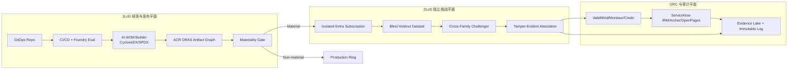
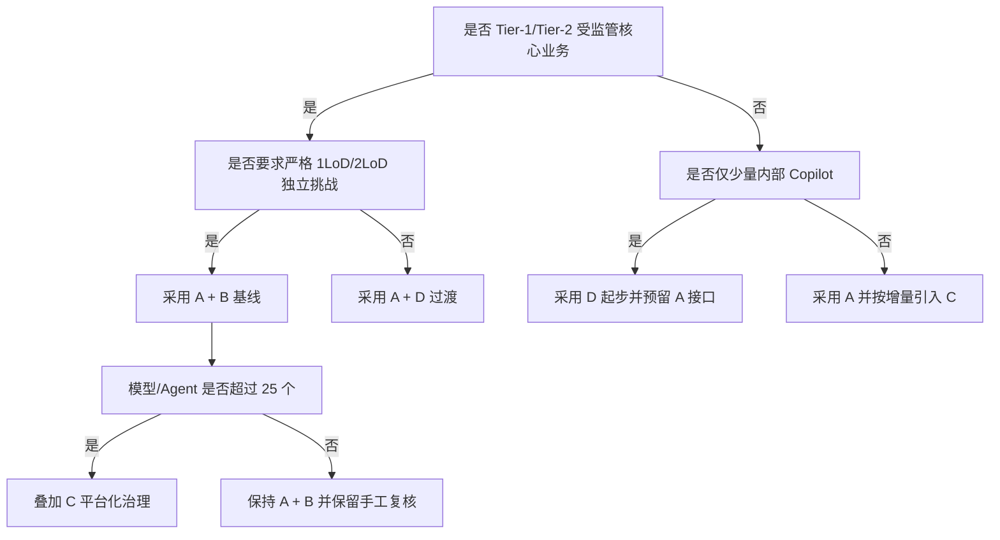

# 企业受监管模型风险管理（MRM）与机器可读 AI-BOM 治理选型 FAQ：SR 11-7 + CycloneDX 1.6/SPDX 3.0 vs 2LoD 独立挑战者 vs GRC 平台化

> 🌐 **Language Switch**：**中文（当前）** | [English](./sr11-7-model-risk-management-mrm-aibom-cyclonedx-foundry-lineage-vs-2lod-challenger-vs-validmind-grc-selection-faq.en.md)
> **受众**：Cloud & AI Solution Architect、银行/保险/资管模型风险管理负责人、2LoD 独立验证团队、企业 GRC/内审团队、LLMOps 平台负责人。
> **范围**：围绕 `Fed SR 11-7`、`OCC 2011-12`、`PRA SS1/23`、`OSFI E-23` 等监管框架，比较 Compound AI Agent 在生产落地时的 AI-BOM 治理、变更重要性分级、独立挑战者验证、证据归档与三年 TCO。

## 1. 问题定义：为什么银行级 Agent MRM 常被“16 周审批冻结”拖垮交付节奏
多数受监管机构已把 Agent 视为“复合模型系统”而非单一 LLM 调用，这意味着监管审查对象不再只是 base model，而是模型权重、系统提示词、RAG 索引、内容安全阈值、工具契约和人工审批策略的组合体。  
在传统文档化流程中，1LoD 团队每次做 prompt 或工具链微调都要重新走委员会评审、人工证据拼装、验证复核与签字归档，导致原本应在小时级完成的缺陷修复被拉长到周级甚至月级。  
更关键的是，很多组织把“变更审查”和“风险证明”混在一个手工流程里，既没有量化等价边界，也没有机器可读变更包，最终形成“高成本但低可追溯”的治理悖论。  
因此本指南的核心问题是：如何在不破坏 1LoD/2LoD 职责隔离的前提下，把非实质性变更的上线周期从 `18 周` 级缩短到 `<2 小时`，同时让实质性变更依然保留强审查与有效挑战。  

## 2. 四种架构模式（A/B/C/D）与职责边界
**Architecture A（GitOps AI-BOM + 重要性分级变更包）**：以 `CycloneDX 1.6 ML-BOM` 或 `SPDX 3.0 AI-BOM` 描述复合 Agent 组件，结合量化阈值把变更分为“非实质性自动放行”与“实质性升级审查”，并把证据绑定到不可篡改哈希链。  
**Architecture B（2LoD 独立清洁室挑战者）**：在独立订阅与独立身份域中运行盲测 holdout、跨模型家族挑战者评审和可追溯签署，防止 2LoD 复用 1LoD 的评测偏好与数据泄漏。  
**Architecture C（GRC 平台生命周期管理）**：把 ValidMind/Monitaur/Credo AI 等模型治理平台与 ServiceNow IRM/Archer/OpenPages 对接，实现批量化文档生成、周期复核和审计留痕联动。  
**Architecture D（Foundry + Purview + 手工签字）**：适用于少量低风险内部 Copilot 的低成本起步方案，但在 Tier-1/Tier-2 高监管大规模场景会遭遇证据规模与审批吞吐瓶颈。  
实践中四种模式可组合：A 负责机器可读变更事实，B 提供监管要求的独立挑战，C 提供组织级流程吞吐，D 作为低成熟度团队的过渡入口。  

## 3. 端到端参考架构：AI-BOM 主线、双线验证与证据归档分层解耦

该架构把“变更事实生成”“独立挑战验证”“合规流程归档”拆成三个平面，每个平面均有独立数据边界和审计语义，避免单平面系统兼做开发、评估、审批造成的角色冲突。  
关键设计点是让 AI-BOM 成为跨平面的共同主键，任何评估结论、审批意见、上线记录都能追溯到同一份组件指纹集合，从而把监管审查从“文档描述是否一致”升级为“工件证据是否一致”。  

## 4. Architecture A 详解：CycloneDX 1.6/SPDX 3.0 复合 Agent AI-BOM 与预批准变更包
在 A 模式中，每个可发布版本都要生成包含以下实体的机器可读清单：`Base Model Digest`、`LoRA Adapter Digest`、`System Prompt Hash`、`RAG Schema Version`、`Safety Threshold Set`、`MCP Tool Contract Digest`、`Policy Bundle Digest`。  
当 1LoD 团队提交变更时，系统先计算 BOM 差异，再套用预先备案的“非实质性变更包”规则，例如“只允许 prompt 字段白名单变更且 `ΔPass@1 >= -0.5%`、`ΔHallucination <= +0.2%`、`0` 安全回归”。  
若所有指标满足阈值，变更可进入自动放行环并在 `<2 小时` 完成上线；若任一指标越界，自动升级到 2LoD 独立验证流程并冻结发布环。  
该模式的收益不只是速度，而是把“委员会口径”转化为可执行策略，保证同类风险在不同团队与不同时间段得到一致处理。  

## 5. Architecture B 详解：2LoD 清洁室独立挑战与盲测持证签署
B 模式强调“有效挑战”必须满足独立身份、独立数据、独立评估器三项前提：2LoD 不能直接复用 1LoD 的 golden set、不能复用 1LoD 调优过的 judge、也不能在同一订阅内共享运行时缓存。  
典型实现是为 2LoD 建立独立 Entra 租户或至少独立订阅与网络边界，导入只读版本化工件后在隔离环境执行盲测 holdout、逆向提示攻击、越权工具调用和漂移敏感性分析。  
挑战结果以签名 attestations 写入证据账本，并将关键结论回写 GRC 平台形成“可机器校验的签署链”，避免只保留 PDF 或邮件截图导致证据脆弱。  
该模式虽然增加了基础设施与流程成本，但能够显著降低“同源验证偏差”与“开发者自证通过”的监管风险。  

## 6. Architecture C 详解：MRM/GRC 平台化与大规模生命周期编排
对于 `200+` 模型与 Agent 并行运营的集团，C 模式可把模型文档、控制映射、年度复核、异常整改、审计任务统一编排，减少跨团队手工汇总与重复填表。  
GRC 平台通常从 Foundry、监控系统和审计日志中自动提取指标，再映射到 SR 11-7 的概念健全性、结果分析、持续监控三大维度，生成面向内审和监管问询的标准化包。  
当与 ServiceNow IRM/Archer/OpenPages 集成后，可把“风险发现 -> 责任人 -> 整改 -> 复核 -> 关闭”闭环嵌入组织级治理体系，避免 AI 团队与风险团队各自维护孤立工单系统。  
该模式的边际收益随规模增长而增长，尤其适合多法域、多业务线、跨区域审计节奏不一致的机构。  

## 7. Architecture D 详解：Foundry + Purview + 手工签署基线方案
D 模式的优点是初期投入低、上手快，能在 Tier-3 内部效率工具场景快速建立最小治理闭环。  
实践中常见组合是：Foundry 管理实验与部署谱系，Purview 维护资产目录与数据分类，最终以 SharePoint/Word 模板完成审批记录。  
问题在于当模型数量与变更频率上升时，手工证据拼接与人工复核无法线性扩展，审批周转时间、文档一致性和审计准备成本会急剧上升。  
因此 D 更适合作为组织成熟度爬坡阶段的起点，而非长期承载高监管核心业务的终态架构。  

## 8. 12 维对比矩阵：独立性、吞吐、审计强度与长期可运营性
| 维度 | A GitOps AI-BOM | B 2LoD 清洁室 | C GRC 平台化 | D Foundry+Purview 手工 |
|---|---|---|---|---|
| 职责隔离强度 | 中高（策略化） | 很高（硬隔离） | 高（流程隔离） | 中（流程依赖人） |
| 非实质变更吞吐 | 很高 | 低 | 中高 | 中 |
| 实质变更挑战质量 | 中 | 很高 | 高（取决于接入） | 低到中 |
| 审计证据机器可读性 | 很高 | 高 | 很高 | 低 |
| 评估偏差控制 | 中 | 很高 | 高 | 低 |
| 跨区域法规映射 | 中 | 中 | 很高 | 低 |
| 运营复杂度 | 中 | 高 | 中高 | 低 |
| 工具链集成复杂度 | 中高 | 高 | 高 | 低 |
| 首次落地周期 | 中 | 中高 | 高 | 低 |
| 三年总成本可预测性 | 高 | 中 | 中高 | 低 |
| 对组织能力要求 | 中 | 高 | 中高 | 低 |
| 推荐适配场景 | 高频迭代生产队列 | 高监管核心模型 | 集团化规模治理 | 小规模低风险 |

矩阵结论是：A+B+C 形成“快变更 + 强独立 + 可扩展治理”的完整链路，D 仅在规模和监管强度都较低时具备性价比。  

## 9. 关键数学：时间收益、FTE 负载与等价/非劣统计门限
### 9.1 时间与人力负载
设每次变更的人工评审耗时为 `T_manual=18 weeks`，自动化预审耗时为 `T_auto<2h`，2LoD 自动 dossier 生成为 `T_2lod=10 days`。  
若年度变更次数为 `N`，非实质变更占比为 `p`，则年度节省周数近似为：  
`Saved_weeks = N * p * (18 - 2/40)`（按每周 `40h` 换算）。  
以 `N=120, p=0.7` 估算，节省约 `~1,507` 周工时等效，意味着可把人力从重复文档校对转移到高风险挑战分析。  

### 9.2 TOST 非劣/等价判定
当 1LoD 声称“仅做非实质变更”时，可用双单侧检验（TOST）验证核心指标漂移是否在预批准边界内。  
对指标差异 `Δ` 设定边界 `[L, U]`，例如 `L=-0.5%`, `U=+0.5%`，当 `P(Δ>L)` 与 `P(Δ<U)` 同时显著时，判定通过等价门限。  
对非正态分布指标可用 bootstrap CI，要求 `CI_low > L` 且 `CI_high < U`；若不满足，则升级实质变更审查。  

### 9.3 回归风险得分
可定义综合风险得分：  
`RiskScore = w1*Drift + w2*SafetyRegression + w3*ToolSurfaceDelta + w4*DataLineageUncertainty`。  
当 `RiskScore >= θ_material` 时强制进入 2LoD 挑战环，避免单指标达标掩盖多维风险叠加。  

## 10. 选型决策树：先判监管等级，再判变更频率与组织规模

该决策树强调“监管强度优先于工具偏好”，先确定独立挑战与证据要求，再决定是否引入平台化治理，不建议直接从工具便利性出发倒推监管控制。  

## 11. 生产配置片段一：CycloneDX 1.6 复合 Agent BOM（示例）
```json
{
  "bomFormat": "CycloneDX",
  "specVersion": "1.6",
  "version": 1,
  "metadata": {
    "timestamp": "2026-11-23T01:30:00Z",
    "component": {
      "type": "application",
      "name": "credit-risk-compound-agent",
      "version": "2026.11.23.1"
    },
    "properties": [
      { "name": "regulatory.frameworks", "value": "SR11-7,OCC2011-12,PRA-SS1-23,OSFI-E-23" },
      { "name": "materiality.envelope.pass_at_1_delta_min", "value": "-0.5%" },
      { "name": "materiality.envelope.hallucination_delta_max", "value": "+0.2%" },
      { "name": "materiality.envelope.safety_regression_max", "value": "0" }
    ]
  },
  "components": [
    {
      "type": "machine-learning-model",
      "name": "base-model",
      "version": "gpt-4.1-2026-10",
      "hashes": [{ "alg": "SHA-256", "content": "6f0f8f9e3b...a1" }]
    },
    {
      "type": "machine-learning-model",
      "name": "lora-adapter",
      "version": "credit-risk-lora-v14",
      "hashes": [{ "alg": "SHA-256", "content": "2cc7a4f89e...7d" }]
    },
    {
      "type": "data",
      "name": "rag-index-schema",
      "version": "v9",
      "hashes": [{ "alg": "SHA-256", "content": "95b2d9ab1c...4f" }]
    },
    {
      "type": "service",
      "name": "mcp-tool-contract-bundle",
      "version": "2026-11-23",
      "externalReferences": [
        { "type": "bom", "url": "oras://acr-registry/agent-mcp-contracts:sha256-3ea1..." }
      ]
    }
  ],
  "dependencies": [
    { "ref": "credit-risk-compound-agent", "dependsOn": ["base-model", "lora-adapter", "rag-index-schema", "mcp-tool-contract-bundle"] }
  ]
}
```
该片段展示了把复合 Agent 的关键可变组件统一映射到机器可读 BOM 的方法，重点是每个组件都必须有不可变版本号与摘要，便于后续审计与回放一致性检查。  

## 12. 生产配置片段二：1LoD/2LoD 重要性门限评估器（Python）
```python
from dataclasses import dataclass
from typing import Dict

@dataclass
class Envelope:
    pass_at_1_min_delta: float = -0.5
    hallucination_max_delta: float = 0.2
    safety_regression_max: int = 0
    tost_lower: float = -0.5
    tost_upper: float = 0.5


def classify_change(metrics: Dict[str, float], envelope: Envelope) -> str:
    if metrics["pass_at_1_delta_pct"] < envelope.pass_at_1_min_delta:
        return "material_escalate_2lod"
    if metrics["hallucination_delta_pct"] > envelope.hallucination_max_delta:
        return "material_escalate_2lod"
    if int(metrics["safety_regression_count"]) > envelope.safety_regression_max:
        return "material_escalate_2lod"
    if metrics["tost_ci_low"] <= envelope.tost_lower:
        return "material_escalate_2lod"
    if metrics["tost_ci_high"] >= envelope.tost_upper:
        return "material_escalate_2lod"
    return "non_material_autoclear"


def render_attestation(decision: str, bom_digest: str, run_id: str) -> Dict[str, str]:
    return {
        "run_id": run_id,
        "bom_digest": bom_digest,
        "decision": decision,
        "lineage_state": "signed_pending_2lod" if decision.startswith("material") else "signed_autoclear",
    }
```
这段代码体现了治理核心原则：门限规则必须可执行、可审计、可回放，不应仅停留在会议纪要或 wiki 描述。  

## 13. 企业场景一：全球银行零售信贷 Agent 的高频策略微调
该银行每周有 `8-15` 次 prompt 与检索策略细化变更，若按传统流程逐次送审，业务修复窗口经常落后于监管政策和欺诈手法变化。  
引入 A+B 后，非实质变更在预批准边界内自动通过并在小时级上线，实质变更进入 2LoD 清洁室挑战环，平均 `10` 天形成结构化签署包。  
上线一年后，团队把变更交付周期中位数从 `11.5` 周降至 `2.3` 天，并显著减少“等待审签导致的已知缺陷暴露窗口”。  

## 14. 企业场景二：跨法域保险集团的年度重认证与问询应答
该集团在英国、加拿大和美国均有受监管业务，年度审计问询重点从“有没有文档”转向“证据是否可验证且前后一致”。  
通过 C 模式把 Foundry 谱系、挑战报告、审批记录与整改闭环统一到 GRC 平台后，审计团队可按法域模板自动生成 dossier，并在问询周内完成跨区域证据调取。  
相比原有手工收集模式，年度重认证准备工时下降约 `42%`，且“证据版本冲突”类问题明显减少。  

## 15. 三年 TCO、定量 Q&A、Day-0/Day-2 清单与适配结论
### 15.1 三年 TCO（`25/80/220` 受监管 Agent 规模）
| 成本项（3 年） | A | A+B | A+B+C | D |
|---|---:|---:|---:|---:|
| 平台与基础设施 | `$0.74M` | `$1.06M` | `$1.42M` | `$0.39M` |
| 验证与治理人力 | `$1.88M` | `$1.26M` | `$0.98M` | `$2.11M` |
| 审计准备与问询应答 | `$0.63M` | `$0.44M` | `$0.28M` | `$0.91M` |
| 变更延迟机会成本 | `$1.37M` | `$0.58M` | `$0.41M` | `$1.62M` |
| 三年综合成本 | `$4.62M` | `$3.34M` | `$3.09M` | `$5.03M` |

该表说明 D 的前期成本最低但长期综合成本最高，A+B+C 在中大规模受监管场景通常具有更优总成本曲线。  

### 15.2 定量 Q&A（6 项）
**Q1：为什么要把“非实质变更”边界量化到 `ΔPass@1` 与 `ΔHallucination`？**  
因为仅靠“风险专家经验判断”无法实现跨团队一致性，量化边界能把治理口径固化为可重复执行策略。  

**Q2：为什么 2LoD 不能复用 1LoD 的 LLM-as-a-judge？**  
复用同源评估器会放大共同偏差，削弱“有效挑战”独立性，难以满足 SR 11-7 对独立验证的实质要求。  

**Q3：A 模式是否会放大误放行风险？**  
若门限定义过宽会放大风险，因此必须叠加安全回归硬约束、TOST 边界和随机抽检回灌机制。  

**Q4：何时必须引入 C 平台化？**  
当受监管模型或 Agent 超过 `~25` 且跨区域审计周期重叠时，手工流程通常无法维持证据一致性与时效。  

**Q5：如何判定“上线快”没有破坏“挑战强度”？**  
关键看 material 变更的挑战覆盖率、挑战失败检出率与整改闭环时长，而不仅看发布流水线速度。  

**Q6：SPDX 3.0 AI-BOM 与 CycloneDX 1.6 ML-BOM 如何选？**  
若组织已有软件供应链 SBOM 体系并偏重组件关系图，优先 CycloneDX；若需要与既有 SPDX 资产治理统一，可采用 SPDX 并补齐模型扩展字段。  

### 15.3 Day-0 落地清单
- 定义监管映射：SR 11-7/OCC/PRA/OSFI 控制点到技术控制项的一对一关系。  
- 确定非实质变更包阈值并完成风险委员会备案。  
- 建立 AI-BOM 构建流水线并强制发布工件绑定摘要。  
- 建立 2LoD 独立挑战环境与身份边界策略。  
- 接通证据存储与签署链，确保 run 级可追溯。  
- 设定抽检规则与异常升级路径。  

### 15.4 Day-2 运营清单
- 每周复核门限命中分布，防止阈值漂移导致系统性误判。  
- 每周抽样验证 non-material 自动放行结果与人工复核一致性。  
- 每月演练 2LoD 清洁室隔离与证据回放完整性。  
- 每月复盘挑战失败案例，更新挑战集与判定策略。  
- 每季度重估三年 TCO 参数与人力结构。  
- 每季度进行跨法域审计问询演练。  

### 15.5 Good fit vs Not for
| 结论 | 说明 |
|---|---|
| ✅ Good fit | 高频变更、强监管、要求 1LoD/2LoD 明确隔离、并需要机器可读证据与可回放审计链的大型机构。 |
| ⛔ Not for | 低风险内部工具、模型数量很少、无独立挑战要求且可接受手工签审的轻量场景。 |

建议路线：以 **A** 建立机器可读事实基线，以 **B** 保证监管意义上的独立挑战，以 **C** 提升组织级吞吐和一致性，把 **D** 限定为低风险入门路径而非长期主架构。  
在受监管企业中，真正可持续的“快发布”不是绕过审查，而是把审查标准转化为可执行、可追溯、可复核的工程系统。  

### 15.6 治理运营看板与告警阈值建议
在生产环境中，最常见的失效模式不是“没有控制”，而是“控制存在但缺乏持续监控”，因此建议把 MRM 流程拆解为可观测指标并纳入日常运营例会。  
建议至少覆盖发布吞吐、挑战覆盖、证据完整性、整改闭环四个维度，并为每个维度设置可触发的升级动作，避免指标只做展示不驱动治理行为。  

| 指标域 | 目标值（建议） | 告警阈值（建议） | 处置动作（建议） |
|---|---:|---:|---|
| 非实质变更自动放行耗时 P95 | `<2h` | `>4h` 连续 3 个窗口 | 排查评测队列拥塞、检查 BOM 构建失败重试、提升并行评测配额 |
| material 变更挑战覆盖率 | `100%` | `<99%` 任一周 | 冻结对应发布环并触发 2LoD 补审 |
| 证据链完整率（run->digest->attestation） | `100%` | `<99.5%` 任一日 | 阻断上线并执行证据回补作业 |
| 整改工单超时率 | `<5%` | `>10%` 连续两周 | 启动管理升级并调整责任矩阵 |
| 年度重认证准时完成率 | `100%` | `<95%` | 调整 GRC 日历并预留跨区域评审窗口 |

### 15.7 0–90 天推进里程碑（组织落地节奏）
第一阶段（0–30 天）重点是“规则落地”，完成阈值备案、AI-BOM 构建、最小证据链贯通，确保每次发布都能留下一致的机器可读事实。  
第二阶段（31–60 天）重点是“独立挑战稳定化”，让 2LoD 清洁室评测从一次性项目变成稳定流水线，并建立失败案例复盘与挑战集更新机制。  
第三阶段（61–90 天）重点是“规模化治理”，接入 GRC 平台、打通 IRM 工单、固化季度重认证节奏，把审计准备从突击任务转成常态运营。  

1. **Day 0–30（规则与工件）**：阈值备案、BOM 签名、发布策略上线、证据主键统一。  
2. **Day 31–60（独立挑战）**：2LoD 持续评测、盲测集轮换、挑战失败整改闭环。  
3. **Day 61–90（规模治理）**：GRC 集成、跨法域模板化、季度审计演练机制固化。  

### 15.8 审计问询快速应答模板（建议字段）
为缩短监管问询响应时间，建议按“版本事实 -> 验证结果 -> 审批链 -> 整改状态”四段式组织应答，确保每条结论都可回溯到具体 digest 与 run_id。  
推荐模板字段包括：`release_id`、`bom_digest`、`materiality_decision`、`2lod_attestation_id`、`control_exceptions`、`remediation_owner`、`closure_evidence_uri`、`jurisdiction_scope`。  
当组织建立统一模板后，问询准备可从“人工拼接文件”转向“参数化导出 dossier”，显著降低跨区域协同成本与口径冲突概率。  

### 15.9 季度治理评审议程（建议）
为避免治理机制在日常压力下退化为“只看发布速度”，建议每季度固定召开跨 1LoD/2LoD/GRC/内审的联合评审，围绕证据质量与挑战有效性做结构化复盘。  
议程建议包含以下九项，且每项都需落到可验证数据而非口头结论。  
- 审核 non-material 自动放行比例是否持续偏高并逼近风险阈值上界。  
- 抽查 material 升级判定样本，确认无“降级绕审”行为。  
- 复盘挑战失败案例在后续版本中的复发率与修复时效。  
- 对比各业务线问询响应时长与证据完备度差异。  
- 检查跨法域控制映射是否因监管更新而需要重标定。  
- 评估 BOM 组件字典是否覆盖新增工具链与安全策略项。  
- 复核季度 TCO 假设与实际工时偏差，纠正预算预测。  
- 审查整改工单关闭质量，防止“形式关闭”未实质修复。  
- 确认下季度阈值与挑战集更新计划及责任人。  
