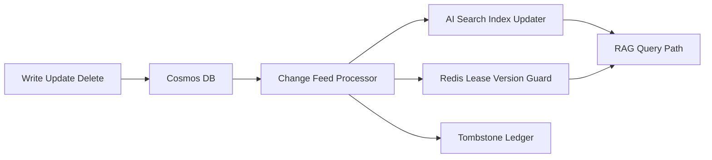
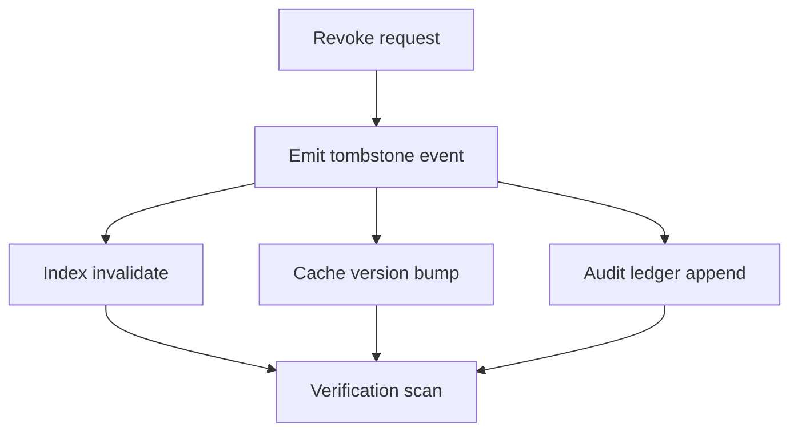

# Enterprise stateful-agent memory revocation and temporal-RAG governance selection FAQ (Cosmos Change Feed vs Redis lease vs AI Search tombstones)

> Audience: Cloud & AI Solution Architects, data-platform leaders, and compliance/security owners.
>
> Core question: how to deliver retrievable, revocable, and auditable long-term memory governance in enterprise multi-tenant agent platforms without stale-memory resurrection across caches and vector indexes.

## 1. Executive summary

Enterprise memory governance must be designed around revocation, not just ingestion. Recommended pattern:

- **Route A (backbone)**: `Cosmos DB + Change Feed + AI Search push updates` for event-driven index consistency.
- **Route B (acceleration guardrail)**: `Redis lease + RYW` controls for session-level immediate revocation effect.
- **Route C (audit layer)**: temporal validity (`valid_from/valid_until`) + append-only tombstone ledger for replayability.
- **Route D (anti-pattern)**: update source DB only while ignoring cache/index invalidation and audit proof.

One-line takeaway: **memory governance success is measured by provable deletion correctness, not just write throughput.**

## 2. Why revocation is harder than ingestion

- Retrieval stacks usually include multiple replicas: transactional store, cache, vector index, and offline lakehouse copies.
- Revocation events can arrive out-of-order and create ghost-hit windows.
- Session context can survive policy updates if version controls are missing.
- Regulatory audits require timestamped explainability of retrieval outcomes.

## 3. Route definitions

### Route A: Cosmos Change Feed consistency backbone

- Persist memory entities in Cosmos and emit mutation/revocation events.
- Push tombstones and updates to AI Search and derived layers.
- Suitable for large-scale, multi-region, event-driven data planes.

### Route B: Redis lease and session-version guardrails

- Maintain short-lived per-tenant lease versions.
- On revocation, increment lease so stale sessions are forced to refresh.
- Suitable when sub-second revocation effect is required.

### Route C: temporal semantics + tombstone audit ledger

- Persist `valid_from`, `valid_until`, and `revoked_at` semantics.
- Keep append-only evidence for replay and regulator review.
- Suitable for high-assurance compliance domains.

### Route D: anti-pattern baseline

- Source-store updates only, no cache/index invalidation discipline.
- No immutable revocation evidence chain.
- Produces “deleted but still retrievable” incidents.

## 4. Quantitative models

### 4.1 Revocation propagation window

Definitions:

- `T_emit`: revocation event emission time
- `T_cache`: cache invalidation completion time
- `T_index`: index invalidation completion time
- `T_client`: session context refresh completion time

Window model:

`W_revoke = max(T_cache, T_index, T_client) - T_emit`

### 4.2 Ghost-hit probability

`P_ghost = P(cache_stale ∪ index_stale ∪ session_stale)`

The target is to constrain `P_ghost` through versioned guardrails and deterministic event handling.

### 4.3 RYW consistency overhead

`Cost_RYW ≈ N_read * C_version_check + N_invalidate * C_invalidate`

Use this to tune lease checks by risk tier.

### 4.4 Compliance replay coverage

`Replay_coverage = Replayed_calls / Total_sensitive_calls`

High-regulation domains should target near-complete replay coverage.

## 5. Twelve-dimension comparison matrix

| Dimension | Route A event backbone | Route B lease guard | Route C audit ledger | Route D anti-pattern |
|---|---|---|---|---|
| Sub-second revocation effect | Medium-high | High | Medium | Low |
| End-to-end consistency | High | Medium-high | Medium-high | Low |
| Audit replayability | Medium | Medium | High | Low |
| Engineering complexity | Medium | Medium | Medium | Low |
| Runtime cost | Medium | Medium | Medium-high | Low (apparent) |
| Multi-region scalability | High | Medium-high | High | Low |
| Cache contamination control | Medium-high | High | Medium | Low |
| Index drift resilience | High | Medium | Medium-high | Low |
| Compliance risk reduction | High | Medium-high | High | Low |
| Explainability | High | Medium | High | Low |
| Evolution flexibility | High | Medium-high | High | Low |
| Recommendation | ✅ backbone | ✅ acceleration | ✅ audit | ⛔ |

## 6. Deep quantitative Q&A (Q1-Q8)
### Q1: Why do deleted memories still appear in answers?
Because source deletion does not automatically invalidate caches, indexes, and active session context.

### Q2: Does Change Feed solve all consistency problems?
No. It solves propagation, but session-level staleness still needs lease/version checks.

### Q3: Does lease validation hurt latency?
Slightly. In critical tiers, the risk reduction usually outweighs the overhead.

### Q4: Why is a tombstone ledger required?
Without immutable evidence, revocation timing and causality cannot be proven during audits.

### Q5: How to handle cross-region out-of-order events?
Use monotonic versions and idempotent handlers so stale events cannot overwrite newer state.

### Q6: How to validate GDPR-style deletions?
Use replay sampling and index scan assertions that revoked entities are no longer retrievable.

### Q7: Can TTL replace explicit revocation?
No. TTL handles expiration, not immediate withdrawal rights and legal evidence obligations.

### Q8: When is A+B+C mandatory?
When business requires sub-second revocation, low ghost-hit tolerance, and strict replayable compliance.

## 7. Architecture diagrams (Mermaid)





## 8. Production snippet: change-feed handler (pseudo-code)

```python
def on_change(event):
    key = event["memory_id"]
    version = event["version"]
    if event["op"] == "revoke":
        search.delete(key)
        redis.set(f"lease:{event['tenant_id']}", version)
        ledger.append({"memory_id": key, "revoked_at": event["ts"], "version": version})
    else:
        search.upsert(event["payload"])
```

## 9. Production snippet: query-path lease guard (pseudo-code)

```python
def guarded_query(tenant_id, session_version, query):
    lease = redis.get(f"lease:{tenant_id}")
    if lease and session_version < lease:
        raise RetryWithRefresh("session context stale")
    return rag.search(query)
```

## 10. Enterprise scenarios (2+)

### Scenario A: regulated financial support assistant

- Policy updates require near-real-time withdrawal of obsolete guidance.
- Route A drives full propagation, Route B enforces immediate session guards.
- Route C preserves auditable evidence for regulator inquiries.

### Scenario B: healthcare follow-up copilot

- Consent withdrawal must invalidate patient-linked memory retrieval quickly.
- Lease versioning blocks stale sessions from replaying old context.
- Replay sampling demonstrates revocation closure to governance teams.

### Scenario C: global manufacturing knowledge hub

- Multi-region replication requires robust out-of-order event handling.
- Idempotent processors and tombstone ledgers limit drift risk.
- Revocation-window SLO is treated as a first-class reliability metric.

## 11. Three-tier 3-year TCO (USD)

| Scale tier | Route A | Route A+B | Route A+C | Route A+B+C |
|---|---:|---:|---:|---:|
| 500K memories | 1,450,000 | 1,620,000 | 1,780,000 | 1,930,000 |
| 50M memories | 8,900,000 | 9,800,000 | 10,700,000 | 11,600,000 |
| 500M memories | 49,500,000 | 53,400,000 | 57,800,000 | 61,900,000 |

Interpretation:

- Composite controls cost more, but reduce compliance and reputation-loss exposure.
- In high-risk sectors, provable deletion correctness outweighs minimal storage cost.

## 12. Day-0 / Day-1 / Day-2 checklist

### Day-0 (contract and model baseline)
- Day-0 control 1: define memory schema, version semantics, revocation policy, and audit retention requirements.
- Day-0 control 2: define memory schema, version semantics, revocation policy, and audit retention requirements.
- Day-0 control 3: define memory schema, version semantics, revocation policy, and audit retention requirements.
- Day-0 control 4: define memory schema, version semantics, revocation policy, and audit retention requirements.
- Day-0 control 5: define memory schema, version semantics, revocation policy, and audit retention requirements.
- Day-0 control 6: define memory schema, version semantics, revocation policy, and audit retention requirements.
- Day-0 control 7: define memory schema, version semantics, revocation policy, and audit retention requirements.
- Day-0 control 8: define memory schema, version semantics, revocation policy, and audit retention requirements.
- Day-0 control 9: define memory schema, version semantics, revocation policy, and audit retention requirements.
- Day-0 control 10: define memory schema, version semantics, revocation policy, and audit retention requirements.
- Day-0 control 11: define memory schema, version semantics, revocation policy, and audit retention requirements.
- Day-0 control 12: define memory schema, version semantics, revocation policy, and audit retention requirements.
- Day-0 control 13: define memory schema, version semantics, revocation policy, and audit retention requirements.
- Day-0 control 14: define memory schema, version semantics, revocation policy, and audit retention requirements.
- Day-0 control 15: define memory schema, version semantics, revocation policy, and audit retention requirements.
- Day-0 control 16: define memory schema, version semantics, revocation policy, and audit retention requirements.
- Day-0 control 17: define memory schema, version semantics, revocation policy, and audit retention requirements.
- Day-0 control 18: define memory schema, version semantics, revocation policy, and audit retention requirements.
- Day-0 control 19: define memory schema, version semantics, revocation policy, and audit retention requirements.
- Day-0 control 20: define memory schema, version semantics, revocation policy, and audit retention requirements.
- Day-0 control 21: define memory schema, version semantics, revocation policy, and audit retention requirements.
- Day-0 control 22: define memory schema, version semantics, revocation policy, and audit retention requirements.
- Day-0 control 23: define memory schema, version semantics, revocation policy, and audit retention requirements.
- Day-0 control 24: define memory schema, version semantics, revocation policy, and audit retention requirements.
- Day-0 control 25: define memory schema, version semantics, revocation policy, and audit retention requirements.
- Day-0 control 26: define memory schema, version semantics, revocation policy, and audit retention requirements.
- Day-0 control 27: define memory schema, version semantics, revocation policy, and audit retention requirements.
- Day-0 control 28: define memory schema, version semantics, revocation policy, and audit retention requirements.
- Day-0 control 29: define memory schema, version semantics, revocation policy, and audit retention requirements.
- Day-0 control 30: define memory schema, version semantics, revocation policy, and audit retention requirements.
- Day-0 control 31: define memory schema, version semantics, revocation policy, and audit retention requirements.
- Day-0 control 32: define memory schema, version semantics, revocation policy, and audit retention requirements.
- Day-0 control 33: define memory schema, version semantics, revocation policy, and audit retention requirements.
- Day-0 control 34: define memory schema, version semantics, revocation policy, and audit retention requirements.
- Day-0 control 35: define memory schema, version semantics, revocation policy, and audit retention requirements.
- Day-0 control 36: define memory schema, version semantics, revocation policy, and audit retention requirements.
- Day-0 control 37: define memory schema, version semantics, revocation policy, and audit retention requirements.
- Day-0 control 38: define memory schema, version semantics, revocation policy, and audit retention requirements.
- Day-0 control 39: define memory schema, version semantics, revocation policy, and audit retention requirements.
- Day-0 control 40: define memory schema, version semantics, revocation policy, and audit retention requirements.
- Day-0 control 41: define memory schema, version semantics, revocation policy, and audit retention requirements.
- Day-0 control 42: define memory schema, version semantics, revocation policy, and audit retention requirements.
- Day-0 control 43: define memory schema, version semantics, revocation policy, and audit retention requirements.
- Day-0 control 44: define memory schema, version semantics, revocation policy, and audit retention requirements.
- Day-0 control 45: define memory schema, version semantics, revocation policy, and audit retention requirements.
- Day-0 control 46: define memory schema, version semantics, revocation policy, and audit retention requirements.
- Day-0 control 47: define memory schema, version semantics, revocation policy, and audit retention requirements.
- Day-0 control 48: define memory schema, version semantics, revocation policy, and audit retention requirements.
- Day-0 control 49: define memory schema, version semantics, revocation policy, and audit retention requirements.
- Day-0 control 50: define memory schema, version semantics, revocation policy, and audit retention requirements.
- Day-0 control 51: define memory schema, version semantics, revocation policy, and audit retention requirements.
- Day-0 control 52: define memory schema, version semantics, revocation policy, and audit retention requirements.
- Day-0 control 53: define memory schema, version semantics, revocation policy, and audit retention requirements.
- Day-0 control 54: define memory schema, version semantics, revocation policy, and audit retention requirements.
- Day-0 control 55: define memory schema, version semantics, revocation policy, and audit retention requirements.
- Day-0 control 56: define memory schema, version semantics, revocation policy, and audit retention requirements.
- Day-0 control 57: define memory schema, version semantics, revocation policy, and audit retention requirements.
- Day-0 control 58: define memory schema, version semantics, revocation policy, and audit retention requirements.
- Day-0 control 59: define memory schema, version semantics, revocation policy, and audit retention requirements.
- Day-0 control 60: define memory schema, version semantics, revocation policy, and audit retention requirements.
- Day-0 control 61: define memory schema, version semantics, revocation policy, and audit retention requirements.
- Day-0 control 62: define memory schema, version semantics, revocation policy, and audit retention requirements.
- Day-0 control 63: define memory schema, version semantics, revocation policy, and audit retention requirements.
- Day-0 control 64: define memory schema, version semantics, revocation policy, and audit retention requirements.
- Day-0 control 65: define memory schema, version semantics, revocation policy, and audit retention requirements.
- Day-0 control 66: define memory schema, version semantics, revocation policy, and audit retention requirements.
- Day-0 control 67: define memory schema, version semantics, revocation policy, and audit retention requirements.
- Day-0 control 68: define memory schema, version semantics, revocation policy, and audit retention requirements.
- Day-0 control 69: define memory schema, version semantics, revocation policy, and audit retention requirements.
- Day-0 control 70: define memory schema, version semantics, revocation policy, and audit retention requirements.
- Day-0 control 71: define memory schema, version semantics, revocation policy, and audit retention requirements.
- Day-0 control 72: define memory schema, version semantics, revocation policy, and audit retention requirements.
- Day-0 control 73: define memory schema, version semantics, revocation policy, and audit retention requirements.
- Day-0 control 74: define memory schema, version semantics, revocation policy, and audit retention requirements.
- Day-0 control 75: define memory schema, version semantics, revocation policy, and audit retention requirements.
- Day-0 control 76: define memory schema, version semantics, revocation policy, and audit retention requirements.
- Day-0 control 77: define memory schema, version semantics, revocation policy, and audit retention requirements.
- Day-0 control 78: define memory schema, version semantics, revocation policy, and audit retention requirements.
- Day-0 control 79: define memory schema, version semantics, revocation policy, and audit retention requirements.
- Day-0 control 80: define memory schema, version semantics, revocation policy, and audit retention requirements.

### Day-1 (engineering rollout)
- Day-1 control 1: wire change-feed processors, index invalidation, lease checks, and alert baselines.
- Day-1 control 2: wire change-feed processors, index invalidation, lease checks, and alert baselines.
- Day-1 control 3: wire change-feed processors, index invalidation, lease checks, and alert baselines.
- Day-1 control 4: wire change-feed processors, index invalidation, lease checks, and alert baselines.
- Day-1 control 5: wire change-feed processors, index invalidation, lease checks, and alert baselines.
- Day-1 control 6: wire change-feed processors, index invalidation, lease checks, and alert baselines.
- Day-1 control 7: wire change-feed processors, index invalidation, lease checks, and alert baselines.
- Day-1 control 8: wire change-feed processors, index invalidation, lease checks, and alert baselines.
- Day-1 control 9: wire change-feed processors, index invalidation, lease checks, and alert baselines.
- Day-1 control 10: wire change-feed processors, index invalidation, lease checks, and alert baselines.
- Day-1 control 11: wire change-feed processors, index invalidation, lease checks, and alert baselines.
- Day-1 control 12: wire change-feed processors, index invalidation, lease checks, and alert baselines.
- Day-1 control 13: wire change-feed processors, index invalidation, lease checks, and alert baselines.
- Day-1 control 14: wire change-feed processors, index invalidation, lease checks, and alert baselines.
- Day-1 control 15: wire change-feed processors, index invalidation, lease checks, and alert baselines.
- Day-1 control 16: wire change-feed processors, index invalidation, lease checks, and alert baselines.
- Day-1 control 17: wire change-feed processors, index invalidation, lease checks, and alert baselines.
- Day-1 control 18: wire change-feed processors, index invalidation, lease checks, and alert baselines.
- Day-1 control 19: wire change-feed processors, index invalidation, lease checks, and alert baselines.
- Day-1 control 20: wire change-feed processors, index invalidation, lease checks, and alert baselines.
- Day-1 control 21: wire change-feed processors, index invalidation, lease checks, and alert baselines.
- Day-1 control 22: wire change-feed processors, index invalidation, lease checks, and alert baselines.
- Day-1 control 23: wire change-feed processors, index invalidation, lease checks, and alert baselines.
- Day-1 control 24: wire change-feed processors, index invalidation, lease checks, and alert baselines.
- Day-1 control 25: wire change-feed processors, index invalidation, lease checks, and alert baselines.
- Day-1 control 26: wire change-feed processors, index invalidation, lease checks, and alert baselines.
- Day-1 control 27: wire change-feed processors, index invalidation, lease checks, and alert baselines.
- Day-1 control 28: wire change-feed processors, index invalidation, lease checks, and alert baselines.
- Day-1 control 29: wire change-feed processors, index invalidation, lease checks, and alert baselines.
- Day-1 control 30: wire change-feed processors, index invalidation, lease checks, and alert baselines.
- Day-1 control 31: wire change-feed processors, index invalidation, lease checks, and alert baselines.
- Day-1 control 32: wire change-feed processors, index invalidation, lease checks, and alert baselines.
- Day-1 control 33: wire change-feed processors, index invalidation, lease checks, and alert baselines.
- Day-1 control 34: wire change-feed processors, index invalidation, lease checks, and alert baselines.
- Day-1 control 35: wire change-feed processors, index invalidation, lease checks, and alert baselines.
- Day-1 control 36: wire change-feed processors, index invalidation, lease checks, and alert baselines.
- Day-1 control 37: wire change-feed processors, index invalidation, lease checks, and alert baselines.
- Day-1 control 38: wire change-feed processors, index invalidation, lease checks, and alert baselines.
- Day-1 control 39: wire change-feed processors, index invalidation, lease checks, and alert baselines.
- Day-1 control 40: wire change-feed processors, index invalidation, lease checks, and alert baselines.
- Day-1 control 41: wire change-feed processors, index invalidation, lease checks, and alert baselines.
- Day-1 control 42: wire change-feed processors, index invalidation, lease checks, and alert baselines.
- Day-1 control 43: wire change-feed processors, index invalidation, lease checks, and alert baselines.
- Day-1 control 44: wire change-feed processors, index invalidation, lease checks, and alert baselines.
- Day-1 control 45: wire change-feed processors, index invalidation, lease checks, and alert baselines.
- Day-1 control 46: wire change-feed processors, index invalidation, lease checks, and alert baselines.
- Day-1 control 47: wire change-feed processors, index invalidation, lease checks, and alert baselines.
- Day-1 control 48: wire change-feed processors, index invalidation, lease checks, and alert baselines.
- Day-1 control 49: wire change-feed processors, index invalidation, lease checks, and alert baselines.
- Day-1 control 50: wire change-feed processors, index invalidation, lease checks, and alert baselines.
- Day-1 control 51: wire change-feed processors, index invalidation, lease checks, and alert baselines.
- Day-1 control 52: wire change-feed processors, index invalidation, lease checks, and alert baselines.
- Day-1 control 53: wire change-feed processors, index invalidation, lease checks, and alert baselines.
- Day-1 control 54: wire change-feed processors, index invalidation, lease checks, and alert baselines.
- Day-1 control 55: wire change-feed processors, index invalidation, lease checks, and alert baselines.
- Day-1 control 56: wire change-feed processors, index invalidation, lease checks, and alert baselines.
- Day-1 control 57: wire change-feed processors, index invalidation, lease checks, and alert baselines.
- Day-1 control 58: wire change-feed processors, index invalidation, lease checks, and alert baselines.
- Day-1 control 59: wire change-feed processors, index invalidation, lease checks, and alert baselines.
- Day-1 control 60: wire change-feed processors, index invalidation, lease checks, and alert baselines.
- Day-1 control 61: wire change-feed processors, index invalidation, lease checks, and alert baselines.
- Day-1 control 62: wire change-feed processors, index invalidation, lease checks, and alert baselines.
- Day-1 control 63: wire change-feed processors, index invalidation, lease checks, and alert baselines.
- Day-1 control 64: wire change-feed processors, index invalidation, lease checks, and alert baselines.
- Day-1 control 65: wire change-feed processors, index invalidation, lease checks, and alert baselines.
- Day-1 control 66: wire change-feed processors, index invalidation, lease checks, and alert baselines.
- Day-1 control 67: wire change-feed processors, index invalidation, lease checks, and alert baselines.
- Day-1 control 68: wire change-feed processors, index invalidation, lease checks, and alert baselines.
- Day-1 control 69: wire change-feed processors, index invalidation, lease checks, and alert baselines.
- Day-1 control 70: wire change-feed processors, index invalidation, lease checks, and alert baselines.
- Day-1 control 71: wire change-feed processors, index invalidation, lease checks, and alert baselines.
- Day-1 control 72: wire change-feed processors, index invalidation, lease checks, and alert baselines.
- Day-1 control 73: wire change-feed processors, index invalidation, lease checks, and alert baselines.
- Day-1 control 74: wire change-feed processors, index invalidation, lease checks, and alert baselines.
- Day-1 control 75: wire change-feed processors, index invalidation, lease checks, and alert baselines.
- Day-1 control 76: wire change-feed processors, index invalidation, lease checks, and alert baselines.
- Day-1 control 77: wire change-feed processors, index invalidation, lease checks, and alert baselines.
- Day-1 control 78: wire change-feed processors, index invalidation, lease checks, and alert baselines.
- Day-1 control 79: wire change-feed processors, index invalidation, lease checks, and alert baselines.
- Day-1 control 80: wire change-feed processors, index invalidation, lease checks, and alert baselines.

### Day-2 (operations and governance)
- Day-2 control 1: monitor revocation window, ghost-hit rate, replay coverage, and regional drift indicators.
- Day-2 control 2: monitor revocation window, ghost-hit rate, replay coverage, and regional drift indicators.
- Day-2 control 3: monitor revocation window, ghost-hit rate, replay coverage, and regional drift indicators.
- Day-2 control 4: monitor revocation window, ghost-hit rate, replay coverage, and regional drift indicators.
- Day-2 control 5: monitor revocation window, ghost-hit rate, replay coverage, and regional drift indicators.
- Day-2 control 6: monitor revocation window, ghost-hit rate, replay coverage, and regional drift indicators.
- Day-2 control 7: monitor revocation window, ghost-hit rate, replay coverage, and regional drift indicators.
- Day-2 control 8: monitor revocation window, ghost-hit rate, replay coverage, and regional drift indicators.
- Day-2 control 9: monitor revocation window, ghost-hit rate, replay coverage, and regional drift indicators.
- Day-2 control 10: monitor revocation window, ghost-hit rate, replay coverage, and regional drift indicators.
- Day-2 control 11: monitor revocation window, ghost-hit rate, replay coverage, and regional drift indicators.
- Day-2 control 12: monitor revocation window, ghost-hit rate, replay coverage, and regional drift indicators.
- Day-2 control 13: monitor revocation window, ghost-hit rate, replay coverage, and regional drift indicators.
- Day-2 control 14: monitor revocation window, ghost-hit rate, replay coverage, and regional drift indicators.
- Day-2 control 15: monitor revocation window, ghost-hit rate, replay coverage, and regional drift indicators.
- Day-2 control 16: monitor revocation window, ghost-hit rate, replay coverage, and regional drift indicators.
- Day-2 control 17: monitor revocation window, ghost-hit rate, replay coverage, and regional drift indicators.
- Day-2 control 18: monitor revocation window, ghost-hit rate, replay coverage, and regional drift indicators.
- Day-2 control 19: monitor revocation window, ghost-hit rate, replay coverage, and regional drift indicators.
- Day-2 control 20: monitor revocation window, ghost-hit rate, replay coverage, and regional drift indicators.
- Day-2 control 21: monitor revocation window, ghost-hit rate, replay coverage, and regional drift indicators.
- Day-2 control 22: monitor revocation window, ghost-hit rate, replay coverage, and regional drift indicators.
- Day-2 control 23: monitor revocation window, ghost-hit rate, replay coverage, and regional drift indicators.
- Day-2 control 24: monitor revocation window, ghost-hit rate, replay coverage, and regional drift indicators.
- Day-2 control 25: monitor revocation window, ghost-hit rate, replay coverage, and regional drift indicators.
- Day-2 control 26: monitor revocation window, ghost-hit rate, replay coverage, and regional drift indicators.
- Day-2 control 27: monitor revocation window, ghost-hit rate, replay coverage, and regional drift indicators.
- Day-2 control 28: monitor revocation window, ghost-hit rate, replay coverage, and regional drift indicators.
- Day-2 control 29: monitor revocation window, ghost-hit rate, replay coverage, and regional drift indicators.
- Day-2 control 30: monitor revocation window, ghost-hit rate, replay coverage, and regional drift indicators.
- Day-2 control 31: monitor revocation window, ghost-hit rate, replay coverage, and regional drift indicators.
- Day-2 control 32: monitor revocation window, ghost-hit rate, replay coverage, and regional drift indicators.
- Day-2 control 33: monitor revocation window, ghost-hit rate, replay coverage, and regional drift indicators.
- Day-2 control 34: monitor revocation window, ghost-hit rate, replay coverage, and regional drift indicators.
- Day-2 control 35: monitor revocation window, ghost-hit rate, replay coverage, and regional drift indicators.
- Day-2 control 36: monitor revocation window, ghost-hit rate, replay coverage, and regional drift indicators.
- Day-2 control 37: monitor revocation window, ghost-hit rate, replay coverage, and regional drift indicators.
- Day-2 control 38: monitor revocation window, ghost-hit rate, replay coverage, and regional drift indicators.
- Day-2 control 39: monitor revocation window, ghost-hit rate, replay coverage, and regional drift indicators.
- Day-2 control 40: monitor revocation window, ghost-hit rate, replay coverage, and regional drift indicators.
- Day-2 control 41: monitor revocation window, ghost-hit rate, replay coverage, and regional drift indicators.
- Day-2 control 42: monitor revocation window, ghost-hit rate, replay coverage, and regional drift indicators.
- Day-2 control 43: monitor revocation window, ghost-hit rate, replay coverage, and regional drift indicators.
- Day-2 control 44: monitor revocation window, ghost-hit rate, replay coverage, and regional drift indicators.
- Day-2 control 45: monitor revocation window, ghost-hit rate, replay coverage, and regional drift indicators.
- Day-2 control 46: monitor revocation window, ghost-hit rate, replay coverage, and regional drift indicators.
- Day-2 control 47: monitor revocation window, ghost-hit rate, replay coverage, and regional drift indicators.
- Day-2 control 48: monitor revocation window, ghost-hit rate, replay coverage, and regional drift indicators.
- Day-2 control 49: monitor revocation window, ghost-hit rate, replay coverage, and regional drift indicators.
- Day-2 control 50: monitor revocation window, ghost-hit rate, replay coverage, and regional drift indicators.
- Day-2 control 51: monitor revocation window, ghost-hit rate, replay coverage, and regional drift indicators.
- Day-2 control 52: monitor revocation window, ghost-hit rate, replay coverage, and regional drift indicators.
- Day-2 control 53: monitor revocation window, ghost-hit rate, replay coverage, and regional drift indicators.
- Day-2 control 54: monitor revocation window, ghost-hit rate, replay coverage, and regional drift indicators.
- Day-2 control 55: monitor revocation window, ghost-hit rate, replay coverage, and regional drift indicators.
- Day-2 control 56: monitor revocation window, ghost-hit rate, replay coverage, and regional drift indicators.
- Day-2 control 57: monitor revocation window, ghost-hit rate, replay coverage, and regional drift indicators.
- Day-2 control 58: monitor revocation window, ghost-hit rate, replay coverage, and regional drift indicators.
- Day-2 control 59: monitor revocation window, ghost-hit rate, replay coverage, and regional drift indicators.
- Day-2 control 60: monitor revocation window, ghost-hit rate, replay coverage, and regional drift indicators.
- Day-2 control 61: monitor revocation window, ghost-hit rate, replay coverage, and regional drift indicators.
- Day-2 control 62: monitor revocation window, ghost-hit rate, replay coverage, and regional drift indicators.
- Day-2 control 63: monitor revocation window, ghost-hit rate, replay coverage, and regional drift indicators.
- Day-2 control 64: monitor revocation window, ghost-hit rate, replay coverage, and regional drift indicators.
- Day-2 control 65: monitor revocation window, ghost-hit rate, replay coverage, and regional drift indicators.
- Day-2 control 66: monitor revocation window, ghost-hit rate, replay coverage, and regional drift indicators.
- Day-2 control 67: monitor revocation window, ghost-hit rate, replay coverage, and regional drift indicators.
- Day-2 control 68: monitor revocation window, ghost-hit rate, replay coverage, and regional drift indicators.
- Day-2 control 69: monitor revocation window, ghost-hit rate, replay coverage, and regional drift indicators.
- Day-2 control 70: monitor revocation window, ghost-hit rate, replay coverage, and regional drift indicators.
- Day-2 control 71: monitor revocation window, ghost-hit rate, replay coverage, and regional drift indicators.
- Day-2 control 72: monitor revocation window, ghost-hit rate, replay coverage, and regional drift indicators.
- Day-2 control 73: monitor revocation window, ghost-hit rate, replay coverage, and regional drift indicators.
- Day-2 control 74: monitor revocation window, ghost-hit rate, replay coverage, and regional drift indicators.
- Day-2 control 75: monitor revocation window, ghost-hit rate, replay coverage, and regional drift indicators.
- Day-2 control 76: monitor revocation window, ghost-hit rate, replay coverage, and regional drift indicators.
- Day-2 control 77: monitor revocation window, ghost-hit rate, replay coverage, and regional drift indicators.
- Day-2 control 78: monitor revocation window, ghost-hit rate, replay coverage, and regional drift indicators.
- Day-2 control 79: monitor revocation window, ghost-hit rate, replay coverage, and regional drift indicators.
- Day-2 control 80: monitor revocation window, ghost-hit rate, replay coverage, and regional drift indicators.
- Day-2 control 81: monitor revocation window, ghost-hit rate, replay coverage, and regional drift indicators.
- Day-2 control 82: monitor revocation window, ghost-hit rate, replay coverage, and regional drift indicators.
- Day-2 control 83: monitor revocation window, ghost-hit rate, replay coverage, and regional drift indicators.
- Day-2 control 84: monitor revocation window, ghost-hit rate, replay coverage, and regional drift indicators.
- Day-2 control 85: monitor revocation window, ghost-hit rate, replay coverage, and regional drift indicators.
- Day-2 control 86: monitor revocation window, ghost-hit rate, replay coverage, and regional drift indicators.
- Day-2 control 87: monitor revocation window, ghost-hit rate, replay coverage, and regional drift indicators.
- Day-2 control 88: monitor revocation window, ghost-hit rate, replay coverage, and regional drift indicators.
- Day-2 control 89: monitor revocation window, ghost-hit rate, replay coverage, and regional drift indicators.
- Day-2 control 90: monitor revocation window, ghost-hit rate, replay coverage, and regional drift indicators.
- Day-2 control 91: monitor revocation window, ghost-hit rate, replay coverage, and regional drift indicators.
- Day-2 control 92: monitor revocation window, ghost-hit rate, replay coverage, and regional drift indicators.
- Day-2 control 93: monitor revocation window, ghost-hit rate, replay coverage, and regional drift indicators.
- Day-2 control 94: monitor revocation window, ghost-hit rate, replay coverage, and regional drift indicators.
- Day-2 control 95: monitor revocation window, ghost-hit rate, replay coverage, and regional drift indicators.
- Day-2 control 96: monitor revocation window, ghost-hit rate, replay coverage, and regional drift indicators.
- Day-2 control 97: monitor revocation window, ghost-hit rate, replay coverage, and regional drift indicators.
- Day-2 control 98: monitor revocation window, ghost-hit rate, replay coverage, and regional drift indicators.
- Day-2 control 99: monitor revocation window, ghost-hit rate, replay coverage, and regional drift indicators.
- Day-2 control 100: monitor revocation window, ghost-hit rate, replay coverage, and regional drift indicators.
- Day-2 control 101: monitor revocation window, ghost-hit rate, replay coverage, and regional drift indicators.
- Day-2 control 102: monitor revocation window, ghost-hit rate, replay coverage, and regional drift indicators.
- Day-2 control 103: monitor revocation window, ghost-hit rate, replay coverage, and regional drift indicators.
- Day-2 control 104: monitor revocation window, ghost-hit rate, replay coverage, and regional drift indicators.
- Day-2 control 105: monitor revocation window, ghost-hit rate, replay coverage, and regional drift indicators.
- Day-2 control 106: monitor revocation window, ghost-hit rate, replay coverage, and regional drift indicators.
- Day-2 control 107: monitor revocation window, ghost-hit rate, replay coverage, and regional drift indicators.
- Day-2 control 108: monitor revocation window, ghost-hit rate, replay coverage, and regional drift indicators.
- Day-2 control 109: monitor revocation window, ghost-hit rate, replay coverage, and regional drift indicators.
- Day-2 control 110: monitor revocation window, ghost-hit rate, replay coverage, and regional drift indicators.
- Day-2 control 111: monitor revocation window, ghost-hit rate, replay coverage, and regional drift indicators.
- Day-2 control 112: monitor revocation window, ghost-hit rate, replay coverage, and regional drift indicators.
- Day-2 control 113: monitor revocation window, ghost-hit rate, replay coverage, and regional drift indicators.
- Day-2 control 114: monitor revocation window, ghost-hit rate, replay coverage, and regional drift indicators.
- Day-2 control 115: monitor revocation window, ghost-hit rate, replay coverage, and regional drift indicators.
- Day-2 control 116: monitor revocation window, ghost-hit rate, replay coverage, and regional drift indicators.
- Day-2 control 117: monitor revocation window, ghost-hit rate, replay coverage, and regional drift indicators.
- Day-2 control 118: monitor revocation window, ghost-hit rate, replay coverage, and regional drift indicators.
- Day-2 control 119: monitor revocation window, ghost-hit rate, replay coverage, and regional drift indicators.
- Day-2 control 120: monitor revocation window, ghost-hit rate, replay coverage, and regional drift indicators.

## 13. Good fit vs Not for

### ✅ Good fit

- Regulated RAG workloads with strict withdrawal and audit obligations.
- Large platforms with multi-layer cache and index paths.
- Multi-region environments requiring revocation resilience drills.

### ⛔ Not for

- Single-node PoCs with no durable memory requirements.
- Low-risk experiments without revocation evidence requirements.
- Teams lacking minimum data-governance engineering capacity.

## 14. Five-step rollout guide

1. Normalize memory entity schema and versioning policy.
2. Integrate mutation and revocation events through Change Feed.
3. Enforce lease-based session-version checks.
4. Build immutable tombstone ledgers and replay tooling.
5. Continuously reduce revocation window via drill-driven tuning.

## 15. Core KPIs

- `revoke_window_p95_seconds`
- `ghost_hit_rate`
- `session_stale_block_rate`
- `replay_coverage`
- `index_drift_incidents`
- `revocation_audit_pass_rate`

## 16. Final recommendation

Use Route A by default, add Route B for critical low-latency withdrawal domains, and add Route C wherever compliance replayability is mandatory; explicitly prohibit Route D.

One-line conclusion:

**The real durability of enterprise memory systems is measured by provable revocation correctness under load, not by ingestion throughput peaks.**
