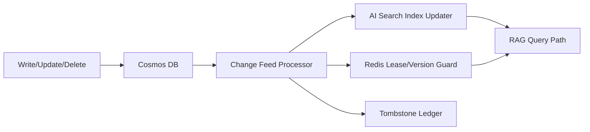
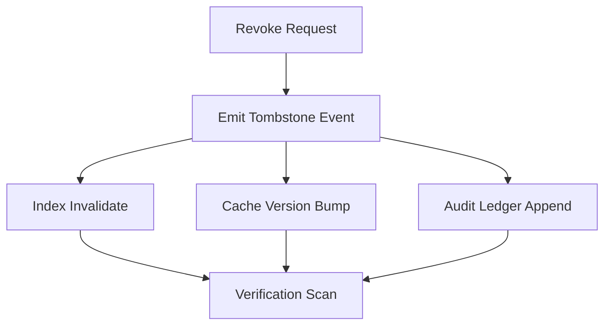

# 企业有状态智能体记忆撤销与时间语义 RAG 选型 FAQ（Cosmos Change Feed vs Redis Lease vs AI Search Tombstone）

> 适用角色：Cloud & AI Solution Architect、数据平台负责人、合规与安全团队。
>
> 核心问题：在多租户企业 Agent 平台中，如何实现“可检索、可撤销、可审计”的长期记忆治理，避免被撤销事实在缓存、向量索引和下游副本中复活。

## 1. 一页结论

企业长期记忆治理不能只做“新增索引”，必须从 Day-0 就设计“撤销路径”。推荐采用三段式治理：

- **Route A（主线）**：`Cosmos DB + Change Feed + AI Search Push`，以事件驱动维护向量与文本索引一致性。
- **Route B（加速层）**：`Redis Lease + RYW`（Read-Your-Write）一致性护栏，用于会话级即时撤销生效。
- **Route C（审计层）**：时间语义（`valid_from/valid_until`）+ tombstone 账本，实现审计可回放。
- **Route D（反模式）**：只更新主库，不处理缓存与索引副本失效。

一句话：**RAG 记忆治理的难点从来不是“写进去”，而是“删得掉、删得净、删得可证明”。**

## 2. 问题分解：为什么撤销总是比写入更难

- 检索链路通常包含多层副本：事务库、缓存层、向量索引层、离线湖仓层。
- 撤销事件可能乱序传播，导致短时“幽灵命中”。
- 会话上下文在客户端或中间层缓存，可能绕过最新策略。
- 合规审计要求能解释“某时刻为何命中某内容”。

## 3. 路线定义

### Route A：Cosmos Change Feed 驱动索引一致性

- 记忆实体写入 Cosmos 后通过 Change Feed 推送增删改事件。
- 事件处理器将 tombstone 同步到 AI Search 索引与衍生缓存。
- 适合大规模、跨区域、事件驱动的数据平面。

### Route B：Redis Lease + 会话级一致性护栏

- 对关键主体维护短租约版本号，读取时校验版本。
- 撤销后立即 bump 版本，阻断旧会话继续读取过期记忆。
- 适合对“秒级撤销生效”有硬要求的场景。

### Route C：时间语义与 tombstone 可审计账本

- 记忆实体记录 `valid_from`、`valid_until`、`revoked_at`。
- 通过 append-only tombstone ledger 保存撤销证据。
- 支持监管复核与事件回放。

### Route D：反模式

- 仅更新主数据库，不处理缓存/索引同步。
- 不保留撤销证据链。
- 结果是“删除成功”但查询仍能命中。

## 4. 定量模型

### 4.1 撤销传播窗口

设：

- `T_emit`：撤销事件产生时间
- `T_cache`：缓存层失效完成时间
- `T_index`：检索索引失效完成时间
- `T_client`：会话上下文刷新时间

撤销一致性窗口：

`W_revoke = max(T_cache, T_index, T_client) - T_emit`

### 4.2 幽灵命中概率

`P_ghost = P(cache_stale ∪ index_stale ∪ session_stale)`

目标是通过版本租约与事件推进把 `P_ghost` 降到可接受阈值。

### 4.3 读后写一致性保护成本

`Cost_RYW ≈ N_read * C_version_check + N_invalidate * C_invalidate`

应平衡一致性收益与额外读路径开销。

### 4.4 合规回放完备率

`Replay_coverage = Replayed_calls / Total_sensitive_calls`

对于高合规域，建议 `Replay_coverage` 接近 100%。

## 5. 12 维对比矩阵

| 维度 | Route A 事件主线 | Route B 租约护栏 | Route C 审计账本 | Route D 反模式 |
|---|---|---|---|---|
| 秒级撤销生效 | 中高 | 高 | 中 | 低 |
| 全链路一致性 | 高 | 中高 | 中高 | 低 |
| 审计可回放 | 中 | 中 | 高 | 低 |
| 工程复杂度 | 中 | 中 | 中 | 低 |
| 运行成本 | 中 | 中 | 中高 | 低（表面） |
| 多区域可扩展性 | 高 | 中高 | 高 | 低 |
| 缓存污染防护 | 中高 | 高 | 中 | 低 |
| 索引漂移防护 | 高 | 中 | 中高 | 低 |
| 合规风险控制 | 高 | 中高 | 高 | 低 |
| 业务可解释性 | 高 | 中 | 高 | 低 |
| 演进弹性 | 高 | 中高 | 高 | 低 |
| 结论 | ✅ 主线 | ✅ 加速 | ✅ 审计 | ⛔ |

## 6. 深度问答（Q1-Q8）
### Q1：为什么删除后还会命中旧内容？
因为缓存、索引与会话上下文可能未同步失效，主库删除并不等于全链路删除。

### Q2：Change Feed 能否覆盖所有一致性问题？
不能。它解决事件传播，但会话级旧上下文仍需租约或版本校验。

### Q3：租约机制会不会增加延迟？
会有轻微开销，但对关键租户的风险控制收益通常更高。

### Q4：tombstone 账本为什么必要？
没有账本就很难证明“某条记忆何时、为何被撤销”。

### Q5：如何处理跨区域乱序事件？
使用单调版本号和幂等处理器，保证后写不被旧事件覆盖。

### Q6：GDPR/监管删除如何验证？
通过回放抽样与索引扫描证明被撤销实体不再可检索。

### Q7：只做 TTL 能否替代撤销事件？
不能。TTL 只解决过期，不解决即时撤销与审计证明。

### Q8：何时必须上 Route A+B+C 组合？
当业务同时要求秒级撤销、低幻觉风险和强合规审计时。

## 7. Mermaid 架构图





## 8. 生产片段：Change Feed 处理器（伪代码）

```python
def on_change(event):
    key = event["memory_id"]
    version = event["version"]
    if event["op"] == "revoke":
        search.delete(key)
        redis.set(f"lease:{event['tenant_id']}", version)
        ledger.append({"memory_id": key, "revoked_at": event["ts"], "version": version})
    else:
        search.upsert(event["payload"])
```

## 9. 生产片段：查询路径版本校验（伪代码）

```python
def guarded_query(tenant_id, session_version, query):
    lease = redis.get(f"lease:{tenant_id}")
    if lease and session_version < lease:
        raise RetryWithRefresh("session context stale")
    return rag.search(query)
```

## 10. 企业场景（2+）

### 场景 A：金融客服知识助手

- 监管条款变更后需秒级撤销旧知识。
- Route A 做全链路传播，Route B 保证会话即时生效。
- Route C 保留审计证据用于事后监管问询。

### 场景 B：医疗随访辅助系统

- 患者撤回授权后，相关记忆必须立即不可检索。
- 通过版本租约阻断旧会话复用历史上下文。
- 通过回放抽检证明撤销闭环。

### 场景 C：跨国制造知识中台

- 多区域同步下需避免索引乱序漂移。
- 采用幂等版本处理与 tombstone 账本。
- 把撤销窗口纳入 SLA 和跨区演练。

## 11. 三档三年 TCO（USD）

| 规模档位 | Route A | Route A+B | Route A+C | Route A+B+C |
|---|---:|---:|---:|---:|
| 50 万记忆 | 1,450,000 | 1,620,000 | 1,780,000 | 1,930,000 |
| 5,000 万记忆 | 8,900,000 | 9,800,000 | 10,700,000 | 11,600,000 |
| 5 亿记忆 | 49,500,000 | 53,400,000 | 57,800,000 | 61,900,000 |

解释：

- 组合路线成本更高，但能显著降低合规与品牌损失。
- 高风险行业通常更在意“可证明删除”而非最低存储成本。

## 12. Day-0 / Day-1 / Day-2 清单

### Day-0（模型与契约）
- Day-0 项 1: 明确记忆实体、版本策略、撤销语义与审计保留周期。
- Day-0 项 2: 明确记忆实体、版本策略、撤销语义与审计保留周期。
- Day-0 项 3: 明确记忆实体、版本策略、撤销语义与审计保留周期。
- Day-0 项 4: 明确记忆实体、版本策略、撤销语义与审计保留周期。
- Day-0 项 5: 明确记忆实体、版本策略、撤销语义与审计保留周期。
- Day-0 项 6: 明确记忆实体、版本策略、撤销语义与审计保留周期。
- Day-0 项 7: 明确记忆实体、版本策略、撤销语义与审计保留周期。
- Day-0 项 8: 明确记忆实体、版本策略、撤销语义与审计保留周期。
- Day-0 项 9: 明确记忆实体、版本策略、撤销语义与审计保留周期。
- Day-0 项 10: 明确记忆实体、版本策略、撤销语义与审计保留周期。
- Day-0 项 11: 明确记忆实体、版本策略、撤销语义与审计保留周期。
- Day-0 项 12: 明确记忆实体、版本策略、撤销语义与审计保留周期。
- Day-0 项 13: 明确记忆实体、版本策略、撤销语义与审计保留周期。
- Day-0 项 14: 明确记忆实体、版本策略、撤销语义与审计保留周期。
- Day-0 项 15: 明确记忆实体、版本策略、撤销语义与审计保留周期。
- Day-0 项 16: 明确记忆实体、版本策略、撤销语义与审计保留周期。
- Day-0 项 17: 明确记忆实体、版本策略、撤销语义与审计保留周期。
- Day-0 项 18: 明确记忆实体、版本策略、撤销语义与审计保留周期。
- Day-0 项 19: 明确记忆实体、版本策略、撤销语义与审计保留周期。
- Day-0 项 20: 明确记忆实体、版本策略、撤销语义与审计保留周期。
- Day-0 项 21: 明确记忆实体、版本策略、撤销语义与审计保留周期。
- Day-0 项 22: 明确记忆实体、版本策略、撤销语义与审计保留周期。
- Day-0 项 23: 明确记忆实体、版本策略、撤销语义与审计保留周期。
- Day-0 项 24: 明确记忆实体、版本策略、撤销语义与审计保留周期。
- Day-0 项 25: 明确记忆实体、版本策略、撤销语义与审计保留周期。
- Day-0 项 26: 明确记忆实体、版本策略、撤销语义与审计保留周期。
- Day-0 项 27: 明确记忆实体、版本策略、撤销语义与审计保留周期。
- Day-0 项 28: 明确记忆实体、版本策略、撤销语义与审计保留周期。
- Day-0 项 29: 明确记忆实体、版本策略、撤销语义与审计保留周期。
- Day-0 项 30: 明确记忆实体、版本策略、撤销语义与审计保留周期。
- Day-0 项 31: 明确记忆实体、版本策略、撤销语义与审计保留周期。
- Day-0 项 32: 明确记忆实体、版本策略、撤销语义与审计保留周期。
- Day-0 项 33: 明确记忆实体、版本策略、撤销语义与审计保留周期。
- Day-0 项 34: 明确记忆实体、版本策略、撤销语义与审计保留周期。
- Day-0 项 35: 明确记忆实体、版本策略、撤销语义与审计保留周期。
- Day-0 项 36: 明确记忆实体、版本策略、撤销语义与审计保留周期。
- Day-0 项 37: 明确记忆实体、版本策略、撤销语义与审计保留周期。
- Day-0 项 38: 明确记忆实体、版本策略、撤销语义与审计保留周期。
- Day-0 项 39: 明确记忆实体、版本策略、撤销语义与审计保留周期。
- Day-0 项 40: 明确记忆实体、版本策略、撤销语义与审计保留周期。
- Day-0 项 41: 明确记忆实体、版本策略、撤销语义与审计保留周期。
- Day-0 项 42: 明确记忆实体、版本策略、撤销语义与审计保留周期。
- Day-0 项 43: 明确记忆实体、版本策略、撤销语义与审计保留周期。
- Day-0 项 44: 明确记忆实体、版本策略、撤销语义与审计保留周期。
- Day-0 项 45: 明确记忆实体、版本策略、撤销语义与审计保留周期。
- Day-0 项 46: 明确记忆实体、版本策略、撤销语义与审计保留周期。
- Day-0 项 47: 明确记忆实体、版本策略、撤销语义与审计保留周期。
- Day-0 项 48: 明确记忆实体、版本策略、撤销语义与审计保留周期。
- Day-0 项 49: 明确记忆实体、版本策略、撤销语义与审计保留周期。
- Day-0 项 50: 明确记忆实体、版本策略、撤销语义与审计保留周期。
- Day-0 项 51: 明确记忆实体、版本策略、撤销语义与审计保留周期。
- Day-0 项 52: 明确记忆实体、版本策略、撤销语义与审计保留周期。
- Day-0 项 53: 明确记忆实体、版本策略、撤销语义与审计保留周期。
- Day-0 项 54: 明确记忆实体、版本策略、撤销语义与审计保留周期。
- Day-0 项 55: 明确记忆实体、版本策略、撤销语义与审计保留周期。
- Day-0 项 56: 明确记忆实体、版本策略、撤销语义与审计保留周期。
- Day-0 项 57: 明确记忆实体、版本策略、撤销语义与审计保留周期。
- Day-0 项 58: 明确记忆实体、版本策略、撤销语义与审计保留周期。
- Day-0 项 59: 明确记忆实体、版本策略、撤销语义与审计保留周期。
- Day-0 项 60: 明确记忆实体、版本策略、撤销语义与审计保留周期。
- Day-0 项 61: 明确记忆实体、版本策略、撤销语义与审计保留周期。
- Day-0 项 62: 明确记忆实体、版本策略、撤销语义与审计保留周期。
- Day-0 项 63: 明确记忆实体、版本策略、撤销语义与审计保留周期。
- Day-0 项 64: 明确记忆实体、版本策略、撤销语义与审计保留周期。
- Day-0 项 65: 明确记忆实体、版本策略、撤销语义与审计保留周期。
- Day-0 项 66: 明确记忆实体、版本策略、撤销语义与审计保留周期。
- Day-0 项 67: 明确记忆实体、版本策略、撤销语义与审计保留周期。
- Day-0 项 68: 明确记忆实体、版本策略、撤销语义与审计保留周期。
- Day-0 项 69: 明确记忆实体、版本策略、撤销语义与审计保留周期。
- Day-0 项 70: 明确记忆实体、版本策略、撤销语义与审计保留周期。
- Day-0 项 71: 明确记忆实体、版本策略、撤销语义与审计保留周期。
- Day-0 项 72: 明确记忆实体、版本策略、撤销语义与审计保留周期。
- Day-0 项 73: 明确记忆实体、版本策略、撤销语义与审计保留周期。
- Day-0 项 74: 明确记忆实体、版本策略、撤销语义与审计保留周期。
- Day-0 项 75: 明确记忆实体、版本策略、撤销语义与审计保留周期。
- Day-0 项 76: 明确记忆实体、版本策略、撤销语义与审计保留周期。
- Day-0 项 77: 明确记忆实体、版本策略、撤销语义与审计保留周期。
- Day-0 项 78: 明确记忆实体、版本策略、撤销语义与审计保留周期。
- Day-0 项 79: 明确记忆实体、版本策略、撤销语义与审计保留周期。
- Day-0 项 80: 明确记忆实体、版本策略、撤销语义与审计保留周期。

### Day-1（工程上线）
- Day-1 项 1: 打通 Change Feed、索引更新、缓存租约与告警看板。
- Day-1 项 2: 打通 Change Feed、索引更新、缓存租约与告警看板。
- Day-1 项 3: 打通 Change Feed、索引更新、缓存租约与告警看板。
- Day-1 项 4: 打通 Change Feed、索引更新、缓存租约与告警看板。
- Day-1 项 5: 打通 Change Feed、索引更新、缓存租约与告警看板。
- Day-1 项 6: 打通 Change Feed、索引更新、缓存租约与告警看板。
- Day-1 项 7: 打通 Change Feed、索引更新、缓存租约与告警看板。
- Day-1 项 8: 打通 Change Feed、索引更新、缓存租约与告警看板。
- Day-1 项 9: 打通 Change Feed、索引更新、缓存租约与告警看板。
- Day-1 项 10: 打通 Change Feed、索引更新、缓存租约与告警看板。
- Day-1 项 11: 打通 Change Feed、索引更新、缓存租约与告警看板。
- Day-1 项 12: 打通 Change Feed、索引更新、缓存租约与告警看板。
- Day-1 项 13: 打通 Change Feed、索引更新、缓存租约与告警看板。
- Day-1 项 14: 打通 Change Feed、索引更新、缓存租约与告警看板。
- Day-1 项 15: 打通 Change Feed、索引更新、缓存租约与告警看板。
- Day-1 项 16: 打通 Change Feed、索引更新、缓存租约与告警看板。
- Day-1 项 17: 打通 Change Feed、索引更新、缓存租约与告警看板。
- Day-1 项 18: 打通 Change Feed、索引更新、缓存租约与告警看板。
- Day-1 项 19: 打通 Change Feed、索引更新、缓存租约与告警看板。
- Day-1 项 20: 打通 Change Feed、索引更新、缓存租约与告警看板。
- Day-1 项 21: 打通 Change Feed、索引更新、缓存租约与告警看板。
- Day-1 项 22: 打通 Change Feed、索引更新、缓存租约与告警看板。
- Day-1 项 23: 打通 Change Feed、索引更新、缓存租约与告警看板。
- Day-1 项 24: 打通 Change Feed、索引更新、缓存租约与告警看板。
- Day-1 项 25: 打通 Change Feed、索引更新、缓存租约与告警看板。
- Day-1 项 26: 打通 Change Feed、索引更新、缓存租约与告警看板。
- Day-1 项 27: 打通 Change Feed、索引更新、缓存租约与告警看板。
- Day-1 项 28: 打通 Change Feed、索引更新、缓存租约与告警看板。
- Day-1 项 29: 打通 Change Feed、索引更新、缓存租约与告警看板。
- Day-1 项 30: 打通 Change Feed、索引更新、缓存租约与告警看板。
- Day-1 项 31: 打通 Change Feed、索引更新、缓存租约与告警看板。
- Day-1 项 32: 打通 Change Feed、索引更新、缓存租约与告警看板。
- Day-1 项 33: 打通 Change Feed、索引更新、缓存租约与告警看板。
- Day-1 项 34: 打通 Change Feed、索引更新、缓存租约与告警看板。
- Day-1 项 35: 打通 Change Feed、索引更新、缓存租约与告警看板。
- Day-1 项 36: 打通 Change Feed、索引更新、缓存租约与告警看板。
- Day-1 项 37: 打通 Change Feed、索引更新、缓存租约与告警看板。
- Day-1 项 38: 打通 Change Feed、索引更新、缓存租约与告警看板。
- Day-1 项 39: 打通 Change Feed、索引更新、缓存租约与告警看板。
- Day-1 项 40: 打通 Change Feed、索引更新、缓存租约与告警看板。
- Day-1 项 41: 打通 Change Feed、索引更新、缓存租约与告警看板。
- Day-1 项 42: 打通 Change Feed、索引更新、缓存租约与告警看板。
- Day-1 项 43: 打通 Change Feed、索引更新、缓存租约与告警看板。
- Day-1 项 44: 打通 Change Feed、索引更新、缓存租约与告警看板。
- Day-1 项 45: 打通 Change Feed、索引更新、缓存租约与告警看板。
- Day-1 项 46: 打通 Change Feed、索引更新、缓存租约与告警看板。
- Day-1 项 47: 打通 Change Feed、索引更新、缓存租约与告警看板。
- Day-1 项 48: 打通 Change Feed、索引更新、缓存租约与告警看板。
- Day-1 项 49: 打通 Change Feed、索引更新、缓存租约与告警看板。
- Day-1 项 50: 打通 Change Feed、索引更新、缓存租约与告警看板。
- Day-1 项 51: 打通 Change Feed、索引更新、缓存租约与告警看板。
- Day-1 项 52: 打通 Change Feed、索引更新、缓存租约与告警看板。
- Day-1 项 53: 打通 Change Feed、索引更新、缓存租约与告警看板。
- Day-1 项 54: 打通 Change Feed、索引更新、缓存租约与告警看板。
- Day-1 项 55: 打通 Change Feed、索引更新、缓存租约与告警看板。
- Day-1 项 56: 打通 Change Feed、索引更新、缓存租约与告警看板。
- Day-1 项 57: 打通 Change Feed、索引更新、缓存租约与告警看板。
- Day-1 项 58: 打通 Change Feed、索引更新、缓存租约与告警看板。
- Day-1 项 59: 打通 Change Feed、索引更新、缓存租约与告警看板。
- Day-1 项 60: 打通 Change Feed、索引更新、缓存租约与告警看板。
- Day-1 项 61: 打通 Change Feed、索引更新、缓存租约与告警看板。
- Day-1 项 62: 打通 Change Feed、索引更新、缓存租约与告警看板。
- Day-1 项 63: 打通 Change Feed、索引更新、缓存租约与告警看板。
- Day-1 项 64: 打通 Change Feed、索引更新、缓存租约与告警看板。
- Day-1 项 65: 打通 Change Feed、索引更新、缓存租约与告警看板。
- Day-1 项 66: 打通 Change Feed、索引更新、缓存租约与告警看板。
- Day-1 项 67: 打通 Change Feed、索引更新、缓存租约与告警看板。
- Day-1 项 68: 打通 Change Feed、索引更新、缓存租约与告警看板。
- Day-1 项 69: 打通 Change Feed、索引更新、缓存租约与告警看板。
- Day-1 项 70: 打通 Change Feed、索引更新、缓存租约与告警看板。
- Day-1 项 71: 打通 Change Feed、索引更新、缓存租约与告警看板。
- Day-1 项 72: 打通 Change Feed、索引更新、缓存租约与告警看板。
- Day-1 项 73: 打通 Change Feed、索引更新、缓存租约与告警看板。
- Day-1 项 74: 打通 Change Feed、索引更新、缓存租约与告警看板。
- Day-1 项 75: 打通 Change Feed、索引更新、缓存租约与告警看板。
- Day-1 项 76: 打通 Change Feed、索引更新、缓存租约与告警看板。
- Day-1 项 77: 打通 Change Feed、索引更新、缓存租约与告警看板。
- Day-1 项 78: 打通 Change Feed、索引更新、缓存租约与告警看板。
- Day-1 项 79: 打通 Change Feed、索引更新、缓存租约与告警看板。
- Day-1 项 80: 打通 Change Feed、索引更新、缓存租约与告警看板。

### Day-2（运营治理）
- Day-2 项 1: 例行抽检撤销窗口、幽灵命中率与回放完备率。
- Day-2 项 2: 例行抽检撤销窗口、幽灵命中率与回放完备率。
- Day-2 项 3: 例行抽检撤销窗口、幽灵命中率与回放完备率。
- Day-2 项 4: 例行抽检撤销窗口、幽灵命中率与回放完备率。
- Day-2 项 5: 例行抽检撤销窗口、幽灵命中率与回放完备率。
- Day-2 项 6: 例行抽检撤销窗口、幽灵命中率与回放完备率。
- Day-2 项 7: 例行抽检撤销窗口、幽灵命中率与回放完备率。
- Day-2 项 8: 例行抽检撤销窗口、幽灵命中率与回放完备率。
- Day-2 项 9: 例行抽检撤销窗口、幽灵命中率与回放完备率。
- Day-2 项 10: 例行抽检撤销窗口、幽灵命中率与回放完备率。
- Day-2 项 11: 例行抽检撤销窗口、幽灵命中率与回放完备率。
- Day-2 项 12: 例行抽检撤销窗口、幽灵命中率与回放完备率。
- Day-2 项 13: 例行抽检撤销窗口、幽灵命中率与回放完备率。
- Day-2 项 14: 例行抽检撤销窗口、幽灵命中率与回放完备率。
- Day-2 项 15: 例行抽检撤销窗口、幽灵命中率与回放完备率。
- Day-2 项 16: 例行抽检撤销窗口、幽灵命中率与回放完备率。
- Day-2 项 17: 例行抽检撤销窗口、幽灵命中率与回放完备率。
- Day-2 项 18: 例行抽检撤销窗口、幽灵命中率与回放完备率。
- Day-2 项 19: 例行抽检撤销窗口、幽灵命中率与回放完备率。
- Day-2 项 20: 例行抽检撤销窗口、幽灵命中率与回放完备率。
- Day-2 项 21: 例行抽检撤销窗口、幽灵命中率与回放完备率。
- Day-2 项 22: 例行抽检撤销窗口、幽灵命中率与回放完备率。
- Day-2 项 23: 例行抽检撤销窗口、幽灵命中率与回放完备率。
- Day-2 项 24: 例行抽检撤销窗口、幽灵命中率与回放完备率。
- Day-2 项 25: 例行抽检撤销窗口、幽灵命中率与回放完备率。
- Day-2 项 26: 例行抽检撤销窗口、幽灵命中率与回放完备率。
- Day-2 项 27: 例行抽检撤销窗口、幽灵命中率与回放完备率。
- Day-2 项 28: 例行抽检撤销窗口、幽灵命中率与回放完备率。
- Day-2 项 29: 例行抽检撤销窗口、幽灵命中率与回放完备率。
- Day-2 项 30: 例行抽检撤销窗口、幽灵命中率与回放完备率。
- Day-2 项 31: 例行抽检撤销窗口、幽灵命中率与回放完备率。
- Day-2 项 32: 例行抽检撤销窗口、幽灵命中率与回放完备率。
- Day-2 项 33: 例行抽检撤销窗口、幽灵命中率与回放完备率。
- Day-2 项 34: 例行抽检撤销窗口、幽灵命中率与回放完备率。
- Day-2 项 35: 例行抽检撤销窗口、幽灵命中率与回放完备率。
- Day-2 项 36: 例行抽检撤销窗口、幽灵命中率与回放完备率。
- Day-2 项 37: 例行抽检撤销窗口、幽灵命中率与回放完备率。
- Day-2 项 38: 例行抽检撤销窗口、幽灵命中率与回放完备率。
- Day-2 项 39: 例行抽检撤销窗口、幽灵命中率与回放完备率。
- Day-2 项 40: 例行抽检撤销窗口、幽灵命中率与回放完备率。
- Day-2 项 41: 例行抽检撤销窗口、幽灵命中率与回放完备率。
- Day-2 项 42: 例行抽检撤销窗口、幽灵命中率与回放完备率。
- Day-2 项 43: 例行抽检撤销窗口、幽灵命中率与回放完备率。
- Day-2 项 44: 例行抽检撤销窗口、幽灵命中率与回放完备率。
- Day-2 项 45: 例行抽检撤销窗口、幽灵命中率与回放完备率。
- Day-2 项 46: 例行抽检撤销窗口、幽灵命中率与回放完备率。
- Day-2 项 47: 例行抽检撤销窗口、幽灵命中率与回放完备率。
- Day-2 项 48: 例行抽检撤销窗口、幽灵命中率与回放完备率。
- Day-2 项 49: 例行抽检撤销窗口、幽灵命中率与回放完备率。
- Day-2 项 50: 例行抽检撤销窗口、幽灵命中率与回放完备率。
- Day-2 项 51: 例行抽检撤销窗口、幽灵命中率与回放完备率。
- Day-2 项 52: 例行抽检撤销窗口、幽灵命中率与回放完备率。
- Day-2 项 53: 例行抽检撤销窗口、幽灵命中率与回放完备率。
- Day-2 项 54: 例行抽检撤销窗口、幽灵命中率与回放完备率。
- Day-2 项 55: 例行抽检撤销窗口、幽灵命中率与回放完备率。
- Day-2 项 56: 例行抽检撤销窗口、幽灵命中率与回放完备率。
- Day-2 项 57: 例行抽检撤销窗口、幽灵命中率与回放完备率。
- Day-2 项 58: 例行抽检撤销窗口、幽灵命中率与回放完备率。
- Day-2 项 59: 例行抽检撤销窗口、幽灵命中率与回放完备率。
- Day-2 项 60: 例行抽检撤销窗口、幽灵命中率与回放完备率。
- Day-2 项 61: 例行抽检撤销窗口、幽灵命中率与回放完备率。
- Day-2 项 62: 例行抽检撤销窗口、幽灵命中率与回放完备率。
- Day-2 项 63: 例行抽检撤销窗口、幽灵命中率与回放完备率。
- Day-2 项 64: 例行抽检撤销窗口、幽灵命中率与回放完备率。
- Day-2 项 65: 例行抽检撤销窗口、幽灵命中率与回放完备率。
- Day-2 项 66: 例行抽检撤销窗口、幽灵命中率与回放完备率。
- Day-2 项 67: 例行抽检撤销窗口、幽灵命中率与回放完备率。
- Day-2 项 68: 例行抽检撤销窗口、幽灵命中率与回放完备率。
- Day-2 项 69: 例行抽检撤销窗口、幽灵命中率与回放完备率。
- Day-2 项 70: 例行抽检撤销窗口、幽灵命中率与回放完备率。
- Day-2 项 71: 例行抽检撤销窗口、幽灵命中率与回放完备率。
- Day-2 项 72: 例行抽检撤销窗口、幽灵命中率与回放完备率。
- Day-2 项 73: 例行抽检撤销窗口、幽灵命中率与回放完备率。
- Day-2 项 74: 例行抽检撤销窗口、幽灵命中率与回放完备率。
- Day-2 项 75: 例行抽检撤销窗口、幽灵命中率与回放完备率。
- Day-2 项 76: 例行抽检撤销窗口、幽灵命中率与回放完备率。
- Day-2 项 77: 例行抽检撤销窗口、幽灵命中率与回放完备率。
- Day-2 项 78: 例行抽检撤销窗口、幽灵命中率与回放完备率。
- Day-2 项 79: 例行抽检撤销窗口、幽灵命中率与回放完备率。
- Day-2 项 80: 例行抽检撤销窗口、幽灵命中率与回放完备率。
- Day-2 项 81: 例行抽检撤销窗口、幽灵命中率与回放完备率。
- Day-2 项 82: 例行抽检撤销窗口、幽灵命中率与回放完备率。
- Day-2 项 83: 例行抽检撤销窗口、幽灵命中率与回放完备率。
- Day-2 项 84: 例行抽检撤销窗口、幽灵命中率与回放完备率。
- Day-2 项 85: 例行抽检撤销窗口、幽灵命中率与回放完备率。
- Day-2 项 86: 例行抽检撤销窗口、幽灵命中率与回放完备率。
- Day-2 项 87: 例行抽检撤销窗口、幽灵命中率与回放完备率。
- Day-2 项 88: 例行抽检撤销窗口、幽灵命中率与回放完备率。
- Day-2 项 89: 例行抽检撤销窗口、幽灵命中率与回放完备率。
- Day-2 项 90: 例行抽检撤销窗口、幽灵命中率与回放完备率。
- Day-2 项 91: 例行抽检撤销窗口、幽灵命中率与回放完备率。
- Day-2 项 92: 例行抽检撤销窗口、幽灵命中率与回放完备率。
- Day-2 项 93: 例行抽检撤销窗口、幽灵命中率与回放完备率。
- Day-2 项 94: 例行抽检撤销窗口、幽灵命中率与回放完备率。
- Day-2 项 95: 例行抽检撤销窗口、幽灵命中率与回放完备率。
- Day-2 项 96: 例行抽检撤销窗口、幽灵命中率与回放完备率。
- Day-2 项 97: 例行抽检撤销窗口、幽灵命中率与回放完备率。
- Day-2 项 98: 例行抽检撤销窗口、幽灵命中率与回放完备率。
- Day-2 项 99: 例行抽检撤销窗口、幽灵命中率与回放完备率。
- Day-2 项 100: 例行抽检撤销窗口、幽灵命中率与回放完备率。

## 13. Good fit vs Not for

### ✅ Good fit

- 强监管、强审计、强撤销要求的 RAG 业务。
- 多层缓存与索引并存的大规模平台。
- 需要跨区域一致性演练的企业。

### ⛔ Not for

- 单机 PoC 或无长期记忆需求场景。
- 不要求撤销可证明的临时实验。
- 缺乏基础数据工程能力的极小团队。

## 14. 五步落地指南

1. 统一记忆对象模型与版本号规范。
2. 接入 Change Feed 增删改事件流。
3. 实施缓存租约与会话版本校验。
4. 建立 tombstone 账本与回放工具。
5. 用演练与指标持续收敛撤销窗口。

## 15. 核心 KPI

- `revoke_window_p95_seconds`
- `ghost_hit_rate`
- `session_stale_block_rate`
- `replay_coverage`
- `index_drift_incidents`
- `revocation_audit_pass_rate`

## 16. 最终建议

建议默认采用 Route A，关键租户叠加 Route B，受监管域叠加 Route C，明确禁止 Route D。

一句话：

**企业记忆治理真正的护城河，是“撤销正确性可证明”，而不是“写入吞吐够高”。**
