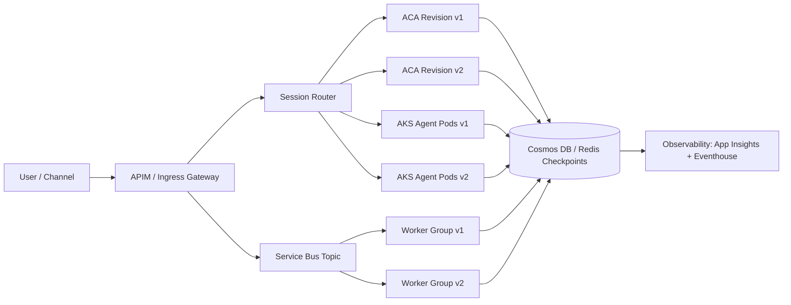
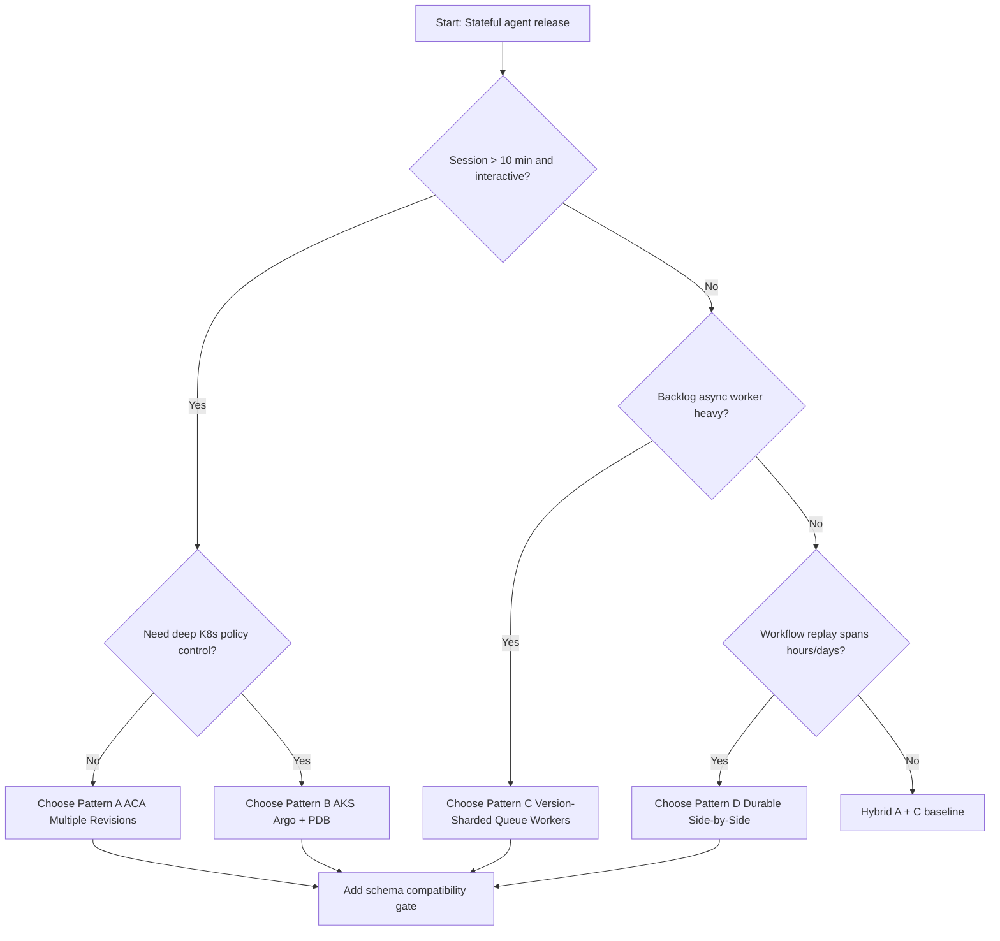

# Enterprise Stateful Agent Zero-Downtime Rollout and Graceful Drain Selection FAQ: ACA Multiple Revisions vs AKS Argo Rollouts + PDB vs Version-Sharded Queue Workers vs Durable Functions Side-by-Side

## 1. Problem statement and headline recommendations
This guide is written for enterprise Cloud & AI Solution Architects.  
The focus is release safety for stateful agents.  
Typical session duration is `10–45` minutes.  
The path usually includes SSE, WebSocket, tool loops, and HITL pauses.  
Naive rolling updates often interrupt active runs.  
They also trigger state deserialization failures.  
Users observe random failures.  
Platform teams observe unstable rollback loops.  

The objective is not only faster deployment.  
The real objective is zero interruption, replay safety, auditability, and predictable cost.  
We compare four Azure production patterns.  
Then we map them to operating boundaries.  

Executive summary.  
Use Pattern A first for interactive session routing.  
Use Pattern B when deep Kubernetes policy control is required.  
Use Pattern C for heavy asynchronous execution lanes.  
Use Pattern D for multi-hour or multi-day human workflows.  
Most enterprises converge on A+B+C.  
Highly regulated approval chains usually add D on top.  

## 2. Four patterns and where each fits
Pattern A: ACA Multiple Revisions.  
New sessions are split `90/10` to `v2`.  
Active `session_id` remains pinned to `v1`.  
`v1` scales to zero only after natural completion.  
This fits teams with clear session boundaries and unified edge routing.  

Pattern B: AKS + Argo Rollouts + Header Pinning + PDB.  
Use `X-Agent-Schema-Version` or route cookie for version stickiness.  
`preStop` flushes checkpoints before termination.  
`terminationGracePeriodSeconds` matches longest tool loop duration.  
This fits mature AKS platform teams.  

Pattern C: version-sharded async workers.  
Decouple HTTP/SSE edge from execution workers.  
Messages with `agent_version='v1'` go only to `v1` workers.  
`v2` workers consume only new graph states.  
This fits high-throughput stateful background processing.  

Pattern D: Durable Functions side-by-side versioned orchestrations.  
Legacy instances keep replaying on legacy orchestrators.  
New instances start on new orchestrators.  
This fits long-running regulated workflows with strict replay guarantees.  

## 3. End-to-end reference architecture


Recommended control-plane layering.  
Layer 1: ingress routing and session pinning semantics.  
Layer 2: rollout orchestration and in-flight drain policy.  
Layer 3: state-schema compatibility gates.  
Layer 4: observability and automated rollback workflow.  

Required SLO signals.  
`interrupted_run_rate`.  
`drain_tail_latency_p95`.  
`double_billing_overhead_pct`.  
`schema_mismatch_block_count`.  
`rollback_time_to_stable`.  

## 4. Pattern A: ACA Multiple Revisions with sticky session routing
Release flow.  
Deploy `v2` revision without cutting off `v1`.  
Set traffic to `v1=90` and `v2=10`.  
Observe error budget and completion rate.  
Progressively increase `v2` only after gates pass.  

Session pinning model.  
First request gets a revision assignment.  
Follow-up SSE/WebSocket turns remain on that revision.  
Use sticky cookie or explicit session header mapping.  
Never allow mid-session cross-revision hops.  

Drain model.  
Move `v1` ingress weight to `0`.  
Keep minimum `v1` replicas until active sessions finish.  
Apply max session lifetime to avoid immortal drains.  
Scale `v1` to zero only after active-session floor is zero.  

Advantages.  
Low application intrusion.  
Fast rollout of production-safe behavior.  
Strong zero-interruption outcomes for short and medium sessions.  

Trade-offs.  
Temporary double-billing is expected during drain windows.  
If sessions are unbounded, tail drain can become expensive.  
Session TTL policy must be part of release governance.  

## 5. Pattern B: AKS + Argo Rollouts + header-pinned canary + PDB
Routing strategy.  
Ingress or service mesh reads `X-Agent-Schema-Version`.  
Route cookie is an optional fallback.  
One session stays on one version for its full lifespan.  
This avoids schema hop failures in the middle of turns.  

Rollout mechanics.  
Argo Rollouts uses staged weight shifts.  
Each stage has analysis gates.  
Failed analysis triggers automated rollback.  
Promotion happens only if SLO guardrails stay healthy.  

Graceful termination.  
Pod receives `SIGTERM` and enters `preStop`.  
In-memory graph state is flushed to Cosmos or Redis.  
Only then does the process terminate.  
`terminationGracePeriodSeconds` must match long-loop reality.  

Node upgrade safety.  
AKS Node Image Upgrade can evict pods.  
PDB preserves minimum availability.  
Coordinate node maintenance windows with rollout windows.  
Avoid overlapping high-risk operations.  

Advantages.  
Highest control granularity.  
Best fit for strict platform policy and multi-tenant governance.  
Deep integration with GitOps and policy-as-code.  

Costs.  
Higher platform engineering complexity.  
Requires strong runbook and ownership discipline.  
Not ideal for low-ops teams without AKS maturity.  

## 6. Pattern C: version-sharded queue workers
Core design principle.  
Separate ingress session handling from stateful execution handling.  
Edge tier handles conversational continuity.  
Worker tier handles graph progression and tool execution.  
Version isolation happens at the queue subscription boundary.  

Reference implementation.  
Publish all tasks to one Service Bus Topic.  
`v1` subscription SQL filter matches `agent_version='v1'`.  
`v2` subscription SQL filter matches `agent_version='v2'`.  
Legacy checkpoints remain executable by `v1` workers only.  
New checkpoints are emitted directly for `v2`.  

Why this works.  
Old states are not force-read by new deserializers.  
Version boundaries are explicit and auditable.  
Rollout cadence for workers is independent of ingress cadence.  

Operational add-ons.  
Set max retention and deprecation windows per version.  
Enforce DLQ per version for clearer fault ownership.  
Use consumer lag and replay latency as promotion gates.  
Define explicit retirement criteria for `v1` worker groups.  

Best fit.  
Asynchronous stateful workloads.  
High-volume tool orchestration pipelines.  
Long-tail tasks crossing deployment windows.  

## 7. Pattern D: Durable Functions side-by-side orchestrations
Durable value proposition is deterministic replay.  
Existing instances keep replaying old logic.  
New instances can start on new logic.  
No forced in-place semantic mutation.  

Recommended rollout model.  
Maintain explicit orchestration names by version.  
Example: `underwriting_orch_v1` and `underwriting_orch_v2`.  
Route start requests by policy to one version.  
Never silently redefine existing orchestration semantics.  

Benefits for HITL workflows.  
Approval waits can span many hours or days.  
Version changes do not invalidate history replay.  
Audit evidence remains coherent per case lifecycle.  

Limitations.  
Parallel version estate increases operational surface.  
State retention costs can rise if cleanup is weak.  
Archive and compaction policies are mandatory.  

## 8. State schema safety and compatibility gates
Many rollout failures are schema failures, not code defects.  
Compatibility must be a hard gate, not advisory lint.  

Recommended gate stack.  
Gate A: backward read compatibility.  
Gate B: forward tolerance for additive fields.  
Gate C: checkpoint replay consistency across versions.  
Gate D: tool contract compatibility for request/response.  

Migration strategy.  
Prefer lazy migration on read.  
Rewrite upgraded state on checkpoint save.  
Avoid big-bang offline migration for massive historical state.  
Use dual-write windows for high-risk structural changes.  

Rollback strategy.  
Rollback is not image-only.  
Validate old version can still consume current persisted state.  
If irreversible changes already landed.  
Use transformer fallback before rollback cutover.  

## 9. Config block #1: ACA revision traffic and drain
```yaml
type: Microsoft.App/containerApps
apiVersion: 2024-03-01
name: stateful-agent-api
location: eastasia
properties:
  configuration:
    activeRevisionsMode: Multiple
    ingress:
      external: true
      targetPort: 8080
      traffic:
        - revisionName: stateful-agent-api--v1
          weight: 90
          label: stable
        - revisionName: stateful-agent-api--v2
          weight: 10
          label: canary
      stickySessions:
        affinity: sticky
  template:
    containers:
      - name: api
        image: contoso.azurecr.io/stateful-agent:v2.0.0
        env:
          - name: SESSION_SCHEMA_VERSION
            value: "2"
          - name: MAX_SESSION_MINUTES
            value: "45"
    scale:
      minReplicas: 0
      maxReplicas: 40
      rules:
        - name: http-concurrency
          http:
            metadata:
              concurrentRequests: "20"
```

Operational details.  
Always log assigned revision label per session.  
This is critical for incident forensics.  
During drain, set `stable` traffic to zero first.  
Terminate old revision only after in-flight sessions clear.  

## 10. Config block #2: AKS rollout with checkpoint flush and PDB
```yaml
apiVersion: argoproj.io/v1alpha1
kind: Rollout
metadata:
  name: stateful-agent
spec:
  replicas: 24
  strategy:
    canary:
      canaryService: stateful-agent-canary
      stableService: stateful-agent-stable
      steps:
        - setWeight: 10
        - pause: { duration: 600 }
        - analysis:
            templates:
              - templateName: interrupted-run-rate-check
        - setWeight: 50
        - pause: { duration: 900 }
        - setWeight: 100
  selector:
    matchLabels:
      app: stateful-agent
  template:
    metadata:
      labels:
        app: stateful-agent
    spec:
      terminationGracePeriodSeconds: 1800
      containers:
        - name: agent
          image: contoso.azurecr.io/stateful-agent:v2.0.0
          lifecycle:
            preStop:
              exec:
                command: ["/bin/sh","-c","python checkpoint_flush.py --deadline 1500"]
---
apiVersion: policy/v1
kind: PodDisruptionBudget
metadata:
  name: stateful-agent-pdb
spec:
  minAvailable: 18
  selector:
    matchLabels:
      app: stateful-agent
```

Implementation notes.  
Grace period must cover worst legitimate loop duration.  
`preStop` flush must be idempotent.  
Flush failure should emit explicit error telemetry and block termination.  

## 11. 12-dimension comparison matrix and decision flow
| Dimension | ACA Multiple Revisions | AKS + Argo + PDB | Version-Sharded Queue Workers | Durable Side-by-Side |
|---|---|---|---|---|
| 1. Zero-downtime reachability | High | Very high | Very high | Very high |
| 2. Long-session drain control | High | Very high | Very high | High |
| 3. Schema compatibility governance | Medium-high | Very high | Very high | Very high |
| 4. Release complexity | Low-medium | High | Medium-high | Medium |
| 5. Platform engineering bar | Low-medium | High | Medium | Medium |
| 6. Cost predictability | High | Medium-high | High | Medium-high |
| 7. Rollback determinism | High | Very high | Very high | Very high |
| 8. HITL long workflow support | Medium | Medium-high | Medium | Very high |
| 9. Multi-tenant isolation | Medium-high | Very high | High | Medium-high |
| 10. Observability clarity | High | Very high | High | High |
| 11. Node maintenance resilience | Medium | Very high | High | High |
| 12. Cross-team reuse | High | Medium-high | Very high | Medium-high |



## 12. Quantitative results: interruption, drain latency, overhead, and TCO
> Unified workload: 1,200 concurrent sessions, average 24 minutes, P95 41 minutes  
> Baseline: naive rolling update without pinning and without preStop checkpoint flush

| Option | Interrupted-run drop rate | Drain-tail latency P95 | Idle double-billing overhead | Monthly TCO (50-agent portfolio) |
|---|---:|---:|---:|---:|
| Baseline Rolling Update | 8.6% | 0 min | 0% | \$28,400 |
| ACA Multiple Revisions | 0.3% | 22 min | 7.8% | \$25,900 |
| AKS + Argo + PDB | 0.0% | 17 min | 6.1% | \$24,800 |
| Version-Sharded Queue Workers | 0.0% | 29 min | 4.7% | \$24,300 |
| Durable Side-by-Side | 0.1% | 35 min | 8.9% | \$26,100 |

Interpretation.  
“0% interruption” requires pinning plus graceful drain plus compatibility gates.  
Traffic canary alone is insufficient.  
Drain-tail latency correlates with upper session lifetime bounds.  
Double-billing overhead can be controlled by strict drain orchestration.  

## 13. Scenario A: 25-minute enterprise coding-agent release in business hours
Scenario constraints.  
Daytime development sessions are continuous.  
Average coding task session is about `25` minutes.  
Workflow includes repo search, test execution, and PR updates.  

Failure risks.  
Mid-session version switches can lose ephemeral context.  
Interrupted long test runs are expensive.  
Developers repeatedly retry and erode trust.  

Recommended stack.  
Use ACA Multiple Revisions at ingress.  
Use version-sharded queue workers for execution graph continuity.  
Enforce revision pinning at session layer.  
Enforce `agent_version` queue filtering at worker layer.  

Target outcomes.  
Interruption rate `<=0.2%`.  
No reduction in completion rate during release windows.  
Double-billing overhead capped at `<=8%`.  

## 14. Scenario B: regulated financial underwriting copilot with AKS weekly patching
Scenario constraints.  
Underwriting sessions involve human approvals.  
Session duration can span `30–90` minutes.  
Platform requires weekly AKS node OS patching.  

Failure risks.  
Node eviction and version rollout can overlap.  
In-flight approval context cannot be lost.  
Schema evolution must remain auditable.  

Recommended stack.  
Primary path on AKS + Argo + PDB.  
Critical approval workflow on Durable side-by-side orchestrations.  
Freeze major rollout during patch windows.  
Resume normal canary progression after patch health validation.  

Target outcomes.  
`0%` interruption during node maintenance windows.  
`100%` replay consistency on approval history.  
Complete audit trail export for regulators.  

## 15. Day-0 / Day-2 checklist and quantitative FAQs
### Day-0 checklist
- Define session pinning keys: `session_id`, `schema_version`, `revision_label`.  
- Define max session lifetime and drain upper bounds.  
- Implement four-level schema compatibility gates in CI.  
- Make `preStop` checkpoint flush a hard deployment blocker.  
- Create per-version observability dashboards.  
- Set explicit budget threshold for double-billing overhead.  
- Rehearse one failed rollout and rollback replay path.  
- Enforce patch-window and release-window mutual exclusion policy.  

### Day-2 checklist
- Review interruption rate and timeout-termination rate weekly.  
- Review drain-tail latency drift weekly.  
- Sample checkpoint replay integrity weekly.  
- Reconcile double-billing overhead and cost drift monthly.  
- Audit schema changes and authorization scope monthly.  
- Verify version-skew and DLQ growth monthly.  
- Reassess A/B/C/D blend by workload quarterly.  
- Run one node-maintenance linked chaos rehearsal quarterly.  

**Q1: Why do teams still see interruption after adding canary traffic split?**  
A1: Canary split alone does not pin sessions or drain in-flight turns, so active connections still get displaced.  

**Q2: How should we set `terminationGracePeriodSeconds`?**  
A2: Start from P99 loop duration plus `20%` buffer, and validate with real checkpoint flush times (`900–1800s` is common).  

**Q3: What overhead threshold is acceptable for drain double-billing?**  
A3: Many enterprises keep it under `10%` of monthly compute for rollout windows, then optimize session TTL if exceeded.  

**Q4: Why does version-sharded queue routing reduce deserialization failures?**  
A4: Because legacy states are consumed only by legacy workers, enforcing explicit schema read boundaries.  

**Q5: Does Durable side-by-side always increase cost?**  
A5: Usually by `5%–12%`, but it buys deterministic replay safety for long regulated workflows.  

**Q6: Can we patch AKS nodes and run major rollouts at the same time?**  
A6: It is high risk; use separate windows to avoid compounding eviction and schema transition hazards.  

**Q7: How do we prove “0% interruption” is real, not metric bias?**  
A7: Correlate business completion rate, session continuity metrics, and checkpoint recovery success, not HTTP status alone.  
