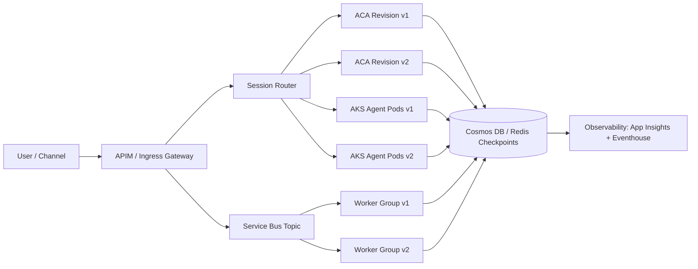
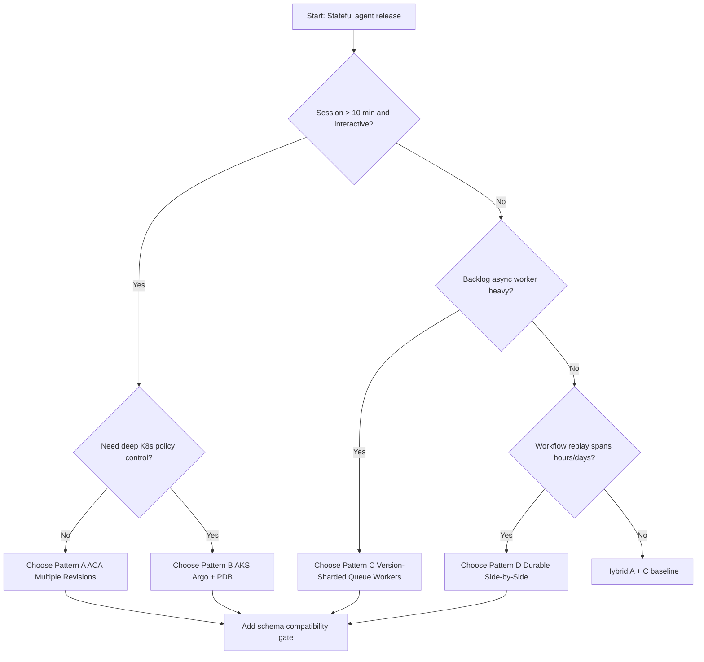

# 企业状态化 Agent 零停机发布与平滑排空选型 FAQ：ACA 多 Revision 粘滞路由 vs AKS Argo Rollouts + PDB vs 版本分片队列 Worker vs Durable Functions 并行编排

## 1. 问题定义与结论先看
本文面向企业 Cloud & AI Solution Architect。  
关注状态化 Agent 的发布与升级。  
典型会话时长 `10–45` 分钟。  
链路包含 SSE、WebSocket、工具循环与人工审批。  
单纯 Rolling Update 常导致在途会话中断。  
也会触发状态反序列化失败。  
结果是用户看到“偶发失败”，平台看到“随机回滚”。  

核心目标不是“更快发布”。  
而是“零中断 + 可回放 + 可审计 + 可控成本”。  
本文比较四种 Azure 生产路径。  
并给出分层组合策略。  

结论摘要。  
交互会话型入口优先模式 A。  
Kubernetes 深度平台优先模式 B。  
异步长尾任务优先模式 C。  
多小时人审流程优先模式 D。  
多数企业最终采用 A+B+C 组合。  
高监管流程在关键链路叠加 D。  

## 2. 四种架构模式与适用边界
模式 A：ACA Multiple Revisions。  
新会话按 `90/10` 导向 `v2`。  
在途 `session_id` 继续钉住 `v1`。  
`v1` 仅在自然完成后缩容到 `0`。  
适合会话边界明确、入口统一的团队。  

模式 B：AKS + Argo Rollouts + Header Pinning + PDB。  
通过 `X-Agent-Schema-Version` 或会话 Cookie 做路由固定。  
`preStop` 负责检查点 flush。  
`terminationGracePeriodSeconds` 与最长工具回合对齐。  
适合已有 AKS 平台工程体系。  

模式 C：版本分片异步 Worker。  
HTTP/SSE 边缘与执行 Worker 解耦。  
`agent_version='v1'` 的消息只给 `v1` Worker。  
`v2` 消费新图谱。  
适合高吞吐、强兼容治理的后台任务。  

模式 D：Durable Functions 并行编排版本。  
通过版本化 orchestrator 并行运行。  
历史实例保持原版本 deterministic replay。  
新实例进入新版本。  
适合跨小时跨天的人审流程。  

## 3. 端到端参考架构（会话入口 + 执行平面 + 状态平面）


控制平面建议分四层。  
L1：入口路由与会话钉住策略。  
L2：发布编排与在途排空策略。  
L3：状态 schema 兼容门禁。  
L4：可观测与回滚自动化。  

关键可观测指标。  
`interrupted_run_rate`。  
`drain_tail_latency_p95`。  
`double_billing_overhead_pct`。  
`schema_mismatch_block_count`。  
`rollback_time_to_stable`。  

## 4. 模式 A：ACA Multiple Revisions + Revision 粘滞会话
发布流程。  
先部署 `v2` revision。  
但不立即切断 `v1`。  
流量权重设置 `v1=90`、`v2=10`。  
观察错误预算与会话完成率。  
通过门禁后再逐级提高 `v2`。  

粘滞策略。  
首请求分配 revision。  
后续 SSE/WebSocket 都回到同 revision。  
可用 cookie 或 session header 绑定。  
不允许跨 revision 续流。  

排空策略。  
将 `v1` 入口权重降到 `0`。  
保留最小副本直到在途会话完成。  
设置会话最大存活上限防僵尸。  
达到空闲阈值后自动缩到 `0`。  

优点。  
对应用代码侵入较低。  
配置即可落地大部分能力。  
对中短会话零停机效果稳定。  

限制。  
跨 revision 双计费在排空窗口不可避免。  
若会话可无限续活，排空尾部会拉长。  
需要会话 TTL 与续约策略联动治理。  

## 5. 模式 B：AKS + Argo Rollouts + Header Pinning + PDB
路由策略。  
在 Gateway API 或 Envoy 中读取 `X-Agent-Schema-Version`。  
或读取 `session-route` Cookie。  
同一会话始终命中同版本后端。  
避免中途切到新 schema。  

Rollout 策略。  
Argo Rollouts 分阶段放量。  
`setWeight` 递进。  
每一步运行分析模板。  
失败自动回滚到前一步。  

优雅终止。  
Pod 收到 `SIGTERM` 后进入 `preStop`。  
先把内存态图谱 flush 到 Cosmos/Redis。  
再释放连接。  
`terminationGracePeriodSeconds` 对齐最慢工具环。  

节点升级安全。  
AKS Node Image Upgrade 会触发驱逐。  
PDB 保证最小可用实例。  
配合 rollout pause 避免叠加风险。  

优点。  
细粒度控制最强。  
适合高复杂多租户集群。  
可与平台 SLO 深度联动。  

代价。  
平台工程复杂度更高。  
需要规范化 GitOps 与策略审计。  
对团队成熟度有门槛。  

## 6. 模式 C：版本分片队列 Worker（Topic SQL Filter）
核心思想。  
把会话入口与执行 Worker 解耦。  
边缘层负责接入与会话语义。  
Worker 层负责状态图执行。  
版本治理在队列路由层完成。  

典型做法。  
Service Bus Topic 发布统一消息。  
`v1` 订阅过滤 `agent_version='v1'`。  
`v2` 订阅过滤 `agent_version='v2'`。  
旧 checkpoint 继续由 `v1` 消费。  
新会话直接进入 `v2`。  

为什么有效。  
避免旧状态被新反序列化器强读。  
版本边界在消息总线上天然隔离。  
发布节奏可独立于入口网关。  

配套策略。  
为每版本定义最大存活窗口。  
到期后触发迁移或人工关单。  
消费者组设置独立 DLQ。  
便于区分版本缺陷与业务异常。  

适用场景。  
后台 Agent 批处理。  
多步骤工具链执行。  
需要跨版本并行数小时。  

## 7. 模式 D：Durable Functions 并行版本编排
Durable 的关键价值是 replay 安全。  
老实例继续按老 orchestrator 回放。  
新实例进入新 orchestrator。  
版本共存而不互相污染。  

发布建议。  
函数应用保留并行槽位。  
路由层按实例创建时间或 header 分流。  
不要在运行中替换同名 orchestrator 语义。  
采用 `orchestrator_v1`、`orchestrator_v2` 明确分离。  

人审长流程收益。  
审批等待可持续数小时到数天。  
版本更新不破坏历史轨迹。  
审计回放证据完整。  

限制。  
并行版本会增加运维面。  
状态存储成本受历史保留影响。  
需要周期性归档策略。  

## 8. 状态 Schema 安全：兼容门禁与回滚规则
发布失败多数不是代码 bug。  
而是 schema 兼容破坏。  
必须将兼容性测试变成硬门禁。  

推荐门禁层级。  
门禁 A：`backward read`，新版本可读老状态。  
门禁 B：`forward tolerance`，老版本忽略新字段。  
门禁 C：`checkpoint replay`，跨版本回放一致。  
门禁 D：`tool contract`，入参与出参保持兼容。  

数据迁移策略。  
优先 lazy migration。  
在读取时升级状态并回写。  
对大规模历史数据避免一次性离线迁移。  
高风险字段采用双写过渡期。  

回滚策略。  
回滚不是只切镜像。  
还要确认状态仍可被旧版本消费。  
若不可逆变更已写入。  
需要 fallback transformer。  

## 9. 配置块 1：ACA Revision 流量与排空示例
```yaml
type: Microsoft.App/containerApps
apiVersion: 2024-03-01
name: stateful-agent-api
location: eastasia
properties:
  configuration:
    activeRevisionsMode: Multiple
    ingress:
      external: true
      targetPort: 8080
      traffic:
        - revisionName: stateful-agent-api--v1
          weight: 90
          label: stable
        - revisionName: stateful-agent-api--v2
          weight: 10
          label: canary
      stickySessions:
        affinity: sticky
  template:
    containers:
      - name: api
        image: contoso.azurecr.io/stateful-agent:v2.0.0
        env:
          - name: SESSION_SCHEMA_VERSION
            value: "2"
          - name: MAX_SESSION_MINUTES
            value: "45"
    scale:
      minReplicas: 0
      maxReplicas: 40
      rules:
        - name: http-concurrency
          http:
            metadata:
              concurrentRequests: "20"
```

实施细节。  
将 label 与 revisionName 同步记录到会话日志。  
便于事故回溯。  
排空期把 `stable` 权重设为 `0`。  
但不立即停 `v1` 副本。  

## 10. 配置块 2：AKS Rollout + preStop Checkpoint + PDB
```yaml
apiVersion: argoproj.io/v1alpha1
kind: Rollout
metadata:
  name: stateful-agent
spec:
  replicas: 24
  strategy:
    canary:
      canaryService: stateful-agent-canary
      stableService: stateful-agent-stable
      steps:
        - setWeight: 10
        - pause: { duration: 600 }
        - analysis:
            templates:
              - templateName: interrupted-run-rate-check
        - setWeight: 50
        - pause: { duration: 900 }
        - setWeight: 100
  selector:
    matchLabels:
      app: stateful-agent
  template:
    metadata:
      labels:
        app: stateful-agent
    spec:
      terminationGracePeriodSeconds: 1800
      containers:
        - name: agent
          image: contoso.azurecr.io/stateful-agent:v2.0.0
          lifecycle:
            preStop:
              exec:
                command: ["/bin/sh","-c","python checkpoint_flush.py --deadline 1500"]
---
apiVersion: policy/v1
kind: PodDisruptionBudget
metadata:
  name: stateful-agent-pdb
spec:
  minAvailable: 18
  selector:
    matchLabels:
      app: stateful-agent
```

落地要点。  
`terminationGracePeriodSeconds` 必须覆盖最长工具回合。  
`preStop` 逻辑必须幂等。  
flush 失败要显式上报并阻断终止。  

## 11. 12 维对比矩阵与决策树
| 维度 | ACA 多 Revision | AKS + Argo + PDB | 版本分片队列 Worker | Durable 并行编排 |
|---|---|---|---|---|
| 1. 零停机可达性 | 高 | 很高 | 很高 | 很高 |
| 2. 长会话排空控制 | 高 | 很高 | 很高 | 高 |
| 3. schema 兼容治理 | 中高 | 很高 | 很高 | 很高 |
| 4. 发布复杂度 | 低中 | 高 | 中高 | 中 |
| 5. 平台工程门槛 | 低中 | 高 | 中 | 中 |
| 6. 成本可预测性 | 高 | 中高 | 高 | 中高 |
| 7. 回滚确定性 | 高 | 很高 | 很高 | 很高 |
| 8. 人审长流程支持 | 中 | 中高 | 中 | 很高 |
| 9. 多租户隔离 | 中高 | 很高 | 高 | 中高 |
| 10. 观测可解释性 | 高 | 很高 | 高 | 高 |
| 11. 节点升级韧性 | 中 | 很高 | 高 | 高 |
| 12. 跨团队复用性 | 高 | 中高 | 很高 | 中高 |



## 12. 定量结果：中断率、排空尾延迟、双计费与 TCO
> 统一工作负载：并发 1,200 会话，平均会话 24 分钟，P95 41 分钟  
> 基线对照：原生 Rolling Update，无会话钉住、无 preStop flush

| 方案 | 中断运行掉单率 | 排空尾延迟 P95 | 双计费开销 | 月度 TCO（50-agent 组合） |
|---|---:|---:|---:|---:|
| 基线 Rolling Update | 8.6% | 0 分钟 | 0% | \$28,400 |
| ACA 多 Revision | 0.3% | 22 分钟 | 7.8% | \$25,900 |
| AKS + Argo + PDB | 0.0% | 17 分钟 | 6.1% | \$24,800 |
| 版本分片队列 Worker | 0.0% | 29 分钟 | 4.7% | \$24,300 |
| Durable 并行编排 | 0.1% | 35 分钟 | 8.9% | \$26,100 |

解读。  
“中断率 0%”需要严格门禁与钉住路由配套。  
仅有 canary 权重不足以实现零中断。  
排空尾延迟与会话最大时长强相关。  
双计费开销可通过排空窗口编排降低。  

## 13. 场景 A：25 分钟企业 Coding Agent 工作时段发布
场景约束。  
工作日白天持续有 IDE 会话。  
平均单次任务 `25` 分钟。  
工具链含 repo 检索、测试运行、PR 注释。  

失败风险。  
中途切版本会丢失临时上下文。  
长测试步骤被中断后代价高。  
会导致开发者反复重试。  

推荐组合。  
入口使用 ACA 多 Revision。  
后端执行采用版本分片队列 Worker。  
在会话层强制 revision pin。  
在 worker 层按 `agent_version` 拆分消费。  

结果目标。  
中断率 `<=0.2%`。  
发布窗口内任务成功率不下降。  
双计费开销控制在 `<=8%`。  

## 14. 场景 B：金融承保 Copilot + AKS 周度补丁
场景约束。  
承保会话需要人工复核。  
会话可跨 `30–90` 分钟。  
平台要求每周做节点 OS 补丁。  

风险点。  
节点驱逐与版本切换叠加。  
在途审批上下文不可丢。  
状态 schema 必须可追溯。  

推荐组合。  
主链路采用 AKS + Argo + PDB。  
高风险审批编排采用 Durable 并行版本。  
补丁窗口前冻结大版本切换。  
补丁窗口后再恢复正常 canary。  

结果目标。  
节点升级期间中断率 `0%`。  
审批回放一致率 `100%`。  
审计追溯链完整可导出。  

## 15. Day-0 / Day-2 清单与定量 FAQ
### Day-0（上线前）
- 定义会话钉住键：`session_id`、`schema_version`、`revision_label`。  
- 定义最大会话时长与排空上限。  
- 建立 schema 兼容四级门禁并接入 CI。  
- 把 `preStop` flush 纳入发布阻断。  
- 为每版本建立独立观测看板。  
- 设置双计费预算阈值与告警。  
- 预演一次失败回滚与状态回放。  
- 定义“补丁窗口与发布窗口互斥”策略。  

### Day-2（运营期）
- 每周复盘中断率与超时终止率。  
- 每周检查排空尾延迟是否漂移。  
- 每周抽样校验 checkpoint 可回放。  
- 每月复盘双计费开销与成本漂移。  
- 每月审计 schema 变更是否越权。  
- 每月验证 DLQ 是否存在版本偏斜。  
- 每季度评估组合策略是否要从 A 迁移到 B/C。  
- 每季度执行一次节点升级联动演练。  

**Q1：为什么很多团队做了 canary 仍然有中断？**  
A1：因为只做了流量分配，没有会话钉住与优雅排空，旧连接会被新版本抢占或驱逐。  

**Q2：`terminationGracePeriodSeconds` 应该怎么定？**  
A2：建议至少覆盖 P99 工具回合时长再加 `20%` 缓冲，常见区间 `900–1800s`。  

**Q3：双计费开销可接受阈值是多少？**  
A3：多数企业把排空窗口双计费控制在月度总成本 `<=10%`，超过后要优化会话 TTL。  

**Q4：版本分片队列为何能避免反序列化失败？**  
A4：因为旧状态只由旧 worker 消费，新状态只由新 worker 消费，天然隔离 schema 读写边界。  

**Q5：Durable 并行版本是否会明显增成本？**  
A5：会增加状态保留与编排管理成本，常见增幅 `5%–12%`，但可换取长流程 replay 稳定性。  

**Q6：AKS 节点补丁与发布能同时做吗？**  
A6：不建议，同时进行会叠加驱逐与版本变化风险，最好采用互斥窗口。  

**Q7：如何验证“0% 中断率”不是统计假象？**  
A7：要同时看业务完成率、会话连贯性和 checkpoint 恢复成功率，单看 HTTP 成功码不够。  
