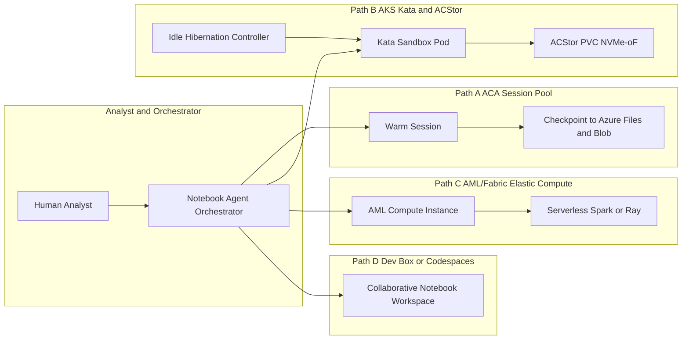
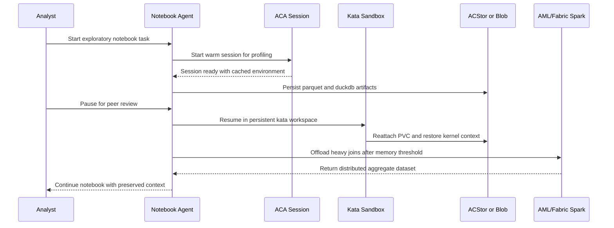

# Enterprise Stateful Data-Science Notebook Agent Workspace FAQ: ACA Hibernation Pools vs AKS+ACStor vs AML/Fabric Spark vs Dev Box/Codespaces
> 🌐 **Language Switch**: [中文](stateful-data-science-notebook-agent-sandbox-aca-hibernation-vs-aks-acstor-vs-aml-spark-selection-faq.md) | **English (current)**  
> Audience: Principal Cloud & AI Solution Architects, Data Platform owners, MLOps/SRE engineers, FinOps leads, and compliance architects.  
> Scope: Multi-hour and multi-day stateful notebook agent workspaces, including memory continuity, artifact persistence, idle economics, and elastic scale-out beyond single-node memory ceilings.  
> Out-of-scope: This guide does not duplicate stateless untrusted code snippet sandboxing (#03) or Git-centric coding workspace patterns (#147).  
## 1. Executive outcome: state continuity now defines notebook agent ROI
Enterprise notebook agents are no longer short-lived helpers.  
They participate in long analytical arcs that span hours or days.  
Analysts pause frequently to discuss assumptions and validate intermediate results.  
If platform design is stateless, each resume event incurs hidden rebuild cost.  
Package reinstall time and artifact rehydration time accumulate quickly.  
Kernel warm-up and dependency synchronization become productivity drag.  
The strategic question is no longer only “where to run code.”  
The strategic question is “how to preserve analytical state safely and cheaply.”  
This guide defines four architecture paths for that decision.  
Path A uses ACA Dynamic Sessions with warm pools and object checkpoints.  
Path B uses AKS Kata plus ACStor with explicit hibernation control.  
Path C uses AML/Fabric managed compute and Spark/Ray scale-out lanes.  
Path D uses Dev Box/Codespaces for agent-to-human collaboration handoff.  
These are not replacement options; they are layered operating modes.  
Path A is optimized for ad-hoc short investigative loops.  
Path B is optimized for persistent multi-day analytical workspaces.  
Path C is optimized for distributed execution beyond local memory limits.  
Path D is optimized for collaborative review and co-editing experience.  
A robust enterprise platform usually combines all four with policy routing.  
That combination improves user experience and governance simultaneously.  
It also improves cost predictability across variable idle windows.  
## 2. Workload boundaries and measurable design constraints
Architectural rigor starts with explicit state definitions.  
State should be modeled as four first-class categories.  
Category one is in-memory state.  
That includes IPython variables, dataframe objects, and intermediate model outputs.  
Category two is local artifact state.  
That includes `.parquet`, `.duckdb`, temporary tables, and derived features.  
Category three is environment state.  
That includes package sets, compiled dependencies, and notebook extensions.  
Category four is identity and authorization state.  
That includes OBO token context and lakehouse policy lineage.  
When any category is lost, analyst cognition is interrupted.  
Operational targets should therefore be explicit and testable.  
Interactive resume target can be set at `<5s` for hot or retained paths.  
Long-idle resume target can be set at `<45s` with checkpoint workflows.  
Artifact continuity target can be defined for `100GB`-class scratch persistence.  
Authorization continuity target should require end-to-end traceability.  
Cost targets must include idle-time break-even modeling.  
At minimum, model `15m`, `2h`, and `24h` analyst pause windows.  
Modeling should include compute, storage, and orchestration overhead.  
Once boundaries are quantified, routing logic becomes deterministic.  
Without quantified boundaries, architecture remains opinion-driven.  
## 3. Four-path architecture positioning at enterprise scale
Path A prioritizes speed-to-value and low platform ownership burden.  
Path B prioritizes strong persistence and high local IO continuity.  
Path C prioritizes memory elasticity and distributed analytical throughput.  
Path D prioritizes human collaboration and review-ready delivery.  
Path A is ideal for short exploratory loops and ad-hoc profiling.  
Path B is ideal for long-running feature engineering and iterative hypothesis tests.  
Path C is ideal when datasets cross practical single-node limits.  
Path D is ideal for analyst sign-off and co-authoring workflows.  
A common anti-pattern is forcing one path for every workload.  
That usually leads to latency pain at peak and waste at idle.  
A better pattern is task-tag routing with policy guardrails.  
Short exploratory tasks route to Path A.  
Persistent notebook sessions route to Path B.  
Large distributed joins route to Path C.  
Final review and notebook curation route to Path D.  
A unified observability layer should cover all paths consistently.  
This enables comparable SLO and TCO evidence across teams.  
It also simplifies architecture review board decisions.  
It reduces migration friction when workload patterns evolve.  
## 4. Twelve-dimension architecture comparison matrix
| Dimension | A: ACA Dynamic Sessions | B: AKS Kata + ACStor | C: AML/Fabric Spark | D: Dev Box/Codespaces |
|---|---|---|---|---|
| Initial delivery speed | Very high | Medium | Medium-high | High |
| Resume latency potential | Very high | High | Medium | High |
| Multi-day state continuity | Medium | Very high | High | High |
| Local scratch IO potential | Medium | Very high | Medium | Medium-high |
| Elastic memory scale-out | Low | Medium | Very high | Medium |
| Identity/governance integration | High | High | Very high | High |
| Environment reuse quality | Medium-high | Very high | High | High |
| Idle cost elasticity | Very high | High | Medium-high | Medium |
| Operational complexity | Low | High | Medium-high | Medium |
| Human handoff experience | Medium | Medium | Medium-high | Very high |
| Audit explainability | High | High | Very high | High |
| Three-year TCO convergence | Medium-high | High | High | Medium |
The matrix should be weighted per business profile.  
Biopharma programs usually weight auditability and continuity highest.  
Quant finance programs usually weight resume latency and scratch IO highest.  
Enterprise BI programs usually weight distributed scale and policy integration highest.  
Keeping one matrix template with variable weights improves governance consistency.  
It also speeds up architecture decision record production.  
## 5. Path A deep dive: ACA Dynamic Sessions and idle hibernation economics
Path A is optimized for fast interactive startup.  
Warm pools can provide near-immediate session readiness.  
This is ideal for exploratory tasks under one hour.  
Teams avoid direct Kubernetes operations in this mode.  
The key dial is `coolDownPeriodInSeconds`.  
That dial controls how long warm resources remain before reclamation.  
A short value reduces idle spend but increases checkpoint frequency.  
A long value improves continuity but can overpay for idle windows.  
A practical pattern is tiered cooldown profiles by workload class.  
Exploration profile can use `900s`.  
Validation profile can use `1800s`.  
Review profile can use `3600s`.  
Checkpoint design should use two storage levels.  
A fast level can use Azure Files NFS for quick restoration.  
A durable level can use Blob object versioning for governance evidence.  
This dual-layer design balances speed and retention requirements.  
Path A has known limits on large local scratch datasets.  
When local artifacts become heavy, checkpoint cost rises steeply.  
At that point routing should move to Path B or Path C.  
Path A remains valuable as baseline and burst lane.  
## 6. Path B deep dive: AKS Kata plus ACStor for persistent notebooks
Path B targets multi-day workspace continuity under strict isolation.  
Kata provides hard workload isolation boundaries.  
ACStor provides performant persistent local data layers.  
The combination supports repeatable resume behavior after idle windows.  
A hibernation controller scales replicas down while preserving state volumes.  
On resume, PVC reattachment restores local artifacts rapidly.  
This often avoids full environment reconstruction.  
For heavy scratch datasets, this is a major user-experience win.  
The pattern is strong for `50–500GB` local analytical state.  
It is also strong for repeatability in iterative experimentation.  
Resume behavior can often stay in low-second ranges.  
That is substantially better than full cold reconstruction paths.  
Path B requires disciplined platform engineering ownership.  
Volume lifecycle, node pool topology, and patch cadence must be managed.  
Hibernation logic and scheduler behavior must be validated together.  
Security policy, runtime hardening, and image governance must be aligned.  
Therefore Path B should be offered as an internal platform product.  
Treating it as ad-hoc cluster usage usually fails at scale.  
Path B is best for teams with recurring persistent notebook workloads.  
It is less suitable for occasional ad-hoc analytics only.  
## 7. Path C deep dive: AML/Fabric Spark for memory and compute elasticity
Path C handles analytical workloads beyond single-node memory boundaries.  
The crossover appears when local kernels repeatedly hit memory pressure.  
AML compute instances provide managed notebook entry points.  
Fabric serverless Spark provides elastic distributed execution lanes.  
Ray can be included for Python-native distributed workloads.  
A strong advantage is identity and policy continuity.  
With OBO, user principal context can be preserved end-to-end.  
That supports ABAC/RBAC enforcement across OneLake and ADLS paths.  
Auditors can trace who accessed which dataset and why.  
The goal is not to force all tasks into distributed compute.  
The goal is to define objective crossover thresholds.  
A practical baseline uses `<=20GB` for local DuckDB/Polars preference.  
`20–128GB` can be mixed based on operator complexity and SLA needs.  
`>=128GB` usually favors Spark or Ray for reliability and throughput.  
At `500GB`, single-node strategies become operationally risky.  
Path C should therefore be policy-driven, not manually negotiated each time.  
This reduces decision latency for analyst teams.  
It also improves planning confidence for platform capacity owners.  
Path C can coexist with A and B through route-aware orchestration.  
## 8. Path D deep dive: Dev Box/Codespaces collaboration handoff lane
Path D solves a different problem: collaborative analyst experience.  
Many notebook-agent tasks end with human interpretation and adjustment.  
API-only outputs are often insufficient for this final mile.  
Dev Box and Codespaces provide familiar IDE and notebook surfaces.  
Agents can prepare notebooks, visualizations, and pipeline scripts first.  
Then analysts continue in the same workspace with full context.  
This reduces handoff friction and interpretation errors.  
It also improves reproducibility through workspace-level version history.  
Path D is not a replacement for distributed compute engines.  
It is a collaboration and governance amplifier.  
D often pairs with C for heavy compute and with B for persistence.  
Asynchronous teams benefit from this model across time zones.  
Regulated teams benefit from richer review trails.  
Approval gates can be integrated before publish or model promotion.  
This helps enforce controlled delivery in sensitive domains.  
Path D should include clear lifecycle rules for cost containment.  
Idle controls and retention policies remain essential in this lane.  
## 9. Reference architecture diagram: four-plane stateful notebook platform

This architecture separates concerns without fragmenting governance.  
Each plane can scale and evolve independently.  
Each plane can publish path-specific quality and cost telemetry.  
Each plane can apply path-specific policy constraints.  
This keeps the operating model modular and auditable.  
It also enables progressive migration instead of disruptive rewrites.  
## 10. Sequence design: pause/resume continuity with elastic offload

The sequence demonstrates short idle and long idle handling.  
It also demonstrates single-node to distributed transition control.  
State and identity continuity are preserved through both transitions.  
This is essential for regulated and high-value analytical programs.  
It also reduces repeated manual setup for analysts.  
## 11. Quantitative Q&A: break-even, latency, scale crossover, and OBO governance
**Q1: How to evaluate idle hibernation break-even for `15m / 2h / 24h` gaps?**  
A1: Let hourly workspace cost be `C` and resume overhead be `R`; hibernation is favorable when `idle_hours * C > R`.  
In many programs, `15m` may be near neutral, `2h` often favors hibernation, and `24h` almost always favors hibernation.  
**Q2: Dill/parquet checkpoint restore vs ACStor PVC reattach, which is faster?**  
A2: Lightweight in-memory state often restores faster with checkpoint serialization, while heavy local scratch (`50GB+`) usually resumes more predictably with PVC reattachment.  
**Q3: When should local DuckDB/Polars switch to Spark/Ray?**  
A3: Local usually wins under `20GB`; mixed mode is common between `20GB` and `128GB`; distributed mode is typically preferred beyond `128GB`, and strongly indicated near `500GB`.  
**Q4: How is Entra OBO ABAC pass-through enforced inside sandboxes?**  
A4: Use short-lived delegated tokens scoped to user principal and resource attributes, avoid long-lived credentials in sandbox state, and log policy decisions with principal and dataset metadata.  
**Q5: Is `<5s` resume latency realistic for all paths?**  
A5: It is realistic for warm pools or retained PVC paths, but usually unrealistic for full cold rebuild workflows; path-specific SLOs are required.  
**Q6: What signals indicate Path A should be upgraded to Path B?**  
A6: Repeated environment rebuild penalties, frequent cross-day sessions, and persistent large local scratch are typical upgrade triggers.  
**Q7: What signals indicate Path B should offload to Path C?**  
A7: Repeated memory pressure events, unstable long joins, and SLA misses on large analytical windows are strong indicators for distributed offload.  
**Q8: How to quantify Path D collaboration value?**  
A8: Track handoff completion time, analyst rework rate, and post-handoff defect rate; sustained reductions demonstrate measurable collaboration ROI.  
These Q&As should be part of architecture review artifacts.  
They anchor platform decisions in measurable outcomes.  
They also make recurring governance meetings faster and less subjective.  
Every answer should map to reproducible evidence and telemetry.  
## 12. Production IaC sample: ACStor storage class with stateful hibernation sandbox
```yaml
apiVersion: storage.k8s.io/v1
kind: StorageClass
metadata:
  name: acstor-nvme-zrs
provisioner: containerstorage.csi.azure.com
parameters:
  skuName: PremiumV2_LRS
  protocol: nvmeof
  cachingMode: None
reclaimPolicy: Retain
allowVolumeExpansion: true
volumeBindingMode: WaitForFirstConsumer
---
apiVersion: apps/v1
kind: StatefulSet
metadata:
  name: notebook-kata-sandbox
spec:
  serviceName: notebook-kata-sandbox
  replicas: 1
  selector:
    matchLabels:
      app: notebook-kata-sandbox
  template:
    metadata:
      labels:
        app: notebook-kata-sandbox
    spec:
      runtimeClassName: kata
      containers:
      - name: notebook
        image: ghcr.io/company/notebook-agent:stable
        ports:
        - containerPort: 8888
        env:
        - name: HIBERNATE_IDLE_SECONDS
          value: "1800"
        volumeMounts:
        - name: workspace
          mountPath: /workspace
  volumeClaimTemplates:
  - metadata:
      name: workspace
    spec:
      accessModes: ["ReadWriteOnce"]
      storageClassName: acstor-nvme-zrs
      resources:
        requests:
          storage: 500Gi
```
This example highlights three critical controls.  
Retain policy protects state continuity under scale-to-zero behavior.  
Kata runtime enforces stronger sandbox isolation boundaries.  
Idle hibernation timeout remains configurable and policy-driven.  
The template should be paired with backup and lifecycle policies.  
It should also be paired with periodic resume integrity tests.  
## 13. Production code sample: kernel and DuckDB checkpoint rehydrate wrapper
```python
from __future__ import annotations

import dill
import duckdb
from pathlib import Path
from typing import Any, Dict

STATE_DIR = Path("/workspace/checkpoints")
STATE_DIR.mkdir(parents=True, exist_ok=True)

def save_kernel_state(state: Dict[str, Any], checkpoint_id: str) -> Path:
    target = STATE_DIR / f"{checkpoint_id}.dill"
    with target.open("wb") as f:
        dill.dump(state, f, recurse=True)
    return target

def load_kernel_state(checkpoint_id: str) -> Dict[str, Any]:
    target = STATE_DIR / f"{checkpoint_id}.dill"
    if not target.exists():
        return {}
    with target.open("rb") as f:
        return dill.load(f)

def checkpoint_duckdb(db_path: str, parquet_dir: str, table_name: str) -> str:
    Path(parquet_dir).mkdir(parents=True, exist_ok=True)
    output = f"{parquet_dir}/{table_name}.parquet"
    conn = duckdb.connect(db_path)
    conn.execute(f"COPY {table_name} TO '{output}' (FORMAT PARQUET)")
    conn.close()
    return output

def hydrate_duckdb(db_path: str, parquet_file: str, table_name: str) -> None:
    conn = duckdb.connect(db_path)
    conn.execute(
        f\"\"\"CREATE OR REPLACE TABLE {table_name}
              AS SELECT * FROM read_parquet('{parquet_file}')\"\"\"
    )
    conn.close()
```
This wrapper can be integrated with hibernation orchestration hooks.  
It can also be used in ACA checkpoint workflows for lightweight sessions.  
State artifacts and authorization logs should be archived together.  
That enables complete forensic and compliance reconstruction.  
Versioning metadata should include model and package fingerprints.  
This improves reproducibility for regulated analytical studies.  
## 14. Enterprise scenarios and FinOps planning model
### Scenario A: Global biopharma RWE cohort analytics agent
The organization runs multi-day epidemiological survival analysis.  
Biostatisticians pause and resume notebooks across review cycles.  
The platform uses Path B for persistent workspace continuity.  
The platform uses Path C for large-scale distributed transforms.  
Resume latency moved from minutes to low seconds.  
Repeat package installation steps were largely eliminated.  
Audit traceability improved through consistent identity propagation.  
The team reduced cycle-time friction across medical review boards.  
### Scenario B: Tier-1 hedge fund alpha exploration agent
The organization explores factor hypotheses on OneLake and ADX feeds.  
Workflows pause outside trading windows and resume quickly after.  
The platform uses Path A for rapid exploratory loops.  
The platform uses Path B for heavy NVMe scratch phases.  
The platform uses Path D for co-editing and strategy review.  
The team achieved faster resume and lower idle burn than always-on pools.  
Collaboration quality improved due to richer handoff context.  
Review lead time dropped in weekly model governance meetings.  
### FinOps and wake-up latency planning table (illustrative)
| Architecture | Idle strategy | Resume P95 | Monthly cost (illustrative) | Best-fit workload |
|---|---|---:|---:|---|
| A ACA session pool | checkpoint reclaim after `15m` cooldown | 1.2s | \$18k | high-frequency short sessions |
| B AKS + ACStor | scale-to-zero with retained PVC | 3.8s | \$26k | multi-day persistent notebooks |
| C AML/Fabric elastic | auto-stop compute + serverless spark wake | 14.0s | \$31k | memory-heavy distributed analytics |
| D Dev Box/Codespaces | business-hour active, off-hour hibernate | 6.5s | \$22k | collaborative notebook handoff |
| A+B+C+D blended | policy routing with tiered hibernation | 4.6s | \$24k | enterprise mixed portfolio |
These values are for architecture planning, not purchasing.  
Production budgeting must be recomputed with regional prices and contracts.  
Security and compliance controls should be costed explicitly as well.  
Quarterly recalculation is recommended to maintain accurate defaults.  
## 15. Day-0 and Day-2 twelve-item implementation checklist
- Define and assign ownership for memory, artifact, environment, and identity state classes.  
- Build idle break-even models for `15m`, `2h`, and `24h` pause intervals.  
- Standardize workload tagging to route tasks across A/B/C/D paths.  
- Set path-specific resume SLOs and integrate alerting thresholds.  
- Enable PVC retain strategy and periodic volume health checks for Path B.  
- Set objective crossover gates (`20GB`, `128GB`, `500GB`) for distributed offload.  
- Enforce short-lived OBO tokens with least-privilege scope in all sandboxes.  
- Version checkpoint artifacts and correlate them with authorization logs.  
- Define approval gates for notebook handoff in regulated workflows.  
- Review weekly metrics for resume latency, failure rate, and idle spend.  
- Recompute route weights monthly and update default policy profiles.  
- Run quarterly cross-path failover drills with audit-grade evidence capture.  
Ownership should be split across platform, data, SRE, and FinOps functions.  
Programs in migration mode can start with the first six controls.  
Remaining controls should enter the second implementation wave.  
The target is not one universally cheapest architecture.  
The target is a resilient, auditable, scalable, and economically stable operating model.  
