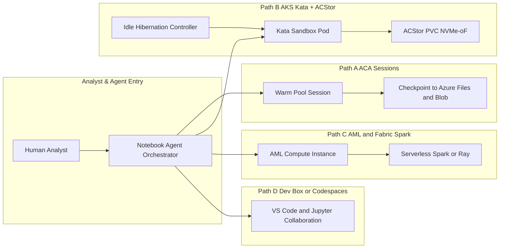
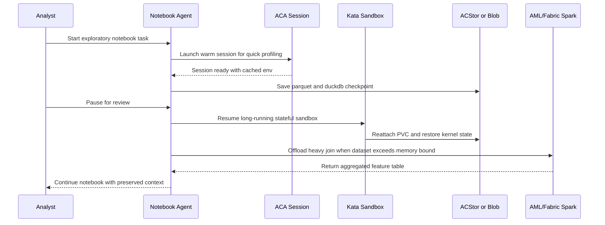

# 企业状态化数据科学 Notebook Agent 工作区选型 FAQ：ACA 休眠池 vs AKS+ACStor 持久沙箱 vs AML/Fabric Spark 扩展 vs Dev Box/Codespaces 协作
> 🌐 **Language Switch**: **中文（当前）** | [English](stateful-data-science-notebook-agent-sandbox-aca-hibernation-vs-aks-acstor-vs-aml-spark-selection-faq.en.md)  
> 角色定位：Principal Cloud & AI Solution Architect、Data Platform Lead、MLOps/SRE、FinOps、合规与数据治理团队。  
> 主题边界：聚焦多小时/多天状态化 Notebook Agent 工作区，不讨论 #03 无状态代码片段沙箱与 #147 Git PR 编码工作区。  
## 1. 执行摘要：Notebook Agent 进入“状态成本”时代
企业 Data-Science Agent 不再是单轮脚本调用。  
它们常在同一分析任务上运行数小时甚至数天。  
分析师会反复暂停、复盘、继续。  
若平台只能提供无状态容器，重启成本会快速放大。  
包重装、数据回拷、Kernel 冷启动会吞噬生产力。  
因此选型核心从“能不能跑”转为“状态如何保存”。  
本指南给出四类生产路径。  
路径 A：ACA Dynamic Sessions + 冷热池 + 文件/对象检查点。  
路径 B：AKS Kata + ACStor + hibernation controller。  
路径 C：AML/Fabric Spark 与托管计算实例协同扩展。  
路径 D：Dev Box/Codespaces 面向人机协作交接。  
四路径并非二选一。  
真实企业常采用组合路由。  
短会话实验由 A 承接。  
多天持续分析由 B 承接。  
超内存分析由 C 承接。  
多人协作交付由 D 承接。  
这类组合能同时满足体验、治理与成本。  
也能将业务中断风险压到可审计范围。  
## 2. 业务场景与设计约束：把“状态化”定量化
先定义状态对象再讨论平台。  
状态对象至少包含四类。  
第一类是内存态。  
包括 IPython 变量、DataFrame、模型中间结果。  
第二类是磁盘态。  
包括 `.parquet`、`.duckdb`、特征缓存、临时图表。  
第三类是环境态。  
包括 `uv`/conda 包、系统二进制、扩展插件。  
第四类是身份态。  
包括用户 OBO 上下文与数据访问授权。  
若四类状态不能连续保留，就会出现“分析上下文断层”。  
建议在项目启动时定义统一 SLO。  
交互恢复目标可设为 `<5s`。  
长暂停恢复目标可设为 `<45s`。  
数据回填目标可设为 `100GB` 级免重下。  
身份透传目标可设为全链路可审计。  
费用目标可按空闲窗口建模。  
至少覆盖 `15m`、`2h`、`24h` 三个停顿档位。  
## 3. 四路径定位：短会话、长会话、大数据、协作交接
路径 A 适合高频短会话。  
重点在快速唤醒与低运维。  
路径 B 适合多天持续工作区。  
重点在卷重挂载与环境常驻。  
路径 C 适合数据突破单机内存时扩展。  
重点在 Spark/Ray 分布式执行与湖仓权限继承。  
路径 D 适合 Agent 到人类分析师的接力。  
重点在可视 IDE、Notebook 共编与审阅闭环。  
组织常见反模式是单一路径覆盖所有场景。  
结果通常是高峰慢、低峰贵、审计碎片化。  
正确做法是按任务标签路由。  
短暂探索任务走 A。  
持续研究任务走 B。  
超内存任务走 C。  
最终成果润色与评审走 D。  
再用统一观测层汇总成本与质量证据。  
## 4. 12 维架构比较矩阵（Stateful Notebook Agent 专用）
| 维度 | A ACA Dynamic Sessions | B AKS Kata + ACStor | C AML/Fabric Spark | D Dev Box/Codespaces |
|---|---|---|---|---|
| 首次上线速度 | 极高 | 中 | 中高 | 高 |
| 会话唤醒延迟 | 极高 | 高 | 中 | 高 |
| 多天状态连续性 | 中 | 极高 | 高 | 高 |
| 单节点本地盘性能 | 中 | 极高 | 中 | 中高 |
| 超内存扩展能力 | 低 | 中 | 极高 | 中 |
| 身份与数据治理集成 | 高 | 高 | 极高 | 高 |
| 包环境可复用性 | 中高 | 极高 | 高 | 高 |
| 空闲成本弹性 | 极高 | 高 | 中高 | 中 |
| 运维复杂度 | 低 | 高 | 中高 | 中 |
| 多人协作交接体验 | 中 | 中 | 中高 | 极高 |
| 合规审计可解释性 | 高 | 高 | 极高 | 高 |
| 三年 TCO 收敛性 | 中高 | 高 | 高 | 中 |
矩阵需要按行业权重重算。  
生物医药更重视审计与长周期连续性。  
金融量化更重视本地盘吞吐与低延迟恢复。  
企业 BI 更重视 Spark 扩展与身份治理。  
统一矩阵模板有助于跨 BU 治理一致性。  
## 5. 路径 A：ACA Dynamic Sessions 休眠经济学
路径 A 适合 `<=60` 分钟探索会话。  
其优势是 warm pool 下的亚秒级启动体验。  
团队无需管理复杂集群基础设施。  
对临时分析任务，A 的交付效率极高。  
关键设计点是 `coolDownPeriodInSeconds`。  
该参数决定会话从热态转入回收前的窗口。  
窗口太短会增加状态序列化频率。  
窗口太长会造成空闲算力浪费。  
建议按分析师行为分层配置。  
例如探索型任务可设置 `900s`。  
审阅型任务可设置 `1800s`。  
长推演任务可设置 `3600s`。  
状态保存建议拆两级。  
快速级写 Azure Files NFS。  
耐久级写 Blob 版本化对象。  
这样可以兼顾恢复速度与审计追踪。  
路径 A 的风险在于超大本地数据集。  
当本地 scratch 超过数十 GB，序列化成本上涨。  
此时应路由到 B 或 C。  
## 6. 路径 B：AKS Kata + ACStor 多天工作区
路径 B 适合多天连续分析。  
核心收益是状态“就地保留”。  
ACStor 可提供 NVMe-oF 或 Premium SSD v2 性能层。  
Kata 沙箱提供硬隔离执行边界。  
二者结合可在安全与性能间取得平衡。  
关键能力是 idle hibernation controller。  
控制器可在空闲后缩容到零副本。  
同时保留 PVC 与镜像缓存。  
恢复时只做卷重挂载与内核恢复。  
典型恢复可以压到 `<3s` 到 `<8s` 区间。  
相比全量重建环境，时延优势明显。  
路径 B 非常适合 `50–500GB` 本地 scratch。  
例如 DuckDB 中间库、Parquet 分区与特征缓存。  
它也适合需要重复验证的多轮实验。  
但 B 的代价是运维复杂度更高。  
需治理节点池、卷性能、镜像与安全补丁。  
需保证 hibernation 与任务调度一致性。  
因此 B 应由平台团队以产品化方式托管。  
## 7. 路径 C：AML/Fabric Spark 弹性扩展平面
路径 C 解决“单机内存天花板”。  
当数据从 `20GB` 增长到 `500GB`，单内核策略会失效。  
此时需要把任务拆到 Spark 或 Ray。  
AML 托管计算实例适合 Notebook 入口。  
Fabric Serverless Spark 适合弹性批并行。  
两者共同点是与湖仓权限深度集成。  
通过 Entra OBO 可传递用户身份上下文。  
这样可保持 ABAC/RBAC 策略一致。  
分析师不会因平台切换丢失权限语义。  
路径 C 的关键并非“全面替代单机”。  
而是建立清晰 crossover 门槛。  
如 `20GB` 内优先 DuckDB/Polars。  
`20–128GB` 进入混合阶段。  
超过 `128GB` 优先 Spark/Ray。  
若没有门槛，团队会在错误层级浪费成本。  
若门槛清晰，调度器可自动选最优执行平面。  
## 8. 路径 D：Dev Box/Codespaces 人机协作工作区
路径 D 的价值在“交接体验”。  
很多 Data-Science Agent 最终需要人类审阅。  
纯 API 输出难以承载复杂可视化与交互探索。  
Dev Box 与 Codespaces 可提供熟悉的 IDE 场景。  
Agent 可先准备 notebook、pipeline、图表与注释。  
然后交付可访问 URL 给分析师共编。  
这种模式能显著降低 handoff 摩擦。  
也便于将探索过程纳入版本管理。  
路径 D 不擅长超大规模分布式执行。  
因此应与 C 协同。  
D 负责交互开发与验证。  
C 负责重计算与大规模并行。  
对跨时区团队，D 还能提升异步协作效率。  
对监管场景，D 还能保留更完整审阅痕迹。  
## 9. 参考架构：状态化 Notebook Agent 四平面

该图强调“同一编排器，多执行平面”。  
每条路径可按任务标签独立扩展。  
也可按合规要求独立审计。  
## 10. 时序：暂停/恢复与超内存扩展协同

此时序覆盖短停顿与长停顿。  
也覆盖单机到分布式的跨层升级。  
关键在于状态与身份的一致传递。  
## 11. 定量问答：恢复时延、成本拐点与身份治理
**Q1：空闲窗口 `15m / 2h / 24h` 下，休眠何时比常驻更省？**  
A1：若工作区单位小时成本为 `C`，恢复成本为 `R`，当 `idle_hours * C > R` 时应休眠。  
在大多数场景，`15m` 可能接近平衡，`2h` 通常休眠更优，`24h` 几乎必然休眠。  
**Q2：`dill`+Parquet 检查点与 ACStor PVC 重挂载延迟差异？**  
A2：轻量状态（小内存）常见 `dill` 路径更快。  
重状态（大 scratch）常见 PVC 重挂载更稳。  
经验上 `50GB+` 本地数据通常优先 PVC。  
**Q3：DuckDB/Polars 与 Spark 的 crossover 如何定？**  
A3：`<=20GB` 通常单机更快更省。  
`20–128GB` 需看算子与并发度。  
`>=128GB` 常见 Spark/Ray 总体更优。  
若达到 `500GB`，单机路径风险显著上升。  
**Q4：OBO + ABAC 在沙箱内如何确保不越权？**  
A4：令牌必须随会话最小化签发并绑定租户与资源。  
沙箱内只接受短时令牌，不缓存长期凭据。  
同时记录用户主体、查询对象与策略决策日志。  
**Q5：恢复目标设 `<5s` 是否现实？**  
A5：对 warm pool 或已缓存卷可实现。  
对冷池且需重建环境的路径通常不可实现。  
因此要按路径分别定义恢复 SLO。  
**Q6：什么时候必须从 A 升级到 B？**  
A6：当会话跨天且频繁重装环境时。  
当本地 scratch 长期高于 `50GB` 时。  
当恢复时延已影响分析师迭代效率时。  
**Q7：什么时候从 B 升级到 C？**  
A7：当任务多次触碰内存上限。  
当 join/groupby 明显受单机瓶颈限制。  
当 SLA 要求并行批次稳定吞吐。  
**Q8：D 路径的价值如何量化？**  
A8：可用“交接完成时间”与“返工率”衡量。  
若交接时间下降且返工率下降，D 的协作 ROI 明显。  
## 12. 生产 IaC 示例：ACStor + 状态化沙箱休眠控制
```yaml
apiVersion: storage.k8s.io/v1
kind: StorageClass
metadata:
  name: acstor-nvme-zrs
provisioner: containerstorage.csi.azure.com
parameters:
  skuName: PremiumV2_LRS
  protocol: nvmeof
  cachingMode: None
reclaimPolicy: Retain
allowVolumeExpansion: true
volumeBindingMode: WaitForFirstConsumer
---
apiVersion: apps/v1
kind: StatefulSet
metadata:
  name: notebook-kata-sandbox
spec:
  serviceName: notebook-kata-sandbox
  replicas: 1
  selector:
    matchLabels:
      app: notebook-kata-sandbox
  template:
    metadata:
      labels:
        app: notebook-kata-sandbox
    spec:
      runtimeClassName: kata
      containers:
      - name: notebook
        image: ghcr.io/company/notebook-agent:stable
        ports:
        - containerPort: 8888
        env:
        - name: HIBERNATE_IDLE_SECONDS
          value: "1800"
        volumeMounts:
        - name: ws
          mountPath: /workspace
  volumeClaimTemplates:
  - metadata:
      name: ws
    spec:
      accessModes: ["ReadWriteOnce"]
      storageClassName: acstor-nvme-zrs
      resources:
        requests:
          storage: 500Gi
```
上例展示了三件关键事。  
第一是卷策略 `Retain`。  
第二是 Kata 隔离。  
第三是空闲休眠参数外置化。  
## 13. 生产代码示例：Jupyter Kernel + DuckDB 检查点恢复封装
```python
from __future__ import annotations

import os
import dill
import duckdb
from pathlib import Path
from typing import Any, Dict

CHECKPOINT_DIR = Path("/workspace/checkpoints")
CHECKPOINT_DIR.mkdir(parents=True, exist_ok=True)

def save_kernel_state(state: Dict[str, Any], name: str) -> Path:
    target = CHECKPOINT_DIR / f"{name}.dill"
    with target.open("wb") as f:
        dill.dump(state, f, recurse=True)
    return target

def load_kernel_state(name: str) -> Dict[str, Any]:
    target = CHECKPOINT_DIR / f"{name}.dill"
    if not target.exists():
        return {}
    with target.open("rb") as f:
        return dill.load(f)

def checkpoint_duckdb(db_path: str, parquet_dir: str, table: str) -> str:
    conn = duckdb.connect(db_path)
    os.makedirs(parquet_dir, exist_ok=True)
    output = f"{parquet_dir}/{table}.parquet"
    conn.execute(f"COPY {table} TO '{output}' (FORMAT PARQUET)")
    conn.close()
    return output

def hydrate_duckdb(db_path: str, parquet_file: str, table: str) -> None:
    conn = duckdb.connect(db_path)
    conn.execute(f"CREATE OR REPLACE TABLE {table} AS SELECT * FROM read_parquet('{parquet_file}')")
    conn.close()
```
该封装适合与 hibernation controller 结合。  
也适合在 A 路径中做轻量恢复。  
关键是把状态文件与身份日志同时归档。  
## 14. 企业场景与 FinOps：生物医药与量化研究双样本
### 场景 A：全球生物医药 RWE 生存分析 Agent
该团队每日处理多批临床观察数据。  
分析流程跨多天，且需要生统专家反复审阅。  
他们采用 B+C 组合。  
B 承担状态化 notebook 与本地中间态。  
C 承担大规模生存曲线批处理。  
恢复时延从分钟级降到秒级。  
并保持了审计链路完整。  
### 场景 B：Tier-1 对冲基金 Alpha 探索 Agent
该团队需在 OneLake/ADX 上迭代因子。  
任务在交易时段外会暂停。  
恢复后需立即继续高频实验。  
他们采用 A+B+D 组合。  
A 处理轻量探索。  
B 处理高 IO scratch。  
D 支持研究员与 Agent 共编验证。  
最终在空闲成本与恢复速度间取得平衡。  
### FinOps 与唤醒时延推演表
| 方案 | 空闲策略 | 唤醒 P95 | 月度成本（示例） | 适配场景 |
|---|---|---:|---:|---|
| A ACA 会话池 | `15m` 冷却后检查点回收 | 1.2s | \$18k | 高频短会话 |
| B AKS+ACStor | 空闲缩容到零，PVC 保留 | 3.8s | \$26k | 多天状态任务 |
| C AML/Fabric | 计算实例自动关停 + Spark 按需拉起 | 14.0s | \$31k | 超内存分析 |
| D Dev Box/Codespaces | 开发时段常驻，非时段休眠 | 6.5s | \$22k | 人机协作交接 |
| A+B+C+D 组合 | 标签路由 + 分层休眠 | 4.6s | \$24k | 综合企业平台 |
表中值用于策略推演。  
实际采购与预算需按区域单价复算。  
同时要纳入合规隔离附加成本。  
## 15. Day-0 / Day-2 十二项落地清单
- 明确定义四类状态对象并绑定责任人。  
- 建立 `15m / 2h / 24h` 空闲窗口成本模型。  
- 为 A/B/C/D 四路径配置统一任务标签规范。  
- 设置恢复时延分档 SLO 并接入告警。  
- 对 B 路径启用 PVC Retain 与卷健康巡检。  
- 对 C 路径建立 `20GB/128GB/500GB` 扩展门槛。  
- 对 OBO 令牌实现短时签发与最小权限。  
- 对状态文件启用版本化与审计日志关联。  
- 对 notebook 交接流程定义可追溯审批节点。  
- 每周复盘唤醒时延、失败率、空闲成本三指标。  
- 每月重算路径权重并更新默认路由策略。  
- 每季度执行一次跨路径故障演练与恢复审计。  
建议将清单拆分到平台、数据、SRE、FinOps 四类团队。  
首期可先落地前六项。  
其余项在第二阶段并入平台治理节奏。  
最终目标不是单一路径“最便宜”。  
而是持续可恢复、可扩展、可审计、可控成本。  
