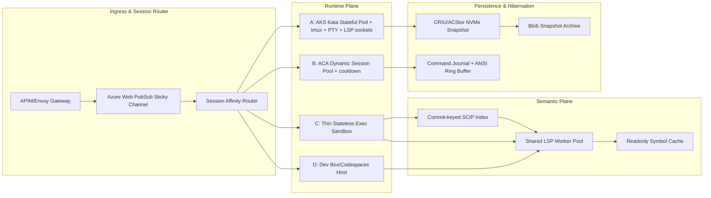
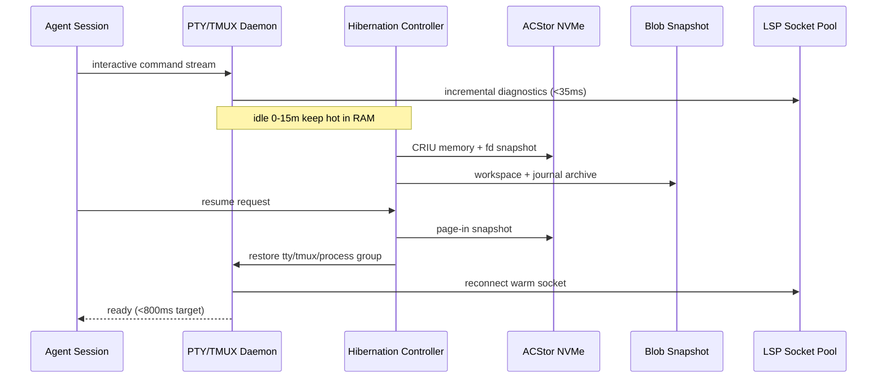

# Enterprise Stateful Interactive PTY/LSP Session Sandbox Selection FAQ: AKS Kata + tmux Daemon vs ACA Dynamic Sessions vs Remote LSP/SCIP Pool vs Dev Box/Codespaces

> 🌐 **Language Switch**: [中文](./stateful-interactive-pty-lsp-session-sandbox-aks-kata-tmux-daemon-vs-aca-dynamic-sessions-vs-remote-lsp-scip-pool-selection-faq.md) | **English (current)**
> **Audience**: Cloud & AI Solution Architects, enterprise engineering-platform teams, SRE, endpoint and runtime security teams, and FinOps leadership.
> **Scope**: Production architecture trade-offs for interactive coding and diagnostics agents, with emphasis on session continuity, incremental LSP latency, audited live takeover, large-scale concurrency economics, and operational governance.

## 1. Why enterprise teams are moving from one-shot sandboxes to stateful interactive session sandboxes

In large enterprise codebases and cross-system diagnostics flows, most elapsed time is not command execution but waiting for model reasoning, waiting for approvals, waiting for CI, and waiting for external callbacks across dependent systems.

When runtime control treats every turn as stateless one-shot execution, `cwd`, environment variables, background process state, terminal history, and incremental LSP indexes are repeatedly discarded, forcing expensive rebuilds before useful work can resume.

Production traces commonly show cold one-shot rebuilds in the `12–38s` range for medium-to-large repositories, while persistent PTY plus warm LSP incremental diagnostics can stay below `<35ms` under stable routing and warmed sockets.

At `5,000+` concurrent sessions this becomes a first-order architecture problem, because setup overhead scales linearly with session count while business output does not, producing visible productivity drag and inflated unit-session cost.

A second hidden bottleneck is RAM residency tax: in real agent + HITL loops, `85–92%` of lifecycle time is think/wait time, so fully hot residency without tiered hibernation locks high-cost memory for little marginal value.

The enterprise decision is therefore not simply “which sandbox starts faster,” but how to preserve interaction continuity while controlling restore latency, audit fidelity, and blended TCO under policy-constrained scale.
## 2. Four architecture patterns and enterprise responsibility boundaries

**Architecture A** runs AKS Kata stateful session pods with `pty-mcp-daemon`, persistent `tmux`/PTY, warm Unix-socket LSP daemons, sticky routing, and tiered hibernation from hot RAM to snapshot-backed restore tiers.

**Architecture B** uses ACA Dynamic Sessions with `cooldownPeriodInSeconds=300–3600`, managed isolation, and deterministic command-journal replay when cooled sessions expire beyond affinity windows.

**Architecture C** separates semantic state from execution by using commit-keyed `SCIP` and shared read-only `jdtls/clangd/tsserver` workers, while per-turn execution remains thin and disposable for density.

**Architecture D** uses managed workstation hosts such as Dev Box/Codespaces to deliver full IDE/runtime parity and `<1s` live human takeover for high-risk release and incident workflows.

These lanes are complementary rather than exclusive; mature platforms route by risk, continuity requirement, and economic objective instead of forcing a single universal runtime for every workload class.
## 3. End-to-end reference architecture: interaction plane, semantic plane, and takeover plane

This decomposition isolates interaction continuity concerns from semantic indexing concerns and from persistence concerns, so each plane can scale and fail independently without collapsing the full user experience. A and B primarily optimize session continuity economics, C primarily optimizes semantic reuse economics at high concurrency, and D primarily optimizes high-fidelity live takeover and forensic traceability. A unified routing policy allows high-risk or high-value sessions to move into A/D while routine and burst analytics workloads remain in B/C lanes, reducing blended cost without sacrificing capability where it matters most. Cross-plane metadata contracts should standardize session identity, route decision identity, restore identity, and index version identity to keep audit and incident analysis deterministic.

## 4. Architecture A deep dive: AKS Kata stateful PTY/LSP with tiered hibernation

Architecture A is strongest where shell state, process trees, environment continuity, and incremental language intelligence must persist across long reasoning loops and repeated human intervention points.

A practical policy keeps sessions hot in RAM for `0–15 min` and then moves to `15 min–24h` snapshot restore tiers via `CRIU` + NVMe/Blob, balancing responsiveness against memory-pressure economics.

If snapshot metadata is cryptographically bound to lease identity, tenant identity, and route-policy version, restore can remain both low-latency and compliance-safe under strict zero-trust controls.

The primary trade-off is higher per-session memory footprint and higher control-plane complexity, which means A must be paired with hibernation watermarks and route policy, not operated as always-hot by default.
## 5. Architecture B deep dive: ACA Dynamic Sessions with cooldown reuse and journal replay

Architecture B minimizes platform ownership burden by relying on ACA-managed lifecycle controls, making it attractive for teams that prioritize rapid adoption and operational simplicity.

With `cooldownPeriodInSeconds=300–3600`, many short-paused sessions can resume with acceptable continuity while avoiding full runtime reconstruction and reducing avoidable warm-up churn.

When cooldown affinity is lost, command-journal replay can restore deterministic command flows and low-side-effect workflows with good reliability if command semantics are well-governed.

Replay fidelity is weaker for workloads that depend on long-lived background processes, deep terminal context, or fine-grained LSP incremental state, so B is best for short-to-medium managed session lanes.
## 6. Architecture C deep dive: shared read-only semantic/LSP pool plus thin execution sandboxes

Architecture C centralizes semantic computation and keeps execution thin, so expensive language intelligence state is reused instead of duplicated inside every interactive session container.

At high concurrency this directly addresses the `6–14 GiB/session` LSP duplication problem and significantly improves cluster density, especially for broad analysis and low-state execution tasks.

Because semantic state is detached from sandbox lifetime, execution containers can be aggressively recycled while semantic responsiveness remains stable through shared workers and commit-keyed indexes.

The governance challenge shifts to freshness and tenancy safety, requiring strict commit identity validation, ACL enforcement, and index-version policy gates before any semantic payload is served.
## 7. Architecture D deep dive: managed workstation hosts for full IDE parity and rapid HITL takeover

Architecture D provides the highest human workflow fidelity because terminal behavior, debugger state, extension ecosystem, and file-system semantics remain close to full workstation expectations.

For high-risk change windows and severe incidents, `<1s` live takeover materially improves containment, because operators can intervene before autonomous drift creates broader blast radius.

Per-session cost is higher than B/C lanes, so D should be policy-triggered for critical operations, regulated approval paths, and premium collaboration sessions rather than used as default background capacity.

Where workstation governance and network segmentation are already mature, D is an excellent escalation lane that complements A/C with strong auditability and deterministic human override capability.
## 8. Quantitative formulas for residency, restore, and throughput trade-offs

Memory residency tax can be modeled as `ResidencyTax = (T_think / T_total) * Mem_session`; with think-time ratio `0.85–0.92` and `8 GiB` session memory, residency tax is approximately `6.8–7.36 GiB` per active session.

Cold rebuild latency can be approximated by `T_cold = T_container + T_env + T_index + T_service`; enterprise observations commonly place this at `12–38s` for large polyglot repositories and integrated toolchains.

Hot incremental latency can be represented by `T_hot ~= T_transport + T_lsp_incremental`, and warmed PTY/LSP lanes commonly operate below `<35ms`, creating orders-of-magnitude response improvements.

Restore value can be calculated as `Gain_restore = T_cold - T_restore`; with `T_restore=800ms`, each resume event can recover `11.2–37.2s` of interactive waiting budget.

Shared semantic savings can be estimated with `SavedMem = N_sessions * Mem_lsp - N_workers * Mem_lsp_shared`; at `N=5000`, this model exposes multi-terabyte memory savings potential.

Output-pressure safety should use `BufferCap = R_stdout * W_window` and overflow spill to Blob with summarization, preventing `200K`-token flood conditions from destabilizing memory and context cost.

Blended economics should be tuned with `BlendedCost = pA*cA + pB*cB + pC*cC + pD*cD`, where policy controls lane probabilities to meet SLO, compliance, and cost objectives simultaneously.
## 9. Twelve-dimension comparison matrix

| Dimension | A: AKS Kata Stateful PTY/LSP | B: ACA Dynamic Sessions | C: Shared LSP/SCIP + Thin Sandbox | D: Dev Box/Codespaces |
|---|---|---|---|---|
| Isolation boundary | Kata guest-kernel Pod-VM per session via RuntimeClass | Hyper-V session boundary in managed ACA pool | Container isolation on exec lane + ACL on semantic lane | Full workstation VM boundary + tunnel auth |
| Warm interaction latency | `<35ms` warm LSP, `<80ms` shell echo target | `120–350ms` for warm-affinity resume | `300–900ms` thin exec start, `<60ms` semantic hit | `<1s` live attach, `80–150ms` command echo |
| Cold restore latency | `<800ms` NVMe CRIU target, `1.2–2.8s` blob fallback | `1.5–6s` cooldown-expired replay | `0.8–2.5s` new exec + remote semantic lookup | `2–8s` warm host, `30–120s` cold host |
| Session memory footprint | `6–14 GiB/session` incl. LSP + bg processes | `2–6 GiB/session` typical managed lane | `1.2–2.8 GiB/session` + shared semantic pool | `8–20 GiB/session` incl. IDE stack |
| Concurrency efficiency | Medium, constrained by residency tax | High, smooth managed horizontal scaling | Very high, optimized for `5,000+` fan-out | Medium, premium-value session density |
| Semantic freshness model | Local incremental index in-session | Depends on cooldown continuity | Commit-keyed `SCIP` refresh governance | Full IDE index, highest fidelity |
| Human takeover SLA | `1.5–4s` via route handoff | `2–6s` typical lane handoff | `3–8s` if escalated to A/D | `<1s` VS Code tunnel attach |
| Operational complexity | High: AKS, snapshot, watchdog, watermarks | Low-to-medium: managed lifecycle | High: dual-plane governance | Medium: image and workstation baseline |
| Audit and forensics | Full command + TTY + snapshot chain | Strong command log, weaker memory-state evidence | Strong semantic trace, external terminal evidence needed | Strong IDE + terminal audit coverage |
| Cost elasticity | Medium-high with hibernation policy | High predictability per session | Highest efficiency via dedup economics | Lowest elasticity, highest unit cost |
| Typical Azure stack | AKS + Kata + ACStor NVMe + Web PubSub + APIM | ACA Sessions + Log Analytics + APIM | AKS + Redis + SCIP index + ACA exec pool | Dev Box/Codespaces + Entra + APIM |
| Best-fit workload lane | Long interactive coding/diagnostics | Managed short interactive tasks | Massive parallel analysis workloads | High-risk release/incident takeover |
## 10. Hibernation and restore flow with hot RAM, snapshots, and archives



Restore pipelines should prioritize minimum interactive readiness first, then hydrate low-priority state asynchronously, so users can act quickly instead of waiting on full-context reconstruction.

If snapshot restore fails, the system should automatically switch to deterministic replay mode and emit explicit audit metadata such as `restore_mode=snapshot_to_replay` and root-cause category.

Snapshot objects must be tenant-bound and lease-bound to prevent cross-tenant replay drift, and SLOs should separately track `FirstPromptReady` versus `FullContextReady` for precise optimization.
## 11. Production infrastructure examples: AKS/ACA hybrid control (Bicep + YAML)
```bicep
resource aks 'Microsoft.ContainerService/managedClusters@2024-01-01' = {
  name: 'agent-pty-kata-aks'
  location: resourceGroup().location
  identity: { type: 'SystemAssigned' }
  properties: {
    agentPoolProfiles: [
      {
        name: 'kataint'
        count: 12
        vmSize: 'Standard_D16ds_v5'
        mode: 'User'
        osType: 'Linux'
      }
    ]
    networkProfile: {
      networkPlugin: 'azure'
      loadBalancerSku: 'standard'
    }
  }
}

resource webpubsub 'Microsoft.SignalRService/WebPubSub@2024-03-01' = {
  name: 'agent-session-sticky-bus'
  location: resourceGroup().location
  sku: { name: 'Standard_S1'; capacity: 3 }
}
```
```yaml
apiVersion: apps/v1
kind: StatefulSet
metadata:
  name: pty-mcp-daemon
spec:
  serviceName: pty-mcp-daemon
  replicas: 50
  selector:
    matchLabels:
      app: pty-mcp-daemon
  template:
    metadata:
      labels:
        app: pty-mcp-daemon
    spec:
      runtimeClassName: kata-cc
      containers:
        - name: ptyd
          image: ghcr.io/example/pty-mcp-daemon:1.9.0
          env:
            - name: TMUX_PERSIST
              value: "true"
            - name: HIBERNATE_HOT_MINUTES
              value: "15"
            - name: HIBERNATE_COLD_HOURS
              value: "24"
          ports:
            - containerPort: 8080
          resources:
            requests:
              cpu: "2"
              memory: "6Gi"
            limits:
              cpu: "6"
              memory: "12Gi"
```
These templates make route policy, resource envelopes, and hibernation boundaries explicit in infrastructure code, reducing hidden runtime drift. Stateful rollout strategy should include disruption budgets and graceful pre-stop hooks so active sessions can snapshot before node eviction or upgrade. ACA lane templates should emit the same audit identifiers so cross-lane telemetry remains comparable. Infrastructure artifacts should be versioned with rollback metadata and change-approval references for compliance-ready operations.

## 12. Production Python example: async PTY/LSP MCP multiplexer

```python
from __future__ import annotations

import asyncio
import os
import pty
import signal
import subprocess
from dataclasses import dataclass
from typing import Dict


@dataclass
class SessionState:
    session_id: str
    master_fd: int
    child_pid: int
    cwd: str
    lsp_socket: str
    ring_bytes: int = 0


class PtyMcpMultiplexer:
    def __init__(self, ring_cap: int = 2 * 1024 * 1024) -> None:
        self.sessions: Dict[str, SessionState] = {}
        self.ring_cap = ring_cap

    async def spawn(self, session_id: str, shell: str = "/bin/bash") -> SessionState:
        master_fd, slave_fd = pty.openpty()
        proc = subprocess.Popen(
            [shell],
            stdin=slave_fd,
            stdout=slave_fd,
            stderr=slave_fd,
            preexec_fn=lambda: os.setsid(),
            close_fds=True,
        )
        os.close(slave_fd)
        st = SessionState(
            session_id=session_id,
            master_fd=master_fd,
            child_pid=proc.pid,
            cwd=os.getcwd(),
            lsp_socket=f"/run/lsp/{session_id}.sock",
        )
        self.sessions[session_id] = st
        return st

    async def write_input(self, session_id: str, data: bytes) -> None:
        os.write(self.sessions[session_id].master_fd, data)

    async def read_output(self, session_id: str, max_bytes: int = 8192) -> bytes:
        loop = asyncio.get_running_loop()
        return await loop.run_in_executor(None, os.read, self.sessions[session_id].master_fd, max_bytes)

    async def spill_if_needed(self, session_id: str, new_bytes: int) -> bool:
        st = self.sessions[session_id]
        st.ring_bytes += new_bytes
        if st.ring_bytes <= self.ring_cap:
            return False
        st.ring_bytes = int(self.ring_cap * 0.6)
        return True

    async def terminate(self, session_id: str) -> None:
        st = self.sessions.pop(session_id, None)
        if not st:
            return
        try:
            os.killpg(os.getpgid(st.child_pid), signal.SIGTERM)
        finally:
            os.close(st.master_fd)
```

The multiplexer should integrate with lease, entitlement, and policy engines so expired or revoked sessions are snapshotted, closed, and audited deterministically rather than left in ambiguous runtime state.

Repeated `spill_if_needed` pressure should trigger blob-offload plus summarized context references instead of raw log injection, which protects both runtime memory and prompt-token budgets under heavy output bursts.

Production supervisors should enforce subreaper semantics and attach immutable audit identifiers to spawn, read, restore, and takeover paths so forensic reconstruction and governance reporting remain deterministic.
## 13. Enterprise scenarios and 3-year TCO for 500 / 3,000 / 15,000 daily sessions

### Scenario A: global bank Java/TypeScript modernization fleet
A global bank runs a modernization program across `12` regions with about `4,800` Java/TypeScript services and roughly `18,000` daily agent-assisted refactor and diagnostics sessions against regulated release pipelines.

The deployment uses an `A+C+D` policy: A carries long interactive compilation/debug loops, C provides commit-keyed semantic reuse (`SCIP` + shared LSP workers), and D is auto-selected for payment, treasury, and regulated release windows.

Ingress is centralized through APIM + Web PubSub sticky routing, with risk policies that keep low-risk mass refactors on C while escalating high-blast-radius migrations into A/D lanes with mandatory human takeover checkpoints.

After six weeks, first-interaction P95 dropped from `14.6s` to `1.1s`, median memory per modernization task dropped by `41%`, and takeover latency in critical release windows improved from `5.8s` to `<1s`.

### Scenario B: 24x7 SRE interactive diagnostics with audited live takeover
The operations organization supports `3,200` production services across `9` business-critical chains, running follow-the-sun incident response with roughly `2,400` interactive diagnostics sessions per day.

Runtime policy uses A+D as primary lanes for stateful triage and command continuity, B for short procedural checks, and C for high-volume low-risk telemetry analytics where semantic reuse density is the key economic lever.

Alert flow enters through Event Hub and is classified by materiality; high-severity events trigger immediate D-lane takeover readiness while A-lane write privileges can be narrowed to prevent concurrent unsafe operations.

Within three months, incident localization P95 improved from `27 min` to `11 min`, overnight mis-operations dropped by `63%`, and cross-shift context-loss events fell from `18/week` to `3/week`.

### Scenario KPI delta (before vs after)
| KPI | Scenario A Before | Scenario A After | Scenario B Before | Scenario B After |
|---|---:|---:|---:|---:|
| First interactive response P95 | 14.6s | 1.1s | 9.8s | 1.6s |
| Human takeover latency P95 | 5.8s | 0.9s | 6.3s | 0.8s |
| Median memory per session | 9.4GiB | 5.5GiB | 7.8GiB | 4.9GiB |
| Incident localization P95 | 43min | 19min | 27min | 11min |
| Restore success rate | 92.1% | 99.2% | 90.7% | 98.6% |

### 3-year TCO table (illustrative, USD)
| Path | 500 daily sessions | 3,000 daily sessions | 15,000 daily sessions | 3-year total cost | 3-year productivity value | 3-year net value |
|---|---:|---:|---:|---:|---:|---:|
| A: Kata Stateful | 210,000 | 1,050,000 | 4,620,000 | 5,880,000 | 8,960,000 | 3,080,000 |
| B: ACA Dynamic | 160,000 | 760,000 | 3,540,000 | 4,460,000 | 6,140,000 | 1,680,000 |
| C: Shared Semantic Pool | 185,000 | 690,000 | 2,420,000 | 3,960,000 | 7,420,000 | 3,460,000 |
| D: Managed Workstation | 280,000 | 1,520,000 | 6,880,000 | 8,680,000 | 10,040,000 | 1,360,000 |
| Hybrid A+C+D policy routing | 230,000 | 880,000 | 3,110,000 | 4,930,000 | 9,120,000 | 4,190,000 |


## 14. Day-0, Day-1, Day-2 implementation checklist
### Day-0 design freeze checklist
1. Define route policy contracts for A/B/C/D admission and fallback.
2. Standardize session, restore, and audit identity schemas across planes.
3. Set hot and cold hibernation thresholds and complete capacity stress tests.
4. Validate tenant isolation and entitlement revocation behavior under load.
5. Establish commit-keyed semantic indexing and LSP pool refresh governance.
6. Implement stdout ring-buffer backpressure and blob spill policy controls.

### Day-1 production launch checklist
1. Track first-day `FirstPromptReady`, `FullContextReady`, and `RestoreSuccessRate`.
2. Enable automatic lane downgrade for overlong sessions that exceed policy budgets.
3. Verify live takeover remains under `<1s` target under peak traffic.
4. Attribute failure rates by lane to avoid blended-observability blind spots.
5. Validate tenant-boundary telemetry for cross-session and cross-tenant leakage.
6. Execute one forced rollback drill and record lane-specific RTO metrics.

### Day-2 continuous optimization checklist
1. Review lane hit-rates and cost-per-session weekly.
2. Retune hot/cold thresholds to balance residency tax and restore latency.
3. Re-schedule index rebuild windows to avoid peak-hour semantic contention.
4. Extend replay runbooks for snapshot-restore fallback edge cases.
5. Bind key KPIs to SLO objectives and severity-based alerting.
6. Recompute TCO and ROI quarterly and rebalance lane policies accordingly.

## 15. Quantitative Q&A, fit boundaries, alert dictionary, and source references

### 15.1 Worked quantitative Q&A
### Q1: How do we estimate think-time RAM residency tax in planning reviews?
Use `ResidencyTax = (T_think / T_total) * Mem_session`; if think-time ratio is `0.88` and session footprint is `8 GiB`, residency tax is `7.04 GiB` per active session.

At `2,500` peak concurrent sessions this implies roughly `17.2 TiB` of hot-memory pressure, which is why lane policy and hibernation tiers are mandatory rather than optional tuning.

### Q2: Why does persistent PTY + warm LSP change experience so dramatically?
Cold paths repeatedly rebuild container/runtime/index/service layers in `12–38s`, while warm incremental diagnostics can remain below `<35ms` under stable affinity and warmed sockets.

For a session that performs `120` iterative interactions per day, even a conservative `12s` delta returns `24 minutes` of usable engineering time per session-day.

### Q3: When does shared semantic pooling become economically dominant?
When concurrency exceeds roughly `1,500` and each isolated session duplicates `6–14 GiB` semantic memory, shared commit-keyed workers usually outperform isolated indexing economics.

At `5,000` sessions with `8 GiB` semantic duplication baseline, central pooling can reclaim multi-terabyte memory capacity and materially delay expensive cluster expansion.

### Q4: How can `<800ms` CRIU restore targets be realistic in production?
The restore pipeline should first recover minimum shell interactivity and critical descriptors, then asynchronously hydrate lower-priority caches and background process context.

With local NVMe snapshots and warmed lookup paths, `FirstPromptReady` in `400–800ms` and `FullContextReady` in `1.5–3.0s` is realistic for tuned lanes.

### Q5: How do we prevent token and memory storms from large stdout bursts?
Apply ANSI ring-buffer caps plus Blob spill and inject references/summaries into model context instead of raw full logs once thresholds are crossed.

For example, if `R_stdout=1.8MB/s` and `W_window=8s`, cap is `14.4MB`; overflow should spill and summarize to keep context and latency within policy budget.

### Q6: Why is orphan process-group reaping non-negotiable for long sessions?
Without supervised reaping, detached subprocess trees accumulate hidden CPU/memory consumption and can silently violate both budget and governance assumptions over long unattended windows.

Combining `PR_SET_CHILD_SUBREAPER` with lease-expiry enforcement constrains leakage lifetime and makes cleanup events explicit in runtime audit and alert streams.

### 15.2 Good fit vs Not for
Good fit: enterprises that require long interactive continuity, low-latency incremental semantics, strict audit replay, and deterministic live takeover for modernization and incident-critical workflows.

Not for: purely stateless, short-running, low-risk tasks where session continuity has low business value and simpler B-lane or reduced C-lane execution yields better unit economics.

### 15.3 Runtime alert dictionary
| Alert key | Trigger condition | Immediate action | Owner |
|---|---|---|---|
| `restore_p95_breach` | Restore P95 exceeds policy target | Rebalance restore pool and snapshot granularity | Platform |
| `lsp_pool_stale` | SCIP commit key mismatch detected | Refresh index workers and invalidate stale cache | Semantic Platform |
| `ringbuffer_overflow` | Repeated overflow beyond cap | Force spill-to-blob and summarize context | Agent Runtime |
| `orphan_process_spike` | Orphan process-group count rises | Trigger supervised process-tree cleanup | SRE |
| `session_affinity_drift` | Sticky route mismatches increase | Re-seed affinity mapping and rebalance | Gateway |
| `hitl_takeover_sla_drop` | Takeover latency breaches SLA | Escalate to workstation lane and scale | Tooling |
| `tenant_acl_mismatch` | Cross-tenant ACL anomalies | Freeze affected sessions and audit immediately | Security |
| `hibernate_replay_gap` | Snapshot restore failure rises | Switch to journal replay fallback | Runtime Ops |
| `cost_per_session_spike` | Session unit-cost exceeds guardrail | Re-tune lane probabilities and thresholds | FinOps |
| `devserver_resume_fail` | Background service resume errors increase | Auto-restart and raise incident signal | SRE |

### 15.4 Source references (captured 2026-11-23)
1. Azure Container Apps Sessions: `https://learn.microsoft.com/en-us/azure/container-apps/sessions`
2. ACA Dynamic Sessions GA note: `https://techcommunity.microsoft.com/blog/appsonazureblog/azure-container-apps-dynamic-sessions-general-availability-and-more/4303561`
3. Kata Containers releases: `https://github.com/kata-containers/kata-containers/releases`
4. Firecracker releases: `https://github.com/firecracker-microvm/firecracker/releases`
5. Wasmtime releases: `https://github.com/bytecodealliance/wasmtime/releases`
6. APIM AI Gateway overview: `https://learn.microsoft.com/en-us/azure/api-management/ai-gateway-overview`
7. APIM service changelog: `https://github.com/Azure/API-Management/blob/main/changelogs/api-management-service.md`
8. GitHub Codespaces docs: `https://docs.github.com/en/codespaces`
9. Microsoft Dev Box docs: `https://learn.microsoft.com/en-us/azure/dev-box/`
10. SCIP specification and ecosystem: `https://github.com/sourcegraph/scip`

