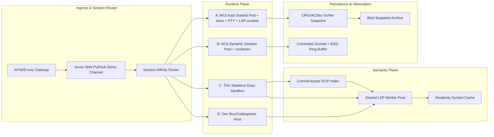
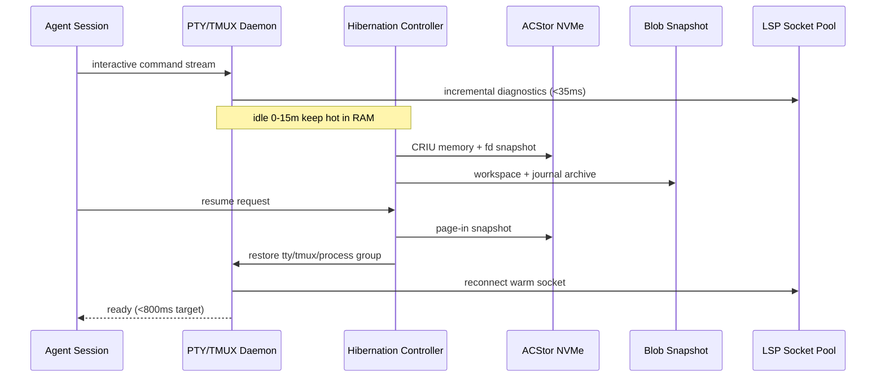

# Enterprise Stateful Interactive PTY/LSP Session Sandbox Selection FAQ: AKS Kata + tmux Daemon vs ACA Dynamic Sessions vs Remote LSP/SCIP Pool vs Dev Box/Codespaces

> 🌐 **Language Switch**: [中文](./stateful-interactive-pty-lsp-session-sandbox-aks-kata-tmux-daemon-vs-aca-dynamic-sessions-vs-remote-lsp-scip-pool-selection-faq.md) | **English (current)**
> **Audience**: Cloud & AI Solution Architects, enterprise engineering-platform teams, SRE, endpoint and runtime security teams, and FinOps leadership.
> **Scope**: Production architecture trade-offs for interactive coding and diagnostics agents, with emphasis on session continuity, incremental LSP latency, audited live takeover, large-scale concurrency economics, and operational governance.

## 1. Why enterprise teams are moving from one-shot sandboxes to stateful interactive session sandboxes
In large monorepos and multi-service diagnostics workflows, most wall-clock time is not spent executing shell commands but waiting for model reasoning, waiting for human approval, waiting for CI signals, and waiting for external system responses. If the runtime model treats every tool invocation as stateless one-shot execution, each cycle loses `cwd`, process environment, background service state, terminal context, and incremental LSP index state, which forces repeated reconstruction before useful work can continue. In production traces, cold one-shot rebuilds that rehydrate dependency environments, restart local service processes, and rebuild language indexes often land in the `12–38s` range, while hot PTY plus warm LSP diagnostics commonly remain below `<35ms`. This gap becomes a first-order productivity and cost factor at `5,000+` concurrent sessions, because repeated setup work scales linearly while useful task progress does not. From a resource perspective, LLM/HITL think time frequently represents `85–92%` of session lifetime, so keeping every session fully resident in hot memory without hibernation controls creates a severe and avoidable RAM residency tax. The architecture problem is therefore not merely “which container runtime is faster,” but rather “how to preserve interaction continuity while controlling memory residency tax, restore latency, and governance risk at enterprise scale.”

## 2. Four architecture patterns and enterprise responsibility boundaries
**Architecture A** uses AKS Kata stateful session pods with `pty-mcp-daemon`, persistent `tmux`/PTY shells, warm Unix-socket LSP daemons, sticky session routing, and tiered hibernation from hot RAM to snapshot restore tiers. **Architecture B** uses ACA Dynamic Sessions with custom containers and `cooldownPeriodInSeconds=300–3600`, relying on managed isolation and command-journal replay when cooled sessions expire. **Architecture C** decouples semantic state by running commit-keyed `SCIP` indexes and shared read-only LSP workers on AKS, while execution remains thin and stateless per turn. **Architecture D** uses managed cloud workstation hosts such as Dev Box or Codespaces to preserve full IDE parity and enable `<1s` live human takeover for high-risk workflows. In mature operating models these patterns are not mutually exclusive, and policy-driven routing should choose the optimal lane per task class, risk class, and economic objective.

## 3. End-to-end reference architecture: interaction plane, semantic plane, and takeover plane

This decomposition isolates interaction continuity concerns from semantic indexing concerns and from persistence concerns, so each plane can scale and fail independently without collapsing the full user experience. A and B primarily optimize session continuity economics, C primarily optimizes semantic reuse economics at high concurrency, and D primarily optimizes high-fidelity live takeover and forensic traceability. A unified routing policy allows high-risk or high-value sessions to move into A/D while routine and burst analytics workloads remain in B/C lanes, reducing blended cost without sacrificing capability where it matters most. Cross-plane metadata contracts should standardize session identity, route decision identity, restore identity, and index version identity to keep audit and incident analysis deterministic.

## 4. Architecture A deep dive: AKS Kata stateful PTY/LSP with tiered hibernation
Architecture A provides native continuity for shell state, process groups, environment variables, background service state, and incremental LSP daemon state, which makes it highly effective for long-running interactive coding and diagnostics loops. A practical hibernation policy is to keep sessions in hot memory for `0–15 min` and then move to snapshot-backed restore for `15 min–24h`, balancing restore speed against memory pressure and cluster packing efficiency. If snapshot metadata is cryptographically bound to session identity and route policy version, restore paths can remain both fast and governance-safe under strict tenancy controls. To avoid long-lived orphan process leakage, the runtime supervisor should own process-tree lifecycle and use subreaper semantics so detached children are reclaimed with predictable policy. The primary trade-off of A is higher per-session baseline memory, so capacity planning must rely on tiered hibernation and lane-aware routing rather than naive always-hot assumptions.

## 5. Architecture B deep dive: ACA Dynamic Sessions with cooldown reuse and journal replay
Architecture B offers managed isolation and lower platform complexity by delegating much of lifecycle orchestration to ACA session pools and managed host infrastructure. With `cooldownPeriodInSeconds=300–3600`, many short-interruption sessions can resume warm enough to avoid full runtime rebuild while still benefiting from bounded idle resource retention. When cooldown expires, command-journal replay can reconstruct execution semantics for deterministic command sequences and low-coupling workflows, especially when side effects are controlled. The limitation is that replay fidelity degrades for workloads that depend on deep in-memory interactive context, multi-process orchestration nuances, or tightly coupled LSP incremental state. B is therefore best for short-to-medium managed session workloads where low operational burden is prioritized over maximal continuity fidelity.

## 6. Architecture C deep dive: shared read-only semantic/LSP pool plus thin execution sandboxes
Architecture C removes duplicated LSP memory from each session by centralizing semantic workers and commit-keyed symbol indexes, while keeping execution containers lightweight and disposable. At large concurrency, this can eliminate massive duplication where each session would otherwise carry `6–14 GiB` of near-identical semantic state, materially improving cluster efficiency and cost. Because semantic state is detached from execution lifecycles, stateless sandboxes can be aggressively recycled without losing core code-intelligence responsiveness. The governance challenge is semantic freshness and tenancy safety: index versions, commit identity, and ACL boundaries must be validated before serving symbol data to any session. C works best as a scale amplifier paired with A or D for high-interaction continuity lanes, not as a universal substitute for interactive runtime continuity.

## 7. Architecture D deep dive: managed workstation hosts for full IDE parity and rapid HITL takeover
Architecture D delivers the strongest parity with human developer workflows by preserving full IDE/runtime semantics, extension behavior, debugger state, and live terminal fidelity. For high-risk change windows and critical incident diagnostics, `<1s` human takeover is often a decisive reliability advantage because operators can intervene before automation drift amplifies impact. The cost profile is generally higher per active session than B/C, so D should be governed by explicit policy triggers such as high-risk tool invocation, broad blast-radius operations, or regulated approval requirements. If workstation governance and network segmentation foundations already exist, D can be integrated as a premium lane while routine workloads stay in lower-cost lanes. A mature control plane should treat D as a deliberate escalation target, not a default destination for every automated interaction.

## 8. Quantitative formulas for residency, restore, and throughput trade-offs
Memory residency tax can be modeled as `ResidencyTax = (T_think / T_total) * Mem_session`, so if think-time ratio is `0.85–0.92` and session memory is `8 GiB`, per-session hot-memory tax is approximately `6.8–7.36 GiB`. Cold one-shot rebuild time can be modeled as `T_cold = T_container + T_env + T_index + T_service`; enterprise observations frequently place this in `12–38s` for medium-to-large engineering repositories. Hot incremental path latency for persistent PTY+LSP can be represented as `T_hot ~= T_transport + T_lsp_incremental`, and stable operating baselines below `<35ms` are achievable in warmed lanes. Restore benefit can be expressed as `Gain_restore = T_cold - T_restore`; with `T_restore=800ms`, expected savings per resume event are `11.2–37.2s`. Shared semantic memory savings can be estimated with `SavedMem = N_sessions * Mem_lsp - N_workers * Mem_lsp_shared`; at `N=5000`, savings become dominant in total cluster memory economics. STDOUT pressure control requires bounded buffering such as `BufferCap = R_stdout * W_window`; overflow beyond cap should spill to Blob to prevent runaway tokenized logs from destabilizing memory and prompt cost. Blended route economics can be represented as `BlendedCost = pA*cA + pB*cB + pC*cC + pD*cD`, where policy tuning manipulates lane probabilities to meet SLO and cost targets simultaneously.

## 9. Twelve-dimension comparison matrix
| Dimension | A: Kata Stateful PTY/LSP | B: ACA Dynamic Sessions | C: Shared LSP/SCIP + Thin Sandbox | D: Dev Box/Codespaces |
|---|---|---|---|---|
| Interactive continuity fidelity | Very high | Medium | Medium | Very high |
| Incremental LSP latency | Very low | Medium | Low | Very low |
| Cold-start recovery quality | High | Medium | High | High |
| Per-session memory footprint | High | Medium | Low | High |
| Hyper-scale concurrency efficiency | Medium | High | Very high | Medium |
| Live human takeover speed | Medium | Medium | Medium | Very high |
| Platform operational complexity | High | Low to medium | High | Medium |
| Isolation strength | High | High | Medium to high | High |
| Audit and replay strength | High | Medium | High | High |
| Cost predictability | Medium | High | High | Medium |
| Legacy toolchain fit | High | Medium | Medium | Very high |
| Recommended lifecycle lane | Core interactive tasks | Managed short sessions | Massive parallel analysis | High-value HITL |

## 10. Hibernation and restore flow with hot RAM, snapshots, and archives

Restore pipelines should prioritize “minimum interactive readiness first” and defer non-critical context hydration asynchronously, otherwise users experience unnecessary full-context blocking. If snapshot restore fails, the platform should automatically transition to deterministic journal replay mode and annotate the reason in audit telemetry for postmortem clarity. Snapshot objects must carry tenant and policy labels to prevent cross-tenant restore drift under concurrent operations and rolling upgrades. SLO instrumentation should split `FirstPromptReady` and `FullContextReady` so teams can optimize interaction quality and completeness separately.

## 11. Production infrastructure examples: AKS/ACA hybrid control (Bicep + YAML)
```bicep
resource aks 'Microsoft.ContainerService/managedClusters@2024-01-01' = {
  name: 'agent-pty-kata-aks'
  location: resourceGroup().location
  identity: { type: 'SystemAssigned' }
  properties: {
    agentPoolProfiles: [
      {
        name: 'kataint'
        count: 12
        vmSize: 'Standard_D16ds_v5'
        mode: 'User'
        osType: 'Linux'
      }
    ]
    networkProfile: {
      networkPlugin: 'azure'
      loadBalancerSku: 'standard'
    }
  }
}

resource webpubsub 'Microsoft.SignalRService/WebPubSub@2024-03-01' = {
  name: 'agent-session-sticky-bus'
  location: resourceGroup().location
  sku: { name: 'Standard_S1'; capacity: 3 }
}
```
```yaml
apiVersion: apps/v1
kind: StatefulSet
metadata:
  name: pty-mcp-daemon
spec:
  serviceName: pty-mcp-daemon
  replicas: 50
  selector:
    matchLabels:
      app: pty-mcp-daemon
  template:
    metadata:
      labels:
        app: pty-mcp-daemon
    spec:
      runtimeClassName: kata-cc
      containers:
        - name: ptyd
          image: ghcr.io/example/pty-mcp-daemon:1.9.0
          env:
            - name: TMUX_PERSIST
              value: "true"
            - name: HIBERNATE_HOT_MINUTES
              value: "15"
            - name: HIBERNATE_COLD_HOURS
              value: "24"
          ports:
            - containerPort: 8080
          resources:
            requests:
              cpu: "2"
              memory: "6Gi"
            limits:
              cpu: "6"
              memory: "12Gi"
```
These templates make route policy, resource envelopes, and hibernation boundaries explicit in infrastructure code, reducing hidden runtime drift. Stateful rollout strategy should include disruption budgets and graceful pre-stop hooks so active sessions can snapshot before node eviction or upgrade. ACA lane templates should emit the same audit identifiers so cross-lane telemetry remains comparable. Infrastructure artifacts should be versioned with rollback metadata and change-approval references for compliance-ready operations.

## 12. Production Python example: async PTY/LSP MCP multiplexer
```python
from __future__ import annotations

import asyncio
import os
import pty
import signal
import subprocess
from dataclasses import dataclass
from typing import Dict


@dataclass
class SessionState:
    session_id: str
    master_fd: int
    child_pid: int
    cwd: str
    lsp_socket: str
    ring_bytes: int = 0


class PtyMcpMultiplexer:
    def __init__(self, ring_cap: int = 2 * 1024 * 1024) -> None:
        self.sessions: Dict[str, SessionState] = {}
        self.ring_cap = ring_cap

    async def spawn(self, session_id: str, shell: str = "/bin/bash") -> SessionState:
        master_fd, slave_fd = pty.openpty()
        proc = subprocess.Popen(
            [shell],
            stdin=slave_fd,
            stdout=slave_fd,
            stderr=slave_fd,
            preexec_fn=lambda: os.setsid(),
            close_fds=True,
        )
        os.close(slave_fd)
        st = SessionState(
            session_id=session_id,
            master_fd=master_fd,
            child_pid=proc.pid,
            cwd=os.getcwd(),
            lsp_socket=f"/run/lsp/{session_id}.sock",
        )
        self.sessions[session_id] = st
        return st

    async def write_input(self, session_id: str, data: bytes) -> None:
        os.write(self.sessions[session_id].master_fd, data)

    async def read_output(self, session_id: str, max_bytes: int = 8192) -> bytes:
        loop = asyncio.get_running_loop()
        return await loop.run_in_executor(None, os.read, self.sessions[session_id].master_fd, max_bytes)

    async def spill_if_needed(self, session_id: str, new_bytes: int) -> bool:
        st = self.sessions[session_id]
        st.ring_bytes += new_bytes
        if st.ring_bytes <= self.ring_cap:
            return False
        st.ring_bytes = int(self.ring_cap * 0.6)
        return True

    async def terminate(self, session_id: str) -> None:
        st = self.sessions.pop(session_id, None)
        if not st:
            return
        try:
            os.killpg(os.getpgid(st.child_pid), signal.SIGTERM)
        finally:
            os.close(st.master_fd)
```
The multiplexer should be integrated with lease and policy engines so suspended, revoked, or expired sessions are snapshotted and closed deterministically. Persistent overflow from `spill_if_needed` should trigger blob offload and summarized context injection to avoid both memory pressure and prompt-token floods. Production supervisors should implement subreaper semantics to guarantee orphan process-group reclamation after session teardown. Audit IDs must flow through spawn, write, read, snapshot, and restore paths so incident reconstruction is complete and policy decisions are explainable.

## 13. Enterprise scenarios and 3-year TCO for 500 / 3,000 / 15,000 daily sessions
### Scenario A: global bank Java/TypeScript modernization fleet
This workload requires durable interactive context and high semantic fidelity across prolonged refactor loops, making A+C a strong baseline and D a premium escalation lane for sensitive release windows. When teams enforce policy-triggered escalation into D for high-risk operations, they reduce incident blast radius while retaining lower blended cost for routine tasks.

### Scenario B: 24x7 SRE interactive diagnostics with audited live takeover
Operational diagnostics demand persistent shell context, running process continuity, and audited takeover under incident pressure, which strongly favors A+D coordination with C-backed semantic reuse. Routine health scans and broad low-risk sweeps can be shifted to B/C lanes to preserve premium resources for urgent and high-value interventions.

### 3-year TCO table (illustrative, USD)
| Path | 500 daily sessions | 3,000 daily sessions | 15,000 daily sessions | 3-year total cost | 3-year productivity value | 3-year net value |
|---|---:|---:|---:|---:|---:|---:|
| A: Kata Stateful | 210,000 | 1,050,000 | 4,620,000 | 5,880,000 | 8,960,000 | 3,080,000 |
| B: ACA Dynamic | 160,000 | 760,000 | 3,540,000 | 4,460,000 | 6,140,000 | 1,680,000 |
| C: Shared Semantic Pool | 185,000 | 690,000 | 2,420,000 | 3,960,000 | 7,420,000 | 3,460,000 |
| D: Managed Workstation | 280,000 | 1,520,000 | 6,880,000 | 8,680,000 | 10,040,000 | 1,360,000 |
| Hybrid A+C+D policy routing | 230,000 | 880,000 | 3,110,000 | 4,930,000 | 9,120,000 | 4,190,000 |

## 14. Day-0, Day-1, Day-2 implementation checklist
### Day-0 design freeze checklist
1. Define route policy contracts for A/B/C/D admission and fallback.
2. Standardize session, restore, and audit identity schemas across planes.
3. Set hot and cold hibernation thresholds and complete capacity stress tests.
4. Validate tenant isolation and entitlement revocation behavior under load.
5. Establish commit-keyed semantic indexing and LSP pool refresh governance.
6. Implement stdout ring-buffer backpressure and blob spill policy controls.

### Day-1 production launch checklist
1. Track first-day `FirstPromptReady`, `FullContextReady`, and `RestoreSuccessRate`.
2. Enable automatic lane downgrade for overlong sessions that exceed policy budgets.
3. Verify live takeover remains under `<1s` target under peak traffic.
4. Attribute failure rates by lane to avoid blended-observability blind spots.
5. Validate tenant-boundary telemetry for cross-session and cross-tenant leakage.
6. Execute one forced rollback drill and record lane-specific RTO metrics.

### Day-2 continuous optimization checklist
1. Review lane hit-rates and cost-per-session weekly.
2. Retune hot/cold thresholds to balance residency tax and restore latency.
3. Re-schedule index rebuild windows to avoid peak-hour semantic contention.
4. Extend replay runbooks for snapshot-restore fallback edge cases.
5. Bind key KPIs to SLO objectives and severity-based alerting.
6. Recompute TCO and ROI quarterly and rebalance lane policies accordingly.

## 15. Quantitative Q&A, fit boundaries, alert dictionary, and source references
### 15.1 Worked quantitative Q&A (at least six)
**Q1: How do we estimate think-time RAM residency tax?** Use `ResidencyTax = (T_think/T_total) * Mem_session`; with `0.9` think-time and `8 GiB` per session, hot-memory tax is about `7.2 GiB` per active session. **Q2: Why does persistent PTY/LSP materially improve user experience?** Rebuilding from cold in `12–38s` versus warm incremental diagnostics under `<35ms` creates orders-of-magnitude latency differences in iterative workflows. **Q3: When does shared semantic pooling have maximum economic impact?** At very high concurrency where each isolated session would duplicate `6–14 GiB` semantic state, central pooling sharply reduces aggregate memory demand. **Q4: How can `<800ms` resume targets be practical?** Restore minimum interactive shell readiness first, then hydrate lower-priority context in background instead of blocking on full-state restoration. **Q5: How do we prevent 200K-token log floods from destabilizing sessions?** Enforce bounded ANSI ring buffers plus blob spill and summarize overflow content before feeding model context. **Q6: Why is orphan process-group reaping mandatory in long-lived interactive lanes?** Without supervised reaping, detached child processes accumulate hidden CPU/memory cost and silently degrade cluster efficiency and governance posture.

### 15.2 Good fit vs Not for
This architecture family is a strong fit for enterprises that require interactive continuity, deterministic auditability, and rapid live takeover under complex engineering and operations workflows. It is not the right default for purely stateless, low-risk, short-running tasks where session continuity carries little business value relative to its runtime overhead.

### 15.3 Runtime alert dictionary (example)
| Alert key | Trigger condition | Immediate action | Owner |
|---|---|---|---|
| `restore_p95_breach` | Restore P95 exceeds policy target | Rebalance restore pool and snapshot granularity | Platform |
| `lsp_pool_stale` | SCIP commit key mismatch detected | Refresh index workers and invalidate stale cache | Semantic Platform |
| `ringbuffer_overflow` | Repeated overflow beyond cap | Force spill-to-blob and summarize context | Agent Runtime |
| `orphan_process_spike` | Orphan process-group count rises | Trigger supervised process-tree cleanup | SRE |
| `session_affinity_drift` | Sticky route mismatches increase | Re-seed affinity mapping and rebalance | Gateway |
| `hitl_takeover_sla_drop` | Takeover latency breaches SLA | Escalate to workstation lane and scale | Tooling |
| `tenant_acl_mismatch` | Cross-tenant ACL anomalies | Freeze affected sessions and audit immediately | Security |
| `hibernate_replay_gap` | Snapshot restore failure rises | Switch to journal replay fallback | Runtime Ops |
| `cost_per_session_spike` | Session unit-cost exceeds guardrail | Re-tune lane probabilities and thresholds | FinOps |
| `devserver_resume_fail` | Background service resume errors increase | Auto-restart and raise incident signal | SRE |

### 15.4 Source references (captured 2026-11-23)
1. Azure Container Apps Sessions: `https://learn.microsoft.com/en-us/azure/container-apps/sessions`
2. ACA Dynamic Sessions GA note: `https://techcommunity.microsoft.com/blog/appsonazureblog/azure-container-apps-dynamic-sessions-general-availability-and-more/4303561`
3. Kata Containers releases: `https://github.com/kata-containers/kata-containers/releases`
4. Firecracker releases: `https://github.com/firecracker-microvm/firecracker/releases`
5. Wasmtime releases: `https://github.com/bytecodealliance/wasmtime/releases`
6. APIM AI Gateway overview: `https://learn.microsoft.com/en-us/azure/api-management/ai-gateway-overview`
7. APIM service changelog: `https://github.com/Azure/API-Management/blob/main/changelogs/api-management-service.md`
8. GitHub Codespaces docs: `https://docs.github.com/en/codespaces`
9. Microsoft Dev Box docs: `https://learn.microsoft.com/en-us/azure/dev-box/`
10. SCIP specification and ecosystem: `https://github.com/sourcegraph/scip`
