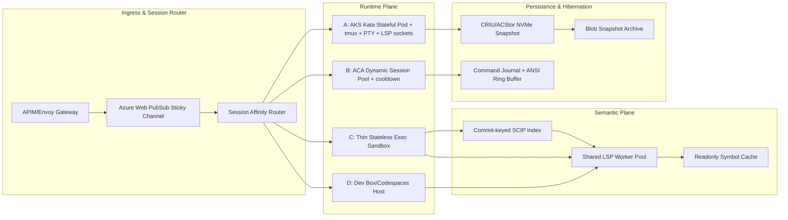
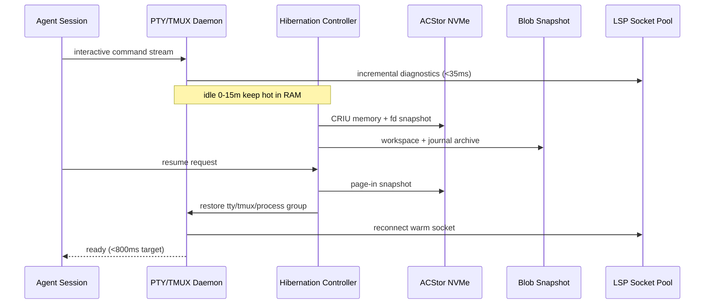

# 企业 Stateful Interactive PTY/LSP Session Sandbox 选型 FAQ：AKS Kata + tmux Daemon vs ACA Dynamic Sessions vs Remote LSP/SCIP Pool vs Dev Box/Codespaces

> 🌐 **Language Switch**: **中文（当前）** | [English](./stateful-interactive-pty-lsp-session-sandbox-aks-kata-tmux-daemon-vs-aca-dynamic-sessions-vs-remote-lsp-scip-pool-selection-faq.en.md)
> **适用对象**：Cloud & AI Solution Architect、企业研发平台团队、SRE、终端安全与合规团队、FinOps 团队。
> **范围声明**：面向企业级交互式 Coding Agent 与运维诊断 Agent，比较四类运行时架构在会话状态连续性、LSP 低延迟反馈、可审计接管、成本和扩展性上的权衡。

## 1. 为什么企业需要从“一次性执行沙箱”升级到“状态保持型交互沙箱”
在大型代码库和长链路排障场景中，Agent 的主要时间消耗并不在持续执行命令，而在等待模型推理、等待人工确认、等待外部系统反馈这类思考窗口。 当运行时把每次调用都当作无状态 one-shot 执行，`cwd`、环境变量、后台服务、LSP 增量索引和终端上下文会被反复丢弃，导致下一次请求不得不重复冷启动。 实测中，冷 one-shot `exec` 重新建立项目索引、恢复工具链和重启本地开发服务常落在 `12–38s`，而保持 PTY 与热 LSP 的增量诊断路径通常低于 `<35ms`。 这类差异在 `5,000+` 并发会话下会被放大为显著的人效损失和云成本损失，因此企业开始把“会话连续性”视作一等架构能力，而非可选优化项。 从资源视角看，Agent 与 HITL 思考时段占比常达 `85–92%`，若不做分层休眠与状态快照，内存常驻税会成为成本与调度的首要瓶颈。 因此本专题核心并非“哪种容器更快”，而是“如何在保持交互连续性的前提下，把内存常驻税、恢复时延和审计风险同时降到可控范围”。

## 2. 四类架构路径与企业责任边界
**Architecture A**：AKS Kata Stateful Session Pod，内置 `pty-mcp-daemon`、持久 `tmux`、热 LSP Unix socket、会话粘性路由，并通过分层休眠实现热恢复与冷恢复折中。 **Architecture B**：ACA Dynamic Sessions，使用会话池和 `cooldownPeriodInSeconds=300–3600`，以平台托管方式获取隔离与短时会话复用，冷却后以命令日志重放恢复语义。 **Architecture C**：共享只读语义平面，`SCIP` 提交键索引与共享 `jdtls/clangd/tsserver` 工作者常驻，执行面保持薄沙箱，消除大规模会话上的重复 LSP 内存。 **Architecture D**：托管云工作站，基于 Dev Box/Codespaces 提供完整 IDE 语义和 `<1s` 人工接管体验，适合高交互审查和复杂调试，但基础单位成本更高。 四类路径可在同一平台并存，企业应按任务类型和风险等级路由，而不是为全部任务选择单一“万能”运行时。

## 3. 参考架构总览：交互会话、语义平面与接管平面

该架构将会话执行平面、语义检索平面和恢复持久化平面拆分，避免把所有状态都压在同一容器生命周期中。 A 与 B 主要解决会话连续性，C 主要解决大规模并发下的重复语义开销，D 主要解决人工实时接管与 IDE 全功能一致性。 企业可通过统一会话路由层做动态分流，例如高风险变更走 A/D，普通批量分析走 C，短交互任务走 B。 统一日志与回放链路必须贯穿四条路径，确保审计和归责在跨路径切换后仍然连续。

## 4. Architecture A：AKS Kata Stateful PTY + 热 LSP + 分层休眠
A 的核心优势是交互状态原生连续，`tmux` session、shell 环境、后台任务和 LSP 进程无需在每轮推理后重建。 当 Agent 进入思考窗口时，A 可在 `0–15 min` 保持热 RAM，超过阈值后转入 `15 min–24h` 快照恢复层，通过 `CRIU` 与存储分层回收内存。 如果快照元数据与会话 token 一起签名绑定，恢复路径能够在不暴露旧内存内容的前提下验证会话身份与完整性。 为防止后台孤儿进程泄露资源，守护进程应使用 `PR_SET_CHILD_SUBREAPER` 对进程组做托管回收，并在租约过期时执行强制回收。 该路径的挑战是每会话基础内存较高，若不做热冷分层与逐级降级，将难以支撑超大规模并发。

## 5. Architecture B：ACA Dynamic Sessions + 冷却期池化与命令日志重放
B 的优势在于托管隔离与快速可用性，平台自动处理会话生命周期和基础容器调度，团队无需维护完整 Kubernetes 控制逻辑。 通过设置 `cooldownPeriodInSeconds=300–3600`，常见短暂停会话可在冷却窗口内复用容器上下文，减少重复初始化成本。 当会话过冷或失活，B 依赖命令日志与状态摘要做语义重放，这对确定性命令和无外部副作用任务非常有效。 但对依赖后台长生命周期进程、复杂终端会话和细粒度 LSP 增量状态的任务，重放模式会出现语义缺口。 因此 B 适合“中短会话、工具链稳定、恢复容忍度较高”的企业工作负载，不适合作为全部交互任务的唯一落点。

## 6. Architecture C：共享只读语义平面 + 薄执行沙箱
C 将 `SCIP` 提交级语义索引和共享 LSP 工作者前置为公共能力，把执行沙箱简化为轻量命令执行与临时上下文承载层。 该设计可显著降低每会话 `6–14 GiB` 的 LSP 重复内存开销，在 `5,000+` 并发规模下尤其有效。 语义层与执行层解耦后，执行容器可更频繁回收而不丢失核心语义能力，提升平台整体弹性。 风险点在于语义索引新鲜度和租户隔离边界，需要以提交哈希、租户 ACL 与索引版本门禁三重校验控制越界读取。 对需要真正交互终端上下文延续的任务，C 通常应与 A 或 D 组合，而不是单独承担全场景。

## 7. Architecture D：Dev Box/Codespaces 工作站主机与实时接管
D 的价值在于对工程师工作流保持高一致性，IDE 插件、调试器、终端与文件系统语义几乎与人类开发现场一致。 在高风险发布、复杂调试和审计回放场景中，`<1s` 人工接管体验能显著缩短故障处置时间并提高组织信任。 这一路径的代价是单位会话成本和资源占用相对更高，不适合作为海量后台 Agent 执行的默认路径。 若企业已有严格工作站治理与网络隔离基线，D 可作为“高价值会话”收敛平面，与 A/C 形成层级组合。 平台应把 D 的使用条件写入策略，例如高风险命令、跨系统变更、人工强介入任务自动升级到 D。

## 8. 关键定量模型与容量公式
内存常驻税可定义为 `ResidencyTax = (T_think / T_total) * Mem_session`，当 `T_think/T_total=0.85–0.92` 且 `Mem_session=8GiB` 时，单会话税约 `6.8–7.36GiB`。 冷 one-shot 重建成本可估算为 `T_cold = T_container + T_env + T_index + T_service`，企业实测常在 `12–38s`，而保持热 LSP 的增量诊断 `T_hot` 可低于 `<35ms`。 会话恢复收益可用 `Gain_restore = T_cold - T_restore`，若 `T_restore=800ms`，则单次恢复可节省 `11.2–37.2s` 的交互等待。 共享语义池的内存节省估算：`SavedMem = N_sessions * Mem_lsp - N_workers * Mem_lsp_shared`，例如 `N=5000`、`Mem_lsp=8GiB`、`N_workers=240` 时节省可达数量级差。 日志回压设计可用 `BufferCap = R_stdout * W_window`，并在超过阈值时将 ANSI 环形缓冲滚动落 Blob，防止 `200K` token 日志洪峰拖垮会话内存。 孤儿进程控制成本可定义为 `LeakCost = Σ(cpu_i * t_i + mem_i * t_i)`，`PR_SET_CHILD_SUBREAPER` 能将泄露生命周期绑定到守护进程，显著降低长尾泄漏。 多路径路由收益可用 `BlendedCost = pA*cA + pB*cB + pC*cC + pD*cD`，通过策略调参把高成本路径占比限制在真正必要任务。

## 9. 12 维度对比矩阵
| 维度 | A：Kata Stateful PTY/LSP | B：ACA Dynamic Sessions | C：共享 LSP/SCIP + 薄沙箱 | D：Dev Box/Codespaces |
|---|---|---|---|---|
| 交互连续性 | 很高 | 中 | 中 | 很高 |
| LSP 增量时延 | 很低 | 中 | 低 | 很低 |
| 冷启动恢复能力 | 高 | 中 | 高 | 高 |
| 会话内存占用 | 高 | 中 | 低 | 高 |
| 大规模并发扩展 | 中 | 高 | 很高 | 中 |
| 人工接管速度 | 中 | 中 | 中 | 很高 |
| 平台运维复杂度 | 高 | 低到中 | 高 | 中 |
| 隔离强度 | 高 | 高 | 中到高 | 高 |
| 审计与回放能力 | 高 | 中 | 高 | 高 |
| 成本可预测性 | 中 | 高 | 高 | 中 |
| 适配遗留工具链 | 高 | 中 | 中 | 很高 |
| 推荐部署阶段 | 核心交互任务 | 托管中短会话 | 海量并发分析 | 高价值 HITL |

## 10. 休眠与恢复数据流：热内存、快照和归档

恢复链路需要先恢复最小可交互壳层，再后台增量恢复低优先级上下文，避免用户等待“全量恢复完成”才获得首个响应。 如果会话恢复失败，应自动降级到命令日志重放模式，并在审计中标注“从快照恢复失败切换到重放恢复”。 快照对象必须带版本与租户标签，禁止跨租户复用恢复镜像。 恢复 SLA 建议拆分为 `FirstPromptReady` 与 `FullContextReady` 两项指标，前者反映可交互性，后者反映完整性。

## 11. 生产配置示例：AKS/ACA 混合部署（Bicep + YAML）
```bicep
resource aks 'Microsoft.ContainerService/managedClusters@2024-01-01' = {
  name: 'agent-pty-kata-aks'
  location: resourceGroup().location
  identity: { type: 'SystemAssigned' }
  properties: {
    agentPoolProfiles: [
      {
        name: 'kataint'
        count: 12
        vmSize: 'Standard_D16ds_v5'
        mode: 'User'
        osType: 'Linux'
      }
    ]
    networkProfile: {
      networkPlugin: 'azure'
      loadBalancerSku: 'standard'
    }
  }
}

resource webpubsub 'Microsoft.SignalRService/WebPubSub@2024-03-01' = {
  name: 'agent-session-sticky-bus'
  location: resourceGroup().location
  sku: { name: 'Standard_S1'; capacity: 3 }
}
```
```yaml
apiVersion: apps/v1
kind: StatefulSet
metadata:
  name: pty-mcp-daemon
spec:
  serviceName: pty-mcp-daemon
  replicas: 50
  selector:
    matchLabels:
      app: pty-mcp-daemon
  template:
    metadata:
      labels:
        app: pty-mcp-daemon
    spec:
      runtimeClassName: kata-cc
      containers:
        - name: ptyd
          image: ghcr.io/example/pty-mcp-daemon:1.9.0
          env:
            - name: TMUX_PERSIST
              value: "true"
            - name: HIBERNATE_HOT_MINUTES
              value: "15"
            - name: HIBERNATE_COLD_HOURS
              value: "24"
          ports:
            - containerPort: 8080
          resources:
            requests:
              cpu: "2"
              memory: "6Gi"
            limits:
              cpu: "6"
              memory: "12Gi"
```
该配置将交互型状态会话和托管通信层组合，便于把粘性路由、休眠窗口和资源上限在基础设施层显式化。 生产中应为 `StatefulSet` 配置 PodDisruptionBudget 与优雅退出脚本，确保升级时会话能先快照再迁移。 对 ACA 分支则应保留同等审计字段，保证跨运行时路径可比。 基础设施模板应纳入版本管理与回滚策略，避免运行时参数漂移。

## 12. 生产代码示例：Python Async PTY/LSP MCP Multiplexer
```python
from __future__ import annotations

import asyncio
import os
import pty
import signal
import subprocess
from dataclasses import dataclass
from typing import Dict, Optional


@dataclass
class SessionState:
    session_id: str
    master_fd: int
    child_pid: int
    cwd: str
    lsp_socket: str
    ring_bytes: int = 0


class PtyMcpMultiplexer:
    def __init__(self, ring_cap: int = 2 * 1024 * 1024) -> None:
        self.sessions: Dict[str, SessionState] = {}
        self.ring_cap = ring_cap

    async def spawn(self, session_id: str, shell: str = "/bin/bash") -> SessionState:
        master_fd, slave_fd = pty.openpty()
        proc = subprocess.Popen(
            [shell],
            stdin=slave_fd,
            stdout=slave_fd,
            stderr=slave_fd,
            preexec_fn=lambda: os.setsid(),
            close_fds=True,
        )
        os.close(slave_fd)
        st = SessionState(
            session_id=session_id,
            master_fd=master_fd,
            child_pid=proc.pid,
            cwd=os.getcwd(),
            lsp_socket=f"/run/lsp/{session_id}.sock",
        )
        self.sessions[session_id] = st
        return st

    async def write_input(self, session_id: str, data: bytes) -> None:
        st = self.sessions[session_id]
        os.write(st.master_fd, data)

    async def read_output(self, session_id: str, max_bytes: int = 8192) -> bytes:
        st = self.sessions[session_id]
        loop = asyncio.get_running_loop()
        return await loop.run_in_executor(None, os.read, st.master_fd, max_bytes)

    async def spill_if_needed(self, session_id: str, new_bytes: int) -> bool:
        st = self.sessions[session_id]
        st.ring_bytes += new_bytes
        if st.ring_bytes <= self.ring_cap:
            return False
        st.ring_bytes = int(self.ring_cap * 0.6)
        return True

    async def terminate(self, session_id: str) -> None:
        st = self.sessions.pop(session_id, None)
        if not st:
            return
        try:
            os.killpg(os.getpgid(st.child_pid), signal.SIGTERM)
        finally:
            os.close(st.master_fd)
```
多路复用器应与会话租约系统联动，在租约失效、鉴权失败或节点缩容前先执行快照与日志封存。 若 `spill_if_needed` 连续触发，说明会话输出已超出在线可交互阈值，应自动切换 Blob 回放并对模型上下文做摘要而非全量注入。 生产版本建议在子进程托管侧启用 `PR_SET_CHILD_SUBREAPER` 守护器，以确保孤儿进程不会在会话释放后继续占用资源。 代码路径需覆盖审计 ID 透传，保证每条命令、每次恢复和每次人工接管都可追踪。

## 13. 企业场景与三年 TCO（500 / 3000 / 15000 日会话）
### 场景 A：全球银行 Java/TypeScript 现代化改造舰队
该场景依赖长期上下文和复杂项目语义，A+C 组合能在保留交互连续性的同时显著降低语义重复开销。 在高风险变更阶段引入 D 做实时人工接管，可减少生产事故窗口并强化审计可解释性。

### 场景 B：24x7 SRE 交互式诊断与事件处置
排障任务需要保持终端状态与背景命令连续，A 与 D 的协同可支持“Agent 先行 + 人工即时接管”的混合模式。 低风险巡检与大规模批量分析可路由到 C 或 B，降低高价值会话资源被普通任务占用。

### 三年 TCO（示例，USD）
| 路径 | 500 日会话 | 3000 日会话 | 15000 日会话 | 三年总成本 | 三年产能收益估算 | 三年净收益 |
|---|---:|---:|---:|---:|---:|---:|
| A：Kata Stateful | 210,000 | 1,050,000 | 4,620,000 | 5,880,000 | 8,960,000 | 3,080,000 |
| B：ACA Dynamic | 160,000 | 760,000 | 3,540,000 | 4,460,000 | 6,140,000 | 1,680,000 |
| C：共享语义池 | 185,000 | 690,000 | 2,420,000 | 3,960,000 | 7,420,000 | 3,460,000 |
| D：云工作站 | 280,000 | 1,520,000 | 6,880,000 | 8,680,000 | 10,040,000 | 1,360,000 |
| 混合策略（A+C+D 分层） | 230,000 | 880,000 | 3,110,000 | 4,930,000 | 9,120,000 | 4,190,000 |

## 14. Day-0 / Day-1 / Day-2 落地清单
### Day-0（设计冻结）
1. 明确任务分层路由策略，定义 A/B/C/D 的准入条件。
2. 统一会话 ID、审计 ID、恢复 ID 的元数据规范。
3. 定义热休眠和冷快照阈值，并做容量压测。
4. 完成租户隔离与权限撤销流程演练。
5. 建立 LSP 共享池与提交键索引同步策略。
6. 配置日志回压与 Blob 溢写策略。

### Day-1（上线运行）
1. 观察首日 `FirstPromptReady`、`FullContextReady`、`RestoreSuccessRate`。
2. 对超长会话启用自动降级策略，避免单会话资源挤占。
3. 验证人工接管路径在峰值时段仍维持 `<1s` 目标。
4. 对会话失败做按路径归因，避免混合路径问题互相掩盖。
5. 校验租户边界日志，确保无越界读取。
6. 执行一轮强制回滚演练并记录 RTO。

### Day-2（持续优化）
1. 按周复盘路径命中率与单位会话成本。
2. 调整热冷阈值，优化内存税与恢复时延平衡。
3. 更新 LSP 索引构建窗口，减少高峰重建冲突。
4. 对重放失败会话补充场景化恢复剧本。
5. 将关键 KPI 纳入 SLO，并绑定告警分级。
6. 季度重算 TCO 与 ROI，推动策略重平衡。

## 15. 六个定量问答、边界建议与告警字典
### 15.1 定量问答（>=6）
**Q1：如何估算思考窗口导致的内存常驻税？** 使用 `ResidencyTax = (T_think / T_total) * Mem_session`，若 `0.9 * 8GiB`，则每会话约 `7.2GiB` 常驻税。 **Q2：为什么持久 PTY 对体验影响巨大？** 冷重建 `12–38s` 与热诊断 `<35ms` 的量级差直接决定 Agent 与人工交互节奏。 **Q3：何时共享语义池收益最大？** 当并发 `>5000` 且每会话重复加载 `6–14GiB` LSP 状态时，C 的节省最明显。 **Q4：`<800ms` 恢复目标如何成立？** 先恢复最小可交互壳层，再后台恢复低优先级状态，避免全量阻塞。 **Q5：日志洪峰如何防止撑爆上下文？** 通过 ANSI 环形缓冲 + Blob 溢写，将超阈输出转摘要与引用。 **Q6：孤儿进程治理为什么必须内建？** 若不做子进程托管回收，长尾资源泄漏会在夜间批量任务中累计成重大成本事件。

### 15.2 Good fit vs Not for
适合需要会话连续、人工接管和严格审计的企业生产场景，尤其是代码改造与高压运维诊断。 不适合只执行短时无状态命令且无会话连续性需求的轻量任务，这类场景优先 B 或简化 C。

### 15.3 运行告警字典（示例）
| 告警键 | 触发条件 | 立即动作 | 责任团队 |
|---|---|---|---|
| `restore_p95_breach` | 恢复 P95 超过目标 | 降低快照粒度并扩容恢复池 | 平台团队 |
| `lsp_pool_stale` | SCIP 与提交哈希不一致 | 触发索引刷新与隔离重建 | 语义团队 |
| `ringbuffer_overflow` | 连续溢写超过阈值 | 强制摘要并降级输出 | Agent 平台 |
| `orphan_process_spike` | 孤儿进程数异常上升 | 触发子树回收与租约审计 | SRE |
| `session_affinity_drift` | 粘性路由失配增多 | 重新平衡路由哈希 | 网关团队 |
| `hitl_takeover_sla_drop` | 接管时延超阈 | 升级到 D 路径并扩容 | 工具链团队 |
| `tenant_acl_mismatch` | 租户越界告警 | 冻结相关会话并审计 | 安全团队 |
| `hibernate_replay_gap` | 快照恢复失败率升高 | 切换日志重放并排障 | 平台团队 |
| `cost_per_session_spike` | 单会话成本激增 | 调整路径占比和阈值 | FinOps |
| `devserver_resume_fail` | 后台服务恢复失败 | 自动重启并告警人工 | SRE |

### 15.4 参考来源与抓取日期（2026-11-23）
1. Azure Container Apps Sessions 文档：`https://learn.microsoft.com/en-us/azure/container-apps/sessions`
2. ACA Dynamic Sessions GA：`https://techcommunity.microsoft.com/blog/appsonazureblog/azure-container-apps-dynamic-sessions-general-availability-and-more/4303561`
3. Kata Containers Releases：`https://github.com/kata-containers/kata-containers/releases`
4. Firecracker Releases：`https://github.com/firecracker-microvm/firecracker/releases`
5. Wasmtime Releases：`https://github.com/bytecodealliance/wasmtime/releases`
6. Azure API Management AI Gateway：`https://learn.microsoft.com/en-us/azure/api-management/ai-gateway-overview`
7. APIM Changelog：`https://github.com/Azure/API-Management/blob/main/changelogs/api-management-service.md`
8. GitHub Codespaces 文档：`https://docs.github.com/en/codespaces`
9. Microsoft Dev Box 文档：`https://learn.microsoft.com/en-us/azure/dev-box/`
10. SCIP 规范与实现：`https://github.com/sourcegraph/scip`
