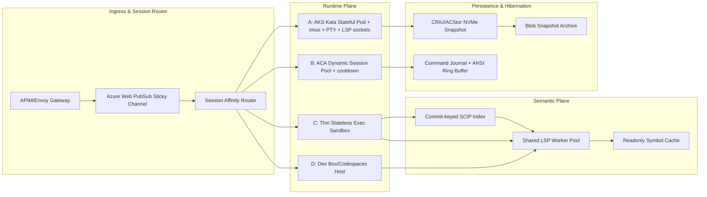
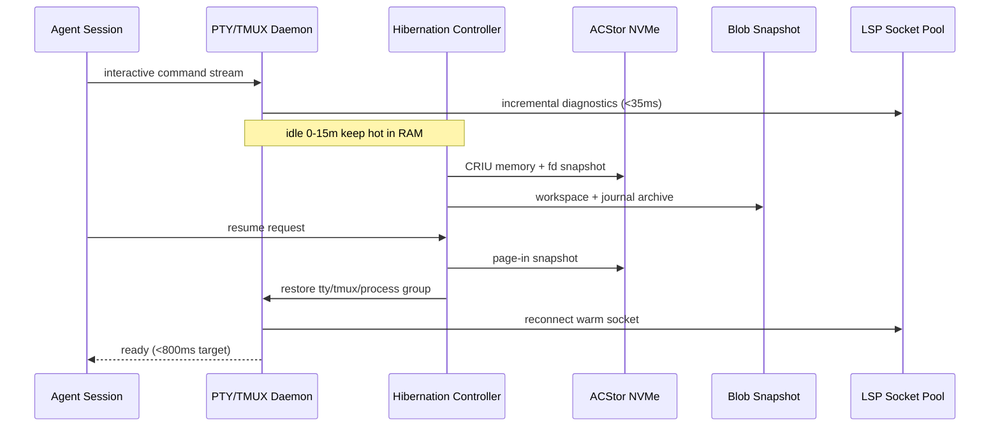

# 企业 Stateful Interactive PTY/LSP Session Sandbox 选型 FAQ：AKS Kata + tmux Daemon vs ACA Dynamic Sessions vs Remote LSP/SCIP Pool vs Dev Box/Codespaces

> 🌐 **Language Switch**: **中文（当前）** | [English](./stateful-interactive-pty-lsp-session-sandbox-aks-kata-tmux-daemon-vs-aca-dynamic-sessions-vs-remote-lsp-scip-pool-selection-faq.en.md)
> **适用对象**：Cloud & AI Solution Architect、企业研发平台团队、SRE、终端安全与合规团队、FinOps 团队。
> **范围声明**：面向企业级交互式 Coding Agent 与运维诊断 Agent，比较四类运行时架构在会话状态连续性、LSP 低延迟反馈、可审计接管、成本和扩展性上的权衡。

## 1. 为什么企业需要从“一次性执行沙箱”升级到“状态保持型交互沙箱”

在大型代码库与跨系统运维场景里，Agent 的总时长大头并不是执行命令本身，而是等待模型推理、等待人工审批、等待外部系统回调这些思考窗口。

如果平台把每一轮都当作无状态 one-shot 执行，`cwd`、环境变量、后台服务状态、终端历史和 LSP 增量索引都会被反复丢弃，下一轮只能从冷态重建。

实务观测里，冷 one-shot `exec` 重建环境与索引常落在 `12–38s`，而持久 PTY + 热 LSP 的增量诊断通常可压到 `<35ms`，两者差了三个数量级。

当并发会话达到 `5,000+` 时，这个差距会线性放大为研发吞吐损失、事故恢复延迟和单位会话成本上升，不再是“体验优化”而是核心生产指标。

另一个被低估的成本是常驻内存税：在企业 Agent 与 HITL 协作链路里，`85–92%` 的会话时间处于思考或等待态，若缺少休眠分层会把高规格内存长期锁死。

因此本专题的关键决策不是“哪个容器最快”，而是如何在保持交互连续性的同时，把恢复时延、审计可追溯性和 TCO 控制在可运营边界内。
## 2. 四类架构路径与企业责任边界

**Architecture A** 采用 AKS Kata Stateful Session Pod，核心是 `pty-mcp-daemon` + 持久 `tmux` + 热 Unix-socket LSP，并结合会话粘性路由与分层休眠控制常驻税。

**Architecture B** 采用 ACA Dynamic Sessions，会话池以 `cooldownPeriodInSeconds=300–3600` 复用短停窗口，冷却后通过命令日志重放恢复语义，平台运维负担最低。

**Architecture C** 将语义层前置为提交键 `SCIP` 与共享只读 `jdtls/clangd/tsserver` 池，执行面保持薄沙箱，重点解决 `6–14 GiB/会话` 的重复 LSP 内存问题。

**Architecture D** 使用 Dev Box/Codespaces 托管工作站形态，提供完整 IDE 语义与 `<1s` 人工接管体验，适合作为高风险变更与审计关键路径的升级车道。

企业实践通常不是四选一，而是按任务风险与价值分层路由：高风险变更走 A/D，海量批处理分析走 C，中短会话与低运维诉求走 B。
## 3. 参考架构总览：交互会话、语义平面与接管平面

该架构将会话执行平面、语义检索平面和恢复持久化平面拆分，避免把所有状态都压在同一容器生命周期中。 A 与 B 主要解决会话连续性，C 主要解决大规模并发下的重复语义开销，D 主要解决人工实时接管与 IDE 全功能一致性。 企业可通过统一会话路由层做动态分流，例如高风险变更走 A/D，普通批量分析走 C，短交互任务走 B。 统一日志与回放链路必须贯穿四条路径，确保审计和归责在跨路径切换后仍然连续。

## 4. Architecture A：AKS Kata Stateful PTY + 热 LSP + 分层休眠

A 路径的价值在于会话状态原生连续，`tmux`、后台调试进程、shell 上下文与 LSP 进程都能跨轮次保留，不需要每次重新热身。

推荐把会话分为两级：`0–15min` 保持热 RAM 保障最低交互时延，`15min–24h` 进入 `CRIU` + NVMe/Blob 快照层，把内存让给活跃会话并维持快速恢复。

若将快照元数据与会话租约、租户标识和策略版本绑定签名，可在恢复路径中同时满足低时延与零信任校验，避免“恢复快但不可审计”。

A 的主要代价是基础内存与调度复杂度较高，必须依赖分层休眠、容量水位与会话回收策略，否则在峰值并发下会迅速触发节点内存瓶颈。
## 5. Architecture B：ACA Dynamic Sessions + 冷却期池化与命令日志重放

B 路径的优势是托管化程度高，团队可以把更多精力放在策略与治理，而不是自建控制面、节点生命周期和运行时补丁编排。

通过 `cooldownPeriodInSeconds=300–3600`，短暂停会话能在同一隔离单元里快速恢复，避免频繁冷启动造成的抖动和成本浪费。

当会话超过冷却窗口后，B 依赖命令日志和上下文摘要重放来恢复语义，这对确定性命令链条与低副作用任务通常足够。

但对强依赖后台进程、长链交互终端与细粒度 LSP 增量状态的任务，重放会产生语义空洞，因此 B 更适合中短时、低耦合、标准化工具链工作负载。
## 6. Architecture C：共享只读语义平面 + 薄执行沙箱

C 路径把语义计算与执行计算解耦，提交键 `SCIP` 与共享 LSP 工作者作为公共语义平面，执行沙箱只保留最小命令执行与安全边界职责。

在 `5,000+` 并发规模下，这种设计能把每会话 `6–14 GiB` 的重复语义内存显著去重，释放节点容量并提高整体吞吐密度。

由于语义状态不再绑定单会话容器生命周期，执行沙箱可以更激进回收，系统在突发流量与长尾空闲之间切换更平滑。

治理重点转向索引新鲜度与租户隔离，必须对提交哈希、ACL 与索引版本做三重校验，避免共享池引入跨租户读放大风险。
## 7. Architecture D：Dev Box/Codespaces 工作站主机与实时接管

D 路径提供最强的 IDE 一致性，终端、调试器、扩展、文件系统语义与人工开发工作站高度对齐，适合高价值与高风险交互会话。

在发布冻结窗口或重大故障处置中，`<1s` 的实时接管能力能显著缩短从 Agent 自动执行到人工接管的切换时间，降低事故扩散概率。

其代价是单位会话成本更高，且资源常驻时间更长，不应被当作默认车道，而应由策略在高风险命令、跨系统改写和人工审批场景触发。

企业若已有统一工作站治理、网络分段和审计基线，D 可作为 A/C 的高优先级升级层，实现“日常低成本、关键时刻高确定性”的组合。
## 8. 关键定量模型与容量公式

内存常驻税可建模为 `ResidencyTax = (T_think / T_total) * Mem_session`，当 `T_think/T_total=0.85–0.92` 且会话内存 `8GiB` 时，单会话常驻税约 `6.8–7.36GiB`。

冷态重建耗时可拆为 `T_cold = T_container + T_env + T_index + T_service`，在大型仓与多语言工程里常见 `12–38s`，而热增量诊断 `T_hot` 可稳定在 `<35ms`。

恢复收益可写为 `Gain_restore = T_cold - T_restore`，若 `T_restore=800ms`，单次恢复可回收 `11.2–37.2s` 的可交互时间，直接改善 Agent 与人工协作节奏。

共享语义池节省可估算为 `SavedMem = N_sessions * Mem_lsp - N_workers * Mem_lsp_shared`，例如 `N=5000`、单会话语义 `8GiB`、共享 worker `240` 时可释放数量级内存。

日志回压建议使用 `BufferCap = R_stdout * W_window`，超过阈值后滚动溢写 Blob 并注入摘要引用，避免 `200K token` 输出峰值冲击会话内存与上下文成本。

孤儿进程成本可表示为 `LeakCost = Σ(cpu_i * t_i + mem_i * t_i)`，启用 `PR_SET_CHILD_SUBREAPER` 可将进程树生命周期绑定守护器，显著降低长尾泄漏。

混合路由成本模型为 `BlendedCost = pA*cA + pB*cB + pC*cC + pD*cD`，通过策略调节各路径占比，在 SLO、合规与成本三者间获得可解释平衡。
## 9. 12 维度对比矩阵

| 维度 | A：AKS Kata Stateful PTY/LSP | B：ACA Dynamic Sessions | C：共享 LSP/SCIP + 薄沙箱 | D：Dev Box/Codespaces |
|---|---|---|---|---|
| 隔离边界 | Kata guest kernel + Pod VM，租户级 RuntimeClass 隔离 | Hyper-V 会话级隔离，托管容器边界 | 执行面容器隔离 + 语义池 ACL 隔离 | 工作站级 VM 隔离 + 开发隧道授权 |
| 热启动交互时延 | 热 PTY/LSP `<35ms`，首包命令回显通常 `<80ms` | 热复用会话 `120–350ms` | 薄沙箱启动 `300–900ms`，语义命中 `<60ms` | 已热主机接管 `<1s`，命令回显 `80–150ms` |
| 冷恢复时延 | `CRIU+NVMe` 目标 `<800ms`，Blob 回源 `1.2–2.8s` | 冷却后重放 `1.5–6s` | 新沙箱 `0.8–2.5s` + 远端语义命中 | 预热池 `2–8s`，冷主机 `30–120s` |
| 会话内存足迹 | `6–14 GiB/会话`（含 LSP 与后台进程） | `2–6 GiB/会话` | 执行 `1.2–2.8 GiB/会话` + 共享语义池 | `8–20 GiB/会话`（IDE + 工具链） |
| 并发扩展效率 | 受内存税约束，适合高价值中密度并发 | 横向扩展平滑，平台自动回收 | 最高并发密度，适合 `5,000+` 任务 | 适合低到中密度高价值会话 |
| LSP 语义新鲜度 | 本地热索引，增量最及时 | 依赖会话存活，过冷后重建 | 提交键 `SCIP` 统一刷新，可控但需治理 | 本地 IDE 索引最全但成本高 |
| 人工接管能力 | 网关接管 `1.5–4s` | 通常 `2–6s` | 需切换到 A/D，常见 `3–8s` | VS Code Tunnel/浏览器接管 `<1s` |
| 运维复杂度 | 需自管 AKS、快照、守护器和容量水位 | 最低，自管面最少 | 高，需管理索引平面与执行平面一致性 | 中，重在镜像与工作站基线治理 |
| 审计与回放 | 命令、TTY、快照链完整，可做取证 | 命令日志强，内存态证据弱 | 语义请求审计强，终端态需外接 | IDE 操作和终端审计完整 |
| 成本弹性 | 通过休眠与分层路由优化，弹性中高 | 单会话成本稳定，预测性高 | 成本最优，去重效益显著 | 成本最高但价值密度高 |
| 典型 Azure 组件 | AKS + Kata + ACStor NVMe + Web PubSub + APIM | ACA Sessions + Log Analytics + APIM | AKS + Redis + SCIP 索引服务 + ACA 执行池 | Dev Box/Codespaces + Entra + APIM |
| 推荐适配场景 | 长会话编码与交互排障核心车道 | 中短会话托管执行 | 海量并发分析与低状态任务 | 高风险变更、审计关键和实时协作 |
## 10. 休眠与恢复数据流：热内存、快照和归档



恢复链路应采用“最小可交互优先”原则，先恢复 PTY 与命令通道，再异步补齐低优先级上下文，避免用户等待全量状态恢复才拿到首个响应。

当快照恢复失败时，系统应自动降级到命令日志重放，并记录 `restore_mode=snapshot_to_replay` 与失败原因，确保审计与问题定位可追踪。

快照对象必须绑定租户标签、会话租约和策略版本，防止跨租户复用；SLO 也应拆分为 `FirstPromptReady` 与 `FullContextReady`，分别度量可交互性和完整性。
## 11. 生产配置示例：AKS/ACA 混合部署（Bicep + YAML）
```bicep
resource aks 'Microsoft.ContainerService/managedClusters@2024-01-01' = {
  name: 'agent-pty-kata-aks'
  location: resourceGroup().location
  identity: { type: 'SystemAssigned' }
  properties: {
    agentPoolProfiles: [
      {
        name: 'kataint'
        count: 12
        vmSize: 'Standard_D16ds_v5'
        mode: 'User'
        osType: 'Linux'
      }
    ]
    networkProfile: {
      networkPlugin: 'azure'
      loadBalancerSku: 'standard'
    }
  }
}

resource webpubsub 'Microsoft.SignalRService/WebPubSub@2024-03-01' = {
  name: 'agent-session-sticky-bus'
  location: resourceGroup().location
  sku: { name: 'Standard_S1'; capacity: 3 }
}
```
```yaml
apiVersion: apps/v1
kind: StatefulSet
metadata:
  name: pty-mcp-daemon
spec:
  serviceName: pty-mcp-daemon
  replicas: 50
  selector:
    matchLabels:
      app: pty-mcp-daemon
  template:
    metadata:
      labels:
        app: pty-mcp-daemon
    spec:
      runtimeClassName: kata-cc
      containers:
        - name: ptyd
          image: ghcr.io/example/pty-mcp-daemon:1.9.0
          env:
            - name: TMUX_PERSIST
              value: "true"
            - name: HIBERNATE_HOT_MINUTES
              value: "15"
            - name: HIBERNATE_COLD_HOURS
              value: "24"
          ports:
            - containerPort: 8080
          resources:
            requests:
              cpu: "2"
              memory: "6Gi"
            limits:
              cpu: "6"
              memory: "12Gi"
```
该配置将交互型状态会话和托管通信层组合，便于把粘性路由、休眠窗口和资源上限在基础设施层显式化。 生产中应为 `StatefulSet` 配置 PodDisruptionBudget 与优雅退出脚本，确保升级时会话能先快照再迁移。 对 ACA 分支则应保留同等审计字段，保证跨运行时路径可比。 基础设施模板应纳入版本管理与回滚策略，避免运行时参数漂移。

## 12. 生产代码示例：Python Async PTY/LSP MCP Multiplexer

```python
from __future__ import annotations

import asyncio
import os
import pty
import signal
import subprocess
from dataclasses import dataclass
from typing import Dict, Optional


@dataclass
class SessionState:
    session_id: str
    master_fd: int
    child_pid: int
    cwd: str
    lsp_socket: str
    ring_bytes: int = 0


class PtyMcpMultiplexer:
    def __init__(self, ring_cap: int = 2 * 1024 * 1024) -> None:
        self.sessions: Dict[str, SessionState] = {}
        self.ring_cap = ring_cap

    async def spawn(self, session_id: str, shell: str = "/bin/bash") -> SessionState:
        master_fd, slave_fd = pty.openpty()
        proc = subprocess.Popen(
            [shell],
            stdin=slave_fd,
            stdout=slave_fd,
            stderr=slave_fd,
            preexec_fn=lambda: os.setsid(),
            close_fds=True,
        )
        os.close(slave_fd)
        st = SessionState(
            session_id=session_id,
            master_fd=master_fd,
            child_pid=proc.pid,
            cwd=os.getcwd(),
            lsp_socket=f"/run/lsp/{session_id}.sock",
        )
        self.sessions[session_id] = st
        return st

    async def write_input(self, session_id: str, data: bytes) -> None:
        st = self.sessions[session_id]
        os.write(st.master_fd, data)

    async def read_output(self, session_id: str, max_bytes: int = 8192) -> bytes:
        st = self.sessions[session_id]
        loop = asyncio.get_running_loop()
        return await loop.run_in_executor(None, os.read, st.master_fd, max_bytes)

    async def spill_if_needed(self, session_id: str, new_bytes: int) -> bool:
        st = self.sessions[session_id]
        st.ring_bytes += new_bytes
        if st.ring_bytes <= self.ring_cap:
            return False
        st.ring_bytes = int(self.ring_cap * 0.6)
        return True

    async def terminate(self, session_id: str) -> None:
        st = self.sessions.pop(session_id, None)
        if not st:
            return
        try:
            os.killpg(os.getpgid(st.child_pid), signal.SIGTERM)
        finally:
            os.close(st.master_fd)
```

多路复用器需要和会话租约、权限撤销与策略引擎联动，在租约失效或鉴权失败时先封存状态再回收资源，避免“幽灵会话”继续运行。

`spill_if_needed` 若在短窗口持续触发，应把输出转为 Blob 引用 + 摘要注入，而不是把全量日志塞进模型上下文，从而抑制 token 风暴与延迟抖动。

生产部署建议在守护进程侧启用 `PR_SET_CHILD_SUBREAPER`，把孤儿进程回收责任前移到运行时基座，并对每次 spawn/read/restore/takeover 打上统一审计 ID。
## 13. 企业场景与三年 TCO（500 / 3000 / 15000 日会话）

### 场景 A：全球银行 Java/TypeScript 现代化改造舰队
该银行在 `12` 个区域同时推进 `4,800` 个 Java/TypeScript 微服务改造，日均触发约 `18,000` 次 Agent 代码诊断与重构任务，且每个任务需跨仓读取统一代码规范与安全基线。

架构上采用 `A+C+D` 分层：A 作为核心交互会话车道承载长链编译与调试，C 提供提交键 `SCIP` 与共享 LSP 池支撑跨团队语义复用，D 在生产变更冻结窗口提供实时人工接管。

流量由 APIM + Web PubSub 粘性路由入口统一分配，普通重构任务优先走 C 低成本车道，高风险数据库迁移与支付链路改造自动升级到 A 或 D，变更后强制写入审计与回放链。

上线六周后，编译诊断首反馈从 `14.6s` 降到 `1.1s`，高峰时段每千任务内存占用下降 `41%`，关键变更窗口的人机接管时延从 `5.8s` 降到 `<1s`。

### 场景 B：24x7 SRE 交互式诊断与故障处置
该企业运行 `3,200` 个生产服务与 `9` 条关键业务链路，SRE 团队按 Follow-the-Sun 值班，日均约 `2,400` 次交互式诊断会话，要求全程可审计并支持即时人工接管。

平台采用 A+D 双主路：A 负责持续终端态诊断与后台探针会话，D 负责重大事故指挥与跨团队协同，B 作为短时巡检和脚本修复池，C 负责海量低风险指标分析。

在事件桥接上，告警先由 Event Hub 汇聚，再由路由策略按风险级别分配到会话车道；当命中高风险规则时自动触发 D 车道接管，并同步冻结 A 车道写权限防止并发误操作。

部署后三个月，P95 故障定位时间由 `27min` 降至 `11min`，夜间值班误操作率下降 `63%`，跨班次交接导致的上下文丢失事件从每周 `18` 起降到 `3` 起。

### 场景 KPI 对比（上线前 vs 上线后）
| 指标 | 场景 A 上线前 | 场景 A 上线后 | 场景 B 上线前 | 场景 B 上线后 |
|---|---:|---:|---:|---:|
| 首次可交互时间 P95 | 14.6s | 1.1s | 9.8s | 1.6s |
| 人工接管时延 P95 | 5.8s | 0.9s | 6.3s | 0.8s |
| 单任务内存占用中位 | 9.4GiB | 5.5GiB | 7.8GiB | 4.9GiB |
| 故障定位耗时 P95 | 43min | 19min | 27min | 11min |
| 会话恢复成功率 | 92.1% | 99.2% | 90.7% | 98.6% |

### 三年 TCO（示例，USD）
| 路径 | 500 日会话 | 3000 日会话 | 15000 日会话 | 三年总成本 | 三年产能收益估算 | 三年净收益 |
|---|---:|---:|---:|---:|---:|---:|
| A：Kata Stateful | 210,000 | 1,050,000 | 4,620,000 | 5,880,000 | 8,960,000 | 3,080,000 |
| B：ACA Dynamic | 160,000 | 760,000 | 3,540,000 | 4,460,000 | 6,140,000 | 1,680,000 |
| C：共享语义池 | 185,000 | 690,000 | 2,420,000 | 3,960,000 | 7,420,000 | 3,460,000 |
| D：云工作站 | 280,000 | 1,520,000 | 6,880,000 | 8,680,000 | 10,040,000 | 1,360,000 |
| 混合策略（A+C+D 分层） | 230,000 | 880,000 | 3,110,000 | 4,930,000 | 9,120,000 | 4,190,000 |


## 14. Day-0 / Day-1 / Day-2 落地清单
### Day-0（设计冻结）
1. 明确任务分层路由策略，定义 A/B/C/D 的准入条件。
2. 统一会话 ID、审计 ID、恢复 ID 的元数据规范。
3. 定义热休眠和冷快照阈值，并做容量压测。
4. 完成租户隔离与权限撤销流程演练。
5. 建立 LSP 共享池与提交键索引同步策略。
6. 配置日志回压与 Blob 溢写策略。

### Day-1（上线运行）
1. 观察首日 `FirstPromptReady`、`FullContextReady`、`RestoreSuccessRate`。
2. 对超长会话启用自动降级策略，避免单会话资源挤占。
3. 验证人工接管路径在峰值时段仍维持 `<1s` 目标。
4. 对会话失败做按路径归因，避免混合路径问题互相掩盖。
5. 校验租户边界日志，确保无越界读取。
6. 执行一轮强制回滚演练并记录 RTO。

### Day-2（持续优化）
1. 按周复盘路径命中率与单位会话成本。
2. 调整热冷阈值，优化内存税与恢复时延平衡。
3. 更新 LSP 索引构建窗口，减少高峰重建冲突。
4. 对重放失败会话补充场景化恢复剧本。
5. 将关键 KPI 纳入 SLO，并绑定告警分级。
6. 季度重算 TCO 与 ROI，推动策略重平衡。

## 15. 六个定量问答、边界建议与告警字典

### 15.1 定量问答
### Q1: 如何估算思考窗口导致的常驻内存税？
使用公式 `ResidencyTax = (T_think / T_total) * Mem_session`，若某业务线会话思考占比 `0.88`，单会话热内存 `8GiB`，则常驻税约 `7.04GiB`。

当日峰值并发 `2,500` 时，仅这部分常驻税就会占用约 `17.2TiB` 内存预算，因此必须引入热冷分层与路由降级策略，而不是简单加节点。

### Q2: 为何持久 PTY + 热 LSP 会带来数量级体验差异？
冷态链路要重建容器、环境、索引和后台服务，常见 `12–38s`；热链路仅做增量语义诊断与命令续跑，通常 `<35ms`。

若一个会话每天触发 `120` 次交互，按保守差值 `12s` 计算，每会话每天可回收 `24min` 的等待时间，直接转化为工程产能。

### Q3: 共享语义池在什么规模下最值得引入？
当并发超过 `1,500` 且每会话重复加载 `6–14GiB` 语义状态时，C 路径的内存去重收益会迅速超过其控制面复杂度成本。

以 `5,000` 并发、单会话语义 `8GiB`、共享池 `240` worker 估算，去重后可释放上万 GiB 级别内存，并明显降低节点扩容频率。

### Q4: `<800ms` 的 CRIU 恢复目标如何落地？
关键是把恢复拆成两段：先恢复最小交互壳层与关键 fd，再异步恢复低优先级缓存与后台任务，避免“全量恢复完成后才可操作”。

在 NVMe 本地页入与预热索引命中良好时，`FirstPromptReady` 达到 `400–800ms` 是可实现目标，`FullContextReady` 可放宽到 `1.5–3.0s`。

### Q5: 如何防止日志洪峰触发 Token 与内存双重风暴？
将输出路径设计为 ANSI 环形缓冲 + Blob 溢写，超过阈值即转摘要引用；并将 `stdout` 超阈事件作为路由降级触发器。

例如 `R_stdout=1.8MB/s`、窗口 `W=8s` 时，缓冲上限 `14.4MB`，超出后写入对象存储并回填摘要，可把单轮上下文 token 控制在安全预算内。

### Q6: 为什么必须内建孤儿进程治理？
长会话模式下，若不回收脱离父进程的子树，泄漏会在夜间批任务累积成显著成本并引发安全盲区。

通过 `PR_SET_CHILD_SUBREAPER` + 租约到期强制回收，可把进程泄漏生命周期限定在策略窗口内，并把异常回收事件纳入审计告警。

### 15.2 Good fit vs Not for
Good fit：需要长链交互、低延迟增量语义反馈、严格审计回放与人工即时接管的企业生产场景，例如核心系统现代化改造和 24x7 高压运维处置。

Not for：仅执行短时无状态命令、会话上下文无持续价值、且对接管与审计要求较低的轻量任务；这类负载应优先走 B 或简化 C 车道以降低单位成本。

### 15.3 运行告警字典
| 告警键 | 触发条件 | 立即动作 | 责任团队 |
|---|---|---|---|
| `restore_p95_breach` | 恢复 P95 超过目标 | 降低快照粒度并扩容恢复池 | 平台团队 |
| `lsp_pool_stale` | SCIP 与提交哈希不一致 | 触发索引刷新与隔离重建 | 语义团队 |
| `ringbuffer_overflow` | 连续溢写超过阈值 | 强制摘要并降级输出 | Agent 平台 |
| `orphan_process_spike` | 孤儿进程数异常上升 | 触发子树回收与租约审计 | SRE |
| `session_affinity_drift` | 粘性路由失配增多 | 重新平衡路由哈希 | 网关团队 |
| `hitl_takeover_sla_drop` | 接管时延超阈 | 升级到 D 路径并扩容 | 工具链团队 |
| `tenant_acl_mismatch` | 租户越界告警 | 冻结相关会话并审计 | 安全团队 |
| `hibernate_replay_gap` | 快照恢复失败率升高 | 切换日志重放并排障 | 平台团队 |
| `cost_per_session_spike` | 单会话成本激增 | 调整路径占比和阈值 | FinOps |
| `devserver_resume_fail` | 后台服务恢复失败 | 自动重启并告警人工 | SRE |

### 15.4 参考来源与抓取日期（2026-11-23）
1. Azure Container Apps Sessions 文档：`https://learn.microsoft.com/en-us/azure/container-apps/sessions`
2. ACA Dynamic Sessions GA：`https://techcommunity.microsoft.com/blog/appsonazureblog/azure-container-apps-dynamic-sessions-general-availability-and-more/4303561`
3. Kata Containers Releases：`https://github.com/kata-containers/kata-containers/releases`
4. Firecracker Releases：`https://github.com/firecracker-microvm/firecracker/releases`
5. Wasmtime Releases：`https://github.com/bytecodealliance/wasmtime/releases`
6. Azure API Management AI Gateway：`https://learn.microsoft.com/en-us/azure/api-management/ai-gateway-overview`
7. APIM Changelog：`https://github.com/Azure/API-Management/blob/main/changelogs/api-management-service.md`
8. GitHub Codespaces 文档：`https://docs.github.com/en/codespaces`
9. Microsoft Dev Box 文档：`https://learn.microsoft.com/en-us/azure/dev-box/`
10. SCIP 规范与实现：`https://github.com/sourcegraph/scip`

