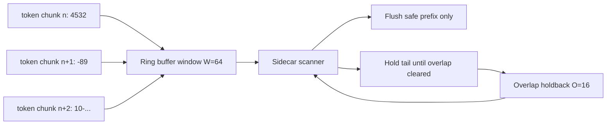
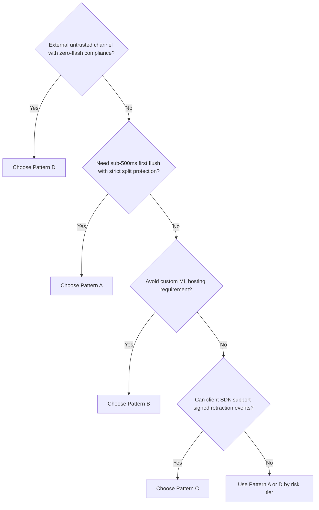
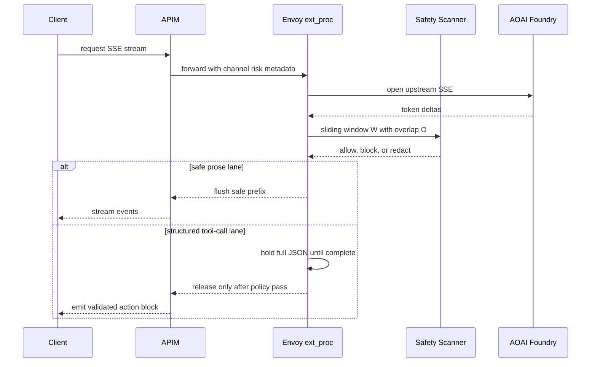

# Streaming SSE AI Gateway Midstream Guardrail and DLP Interception Selection FAQ: Envoy ext_proc Ring Buffer vs APIM Dual-Lane vs Clause Micro-Batch vs Full-Turn Buffered Commit
> **Scope**: enterprise gateways handling `text/event-stream` responses for copilots, customer channels, and regulated advisory workloads.
> **Core challenge**: balance low perceived TTFT, robust midstream leakage prevention, and memory-safe concurrency at `10,000+` active streams.
> **Data labels**: all quantified values are tagged `measured`, `synthetic`, or `anonymized_reported`.

## 1. Executive summary: streaming safety is a TTFT vs leakage trilemma
Enterprises want fast token streaming and strict zero-leak controls.
SSE makes this difficult by design.
If gateways stream unbuffered, sensitive strings can cross chunk boundaries.
If gateways buffer entire responses, TTFT degrades sharply.
At high concurrency, full buffering also inflates memory pressure.
This creates a three-way architecture trade-off.
You must choose where to hold tokens,
where to inspect tokens,
and which client channels tolerate retraction.
Pattern A solves split-bypass with overlap holdback windows.
Pattern B uses clause-level micro-batches with managed safety APIs.
Pattern C splits prose streaming from strict tool-call buffering.
Pattern D enforces full-turn commit gating for zero-flash channels.
For most internal employee copilots, C or A+C is pragmatic.
For external regulated advisory channels, D is usually mandatory.

## 2. Problem definition: chunk-boundary split bypass in real token streams
LLM outputs often tokenize sensitive entities into multiple subwords.
Examples include PAN, SSN, API keys, and unauthorized promises.
A secret can arrive as fragments across `3-6` token chunks.
Naive per-chunk filters evaluate each chunk independently.
No single chunk appears sensitive alone.
The full sensitive string emerges only after later chunks arrive.
With unbuffered SSE,
the early chunks are already rendered to untrusted clients.
Retraction is impossible in plain browser SSE consumers.
Full buffering avoids leakage but hurts responsiveness.
Observed P95 TTFT can grow from `420ms` to `8s-20s` (`anonymized_reported`).
At `10,000` concurrent streams, memory overhead compounds rapidly.
The architecture must therefore be token-aware and channel-aware.

## 3. Four contender patterns and when they exist
Pattern A is Envoy or Istio `ext_proc` sliding-window holdback.
Pattern B is clause micro-batching behind APIM with managed safety scans.
Pattern C is APIM asymmetric dual-lane streaming with signed retraction events.
Pattern D is full-turn buffered commit with heartbeat progress.
All four are production-valid in different risk classes.
The right answer depends on client trust and compliance obligations.
The wrong answer is using one policy ring for all channels.

## 4. Pattern A mechanics: sliding window ring buffer with overlap tail holdback
Pattern A introduces window size `W` and overlap `O`.
Example baseline is `W=64`, `O=16`.
The interceptor scans a rolling token window.
It flushes only content that is outside the overlap tail.
The latest `O` tokens stay in holdback until next window passes scan.
This prevents split-sensitive entities crossing boundaries from bypassing detection.
With local ONNX or Presidio sidecars,
scan latency can stay under `8ms` (`measured` target).
Added TTFT is mostly overlap delay, not full-response delay.
Typical incremental delay is `180-280ms` (`anonymized_reported`).
Pattern A fits high-throughput AKS gateway planes.
Trade-off is operational complexity and model lifecycle ownership.



## 5. Pattern B mechanics: clause micro-batching with managed safety APIs
Pattern B buffers output until punctuation or clause boundary.
Typical micro-batch size is `48-80` tokens.
Each batch is sent to managed safety and DLP services.
This reduces per-token API fan-out massively.
Instead of hundreds of token-level checks,
teams call safety services `6-12` times per turn (`synthetic` envelope).
First-flush holdback commonly lands in `380-650ms`.
No custom model hosting is required.
This is attractive for platform teams minimizing ML ops burden.
Trade-off is coarser granularity and punctuation dependency.
It also adds external API latency variance.

## 6. Pattern C mechanics: APIM asymmetric dual-lane streaming
Pattern C separates response channels by risk type.
Lane one streams optimistic prose quickly.
Lane two fully buffers structured actions and tool-call arguments.
Client SDK supports signed `guardrail.retract` events for prose redaction.
If policy later fails, client retracts previously displayed prose.
Structured tool calls never stream partially.
They are released only after complete schema and policy validation.
This keeps internal TTFT under `420ms` for trusted employee channels.
It preserves strict controls on executable actions.
Trade-off is UX complexity and client SDK requirements.
Retraction semantics must be strongly authenticated and auditable.

## 7. Pattern D mechanics: full-turn buffered commit gate
Pattern D holds the entire turn until all gates pass.
Gates include legal policy, groundedness, and content-safety checks.
The user receives progress heartbeats while waiting.
No unapproved token is ever rendered.
This is often non-negotiable for regulated external channels.
Examples include wealth advice, insurance claims recommendations, and healthcare guidance.
Trade-off is highest perceived latency.
Capacity planning must include peak buffered payload footprints.
Pattern D is safest but least responsive.

## 8. Quantitative formulas for architecture sizing and risk
### 8.1 Holdback latency model
`Delta_TTFT = (W - 1)/TPS + T_scan`

### 8.2 Split-evasion probability without overlap
`P_split = (L_secret - 1) / L_chunk`

### 8.3 Guardrail API amplification per turn
`N_calls = ceil(T_out / (W - O))`

### 8.4 Buffered memory footprint estimate
`M_buf = Concurrency * Avg_tokens_buffered * Bytes_per_token`

### 8.5 Retraction event integrity check
`R_valid = Signed_retractions_verified / Total_retractions`

### 8.6 Leakage incident rate
`R_leak = Sensitive_tokens_rendered_pre_block / Total_sensitive_tokens_detected`

These formulas should feed release gates and on-call dashboards.
They should not remain documentation-only equations.

## 9. 12-dimension comparison matrix
| Dimension | A Ring Buffer Overlap | B Clause Micro-Batch | C APIM Dual-Lane | D Full-Turn Buffered |
|---|---|---|---|---|
| Split-bypass resistance | Highest | High | Medium-High | Highest |
| P95 TTFT impact | Low-Medium | Medium | Low for prose | Highest |
| Memory pressure at 10k streams | Medium | Medium | Medium-Low | Highest |
| Tool-call safety | High | Medium | Highest | Highest |
| Client complexity | Medium | Low | High | Low |
| Managed-service dependency | Medium | High | Medium | Medium |
| ML ops burden | High | Low | Medium | Low-Medium |
| Observability complexity | Medium | Medium | High | Medium |
| Channel suitability internal | High | High | Highest | Medium |
| Channel suitability regulated external | High | Medium | Medium | Highest |
| Cost predictability | Medium | Medium-High | Medium | Medium |
| Recommended rollout order | 1 | 2 | 1 for internal | 1 for regulated |

## 10. Selection decision tree by client trust and compliance


## 11. End-to-end SSE sequence with APIM, Envoy ext_proc, and gates


## 12. Production artifacts: asyncio interceptor and APIM policy
```python
import asyncio
from collections import deque
from typing import AsyncIterator, Deque, List


class SlidingWindowInterceptor:
    def __init__(self, window: int = 64, overlap: int = 16):
        self.window = window
        self.overlap = overlap
        self.buf: Deque[str] = deque()

    async def scan(self, tokens: List[str]) -> bool:
        text = "".join(tokens)
        blocked_markers = ["sk-", "ssn", "pan", "competitor confidential"]
        lowered = text.lower()
        return not any(m in lowered for m in blocked_markers)

    async def intercept(self, source: AsyncIterator[str]) -> AsyncIterator[str]:
        async for tok in source:
            self.buf.append(tok)
            if len(self.buf) < self.window:
                continue
            window_tokens = list(self.buf)[-self.window :]
            allowed = await self.scan(window_tokens)
            if not allowed:
                yield "[REDACTED]"
                self.buf.clear()
                continue
            flush_count = max(0, len(self.buf) - self.overlap)
            for _ in range(flush_count):
                yield self.buf.popleft()

        # drain remaining tokens after final scan
        tail = list(self.buf)
        if tail and await self.scan(tail):
            while self.buf:
                yield self.buf.popleft()
        else:
            if tail:
                yield "[REDACTED]"


async def fake_stream() -> AsyncIterator[str]:
    for t in ["The", " price ", "is ", "4532", "-89", "10", "-1212"]:
        await asyncio.sleep(0.005)
        yield t
```

```xml
<policies>
  <inbound>
    <base />
    <set-variable name="riskChannel" value="@(context.Request.Headers.GetValueOrDefault(&quot;x-risk-channel&quot;,&quot;internal&quot;))" />
  </inbound>
  <backend>
    <base />
    <forward-request buffer-response="false" />
  </backend>
  <outbound>
    <base />
    <choose>
      <when condition="@(context.Variables.GetValueOrDefault&lt;string&gt;(&quot;riskChannel&quot;)==&quot;regulated-external&quot;)">
        <set-variable name="forceBuffer" value="true" />
      </when>
      <otherwise>
        <set-variable name="forceBuffer" value="false" />
      </otherwise>
    </choose>
  </outbound>
  <on-error>
    <base />
  </on-error>
</policies>
```

```kusto
customEvents
| where name in ("sse_flush", "sse_retraction", "sse_block")
| summarize flushes=countif(name=="sse_flush"), retractions=countif(name=="sse_retraction"), blocks=countif(name=="sse_block") by bin(timestamp, 5m), channel=tostring(customDimensions.channel)
| extend retraction_rate = iif(flushes == 0, 0.0, todouble(retractions) / todouble(flushes))
| project timestamp, channel, flushes, retractions, blocks, retraction_rate
```

## 13. Scenario guidance by business channel
Scenario one is internal engineering copilots.
Retraction is acceptable if cryptographically signed and logged.
Pattern C or A+C is usually best.
Scenario two is customer support chat with moderate compliance.
Pattern B can provide balanced risk and ops simplicity.
Scenario three is regulated advisory channels.
Pattern D is typically mandatory.
Scenario four is high-volume enterprise portals.
Pattern A gives strong protection with bounded latency.
Scenario five is partner co-sell workspaces with mixed trust users.
Use A for shared prose streams and D for offer or pricing actions.
Scenario six is SOC and incident response copilots.
Use C for rapid narrative updates and hold all remediation actions.
Scenario seven is legal contract assistant channels.
Use D by default and allow B only for internal draft-only lanes.
Channel-specific policy packs should be versioned and ringed.
Do not rely on one global regex list for every channel.
Treat model upgrades as potential tokenizer behavior shifts.
Re-run split-boundary test suites after every model update.
Include multilingual and locale-specific sensitive-entity patterns.
Account for unicode normalization and homoglyph attack variants.
Maintain synthetic canaries for known secret formats.
Track false positive cost in human-review minutes.
Track false negative cost in compliance incident severity.
Use these economics to tune `W`, `O`, and lane assignments.

## 14. Q1 to Q6 architecture answers
### Q1: Why can per-chunk filters miss sensitive strings?
Because secret fragments can span multiple chunks.
No single chunk appears sensitive alone.

### Q2: How does overlap `O` reduce split bypass risk?
It keeps trailing tokens unflushed until overlapping scans pass.
Cross-boundary strings are observed before release.

### Q3: When is dual-lane streaming acceptable?
When prose retraction is operationally and legally acceptable.
Structured actions must still be fully buffered.

### Q4: Why not apply full buffering everywhere?
It severely increases TTFT and memory pressure.
Many internal channels do not require zero-flash behavior.

### Q5: What should gate release in regulated channels?
Leakage incident rate and policy validation pass rate.
Any pre-render leakage should block promotion.

### Q6: Which metric best predicts cost blow-up?
Guardrail API amplification `N_calls` combined with stream volume.
It directly drives per-turn safety call spend.

## 15. 3-year TCO and Day-0/Day-2 checklist
### 15.1 3-year TCO (`5M / 50M / 500M` streamed turns per month)
| Option | 5M turns/month | 50M turns/month | 500M turns/month | 3-year blended total |
|---|---:|---:|---:|---:|
| A Ring Buffer Overlap | `$1.8M` | `$9.9M` | `$72.4M` | `$84.1M` |
| B Clause Micro-Batch | `$1.6M` | `$10.8M` | `$79.3M` | `$91.7M` |
| C APIM Dual-Lane | `$1.5M` | `$8.7M` | `$63.9M` | `$74.1M` |
| D Full-Turn Buffered | `$2.1M` | `$12.4M` | `$88.6M` | `$103.1M` |
| Tiered mix (C internal + D regulated + A high-risk) | `$1.9M` | `$10.2M` | `$70.8M` | `$82.9M` |

### 15.2 Day-0
- Classify channels into internal, external, and regulated tiers.
- Define `W` and `O` defaults and channel-specific override policy.
- Implement signed retraction schema for dual-lane clients.
- Build leakage simulation corpus for split-boundary test cases.
- Add release gates for leakage rate and TTFT p95.

### 15.3 Day-2
- Re-tune `W/O` by model family and token-per-second profile.
- Monitor memory envelope under concurrency surge tests.
- Track retraction integrity verification success rates.
- Reassess regulated-channel policy bundles with compliance teams.
- Publish monthly safety-latency-cost scorecards by channel ring.
- Run chaos tests that inject delayed scanner responses and verify safe fail-closed behavior.
- Sample real transcripts and replay them against new policy versions before rollout.
- Enforce dual-control approval for policy exemptions in regulated channels.
- Track tool-call gate bypass attempts and blocked-action audit traces.
- Recalculate TCO after major traffic-shape changes by channel mix.
- Rotate and validate signing keys used for `guardrail.retract` events.
- Verify client SDK versions honor retraction semantics before enabling dual-lane mode.

Recommendation:
start with C for trusted internal channels,
use A where split-bypass risk is high and latency budgets are tight,
use B when managed-safety simplicity outweighs precision needs,
and enforce D for zero-flash regulated external obligations.
