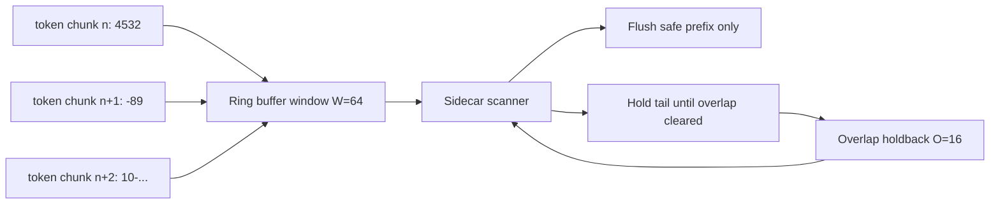
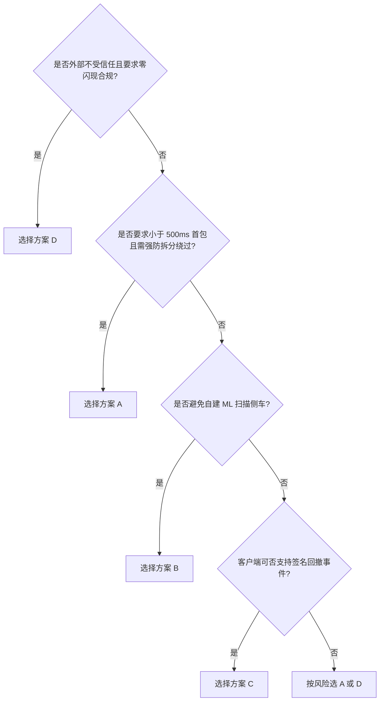
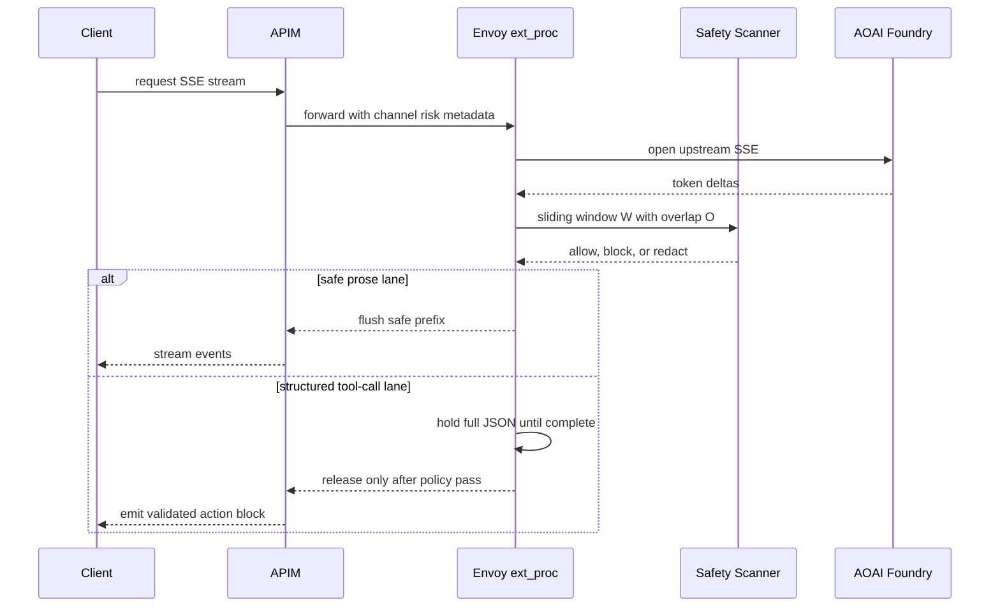

# Streaming SSE AI Gateway 中途拦截与 DLP 选型 FAQ：Envoy ext_proc Ring Buffer vs APIM Dual-Lane vs Clause Micro-Batch vs Full-Turn Buffered Commit
> **适用范围**：面向 `text/event-stream` 流式输出的企业 AI Gateway，包括内部 Copilot、外部客户渠道与强监管顾问场景。
> **核心挑战**：在 `10,000+` 并发 SSE 连接下，同时满足低感知 TTFT、零泄漏拦截与可控内存占用。
> **数据标签**：文中定量数据均标注为 `measured`、`synthetic` 或 `anonymized_reported`。

## 1. 执行摘要：流式安全天然是 TTFT 与零泄漏的三难题
企业既要快，又要严。
SSE 输出天生放大这组矛盾。
若完全不缓冲直通，
敏感片段可能跨 chunk 边界逃逸检测。
若整段全缓冲再放行，
TTFT 会明显上升。
在高并发下，全缓冲还会推高网关内存压力。
因此必须做架构分层决策。
你要明确三件事。
哪里持有 token。
哪里做扫描与策略判定。
哪些客户端可接受回撤机制。
方案 A 用重叠尾部保留解决跨边界逃逸。
方案 B 用分句微批减少 API 放大。
方案 C 把普通文本流与工具调用流拆分。
方案 D 以全量提交门确保零闪现。
内部可信员工助手常用 C 或 A+C。
外部强监管顾问场景通常必须 D。

## 2. 问题定义：Chunk 边界拆分绕过并非理论风险
模型输出常把敏感实体切成多个子词。
如 PAN、SSN、API Key、竞品名、违规价格承诺。
敏感字符串可分散在 `3-6` 个 chunk 中。
逐 chunk 检测只看局部片段。
单个片段可能都“看起来安全”。
完整敏感实体要到后续 chunk 才显现。
若此时网关已直通输出，
外部浏览器会先看到不可逆内容。
普通 SSE 客户端不具备可靠撤回能力。
全缓冲可以压住泄漏，
但会拉高首包等待。
实测或回归中常见 P95 TTFT 从 `420ms` 抬升到 `8s-20s`（`anonymized_reported`）。
并发达到 `10,000` 时，缓存占用快速放大。
因此必须按信道风险做差异化流控。

## 3. 四种候选方案的定位
方案 A 是 Envoy 或 Istio `ext_proc` 滑动窗口保留。
方案 B 是 APIM 后分句微批 + 托管安全服务。
方案 C 是 APIM 非对称双通道流式。
方案 D 是全回合缓冲提交门。
四种方案都可生产化。
关键是与信道信任等级匹配。
不能用一套策略覆盖所有渠道。

## 4. 方案 A：`W/O` 重叠保留 Ring Buffer 机制
方案 A 引入窗口 `W` 与重叠尾部 `O`。
典型基线是 `W=64`、`O=16`。
拦截器按滑动窗口做检测。
只释放窗口前缀安全部分。
尾部 `O` 个 token 永远暂存，直到下一轮重叠扫描通过。
这样能覆盖跨边界拼接敏感串。
在本地 ONNX/Presidio 侧车下，
检测延迟可压到 `<8ms`（`measured` 目标）。
增量 TTFT 主要来自重叠等待，而非整段缓冲。
常见新增延迟约 `180-280ms`（`anonymized_reported`）。
方案 A 适合 AKS 上高吞吐网关平面。
代价是侧车模型运维与策略调参复杂度更高。



## 5. 方案 B：分句微批 + 托管安全 API
方案 B 以标点或从句为边界微批缓存。
单批通常 `48-80` token。
每批调用托管内容安全和 DLP 服务。
这样可显著降低逐 token API 放大。
相比每 token 检查，
单回合只需 `6-12` 次安全调用（`synthetic` 区间）。
首批放行延迟常见 `380-650ms`。
优点是不需要自建模型侧车。
平台团队 ML 运维负担较低。
代价是粒度较粗且依赖分句质量。
外部 API 抖动会带来额外尾延迟。

## 6. 方案 C：APIM 非对称双通道流式
方案 C 按风险类型拆分输出通道。
第一通道是乐观文本流。
第二通道对结构化动作和 tool_call 参数做全缓冲。
客户端 SDK 支持签名 `guardrail.retract` 事件。
若后续判定失败，可对已展示文本回撤。
但结构化动作绝不部分释放。
仅在 schema 与策略全部通过后整块放行。
这样可以保持内部员工场景 `<420ms` TTFT。
同时约束高风险执行路径。
代价是客户端协议复杂度上升。
回撤事件必须可验签、可审计、可重放。

## 7. 方案 D：全回合缓冲提交门
方案 D 在回合末统一判定并一次提交。
常见门禁含法务策略、事实依据和安全检查。
等待期间由服务器发送进度心跳。
未批准 token 永不渲染。
在外部强监管场景通常是硬要求。
如保险建议、财富顾问、医疗建议。
代价是感知时延最高。
容量规划必须纳入峰值缓冲体积。
方案 D 安全性最高但交互速度最低。

## 8. 定量公式：延迟、逃逸概率与调用放大
### 8.1 保留窗口增量延迟
`Delta_TTFT = (W - 1)/TPS + T_scan`

### 8.2 无重叠时跨边界逃逸概率
`P_split = (L_secret - 1) / L_chunk`

### 8.3 单回合安全 API 调用放大
`N_calls = ceil(T_out / (W - O))`

### 8.4 缓冲内存估算
`M_buf = Concurrency * Avg_tokens_buffered * Bytes_per_token`

### 8.5 回撤验签完整率
`R_valid = Signed_retractions_verified / Total_retractions`

### 8.6 泄漏事件率
`R_leak = Sensitive_tokens_rendered_pre_block / Total_sensitive_tokens_detected`

上述指标应纳入发布门禁与值班看板。
不能只停留在设计文档层面。

## 9. 12 维企业级对比矩阵
| 维度 | A Ring Buffer Overlap | B Clause Micro-Batch | C APIM Dual-Lane | D Full-Turn Buffered |
|---|---|---|---|---|
| 跨边界逃逸防护 | 最高 | 高 | 中高 | 最高 |
| P95 TTFT 影响 | 低中 | 中 | 文本低 | 最高 |
| 1 万并发内存压力 | 中 | 中 | 中低 | 最高 |
| Tool-Call 安全性 | 高 | 中 | 最高 | 最高 |
| 客户端复杂度 | 中 | 低 | 高 | 低 |
| 托管服务依赖 | 中 | 高 | 中 | 中 |
| ML 运维负担 | 高 | 低 | 中 | 低中 |
| 可观测复杂度 | 中 | 中 | 高 | 中 |
| 内部渠道适配 | 高 | 高 | 最高 | 中 |
| 外部强监管适配 | 高 | 中 | 中 | 最高 |
| 成本可预测性 | 中 | 中高 | 中 | 中 |
| 推荐落地顺序 | 1 | 2 | 内部可 1 | 监管可 1 |

## 10. 选型决策树：按客户端信任与合规等级决策


## 11. 端到端时序：APIM、Envoy、侧车扫描与流式门控


## 12. 生产配置样例：Python 拦截器与 APIM 策略
```python
import asyncio
from collections import deque
from typing import AsyncIterator, Deque, List


class SlidingWindowInterceptor:
    def __init__(self, window: int = 64, overlap: int = 16):
        self.window = window
        self.overlap = overlap
        self.buf: Deque[str] = deque()

    async def scan(self, tokens: List[str]) -> bool:
        text = "".join(tokens)
        blocked_markers = ["sk-", "ssn", "pan", "competitor confidential"]
        lowered = text.lower()
        return not any(m in lowered for m in blocked_markers)

    async def intercept(self, source: AsyncIterator[str]) -> AsyncIterator[str]:
        async for tok in source:
            self.buf.append(tok)
            if len(self.buf) < self.window:
                continue
            window_tokens = list(self.buf)[-self.window :]
            allowed = await self.scan(window_tokens)
            if not allowed:
                yield "[REDACTED]"
                self.buf.clear()
                continue
            flush_count = max(0, len(self.buf) - self.overlap)
            for _ in range(flush_count):
                yield self.buf.popleft()

        tail = list(self.buf)
        if tail and await self.scan(tail):
            while self.buf:
                yield self.buf.popleft()
        else:
            if tail:
                yield "[REDACTED]"


async def fake_stream() -> AsyncIterator[str]:
    for t in ["The", " price ", "is ", "4532", "-89", "10", "-1212"]:
        await asyncio.sleep(0.005)
        yield t
```

```xml
<policies>
  <inbound>
    <base />
    <set-variable name="riskChannel" value="@(context.Request.Headers.GetValueOrDefault(&quot;x-risk-channel&quot;,&quot;internal&quot;))" />
  </inbound>
  <backend>
    <base />
    <forward-request buffer-response="false" />
  </backend>
  <outbound>
    <base />
    <choose>
      <when condition="@(context.Variables.GetValueOrDefault&lt;string&gt;(&quot;riskChannel&quot;)==&quot;regulated-external&quot;)">
        <set-variable name="forceBuffer" value="true" />
      </when>
      <otherwise>
        <set-variable name="forceBuffer" value="false" />
      </otherwise>
    </choose>
  </outbound>
  <on-error>
    <base />
  </on-error>
</policies>
```

```kusto
customEvents
| where name in ("sse_flush", "sse_retraction", "sse_block")
| summarize flushes=countif(name=="sse_flush"), retractions=countif(name=="sse_retraction"), blocks=countif(name=="sse_block") by bin(timestamp, 5m), channel=tostring(customDimensions.channel)
| extend retraction_rate = iif(flushes == 0, 0.0, todouble(retractions) / todouble(flushes))
| project timestamp, channel, flushes, retractions, blocks, retraction_rate
```

## 13. 业务场景映射建议
场景一是内部研发 Copilot。
可接受回撤时，C 或 A+C 常最优。
场景二是中等合规外部客服。
B 在复杂度与效果之间更均衡。
场景三是强监管建议类渠道。
D 往往是刚性要求。
场景四是高流量企业门户。
A 可在可控延迟内提供强防护。
场景五是合作伙伴协同销售空间。
可将普通叙述走 A，价格与承诺动作走 D。
场景六是 SOC 与故障指挥 Copilot。
可让叙述流走 C，但处置动作统一全缓冲门控。
场景七是法务条款助手渠道。
默认使用 D，仅在内部草拟支路评估 B。
策略包应按渠道版本化并分环发布。
不要依赖一套全局正则覆盖所有业务域。
模型升级可能改变分词边界与逃逸概率。
每次模型版本变更后都应重跑拆分绕过回归集。
敏感实体规则应包含多语言和地区变体。
还要覆盖 unicode 归一化与同形字符绕过攻击。
应维护标准化 synthetic 泄漏金丝雀样本。
并同步统计误报对应的人审工时成本。
也要统计漏报对应的合规事件损失等级。
再用这些经济指标反推 `W/O` 与通道分配参数。

## 14. `Q1..Q6` 实战问答
### Q1: 为什么逐 chunk 过滤会漏检敏感串？
因为敏感实体可能被拆分在多个 chunk 中。
单个片段并不触发规则。

### Q2: 重叠尾部 `O` 如何降低绕过风险？
它延迟尾部释放直到重叠窗口复检通过。
跨边界拼接在释放前就能被观测。

### Q3: 双通道流式何时可接受？
当文本回撤在业务和法务上可接受时。
结构化动作仍必须全缓冲。

### Q4: 为什么不能所有场景都全缓冲？
全缓冲会显著推高 TTFT 与内存压力。
许多内部场景不要求零闪现。

### Q5: 强监管发布应看哪些阻断指标？
优先看泄漏事件率与策略门通过率。
任何先渲染后阻断都应阻断发布。

### Q6: 哪个指标最容易导致成本失控？
`N_calls` 与流量规模的乘积最关键。
它直接决定安全 API 调用费用。

## 15. 三年 TCO 与 Day-0/Day-2 清单
### 15.1 三年 TCO（`5M / 50M / 500M` streamed turns/月）
| 方案 | 5M turns/月 | 50M turns/月 | 500M turns/月 | 三年总计 |
|---|---:|---:|---:|---:|
| A Ring Buffer Overlap | `$1.8M` | `$9.9M` | `$72.4M` | `$84.1M` |
| B Clause Micro-Batch | `$1.6M` | `$10.8M` | `$79.3M` | `$91.7M` |
| C APIM Dual-Lane | `$1.5M` | `$8.7M` | `$63.9M` | `$74.1M` |
| D Full-Turn Buffered | `$2.1M` | `$12.4M` | `$88.6M` | `$103.1M` |
| 组合策略（C 内部 + D 监管 + A 高风险） | `$1.9M` | `$10.2M` | `$70.8M` | `$82.9M` |

### 15.2 Day-0
- 按渠道划分 internal、external、regulated 三个风险层。
- 定义 `W/O` 默认值及按渠道覆盖策略。
- 为双通道客户端定义签名回撤事件规范。
- 构建跨边界敏感串泄漏仿真数据集。
- 将泄漏率与 TTFT p95 纳入发布门禁。

### 15.3 Day-2
- 按模型族与输出 TPS 持续调优 `W/O` 参数。
- 在并发压测中持续跟踪内存峰值包络。
- 审计回撤事件验签通过率与重放可追溯性。
- 与合规团队季度复核强监管策略包。
- 月度发布“安全-延迟-成本”三维评分卡。
- 注入扫描器延迟与故障做混沌演练，验证 fail-closed 行为。
- 将真实匿名转录回放到新策略版本后再放量。
- 对监管信道策略豁免执行双人审批与留痕。
- 跟踪 tool_call 门控绕过尝试与阻断审计链完整性。
- 渠道流量结构变化后重算 TCO 与配额预算。
- 定期轮换并验证 `guardrail.retract` 事件签名密钥。

推荐策略：
内部可信渠道优先 C，
高拆分绕过风险场景优先 A，
偏托管与低运维诉求可选 B，
零闪现强监管场景强制 D。
