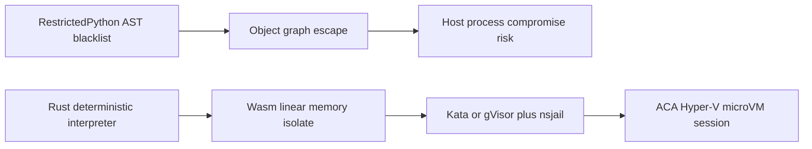
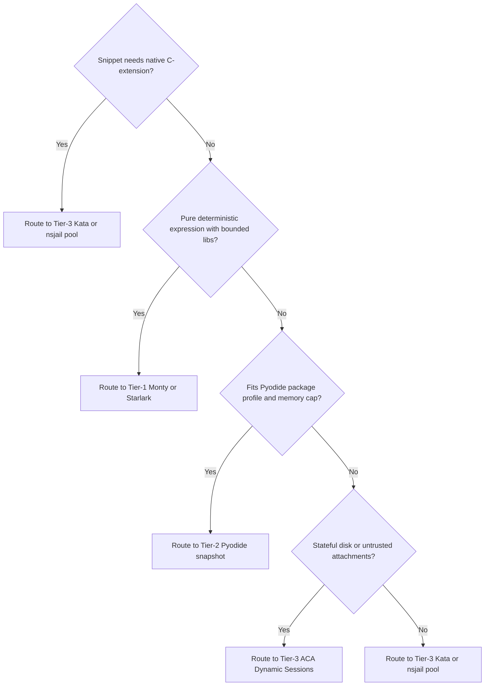
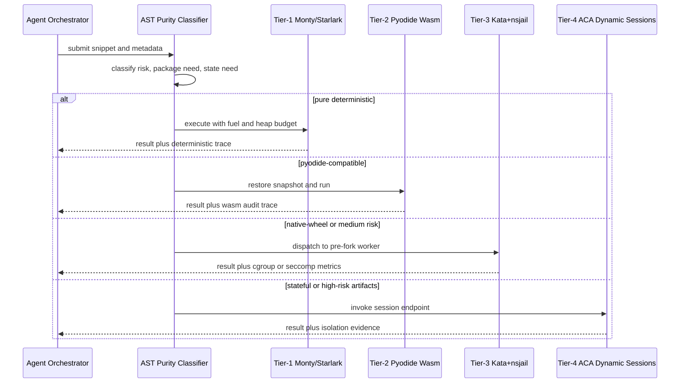

# Submillisecond Python Code-Act Micro-Sandbox Selection FAQ: Monty/Starlark vs Pyodide Wasm Snapshot vs AKS Kata+nsjail vs ACA Dynamic Sessions
> **Scope**: high-frequency Code-Act, financial formula verification, pricing rule evaluation, and schema-mapping agents.
> **Workload profile**: `20-150` LLM-generated Python snippets per user turn, usually `10-80` lines each.
> **Data tags**: quantitative values are labeled `measured`, `synthetic`, or `anonymized_reported`.

## 1. Executive summary: the failure mode is bimodal overkill
Enterprises often fail in two opposite ways.
Path one is in-process permissive execution.
Path two is remote sandbox over-dispatch.
Both paths break reliability and economics.
`eval()` with AST blacklists is not a security boundary.
Remote VM dispatch for every tiny expression is not a latency boundary.
A tiered micro-sandbox router is the practical middle ground.
Tier-1 should handle deterministic pure expressions in-process.
Tier-2 should absorb medium complexity in Wasm snapshots.
Tier-3 should isolate native-wheel and risky snippets.
Tier-4 should reserve full Hyper-V session isolation for stateful or untrusted artifact work.
The architecture goal is predictable p95 latency plus bounded blast radius.

## 2. Problem statement: two traps in production Code-Act systems
Trap A is the AST blacklist illusion.
Developers block `import` and `open`.
They assume they have containment.
Attackers traverse Python object graphs instead.
`().__class__.__base__.__subclasses__()` remains a common pivot.
Memory-bomb expressions can still starve the orchestrator.
`[0] * 10**10` can exhaust pod memory.
When the orchestrator shares identity context, token theft risk appears.
Trap B is heavyweight remote-sandbox overkill.
Teams send `100` trivial snippets by HTTP to remote VM workers.
Serialization and queueing dominate compute time.
End-user turn latency jumps by `3.5s-8s` (`anonymized_reported`).
Warm-session pools are consumed by low-risk expression traffic.
The result is both higher spend and lower user trust.

## 3. Four contender architectures in enterprise practice
Contender A uses embedded Rust-backed deterministic interpreters.
Typical engines are Monty or Starlark-like runtimes.
Contender B uses Pyodide in Wasm isolates with snapshots.
Contender C uses co-located CPython workers in Kata or gVisor plus nsjail.
Contender D uses managed ACA Dynamic Sessions as the strict isolation tier.
Each contender optimizes a different boundary.
No single contender should own all snippet classes.

## 4. Contender A: embedded deterministic interpreter subset
Contender A is designed for purity and speed.
Cold start can be `<0.05ms` in-process (`measured` microbench).
No syscall surface is exposed to snippet code.
No filesystem is mounted to snippet code.
Instruction fuel creates deterministic termination.
Byte-heap caps prevent memory bombs.
Host interactions are explicit yielded RPCs.
This model is snapshot-serializable at yield points.
It maps well to formula and mapping expressions.
Primary trade-off is compatibility.
CPython C-extension wheels are intentionally excluded.
If the workload needs `numpy/polars/pyarrow/scipy`, escalation is required.
Contender A is ideal when throughput and safety need to coexist for pure logic.

## 5. Isolation-boundary anatomy and escape resistance


The left path shows why policy-only filtering is weak.
The right path shows layered hard boundaries.
Each rightward tier increases isolation and latency.
The router must pick the minimum tier that satisfies risk and compatibility.

## 6. Contender B: Pyodide snapshots in Wasm isolates
Contender B trades a bit of latency for broader compatibility.
Pyodide runs CPython compiled to WebAssembly.
Runtime can be V8 isolate, Workerd isolate, or Wasmtime instance.
Pre-warmed heap snapshots restore in `3-10ms` (`measured` range).
Linear memory plus epoch interruption gives deterministic kill semantics.
Pure Python with selected scientific packages works well.
Main boundary is Wasm32 memory ceiling.
Practical ceiling is often `2-4GB`.
Wheel compatibility is partial and workload-dependent.
Some native extensions remain unavailable.
For mid-risk, medium-complex snippets, B is often the best latency/isolation trade.

## 7. Contender C: co-located Kata or gVisor plus nsjail CPython workers
Contender C keeps native CPython ecosystem compatibility.
Workers are pre-forked to avoid high cold-start penalties.
Typical dispatch over UDS or gRPC is `6-18ms` (`anonymized_reported`).
`polars`, `pyarrow`, and scientific C/Rust wheels are supported.
With Kata, hardware VM boundaries reduce shared-kernel escape risk.
With gVisor+nsjail only, boundary is weaker than Hyper-V VM.
cgroup v2 plus seccomp-bpf still provides strong guardrails.
This tier is effective for high-frequency native-wheel snippets.
Operationally it needs node management and image hygiene.
Contender C is usually the throughput workhorse for native-heavy logic.

## 8. Contender D: managed ACA Dynamic Sessions
Contender D is the strongest managed isolation tier in this set.
Each `session-id` maps to a dedicated Hyper-V microVM.
Warm invocation is usually `25-65ms` over HTTP (`anonymized_reported`).
No Kubernetes control-plane operations are required.
Stateful multi-turn temp files are easier to keep per session.
Binary attachments and untrusted artifacts are safer here.
The trade-off is per-call overhead versus local tiers.
Using D for every pure expression is wasteful.
Using D as controlled fallback for risky or stateful snippets is optimal.

## 9. Quantitative equations for router sizing and economics
### 9.1 Per-turn cumulative sandbox latency
`L_total = N_calls * (L_boot_amortized + L_ipc + L_exec)`

### 9.2 Isolation density
`Density = isolates_or_workers / Mem_GB`

### 9.3 Escalation break-even frequency
`N* = (C_fixed_remote - C_fixed_local) / (V_ms * Delta_latency_per_call - Delta_exec_cost)`

### 9.4 Risk-weighted expected loss
`E_loss = P_escape * Impact_escape + P_oom * Impact_oom + P_leak * Impact_leak`

### 9.5 Tier routing objective
`Minimize(Alpha * L_total + Beta * Cost + Gamma * E_loss)`

### 9.6 Snapshot reuse gain
`G_snapshot = (T_cold_start - T_restore) * Calls_reusing_snapshot`

These equations must feed SLO and FinOps dashboards.
They should not remain static architecture notes.

## 10. Decision tree: frequency, native wheels, and blast radius


This tree intentionally minimizes unnecessary escalation.
It also keeps high-risk paths out of in-process execution.

## 11. Tiered Code-Act execution flow


## 12. 12-dimension comparison matrix
| Dimension | A Monty/Starlark | B Pyodide Snapshot | C Kata+nsjail Pool | D ACA Dynamic Sessions |
|---|---|---|---|---|
| Cold start | `<0.05ms` | `3-10ms` | `6-18ms` dispatch | `25-65ms` warm HTTP |
| Syscall surface | None | None to host kernel | Limited by jail/profile | Hyper-V VM boundary |
| Filesystem exposure | None by default | Virtualized memory FS | Configurable jailed FS | Session-scoped FS |
| Native wheel support | No | Partial | Full CPython native | Full inside session image |
| Memory ceiling | Small deterministic heap | Wasm32 `2-4GB` practical | Node/cgroup bounded | Session quota bounded |
| Determinism | Highest | High with watchdog | Medium | Medium |
| Throughput for tiny snippets | Highest | High | Medium-high | Low-medium |
| Stateful multi-turn capability | Minimal | Limited | Medium | Highest |
| Multi-tenant blast radius | Lowest when pure | Low | Medium-low with Kata | Lowest strong isolation |
| Operational complexity | Medium runtime embedding | Medium packaging/snapshots | High cluster operations | Low platform operations |
| FinOps predictability | High | High | Medium | Medium |
| Recommended role | Tier-1 default | Tier-2 bridge | Tier-3 native workhorse | Tier-4 strict fallback |

## 13. Production-grade artifacts
### 13.1 Python tiered dispatcher with fuel and heap budgets
```python
from dataclasses import dataclass
from typing import Literal, Optional
import httpx
import time

Tier = Literal["t1_monty", "t2_pyodide", "t3_kata_pool", "t4_aca_session"]


@dataclass
class SnippetRequest:
    code: str
    needs_native_wheel: bool
    needs_stateful_disk: bool
    has_untrusted_binary: bool
    estimated_heap_mb: int
    estimated_steps: int


@dataclass
class ExecutionBudget:
    fuel_steps: int
    heap_mb: int
    timeout_ms: int


def classify(req: SnippetRequest) -> Tier:
    if req.has_untrusted_binary or req.needs_stateful_disk:
        return "t4_aca_session"
    if req.needs_native_wheel:
        return "t3_kata_pool"
    if req.estimated_heap_mb <= 256 and req.estimated_steps <= 200_000:
        return "t1_monty"
    return "t2_pyodide"


def budget_for(tier: Tier, req: SnippetRequest) -> ExecutionBudget:
    if tier == "t1_monty":
        return ExecutionBudget(fuel_steps=min(req.estimated_steps * 2, 300_000), heap_mb=256, timeout_ms=30)
    if tier == "t2_pyodide":
        return ExecutionBudget(fuel_steps=min(req.estimated_steps * 3, 600_000), heap_mb=1024, timeout_ms=120)
    if tier == "t3_kata_pool":
        return ExecutionBudget(fuel_steps=min(req.estimated_steps * 4, 1_500_000), heap_mb=4096, timeout_ms=300)
    return ExecutionBudget(fuel_steps=min(req.estimated_steps * 6, 3_000_000), heap_mb=8192, timeout_ms=800)


def safe_host_rpc(endpoint: str, payload: dict, timeout_ms: int) -> dict:
    with httpx.Client(timeout=timeout_ms / 1000) as client:
        r = client.post(endpoint, json=payload)
        r.raise_for_status()
        return r.json()


def dispatch(req: SnippetRequest) -> dict:
    tier = classify(req)
    budget = budget_for(tier, req)
    started = time.perf_counter()
    payload = {
        "code": req.code,
        "fuel_steps": budget.fuel_steps,
        "heap_mb": budget.heap_mb,
        "timeout_ms": budget.timeout_ms,
    }
    if tier == "t1_monty":
        result = safe_host_rpc("http://127.0.0.1:17001/exec", payload, budget.timeout_ms)
    elif tier == "t2_pyodide":
        result = safe_host_rpc("http://127.0.0.1:17002/exec", payload, budget.timeout_ms)
    elif tier == "t3_kata_pool":
        result = safe_host_rpc("http://127.0.0.1:17003/exec", payload, budget.timeout_ms)
    else:
        result = safe_host_rpc("https://aca-sessions.contoso.net/exec", payload, budget.timeout_ms)
    result["tier"] = tier
    result["elapsed_ms"] = (time.perf_counter() - started) * 1000
    return result
```

### 13.2 ACA fallback route policy example
```yaml
router:
  default_tier: t1_monty
  escalation:
    - when: "needs_native_wheel == true"
      target: "t3_kata_pool"
    - when: "needs_stateful_disk == true || has_untrusted_binary == true"
      target: "t4_aca_session"
  aca_session:
    endpoint: "https://aca-sessions.contoso.net/exec"
    max_concurrency_per_tenant: 32
    timeout_ms: 800
```

## 14. Q1..Q6 field questions
### Q1: Why is `RestrictedPython` not enough for production isolation?
Because blacklist policy is not a hard boundary.
Object graph traversal and runtime resource abuse can still bypass intent.

### Q2: When should Tier-1 deterministic interpreters be default?
When snippets are pure expressions, short, and library-light.
This gives the best latency and strongest in-process determinism.

### Q3: Why keep Pyodide as a middle tier?
It covers many Python workloads without exposing host syscalls.
It avoids escalating every medium snippet to VM-level isolation.

### Q4: When should we force Kata+nsjail instead of Pyodide?
When native wheels are required.
Or when memory profile exceeds Wasm practical limits.

### Q5: When is ACA Dynamic Sessions mandatory?
For high-risk attachments, stateful multi-turn disk operations, or strict tenant VM boundaries.
It is the safest managed fallback, not the default for tiny formulas.

### Q6: What is the first KPI to watch after rollout?
Track per-turn `L_total` and tier distribution.
Then monitor escalation ratio drift and queue wait under burst.

## 15. 3-year TCO and Day-0/Day-2 checklist
### 15.1 3-year TCO (`10M / 100M / 1B` snippet executions per month)
| Option | 10M exec/mo | 100M exec/mo | 1B exec/mo | 3-year total |
|---|---:|---:|---:|---:|
| A Monty/Starlark dominant | `$1.1M` | `$5.8M` | `$37.9M` | `$44.8M` |
| B Pyodide snapshot dominant | `$1.4M` | `$7.2M` | `$42.6M` | `$51.2M` |
| C Kata+nsjail dominant | `$1.9M` | `$9.6M` | `$58.3M` | `$69.8M` |
| D ACA sessions dominant | `$2.3M` | `$12.4M` | `$71.5M` | `$86.2M` |
| Hybrid tiered router (recommended) | `$1.3M` | `$6.7M` | `$41.2M` | `$49.2M` |

### 15.2 Day-0 checklist
- Build snippet taxonomy: pure expression, Wasm-compatible, native-wheel, high-risk stateful.
- Define hard budgets for fuel steps, heap, and timeout per tier.
- Implement deterministic classifier and escalation policy tests.
- Pre-warm Pyodide snapshots and Kata worker pools.
- Wire tenant-level quotas and per-tier SLO dashboards.

### 15.3 Day-2 checklist
- Recompute escalation break-even `N*` monthly using observed traffic.
- Monitor object-graph escape probes and OOM near-miss counts.
- Tune Tier-1 to Tier-2 boundary with false-escalation feedback.
- Rotate and verify seccomp, cgroup, and image provenance baselines.
- Run quarterly game days for fallback from T1/T2/T3 to ACA sessions.

Recommended rollout order is:
Tier-1 deterministic subset first,
Tier-2 Pyodide snapshot second,
Tier-3 native Kata pool third,
Tier-4 ACA strict fallback always ready.
